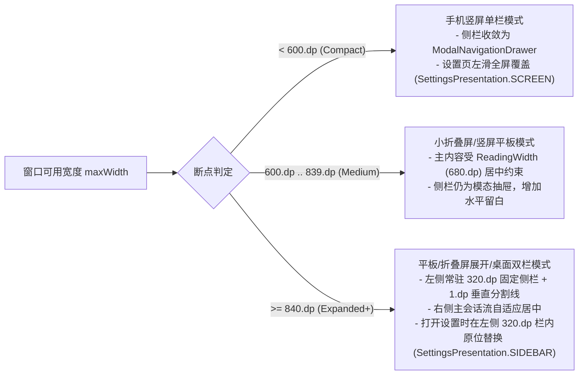

# Open Android Intelligence (OAI) Android 设计规范 (`DESIGN.md`)

> **权威依据与适用边界**
>
> - **权威基准**：本规范以 **Google 官方 Material Design 3 (M3) Expressive** 与 **Jetpack Compose 官方指南**为最高权威依据，吸收 [`google-labs-code/design.md`](https://github.com/google-labs-code/design.md) 的 Agent 导向文档结构、[`canine-labs/m3-expressive-design-md`](https://github.com/canine-labs/m3-expressive-design-md) 的四大 Expressive 支柱（色彩、排版、形状形变、双轨物理弹簧）与 [`hamen/material-3-skill`](https://github.com/hamen/material-3-skill) 的 Compose 实现检查表。
> - **冲突裁决原则**：当社区规范（如包含已进入维护模式的 `@material/web`、CSS 变量、`rem`/`px` 或 `cubic-bezier` 曲线）与 Google 官方 Jetpack Compose 规范或当前工程依赖版本冲突时，**一律以 Google 官方 Jetpack Compose 规范及当前项目实际依赖版本支持的 API 为准**。
> - **依赖与 API 边界**：当前 Android 工程基于 `androidx.compose:compose-bom:2024.12.01`（`material3:1.3.1`、`ui:1.7.6`、`animation:1.7.6`、`navigation-compose:2.8.5`）。尚未引入 `material3:1.4.0+` 的实验性 API（如 `MaterialExpressiveTheme`、`MotionScheme`、`SplitButtonLayout`、`FloatingToolbar`、`WavyProgressIndicator`）或 `material3-adaptive`。所有 M3 Expressive 视觉、形状与物理动效均通过 `apps/android/conversation-ui` 集中封装的语义令牌（Tokens）与组件对外提供。
> - **路径引用约定**：本文档及所有代码实现中，文件路径、模块依赖一律使用以仓库根目录为基准的**相对路径**。

---

## 1. Overview（设计哲学与品牌调性）

### 1.1 核心北极星：「一张安静、可信的本机工作台」

Open Android Intelligence (OAI) 不是悬浮在网页里的娱乐聊天玩具，而是运行在 Android 设备上、拥有系统级执行能力与本机网关协同能力的**原生智能体工作台（Native Agent Workbench）**。

它的视觉气质应当像一台精密调校的现代工程仪器或专注的移动端阅读与控制终端：

- **克制而有张力（Expressive Restraint）**：在阅读流、设置表单与审计日志中保持极高的信噪比与安静感；仅在关键状态切换（发送/停止形态形变、智能体实时响应、录音脉冲、数字助手唤起与圈选）释放物理弹簧与几何形变的表现力。
- **结构替代装饰（Structure over Decoration）**：用色调表面阶梯（Tonal Surface Containers）、`1.dp` 发丝边框（Hairline Stroke）与非对称方向圆角传达层级与归属，而不是堆砌阴影、发光、渐变或图标。
- **状态诚实性（State Honesty）**：UI 只呈现真实绑定的数据源与真实运行时状态。**严禁伪造流式打字机延迟、严禁虚构百分比进度条、严禁渲染无真实后端绑定的假开关或死按钮**。未连接、降级或权限受限时，必须直接、诚实地呈现对应的空状态或恢复引导。

### 1.2 唯一品牌签名：Signal Stitch（信号缝线）

OAI 全应用仅保留一个克制的原创品牌视觉签名——**Signal Stitch（信号缝线）**：

- **源码位置**：`apps/android/conversation-ui/src/main/kotlin/com/openandroidintelligence/conversation/components/SignalStitch.kt`
- **几何构造**：由一条 `2.dp` 宽的 `MaterialTheme.colorScheme.primary` 垂直主轴线，与一枚半径 `2.3.dp` 的状态圆点（正常/流式时为 `tertiary`，失败/异常时为 `error`）组成。
- **适用场景（且仅限以下四处）**：
  1. **智能体回复左侧导轨（`Modifier.stitchGuide`）**：替代传统的机器人圆形头像。高度随智能体回复正文与思考面板实时生长；流式生成时底部圆点执行平滑呼吸脉冲（`StitchPulsePeriodMs = 900ms`），完成后静止，失败时圆点立即切换为静态 `error` 色。
  2. **登录与连接页品牌标识**：在 `GatewayLoginScreen` 标题旁作为紧凑的本机工作台徽记。
  3. **首次引导（Onboarding）与欢迎页视觉锚点**：与制图级轨道线（`OrbitalDiagram`）协同传递工程感。
  4. **工作台空状态（`EmptyConversationHero`）**：在无消息画布中央偏上位置配合能力建议 Chip 呈现。

### 1.3 明确拒绝的「AI 套路」黑名单

以下视觉元素在 OAI Android 中**永久禁止出现**：

- 紫青/蓝紫霓虹渐变背景、发光描边或呼吸光晕（Glowing Borders / Neon Aura）
- 星星、火花、魔法棒图标（Sparkles `✨` / Magic Wand）或拟人化机器人头像
- 为凑齐视觉对称而给每条设置项强行编造左侧装饰性图标
- 在普通页面背景、聊天列表或常规弹窗上叠加全屏实时高斯模糊（Full-screen Blur）

---

## 2. Colors（色彩与色调层级体系）

OAI 的色彩系统定义在 `apps/android/conversation-ui/src/main/kotlin/com/openandroidintelligence/conversation/theme/` 下，遵循 Material 3 动态色彩优先、感知均匀（Perceptually Uniform CIE LCh）预设兜底与全角色平滑插值原则。

### 2.1 动态取色与预设调色板（Dynamic Color & CIE LCh Palettes）

- **入口组件**：`OpenAndroidIntelligenceTheme`（`apps/android/conversation-ui/src/main/kotlin/com/openandroidintelligence/conversation/theme/Theme.kt`）
- **优先级策略**：
  1. **Android 12+ (API 31+) 系统动态取色（Monet）**：当用户在外观设置中开启 `dynamicColor = true` 时，直接调用 `dynamicLightColorScheme(context)` / `dynamicDarkColorScheme(context)` 提取壁纸主色。
  2. **6 套 CIE LCh 预设调色板（`AppPalette`）**：当关闭动态取色或作为默认品牌色时，使用 `AppPalettes.kt` 中通过 CIE LCh 色彩空间算法实时生成的调色板（默认主题为 **`EMBER` 炽橙**）。

| 调色板枚举 (`AppPalette`) | 中文名称 | 主色色相与色度 (`Primary h, C`) | 次色 (`Secondary h, C`) | 第三色 (`Tertiary h, C`) | 中性色 (`Neutral h, C`) | 中性变体 (`NeutralVariant h, C`) | 适用气质 |
| :--- | :--- | :--- | :--- | :--- | :--- | :--- | :--- |
| `EMBER` *(默认)* | 炽橙 | `h=46°, C=80` | `h=48°, C=30` | `h=85°, C=48` | `h=55°, C=6` | `h=52°, C=12` | 温暖工业仪器感、品牌主调 |
| `INDIGO` | 靛青 | `h=265°, C=68` | `h=265°, C=24` | `h=310°, C=44` | `h=265°, C=5` | `h=265°, C=11` | 沉稳深邃的工程终端 |
| `AZURE` | 晴空 | `h=245°, C=66` | `h=245°, C=22` | `h=200°, C=44` | `h=245°, C=5` | `h=245°, C=10` | 清澈高对比度阅读体验 |
| `VIOLET` | 紫罗兰 | `h=300°, C=62` | `h=300°, C=22` | `h=345°, C=44` | `h=300°, C=5` | `h=300°, C=11` | 柔和现代的创作空间 |
| `CORAL` | 珊瑚 | `h=25°, C=74` | `h=28°, C=28` | `h=65°, C=46` | `h=30°, C=6` | `h=28°, C=12` | 鲜明醒目的高活力反馈 |
| `GRAPHITE` | 石墨 | `h=250°, C=18` | `h=250°, C=10` | `h=210°, C=24` | `h=250°, C=3` | `h=250°, C=6` | 极简低饱和度专注模式 |

### 2.2 浅色与深色 Tone 映射阶梯

`AppPalettes.kt` 严格按照明度（Lightness `L`）阶梯生成 `ColorScheme`，确保深色模式绝非纯黑（`#000000`）反相，而是带有微弱色相倾向的暖炭/冷灰层级：

| Material 3 颜色角色 (`ColorScheme`) | 浅色模式明度 (`Light L`) | 深色模式明度 (`Dark L`) | OAI 标准语义用途 |
| :--- | :--- | :--- | :--- |
| `primary` / `onPrimary` | `L=42` / `L=99` | `L=80` / `L=20` | 主操作按钮（发送、确认授权）、`SignalStitch` 主轴线、选中态强焦点 |
| `primaryContainer` / `onPrimaryContainer` | `L=90` / `L=15` | `L=30` / `L=90` | 侧栏当前选中会话项高亮、主推功能胶囊底色 |
| `secondary` / `onSecondary` | `L=44` / `L=99` | `L=78` / `L=22` | 次要交互控件、辅助筛选器、次级状态徽章 |
| `secondaryContainer` / `onSecondaryContainer` | `L=91` / `L=18` | `L=28` / `L=88` | 筛选 Chip 选中态、连接诊断只读标签底色 |
| `tertiary` / `onTertiary` | `L=44` / `L=99` | `L=80` / `L=20` | `SignalStitch` 流式脉动圆点、思考/工具运行中指示、非阻塞提示强调 |
| `tertiaryContainer` / `onTertiaryContainer` | `L=91` / `L=16` | `L=29` / `L=90` | 临时授权生效横幅、引导页阶段徽章底色 |
| `background` / `surface` | `L=97.5` | `L=9.5` | 主工作台、设置页、登录页的根级画布底色 |
| `surfaceContainerLowest` | `L=100` | `L=6.5` | 代码块内嵌底槽、极低层级内凹区 |
| `surfaceContainerLow` | `L=95.5` | `L=12.5` | 思考与工具调用折叠面板（`ExecutionProcessPanel`）、底部输入栏外围承载区 |
| `surfaceContainer` | `L=93.5` | `L=15.0` | 设置分组卡片（`SettingsSectionCard`）、常规列表卡片容器 |
| `surfaceContainerHigh` | `L=91.0` | `L=18.5` | **用户与智能体消息气泡底色**、输入胶囊内胆、浮动跳至最新按钮 |
| `surfaceContainerHighest` | `L=88.5` | `L=22.5` | 模态弹窗（Dialog）、长按操作单（Action Sheet）、停止生成按钮底色、按键按下态 |
| `onSurface` / `onSurfaceVariant` | `L=12` / `L=38` | `L=92` / `L=74` | 一级正文与标题 / 二级说明文案、时间戳、元数据与未选中图标 |
| `outline` / `outlineVariant` | `L=55` / `L=82` | `L=58` / `L=26` | 表单聚焦边框 / **全应用统一的 `1.dp` 容器分割与卡片描边** |
| `error` / `errorContainer` | `#BA1A1A` / `#FFDAD6` | `#FFB4AB` / `#93000A` | 危险操作（删除、撤销权限、停止所有插件）、连接失败与异常告警 |

### 2.3 扩展语义状态色（`LocalAppStateColors`）

Material 3 标准 `ColorScheme` 不包含独立的「成功（Success）」与「警告（Warning）」槽位。为防止各模块硬编码红绿灯颜色或误用随调色板剧烈漂移的 `tertiary`，OAI 提供了跨调色板恒定的 `LocalAppStateColors`（`apps/android/conversation-ui/src/main/kotlin/com/openandroidintelligence/conversation/theme/AppStateColors.kt`）：

| 状态槽位 | 浅色模式 (`LightAppStateColors`) | 深色模式 (`DarkAppStateColors`) | 适用场景 |
| :--- | :--- | :--- | :--- |
| `success` / `onSuccess` | `#2E6B4F` / `#FFFFFF` | `#8FD3AE` / `#083823` | 网关已连接状态点、TLS 安全传输徽章、权限已授予、工具执行成功 |
| `successContainer` / `onSuccessContainer` | `#CBEFD9` / `#0A291A` | `#154E35` / `#CBEFD9` | 诊断通过横幅、已配对设备状态胶囊 |
| `warning` / `onWarning` | `#8A5A16` / `#FFFFFF` | `#E7BE7E` / `#462A00` | 明文 HTTP 传输警告、重连中/连接降级、敏感权限待确认、限时授权倒计时 |
| `warningContainer` / `onWarningContainer` | `#FBE2B8` / `#2C1900` | `#623E00` / `#FBE2B8` | 明文传输警示条、高风险能力审批提示框 |

> **调用方式**：通过 `OpenAndroidIntelligenceTheme.stateColors.success` 或 `LocalAppStateColors.current.warning` 读取，**严禁在业务组件中直接写死 `Color(0xFF...)`**。

### 2.4 主题切换过渡与对比度红线

- **250ms 全角色平滑插值**：`Theme.kt` 中的 `animatedColorScheme()` 对 `ColorScheme` 的全部 35+ 个颜色槽位执行 `animateColorAsState(tween(250, FastOutSlowInEasing))`。用户在设置或引导页实时切换明暗模式或调色板时，严禁出现整屏闪烁或生硬跳变。
- **对比度强制红线（WCAG AA）**：
  - 所有正文与标签配对（`onSurface` / `surface`、`onSurfaceVariant` / `surfaceContainer*`、`onPrimary` / `primary`、`onErrorContainer` / `errorContainer`）对比度必须 **≥ 4.5:1**。
  - 由单元测试 `apps/android/conversation-ui/src/test/kotlin/com/openandroidintelligence/conversation/theme/ThemeContrastTest.kt` 对全部 6 套调色板的明暗模式自动校验。

---

## 3. Typography（排版与字体系统）

OAI 的排版系统定义在 `apps/android/conversation-ui/src/main/kotlin/com/openandroidintelligence/conversation/theme/AppTypography.kt`，兼顾中文（Noto Sans CJK / 系统默认无衬线体）与西文混排的可读性、信息密度与大字号无障碍缩放。

### 3.1 字体族与字重收敛规则

- **主字体族（`FontFamily.Default`）**：所有界面标题、正文、按钮与标签统一使用系统无衬线字体（Android 中文环境下自动映射为 Noto Sans SC / Roboto），避免打包数兆字节的自定义中文字体包导致安装包膨胀与首帧冷启动回退闪烁。
- **等宽字体族（`FontFamily.Monospace`）**：**严格且仅限**用于技术元数据与代码场景：
  - Markdown 行内代码与代码块（`MarkdownViews.kt`）
  - 工具调用参数、JSON 载荷、终端命令块（`TerminalBlockView`）
  - 耗时计时器（如 `1.4s`）、Token 计数、版本号、SHA 指纹、IP/端口与会话 ID
  - **严禁将 `FontFamily.Monospace` 用于普通聊天正文、设置项说明或按钮文案**。
- **字重收敛（3 档字重制）**：
  - 全应用仅使用 **`FontWeight.Normal` (400)**、**`FontWeight.Medium` (500)** 与 **`FontWeight.SemiBold` (600)** 三档字重。
  - **严禁在业务页面自行硬编码 `FontWeight.ExtraBold` (800)、`FontWeight.Black` (900) 或 `FontWeight.Light` (300)**（注：当前 `onboarding/` 下遗留的 `ExtraBold` 属于待收敛技术债）。

### 3.2 Material 3 标准 15 级排版阶梯 (`AppTypography`)

| 角色 (`MaterialTheme.typography.*`) | 字号 (`fontSize`) | 行高 (`lineHeight`) | 字重 (`fontWeight`) | 字距 (`letterSpacing`) | OAI 标准应用场景与 Expressive 强调约定 |
| :--- | :--- | :--- | :--- | :--- | :--- |
| `displayLarge` | `57.sp` | `64.sp` | `SemiBold (600)` | `-0.25.sp` | 仅限首次引导欢迎页主视觉数字/超大号装饰性锚点 |
| `displayMedium` | `45.sp` | `52.sp` | `SemiBold (600)` | `0.sp` | 大屏引导页大标题 |
| `displaySmall` | `36.sp` | `44.sp` | `SemiBold (600)` | `0.sp` | 引导页分步主标题、重大状态里程碑标题 |
| `headlineLarge` | `32.sp` | `40.sp` | `SemiBold (600)` | `0.sp` | 登录页主标题、全屏空状态核心问候语 |
| `headlineMedium` | `28.sp` | `36.sp` | `SemiBold (600)` | `0.sp` | 一级模态页面标题 |
| `headlineSmall` | `24.sp` | `32.sp` | `SemiBold (600)` | `0.sp` | 高危权限确认弹窗（`ScreenControlConfirmationDialog`）主标题、工作台空状态标题 |
| `titleLarge` | `20.sp` | `28.sp` | `SemiBold (600)` | `0.sp` | 顶栏（`TopAppBar`）主标题、底部抽屉/弹窗标题 |
| `titleMedium` | `16.sp` | `24.sp` | `SemiBold (600)` | `0.1.sp` | **设置列表项主标题**、卡片标题、Markdown 二级标题 |
| `titleSmall` | `14.sp` | `20.sp` | `Medium (500)` | `0.1.sp` | **设置分组卡片（`SettingsSectionCard`）眉头标题**、折叠面板标题 |
| `bodyLarge` | `16.sp` | `24.sp` (`1.5x`) | `Normal (400)` | `0.15.sp` | **聊天消息气泡主正文**、输入框文本、长篇阅读正文 |
| `bodyMedium` | `14.sp` | `20.sp` | `Normal (400)` | `0.15.sp` | **设置列表项副标题（`subtitle`）**、对话框说明正文、次级卡片内容 |
| `bodySmall` | `12.sp` | `16.sp` | `Normal (400)` | `0.2.sp` | 辅助说明、表单底部提示、次要状态描述 |
| `labelLarge` | `14.sp` | `20.sp` | `Medium (500)` | `0.1.sp` | 主次按钮（`Button` / `OutlinedButton` / `TextButton`）文案、Tab 标签 |
| `labelMedium` | `12.sp` | `16.sp` | `Medium (500)` | `0.3.sp` | 筛选/建议 Chip 文案、状态徽章（`StatusPill`）、分区小标题 |
| `labelSmall` | `11.sp` | `16.sp` | `Medium (500)` | `0.3.sp` | 时间戳、最小辅助角标（**全应用字号绝对下限为 `11.sp`，严禁出现 `<11.sp` 的文字**） |

> **M3 Expressive Emphasized 排版映射约定**：由于 `material3:1.3.1` 尚未内置独立的 `Typography.bodyLargeEmphasized` 等 15 个 Emphasized 槽位，当需要在同字号下实现 Expressive 强调层级（如未读会话标题、关键指标值、选中态标签）时，**必须通过 `MaterialTheme.typography.<role>.copy(fontWeight = FontWeight.SemiBold)`（或对 `Normal` 角色提升至 `FontWeight.Medium`）实现**，严禁通过随意拼凑非标 `fontSize`（如 `15.sp`、`19.sp`、`26.sp`）制造强调。

### 3.3 OAI 专有扩展排版令牌 (`AppTextStyles`)

在 `AppTypography.kt` 中定义的 4 个专有样式，用于解决等宽代码与思考过程的信息密度问题：

| 扩展样式 (`AppTextStyles.*`) | 字体族 | 字号 / 行高 | 字重 / 字距 | 专有用途 |
| :--- | :--- | :--- | :--- | :--- |
| `AppTextStyles.Mono` | `FontFamily.Monospace` | `12.sp` / `18.sp` | `Normal` / `0.sp` | 代码块正文、终端命令输出、诊断详情 JSON |
| `AppTextStyles.MonoSmall` | `FontFamily.Monospace` | `11.sp` / `16.sp` | `Medium` / `0.2.sp` | 工具耗时徽章（`120ms`）、状态栏微型技术指标、短哈希 |
| `AppTextStyles.BrandWordmark` | `FontFamily.Default` | `13.sp` / `18.sp` | `SemiBold` / `0.4.sp` | 登录页与引导页顶部品牌字标 |
| `AppTextStyles.Thought` | `FontFamily.Default` | `13.sp` / `18.2.sp` (`1.4x`) | `Normal` / `0.1.sp` | **思考过程与工具日志面板（`ExecutionProcessPanel`）专用紧凑正文**，与主回复 `16.sp` 正文拉开清晰视觉主次 |

### 3.4 防御性排版与大字号（Font Scale 200%）无障碍规则

1. **顶栏双行自动解耦**：在 `WorkbenchTopBar`（`apps/android/conversation-ui/src/main/kotlin/com/openandroidintelligence/conversation/WorkbenchScreen.kt`）中，当系统字体缩放 `LocalDensity.current.fontScale > 1.55f` 时，副标题状态胶囊必须从单行紧凑模式切换为纵向宽松排布，防止标题被挤压成单个省略号。
2. **严禁固定高度截断文字**：包含文字的卡片、列表项或按钮必须使用 `heightIn(min = ...)` 而非写死 `height(...)`。
3. **单行截断必配省略号**：凡设置 `maxLines = 1` 的标题或标签，必须显式声明 `overflow = TextOverflow.Ellipsis`。

---

## 4. Layout & Spacing（布局、栅格与自适应断点）

所有间距、尺寸与断点常量集中在 `apps/android/conversation-ui/src/main/kotlin/com/openandroidintelligence/conversation/theme/DesignTokens.kt` 的 `Dimensions` 单例中。

### 4.1 8dp 基准栅格与间距令牌 (`Dimensions`)

| 令牌名称 (`Dimensions.*`) | 数值 | 语义用途 |
| :--- | :--- | :--- |
| `SpaceXXSmall` | `4.dp` | 图标与紧凑文字间距、极小内嵌徽章内边距、消息尾角半径基准 |
| `SpaceXSmall` | `6.dp` | 紧凑 Chip 间距、Markdown 行内代码块水平内边距 |
| `SpaceSmall` | `8.dp` | 关联元素间距、同一发送者连续消息气泡垂直间距、卡片内部次级间距 |
| `SpaceCompact` | `12.dp` | 表单输入框间距、列表项图文间距、思考面板内边距 |
| `SpaceMedium` / `ScreenHorizontal` / `CardPadding` | `16.dp` | **标准屏幕水平安全边距**、标准卡片内边距、跨发送者消息组间距 |
| `SpaceLarge` | `20.dp` | 大号卡片内边距、对话框内容区块间距 |
| `SpaceXLarge` | `24.dp` | 模态弹窗（Dialog）外围内边距、设置大分组间距 |
| `SpaceXXLarge` | `32.dp` | 空状态/欢迎页主视觉区块上下留白 |
| `SpaceHuge` | `48.dp` | 引导页首屏大跨度结构呼吸留白 |
| `StrokeHairline` | `1.dp` | **全应用唯一标准描边与分割线宽度**（配合 `outlineVariant`） |
| `StitchStrokeWidth` / `StitchDotRadius` | `2.dp` / `2.3.dp` | `SignalStitch` 信号缝线线宽与圆点半径 |

### 4.2 触控热区与阅读宽度上限

| 令牌名称 (`Dimensions.*`) | 数值 | 强制约束说明 |
| :--- | :--- | :--- |
| `MinimumTouchTarget` / `ButtonHeight` | `48.dp` | **M3 无障碍铁律**：任何可点击、可勾选、可拖拽的交互热区最小宽高不得低于 `48.dp × 48.dp`（视觉尺寸为 `32.dp` 或 `40.dp` 的紧凑按钮，必须通过外围透明热区或 `sizeIn(minWidth = 48.dp, minHeight = 48.dp)` 补足） |
| `PrimaryButtonHeight` | `52.dp` | 登录页、引导页底部主行动按钮（Primary CTA）高度 |
| `ComposerMinHeight` | `52.dp` | 底部多模态消息输入胶囊最小高度 |
| `TopBarHeight` | `56.dp` | 工作台与设置页紧凑顶栏基准高度 |
| `ReadingWidth` | `680.dp` | **时间线画布与设置详情流最大阅读宽度**（超宽屏下居中收敛，防止单行超过 75 字符导致扫视疲劳） |
| `MessageWidth` | `640.dp` | 单条消息气泡最大绝对宽度（在窄屏下同时受气泡最大宽度比例 `86%` 约束） |
| `FormWidth` | `480.dp` | 登录表单、配对输入卡片的最大宽度 |
| `DrawerWidth` | `320.dp` | 会话抽屉与平板端左侧固定边栏宽度 |

### 4.3 窗口自适应断点系统（Window Size Classes）

OAI 定义了两个核心窗口宽度阈值（`Dimensions.MediumWindow = 600.dp`、`Dimensions.ExpandedWindow = 840.dp`），对齐 Material 3 Window Width Size Classes：



- **平板端设置原位替换原则（`>= 840.dp`）**：
  - 依据架构规范 `docs/specs/2026-11-03-android-settings-sidebar-and-tablet-panel.md`，当窗口宽度 `>= 840.dp` 时，用户点击「设置」**不得弹出全屏页面遮挡右侧正在进行的智能体对话**，也不得使用底部半屏抽屉（`ModalBottomSheet`）；而是直接在左侧 `320.dp` 常驻边栏内将「会话列表」平滑替换为「设置导航栈」（`SettingsPresentation.SIDEBAR`），支持一边调整网关/能力参数一边观察右侧工作台响应。
- **手机端设置全屏左入原则（`< 840.dp`）**：
  - 在 `< 840.dp` 下，设置作为与左侧抽屉同源的全屏页面，使用 `AppTransitions.modalEnter()` / `modalExit()` 从屏幕左侧滑入/滑出，**严禁将主设置入口做成 `ModalBottomSheet`**。

---

## 5. Elevation & Depth（表面层级与材质）

### 5.1 Tonal Surface Hierarchy 优先于阴影（No Heavy Drop Shadows）

OAI 采用 Material 3 的 **色调表面阶梯（Surface Container Tonal Hierarchy）+ `1.dp` `outlineVariant` 发丝描边** 来表达空间高度，而非传统的多层投影（Drop Shadow）：

1. **零阴影常态**：消息气泡、设置分组卡片、思考折叠面板、代码块与输入栏的 `shadowElevation` 均为 `0.dp`。
2. **同层级边界**：当容器与背景明度接近（如 `surface` 上的 `surfaceContainerLow`）时，使用 `BorderStroke(Dimensions.StrokeHairline, MaterialTheme.colorScheme.outlineVariant)` 勾勒清晰物理边界。
3. **允许轻量高度的例外**：仅限真正悬浮于画布之上的瞬态控件——如时间线「回到底部」悬浮胶囊（`ScrollToLatestButton`，`shadowElevation = 2.dp`）、系统级模态弹窗（`AlertDialog` / `Surface(tonalElevation = 6.dp)`）。

### 5.2 遮罩（Scrim）与禁用实时模糊原则

- **模态背景遮罩**：抽屉、弹窗与数字助手展开态统一使用纯色半透明遮罩（`MaterialTheme.colorScheme.scrim.copy(alpha = 0.32f..0.45f)` 或助手圈选遮罩 `Color.Black.copy(alpha = 0.28f)`）。
- **严禁全屏实时高斯模糊**：在 Android 多机型（尤其是中低端 GPU 与高刷大屏）上，对滚动列表或动态画布叠加 `RenderEffect.createBlurEffect` 会造成严重的掉帧（Jank）与边缘伪影。OAI 全应用禁止使用实时背景模糊替代色调阶梯。

---

## 6. Shapes（形状系统与形态形变）

OAI 的圆角令牌定义在 `apps/android/conversation-ui/src/main/kotlin/com/openandroidintelligence/conversation/theme/DesignTokens.kt` 的 `AppRadius` 与 `AppShapes` 中，并由自动化测试 `apps/android/app/src/test/kotlin/com/openandroidintelligence/mobile/MaterialTokenGuardTest.kt` 强制守护。

### 6.1 七档标准圆角令牌 (`AppRadius`)

**硬性门禁约束**：在业务代码中，`RoundedCornerShape(...)` 的 dp 参数**只能取自以下 7 个刻度值**（`4, 8, 12, 16, 20, 24, 28`）或百分比圆角（`CircleShape` / `RoundedCornerShape(50)`），写入任何非标值（如 `6.dp`、`10.dp`、`14.dp`、`18.dp`）将直接导致 `MaterialTokenGuardTest` 失败！

| 令牌名称 (`AppRadius.*`) | 对应 `MaterialTheme.shapes` | 半径数值 | OAI 标准绑定组件 |
| :--- | :--- | :--- | :--- |
| `AppRadius.ExtraSmall` | `shapes.extraSmall` | `4.dp` | **消息气泡指向尾角（Tail Corner）**、顶部拖拽横条（`32×4.dp`）、行内代码标签 |
| `AppRadius.Small` | `shapes.small` | `8.dp` | 状态小徽章（`StatusPill`）、紧凑筛选标签、设置图标底垫 |
| `AppRadius.Compact` | — | `12.dp` | 代码块外框、二级内嵌卡片（工具调用单项）、表单输入框 |
| `AppRadius.Medium` | `shapes.medium` | `16.dp` | **设置分组卡片（`SettingsSectionCard`）**、思考过程折叠面板（`ExecutionProcessPanel`）、权限审批卡片 |
| `AppRadius.Bubble` | — | `20.dp` | **用户与智能体消息气泡主体圆角** |
| `AppRadius.Large` | `shapes.large` | `24.dp` | **底部多模态输入胶囊（Composer Container）**、登录/引导大卡片、标准模态弹窗 |
| `AppRadius.ExtraLarge` | `shapes.extraLarge` | `28.dp` | 全屏/半屏系统数字助手主面板顶部圆角、大型模态抽屉 |
| `CircleShape` (`50%`) | — | `50%` | 头像占位、常态圆形发送按钮、录音停止按钮、圆形图标按钮 |

### 6.2 非对称方向圆角（Asymmetric Directional Bubble Shapes）

为避免高饱和度大面积色块造成视觉疲劳，OAI 的用户消息气泡与智能体消息气泡**统一使用 `MaterialTheme.colorScheme.surfaceContainerHigh` 作为底色**，通过**非对称几何尾角**建立一眼可辨的对话流向：

- **用户消息气泡（右对齐）**：
  ```kotlin
  RoundedCornerShape(
      topStart = AppRadius.Bubble,     // 20.dp
      topEnd = AppRadius.Bubble,       // 20.dp
      bottomStart = AppRadius.Bubble,  // 20.dp
      bottomEnd = AppRadius.ExtraSmall // 4.dp — 指向右下角用户侧
  )
  ```
- **智能体回复 / 思考卡片（左对齐，配合左侧 `SignalStitch` 导轨）**：
  ```kotlin
  RoundedCornerShape(
      topStart = AppRadius.Bubble,     // 20.dp
      topEnd = AppRadius.Bubble,       // 20.dp
      bottomStart = AppRadius.ExtraSmall, // 4.dp — 指向左下角 SignalStitch 锚点
      bottomEnd = AppRadius.Bubble     // 20.dp
  )
  ```

### 6.3 M3 Expressive 形态形变（Shape Morphing）

OAI 将 M3 Expressive 的动态形状形变运用于高频核心交互点，通过 `SnappySpring` 或 `MorphSpring` 驱动圆角与宽度的连续物理插值：

1. **发送 / 停止按钮形态形变（Composer Action Button Morph）**：
   - **常态（待发送 / 语音入口）**：宽度 `48.dp`、圆角 `50%`（正圆 `CircleShape`）、底色 `primary`（无可发送内容时为 `surfaceContainerHighest`）。
   - **流式生成中（停止按钮）**：宽度平滑拉伸至 `56.dp`、圆角收缩至 `36%`（圆角跑道矩形）、底色插值为 `surfaceContainerHighest`，内部图标通过 `scaleIn + fadeIn` 切换为方形停止图标。
2. **默认数字助手面板圆角形变（Assistant Panel Corner Morph）**：
   - 底部迷你浮层态采用 `AppRadius.ExtraLarge` (`28.dp`) 四角圆角；当用户向上拖拽进入展开工作台态时，底部圆角随手势进度平滑归零贴合屏幕底边，顶部保持 `28.dp` 面板圆角。

---

## 7. Motion（动效系统：Spatial vs Effects 双轨弹簧与转场）

OAI 的动效体系定义在以下三个核心文件中：
- `apps/android/conversation-ui/src/main/kotlin/com/openandroidintelligence/ui/design/MotionPolicy.kt`（无障碍动效策略与系统缩放感知）
- `apps/android/conversation-ui/src/main/kotlin/com/openandroidintelligence/conversation/motion/MotionSpecs.kt`（弹簧物理参数、时长刻度、阻尼与动量公式）
- `apps/android/conversation-ui/src/main/kotlin/com/openandroidintelligence/conversation/motion/AppTransitions.kt`（导航与容器进出场转场）

### 7.1 M3 Expressive 双轨物理弹簧体系 (`MotionSpecs`)

对齐 Google M3 Expressive 的 **Spatial（空间位移/尺寸）** 与 **Effects（形态/颜色/透明度）** 双轨制：空间位移允许轻微、可控的物理弹性，而形态裁剪、折叠高度与透明度严禁发生负值下冲（Undershoot）或剪裁闪烁。

| 弹簧令牌 (`MotionSpecs.*`) | 阻尼比 (`dampingRatio`) | 刚度 (`stiffness`) | M3 Expressive 轨道定位与 OAI 适用场景 |
| :--- | :--- | :--- | :--- |
| `SpatialSpring` / `spatialSpring()` | `0.82f` (微弹欠阻尼) | `380f` | **主空间弹簧（Default Spatial）**：组件位置移动、共享轴位移、布局重排 |
| `MomentumSpring` / `momentumSpring()` | `0.78f` | `320f` | **手势投射弹簧（Gesture Fling）**：数字助手拖拽释放后的惯性归位、卡片松手回弹 |
| `MorphSpring` / `morphSpring()` | `0.85f` | `500f` | **形态形变弹簧（Shape Morph）**：容器圆角插值、胶囊尺寸形变 |
| `SnappySpring` / `snappySpring()` | `0.90f` (近临界阻尼) | `620f` | **快速微交互弹簧（Fast Micro-interaction）**：按压缩放（`bouncyClickable`）、发送/停止按钮宽度形变、录音最新振幅柱响应 |
| `SheetSpring` / `sheetSpring()` | `0.88f` | `420f` | **大面板/抽屉弹簧（Sheet & Drawer）**：侧边栏开合、大型浮层位移 |
| `EntranceSpring` / `entranceSpring()` | `0.92f` | `380f` | **浮层入场弹簧（Overlay Entrance）**：系统默认数字助手 `AssistantSessionRoot` 唤醒入场（仅作用在 `graphicsLayer` 的 `alpha` 与 `translationY`） |
| `ExpandSpring` / `expandSpring()` | `1.0f` (`NoBouncy`) | `380f` | **展开高度弹簧（Critical Damped Expand）**：`ExpandableRegion`、`ExecutionProcessPanel` 思考面板展开（**必须临界阻尼，防止裁剪框越界抖动**） |
| `CollapseSpring` / `collapseSpring()` | `1.0f` (`NoBouncy`) | `520f` | **收起高度弹簧（Critical Damped Collapse）**：折叠面板快速干净收起，绝不拖泥带水 |

### 7.2 时长刻度与 M3 Emphasized 缓动曲线

当动效因平台 API 限制或纯不透明度/颜色插值需要使用 `tween` 时，必须使用 `MotionSpecs` 标准刻度与 M3 Emphasized 贝塞尔曲线（**严禁使用 `LinearEasing` 处理空间运动**，周期性呼吸动画除外）：

- **时长刻度**：
  - `PressDurationMs = 90ms`（触控按下立即响应）
  - `MicroDurationMs = 150ms`（淡入淡出、小图标切换）
  - `ShortDurationMs = 220ms`（模态退出、快速收起）
  - `MediumDurationMs = 300ms`（标准页面推进、模态进入）
  - `LongDurationMs = 420ms`（复杂大屏跨阶段过渡）
- **M3 Emphasized 曲线**：
  - `EmphasizedDecelerate = CubicBezierEasing(0.05f, 0.7f, 0.1f, 1.0f)`（进入屏幕、展开）
  - `EmphasizedAccelerate = CubicBezierEasing(0.3f, 0.0f, 0.8f, 0.15f)`（离开屏幕、收起）
  - `EmphasizedStandard = CubicBezierEasing(0.2f, 0.0f, 0.0f, 1.0f)`（屏内状态迁移）

### 7.3 手势物理公式：橡皮筋阻尼与动量投射

在拖拽边缘（如数字助手面板下拉越界、浮层边界拉扯）与松手投射时，统一调用 `MotionSpecs` 纯函数：

1. **Apple 级橡皮筋阻尼公式 (`MotionSpecs.rubberband`)**：
   $$f(x, d, c) = \frac{x \cdot d \cdot c}{d + c \cdot x} \quad (c = 0.55)$$
   其中 $x$ 为越界偏移量，$d$ 为可拉伸容器维度，$c = 0.55$ 为恒定阻尼系数。极限渐近线严格小于 $d$，保证拉不动也拉不穿。
2. **UIScrollView 动量投射公式 (`MotionSpecs.projectMomentum`)**：
   $$\text{projectedOffset} = \text{initialOffset} + \frac{v_0}{1000} \cdot \frac{d}{1 - d} \quad (d = 0.998)$$
   根据松手瞬间的真实速度 $v_0$ 预测自然停靠点，决定面板是归位、展开还是关闭，确保手势交接无速度突变。

### 7.4 页面与容器转场规范 (`AppTransitions`)

所有 `AnimatedContent`、`AnimatedVisibility` 与 `NavHost` 转场必须调用 `AppTransitions`（`apps/android/conversation-ui/src/main/kotlin/com/openandroidintelligence/conversation/motion/AppTransitions.kt`），**严禁在业务代码中手写裸 `fadeIn() + slideInVertically()`**：

| 转场函数 (`AppTransitions.*`) | 动效组合 | 适用场景 |
| :--- | :--- | :--- |
| `forwardEnter` / `forwardExit` | X 轴正向共享轴滑入 (`+18%` 宽度) + 淡入 / 底层微幅左移 (`-8%`) + 淡出 | 设置二级页面前进、引导流程下一步 |
| `backwardEnter` / `backwardExit` | X 轴反向共享轴滑入 (`-8%` → `0`) + 淡入 / 当前页右移 (`+18%`) + 淡出 | 设置二级页面返回、引导流程上一步 |
| `modalEnter` / `modalExit` | 从屏幕左侧滑入 (`-24%` 宽度) + 淡入 / 向左滑出 (`-18%`) + 淡出 | **手机端（`<840.dp`）打开/关闭设置全屏页**（与左侧抽屉手势方向一致） |
| `crossThroughEnter` / `crossThroughExit` | `0.94f → 1.0f` 缩放 + 淡入 / 淡出 | 会话切换、Tab 面板同级原地切换 |
| `expandableEnter` / `expandableExit` | `ExpandSpring` 垂直展开 + 淡入 / `CollapseSpring` 垂直收起 + 淡出 | 思考面板、工具参数详情、可折叠诊断区 |

### 7.5 无障碍减弱动态降级 (`LocalMotionPolicy`) 与动效禁区

- **`LocalMotionPolicy` 强制感知**：
  - `rememberMotionPolicy()` 自动监听用户在应用内设置的「减弱动态（Reduce Motion）」开关以及 Android 系统级 `Settings.Global.ANIMATOR_DURATION_SCALE == 0f`。
  - 当 `motionPolicy.reduceMotion == true` 时：
    - 所有 `AppTransitions` 自动抹除位移（Slide）与缩放（Scale），降级为 `120ms` 纯透明度交叉淡入淡出（Cross-fade）或瞬时切换。
    - `SignalStitch` 停止呼吸脉冲；`bouncyClickable` 停止按压缩放。
- **性能与布局抖动禁区**：
  - **流式文本生成期间严禁对每行/每个 Token 执行入场动画**。消息列表在流式输出时只允许容器高度随内容自然增长，由 `SignalStitch` 底部圆点承担唯一的流式动态反馈。
  - 浮层入场动画（如 `AssistantSessionRoot`）必须在 `Modifier.graphicsLayer { alpha = ...; translationY = ... }` 阶段完成，**严禁在入场动画每一帧触发父容器重新测量（Remeasure / Relayout）**。

---

## 8. Navigation, Edge-to-Edge & Insets（导航、预测性返回与系统安全区）

### 8.1 顶层状态路由与设置导航栈

1. **主应用顶层状态优先级（`MainActivity.kt`）**：
   - `OnboardingFlow`（首次引导未完成时最高优） → `NativePluginSurface`（开发者信任模式激活原生插件 UI 时） → `GatewayLoginScreen`（未认证或无活跃网关时） → `GatewayWorkbenchScreen`（主对话工作台）。
2. **六大设置分类体系（`SettingsRoutes.kt` & `SettingsNavHost.kt`）**：
   - 概览首页收敛为清晰的 6 大一级领域：**连接与网关（Connection）**、**外观与显示（Appearance）**、**通知与主动回复（Notifications）**、**设备能力授权（Device Capabilities）**、**安全与审计（Security & Audit）**、**高级与关于（Advanced）**。
   - 严禁在设置概览页堆砌超过 2 层的平铺开关；二级详情统一通过 `SettingsNavHost` 推入。

### 8.2 返回手势优先级与预测性返回（Predictive Back）

- **Manifest 要求**：所有承载独立交互栈的 Activity（`MainActivity`、`BubbleConversationActivity`、`AssistantActivity`）必须在 `AndroidManifest.xml` 中显式声明 `android:enableOnBackInvokedCallback="true"`。
- **工作台返回消化优先级（由内向外）**：
  1. 关闭已展开的斜杠命令建议浮层（Command Menu）或附件预览
  2. 退出录音态（若正在录音，提示或取消当前录音）
  3. 关闭正在显示的浮动数字助手面板（`FloatingConversationPanel`）或模态详情
  4. 在手机端若设置页或左侧会话抽屉处于打开态，先退回设置上一级或关闭抽屉
  5. 最后才交还系统执行退出应用返回桌面
- **预测性返回手势过渡**：根级模态层（如 `SettingsNavHost` 在 `SCREEN` 模式下的概览页）使用 `PredictiveBackHandler` 将系统返回手势的 `progress` 实时映射为容器的 `translationX` 与背景遮罩透明度衰减。

### 8.3 Edge-to-Edge 与系统栏对比度控制 (`applySystemBarContrast`)

- **全屏 Edge-to-Edge**：所有 Activity 均启用全屏沉浸式绘制，背景色一直延伸至状态栏（Status Bar）与手势导航栏（Navigation Bar）下方。
- **唯一系统栏明暗控制入口**：
  - 源码位置：`apps/android/app/src/main/kotlin/com/openandroidintelligence/mobile/SystemBars.kt`
  - 必须在 Activity 首帧前及 `LaunchedEffect(isDark)` 中调用 `applySystemBarContrast(isDark)`（内部通过 `enableEdgeToEdge(statusBarStyle = SystemBarStyle.auto(...) { isDark }, navigationBarStyle = ...)` 实现）。
  - **严禁在 `themes.xml` 中写死 `android:windowLightStatusBar`**，确保当用户在系统浅色模式下将 OAI 强制设为深色主题（或反之）时，状态栏时间与电量图标始终清晰可读。

### 8.4 `WindowInsets` 单一消费铁律（防双重缩进与顶栏顶飞）

在编写或修改任何页面布局时，必须严格遵守以下 4 条 Insets 铁律：

> [!IMPORTANT]
> **WindowInsets 四大铁律（历史高频 Bug 防护）**
>
> 1. **严禁同时串联 `.safeDrawingPadding().imePadding()`**：
>    `WindowInsets.safeDrawing` 已经包含了 `systemBars + displayCutout + ime`。在其后再次调用 `.imePadding()` 会导致软键盘弹起时**底部空白被重复扣除两次**（例如 300dp 键盘产生 600dp 空白）。
> 2. **严禁未消费直接串联 `.imePadding().navigationBarsPadding()`**：
>    软键盘高度（`ime.bottom`）本身是从屏幕物理底边（含导航栏区域）开始计算的。若不加消费直接串联两者，键盘上方会多出一条等同于导航栏高度的空白带。正确做法是使用 `Modifier.windowInsetsPadding(WindowInsets.ime.union(WindowInsets.navigationBars))` 或在消费外层 Insets 后调用 `Modifier.consumeWindowInsets(...)`。
> 3. **严禁在包含 `TopAppBar` 的 `Scaffold` 外层直接施加 `.imePadding()`**：
>    在 `Scaffold(modifier = Modifier.imePadding(), ...)` 外层加键盘内边距会导致软键盘弹起时把整个页面连同顶部标题栏（`TopAppBar`）一起顶出屏幕。键盘避让只能作用于 `Scaffold` 内部的可滚动内容区或底部输入栏（Composer）。
> 4. **嵌套容器禁止重复消费 `imePadding`**：
>    当父容器（如侧边栏宿主或 Dialog 容器）已处理键盘避让时，子级 `LazyColumn` 或选择器不得再次叠加 `.imePadding()`，除非父级未消费或已通过 `consumeWindowInsets` 隔离。

---

## 9. Components & OAI Patterns（核心组件与专有模式规范）

### 9.1 交互尺寸阶梯与 `bouncyClickable` 触控反馈

- **五级交互控件高度阶梯**：
  - **XS (`32.dp`)**：紧凑状态胶囊、内嵌复制/重试小按钮（**外围触控热区仍须补足 `48.dp`**）
  - **S (`40.dp`)**：顶栏次级图标按钮、建议 Chip
  - **M (`48.dp`)**：标准按钮（`Dimensions.ButtonHeight`）、设置开关行、常态发送圆形按钮
  - **L (`52.dp`–`56.dp`)**：底部主行动按钮（`Dimensions.PrimaryButtonHeight = 52.dp`）、流式停止按钮宽度（`56.dp`）、顶栏高度（`56.dp`）
  - **XL (`64.dp+`)**：引导页双选部署大卡片、工作台空状态核心入口
- **统一按压物理反馈（`Modifier.bouncyClickable`）**：
  - 源码位置：`apps/android/conversation-ui/src/main/kotlin/com/openandroidintelligence/conversation/components/Interaction.kt`
  - 气泡卡片、设置行、主行动按钮统一使用 `bouncyClickable`：按下时在 `90ms` 内结合 Material Ripple 缩放至 `0.97f`，松手后以 `SnappySpring` 回弹至 `1.0f`（开启减弱动态时自动仅保留 Ripple，不缩放）。
  - **严禁使用 `clickable(indication = null)` 抹除用户的触控视觉反馈**。

### 9.2 顶栏收敛规则 (`WorkbenchTopBar`)

- **操作按钮数量上限**：顶栏右侧直接暴露的图标按钮**最多不超过 2 个**（如「新建会话」与「更多/连接状态」），其余次级操作（导出、清空、切换模型、诊断）必须收纳进溢出菜单（Overflow Menu）或侧边栏，严禁在顶栏横向排满 4–5 个图标。
- **状态诚实展示**：顶栏副标题实时反映网关连接状态与当前活跃 Agent 名称，点击状态区可直接打开连接诊断或快速切换弹窗。

### 9.3 对话时间线、思考过程与工具调用 (`MessageTimeline` & `ExecutionProcessPanel`)

1. **连续消息分组（Message Grouping）**：
   - 同一发送者在短时间内连续发出的多条消息，内部垂直间距收敛为 `Dimensions.SpaceSmall` (`8.dp`)；跨发送者切换时垂直间距扩展为 `Dimensions.SpaceMedium` (`16.dp`)。
2. **思考过程与工具调用折叠面板 (`ExecutionProcessPanel`)**：
   - 源码位置：`apps/android/conversation-ui/src/main/kotlin/com/openandroidintelligence/conversation/MessageTimeline.kt`
   - **视觉容器**：采用 `surfaceContainerLow` 底色 + `1.dp` `outlineVariant` 边框 + `AppRadius.Medium` (`16.dp`) 圆角，与主回复正文形成清晰的内嵌次级关系。
   - **内部排版**：思考文本强制使用 `AppTextStyles.Thought` (`13.sp` / `18.2.sp`) 与 `onSurfaceVariant` 颜色；工具调用项使用 `MarkdownToolCallView` 展示工具名、状态徽章、耗时（`AppTextStyles.MonoSmall`）与可折叠参数。
   - **智能折叠状态机**：
     - 当智能体正在思考或执行工具时，面板默认展开（或实时滚动显示当前步骤）；
     - 当主回复正文开始生成或整轮响应完成时，面板通过 `ExpandSpring` / `CollapseSpring` **自动平滑收起为单行摘要**（如「已完成 3 步思考与工具调用 · 1.8s」）；
     - **尊重用户手动干预**：一旦用户在流式过程中手动点击展开或收起过该面板，状态机立即锁定用户偏好，后续流式结束时不再强制覆盖用户的折叠状态。

### 9.4 权限与高危能力审批卡片 (`ApprovalCard` & `ScreenControlConfirmationDialog`)

- **行内能力审批卡片（`ApprovalCard`）**：
  - 出现在对话流或控制面板中，必须完整呈现三要素：**请求方身份（Agent / 插件名）**、**目标能力与参数摘要（如读取屏幕、执行命令、访问通知）**、**明确的风险级别徽章（`warning` 或 `error`）**。
- **全局屏幕控制确认弹窗（`ScreenControlConfirmationDialog`）**：
  - 源码位置：`apps/android/app/src/main/kotlin/com/openandroidintelligence/mobile/screen/ScreenControlConfirmationDialog.kt`
  - 必须展示实时倒计时（超时自动拒绝）、声明用途、可展开的原始参数审计区，以及清晰的 4 档授权时长单选胶囊（仅此一次 / 5 分钟 / 30 分钟 / 1 小时）。拒绝按钮与允许按钮语义分明，严禁诱导式默认高亮高危永久授权。

### 9.5 统一语音录音界面 (`VoiceRecordingRow` & `RecordingWaveform`)

- **源码位置**：`apps/android/conversation-ui/src/main/kotlin/com/openandroidintelligence/conversation/VoiceRecordingRow.kt`（规格依据：`docs/specs/2026-11-10-unified-voice-recording-ui.md`）
- **原位替换原则**：主工作台、气泡窗口与系统数字助手浮层**共用同一套 `VoiceRecordingRow` 组件**。点击麦克风开始录音时，直接在底部输入栏（Composer）容器内原位替换为录音行，**严禁弹出模态遮罩弹窗打断当前对话上下文**。
- **24 帧真实振幅滚动波形（`RecordingWaveform`）**：
  - 采样周期固定为 `50ms`，维护容量为 `24` 的环形真实音量振幅队列（归一化至 `0.08f..1.0f`）。
  - 使用 `Canvas` 绘制 `24` 根圆角竖条（宽度 `3.dp`，间距 `3.dp`），仅对最新推入的一帧振幅柱使用 `SnappySpring` 做平滑高度过渡，历史帧直接向左平移，兼顾丝滑物理感与 120Hz 零掉帧。
  - **严禁使用伪随机数或正弦波假装录音跳动**。
- **无障碍语义合并**：整个状态指示与波形区域通过 `Modifier.semantics(mergeDescendants = true)` 合并为单一无障碍节点，播报「正在录音，已录制 X分Y秒」，避免 TalkBack 逐根朗读 24 根波形柱。

### 9.6 系统默认数字助手 (`assistant-holder`)

- **源码位置**：`apps/android/assistant-holder/src/main/kotlin/com/openandroidintelligence/assistant/ui/`（规格依据：`docs/specs/2026-11-10-assistant-default-interaction-regression.md`）
- **主题同源**：助手进程通过 `SharedPreferences` (`oai_appearance_prefs`) 与主应用实时共享 `themeMode`、`palette`、`dynamicColor` 与 `reduceMotion`，唤起瞬间即呈现一致的 `OpenAndroidIntelligenceTheme`。
- **定格画布即圈即搜（Circle-to-Search on Frozen Screenshot）**：
  - 当系统传入屏幕截图（`screenshotBitmap`）时，全屏底层立即定格绘制该截图并叠加 `Color.Black.copy(alpha = 0.28f)` 遮罩，用户无需先点击「圈选模式」按钮即可直接在屏幕任意位置按下拖拽画圈。
  - **底部交互保护区（Exclusion Zone）**：底部迷你提问卡片及其上方 `24.dp` 缓冲区域设为圈选禁区，确保点击输入框、语音按钮或上滑展开面板绝不误触画圈。
  - **松手即裁切**：手指抬起且选区宽高均 `>= 24.dp` 时，立即计算归一化坐标并裁切局部缩略图挂载到提问栏，无需二次点击「确认选区」。
- **常驻顶部横条与严格上滑交接（`AssistantDragHandle`）**：
  - 迷你浮层与展开面板顶部正中央常驻 `32.dp × 4.dp` 胶囊横条（`onSurfaceVariant.copy(alpha = 0.4f)`），触控热区为全宽 × `48.dp` 高。
  - **下拉关闭**：支持 `MotionSpecs.rubberband` 阻尼拉伸，下滑超过面板高度 `22%` 或松手速度 `>= 900.dp/s` 时平滑关闭会话。
  - **上滑交接至主应用**：仅当用户在迷你态下向上拖拽距离超过屏幕高度 `18%` 或向上甩动速度 `>= 1200.dp/s` 时，才触发 `onOpenMainWorkbench()` 跳入主应用；单纯点击输入框唤起软键盘时，**必须留在当前轻量助手浮层内完成输入**，严禁点击输入框即强行跳往主应用。

### 9.7 设置组件库 (`SettingsComponents.kt`) 与声明式插件 UI (`PluginDeclarativeUi.kt`)

- **统一设置积木**：
  - 所有设置页面与插件配置面必须复用 `apps/android/conversation-ui/src/main/kotlin/com/openandroidintelligence/conversation/components/SettingsComponents.kt` 中的 `SettingsSectionCard`、`SettingsListItem`、`SettingsSwitchItem`、`SettingsActionButton` 与 `StatusPill`。
  - **同行对齐原则**：`SettingsListItem` 的左侧标题区（`weight(1f)`）与右侧控件区（`Switch` / 值标签 / 箭头）在 `Row` 内垂直居中对齐；分组卡片内部各项之间使用左边距缩进 `16.dp` 的 `HorizontalDivider(thickness = 1.dp, color = outlineVariant.copy(alpha = 0.5f))` 分割。
- **声明式插件 UI 渲染契约（`apps/android/plugin-ui/`）**：
  - 第三方或受管插件仅允许通过 `DeclarativeUiSchema` 声明白名单节点（`SECTION`, `TEXT`, `STATUS`, `TOGGLE`, `SELECT`, `BUTTON`, `PERMISSION_REQUEST`, `CAPABILITY_PICKER`），且受最大深度 `<= 6`、最大节点数 `<= 48` 约束。
  - **无障碍角色强制绑定**：
    - `TOGGLE` 节点必须渲染为具备 `Role.Switch` 与 `Modifier.toggleable` 语义的 `SettingsSwitchItem`（严禁退化为普通 `Role.Button` 的 `SettingsListItem`）。
    - `SELECT` 单选组必须在外层容器声明 `Modifier.selectableGroup()`，并在每个选项行声明 `Modifier.selectable(selected = ..., role = Role.RadioButton)`，且每行高度 `>= 48.dp`。

---

## 10. Do's and Don'ts & Agent Checklists（硬性护栏、API 演进边界与执行清单）

### 10.1 核心 Do's and Don'ts 速查表

| 维度 | ✅ 必须遵循 (Do) | ❌ 严厉禁止 (Don't) |
| :--- | :--- | :--- |
| **色彩与主题** | 使用 `MaterialTheme.colorScheme.*` 与 `OpenAndroidIntelligenceTheme.stateColors.*` | 硬编码 `Color(0xFF...)`、使用纯黑 `#000000` 背景、把 `tertiary` 当作通用成功绿或警告黄 |
| **圆角令牌** | 仅使用 `AppRadius` 七档刻度（`4, 8, 12, 16, 20, 24, 28.dp`）或 `CircleShape` (`50%`) | 传入 `6.dp`、`10.dp`、`14.dp`、`18.dp` 等非标圆角（会触发 `MaterialTokenGuardTest` 门禁失败） |
| **排版与字体** | 使用 `MaterialTheme.typography.*` 与 `AppTextStyles.*`；字号 `>= 11.sp`；字重限 `400/500/600` | 手写裸 `fontSize = 19.sp` / `30.sp` / `9.sp`、使用 `FontWeight.ExtraBold`、将 `Monospace` 用于聊天正文 |
| **表面与深度** | 用 `surfaceContainerLowest..Highest` 五级色调阶梯 + `1.dp` `outlineVariant` 边框表达层级 | 给常规卡片加多层投影阴影、在页面或列表上加全屏实时高斯模糊 |
| **物理动效** | 位移用 `SpatialSpring`/`MomentumSpring`，形态用 `MorphSpring`/`SnappySpring`，折叠用临界阻尼 `ExpandSpring`/`CollapseSpring` | 对折叠高度使用欠阻尼弹簧导致边界闪烁、用 `LinearEasing` 做空间位移、忽略 `LocalMotionPolicy.reduceMotion` |
| **WindowInsets** | 顶栏保持静止，仅内容滚动区与底部输入栏消费 `ime`；正确使用 `union` 或 `consumeWindowInsets` | 串联 `.safeDrawingPadding().imePadding()`、串联 `.imePadding().navigationBarsPadding()`、在 `Scaffold` 最外层加 `.imePadding()` |
| **无障碍与触控** | 交互热区 `>= 48.dp × 48.dp`；开关用 `Role.Switch`，单选用 `Role.RadioButton` + `selectableGroup()` | 热区写成 `34.dp`/`44.dp`、使用 `clickable(indication = null)` 取消按压反馈、用固定 `height` 截断大字号文本 |
| **状态诚实性** | 仅渲染真实连接、真实音量振幅、真实工具执行耗时与真实设置持久化状态 | 伪造流式打字机延迟、伪造随机波形动画、展示未接通后端的空壳开关 |

### 10.2 当前依赖版本（`material3:1.3.1`）与官方 M3 Expressive (`1.4.0+`) 兼容映射表

当 Agent 查阅 Google 最新 M3 Expressive 文档或外部 Skill 时，必须按以下映射表转换为当前工程实际可用的实现，**严禁直接导入当前 `compose-bom:2024.12.01` 中不存在的类**：

| Google M3 Expressive (1.4.0-alpha+ / 社区文档) | 当前工程 (`material3:1.3.1`) 可用性 | OAI Android 标准等价实现方案 |
| :--- | :--- | :--- |
| `MaterialExpressiveTheme` | ❌ 不可用 | 使用 `OpenAndroidIntelligenceTheme`（`Theme.kt`） |
| `MaterialTheme.motionScheme.defaultSpatialSpec()` / `fastEffectsSpec()` | ❌ 不可用 | 使用 `MotionSpecs.spatialSpring()` / `MotionSpecs.snappySpring()` / `MotionSpecs.morphSpring()` |
| `Typography.bodyLargeEmphasized` 等 15 个 Emphasized 角色 | ❌ 不可用 | 使用 `MaterialTheme.typography.<role>.copy(fontWeight = FontWeight.SemiBold)` |
| `LoadingIndicator` / `WavyProgressIndicator` | ❌ 不可用 | 智能体流式响应使用 `SignalStitch` 脉冲导轨；常规加载使用标准 `CircularProgressIndicator(strokeWidth = 2.dp)` |
| `FloatingToolbar` / `SplitButtonLayout` / `ButtonGroup` | ❌ 不可用 | 底部悬浮操作使用 `Surface(shape = CircleShape, color = surfaceContainerHigh)`；分段选择使用 `SingleChoiceSegmentedButtonRow` 或 `FilterChip` |
| `androidx.compose.material3.adaptive.*` (`ListDetailPaneScaffold`) | ❌ 未引入依赖 | 使用 `BoxWithConstraints` 配合 `Dimensions.MediumWindow (600.dp)` 与 `Dimensions.ExpandedWindow (840.dp)` 分发 `SettingsPresentation.SCREEN` / `SIDEBAR` |
| `androidx.navigationevent.compose.NavigationBackHandler` | ❌ 未引入依赖 | 使用 `androidx.activity.compose.PredictiveBackHandler` 或 `BackHandler` |

### 10.3 自动化守护门禁（Automated Guard Tests）

任何 UI 改动提交前，必须确保以下单元测试门禁全部通过（可通过 `npm run test:fast` 或 `./gradlew test` 执行）：

1. **`MaterialTokenGuardTest`**（`apps/android/app/src/test/kotlin/com/openandroidintelligence/mobile/MaterialTokenGuardTest.kt`）：
   - 静态扫描源码，阻止非标 `RoundedCornerShape` 圆角半径、阻止未授权硬编码色值、验证主题令牌完整性。
2. **`ThemeContrastTest`**（`apps/android/conversation-ui/src/test/kotlin/com/openandroidintelligence/conversation/theme/ThemeContrastTest.kt`）：
   - 校验全部 6 套预设调色板（`EMBER`, `INDIGO`, `AZURE`, `VIOLET`, `CORAL`, `GRAPHITE`）在浅色与深色模式下的核心前景/背景对比度 `>= 4.5:1`，并校验 `LocalAppStateColors`（`success` / `warning`）对比度达标。
3. **`AppTransitionsTest` & `MotionPhysicsTest`**（`apps/android/conversation-ui/src/test/kotlin/com/openandroidintelligence/conversation/motion/`）：
   - 校验 `MotionSpecs` 橡皮筋阻尼渐近极限、动量投射单调性，以及 `LocalMotionPolicy(reduceMotion = true)` 下的无障碍转场降级行为。

### 10.4 Agent 任务执行自检清单（Checklists）

#### A. 开发新页面时（New Screen Checklist）
- [ ] 页面根容器是否包裹在 `OpenAndroidIntelligenceTheme` 下，且背景使用 `MaterialTheme.colorScheme.background` 或 `surface`？
- [ ] 是否适配了 `Dimensions.ReadingWidth (680.dp)` 或 `Dimensions.FormWidth (480.dp)` 居中约束，避免在平板横屏下被无限拉宽？
- [ ] `WindowInsets` 是否仅由单一层级消费？软键盘弹起时顶栏是否保持固定、底部无双重空白？
- [ ] 所有颜色、字号、圆角、间距是否 100% 引用自 `MaterialTheme`、`OpenAndroidIntelligenceTheme.stateColors`、`AppTextStyles`、`AppRadius` 与 `Dimensions`？
- [ ] 是否同时支持浅色模式、深色模式、动态取色（Monet）与 `reduceMotion` 无障碍降级？
- [ ] 页面内所有可交互元素的触控热区是否均 `>= 48.dp × 48.dp`，且具备正确的 `Role` 与 `contentDescription`？

#### B. 修改现有页面或组件时（Modification Checklist）
- [ ] 是否先核对了 `docs/specs/` 下的既有界面规格与行为回归测试，确保未擅自删减已有功能、未篡改未涉及的既有 UI 文案？
- [ ] 若涉及设置项修改，是否在手机全屏模式（`SettingsPresentation.SCREEN`）与平板 `320.dp` 侧栏模式（`SettingsPresentation.SIDEBAR`）下均布局正常？
- [ ] 若涉及对话气泡、思考面板、录音行或数字助手浮层，是否保持了 `SignalStitch`、非对称尾角、24 帧真实波形与定格圈选的既有交互契约？
- [ ] 修改后是否运行并通过了 `MaterialTokenGuardTest` 与 `ThemeContrastTest`？

#### C. 执行 UI 一致性审查时（UI Review Checklist）
- [ ] 扫描新增/修改的 `.kt` 文件：是否存在硬编码 `Color(0x...)`、非标 `RoundedCornerShape(X.dp)`、裸 `fontSize = X.sp` 或裸 `tween(...)`？
- [ ] 检查 Insets 修饰符链：是否存在 `.safeDrawingPadding().imePadding()`、`.imePadding().navigationBarsPadding()` 或 `Scaffold(Modifier.imePadding())`？
- [ ] 检查无障碍与极端环境：在 `fontScale = 2.0f`（200% 字体缩放）与 TalkBack 开启下，文字是否被固定高度截断？开关与单选组语义角色是否准确？
