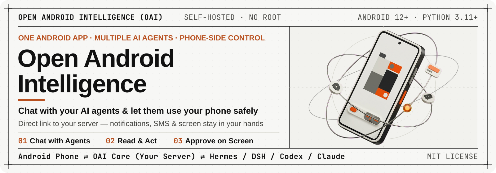
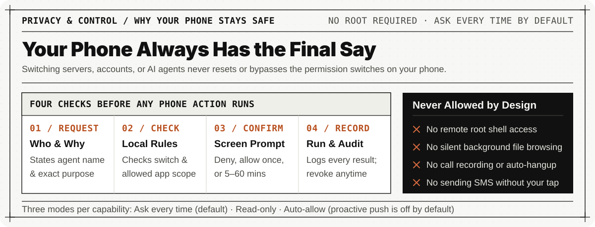

<p align="center">
  
</p>

<div align="center">

**One unified Android client to connect your phone with your favorite AI agents.**  
Chat with your self-hosted AI assistants from your phone anytime—and let them read notifications, check SMS, or tap your screen only when you say yes.

[**Download Android APK**](https://github.com/1rua/open-android-intelligence/releases) · [**What It Is**](#what-it-is) · [**Quick Start**](#quick-start) · [**Project Layout**](#project-layout)

<p>
  <a href="https://github.com/1rua/open-android-intelligence/releases/latest"></a>
  <a href="#quick-start"></a>
  <a href="#quick-start"></a>
  <a href="./LICENSE"></a>
</p>

<sub><a href="./README.md">简体中文</a> · <strong>English</strong></sub>

</div>

---

## What It Is

When you run AI assistants like Claude Code, Codex, Hermes, or DSH on your computer or server, two everyday frustrations come up:
1. **You lose touch away from your desk**: Once you step away from your computer, you cannot easily continue the conversation from your phone or send a quick phone screenshot to your AI.
2. **Your AI cannot safely reach your phone**: Sometimes you want your AI to check a verification text, summarize recent app notifications, or tap through a routine screen flow with permissions controlled on the phone.

**Open Android Intelligence (OAI)** solves both problems in plain, practical terms:

| What You Can Do | Plain-Language Explanation |
| --- | --- |
| **Chat with Your AI Agents on Your Phone** | Install one Android app to connect to **Hermes, DSH, Codex**, and other AI agents running on your machine. Pick up your existing computer chats right on your phone, send photos or files, or set OAI as your default Android digital assistant to circle anything on your screen and ask about it. |
| **Let AI Read Messages & Use Your Screen** | AI agents can use the phone `android_*` MCP tools to request **reading notifications, checking SMS, viewing call logs, taking screenshots, or tapping and swiping your screen**. You can also opt into pushing selected notifications or texts proactively to a chosen agent. |
| **100% of Permission Decisions Stay on Your Phone** | **No root required.** Remote authentication does not grant phone access; local Android switches and confirmation determine whether an AI may read a text or tap the screen. |

### How the Phone and Computer Connect

The Android app owns local permissions, chat and attachments. DSH Remote provides account authentication,
Host discovery and encrypted connections using independent Client and Virtual Host identities. Users select
an actual Host, backend and workspace. Remote authentication does not grant phone capabilities.

The standalone OAI Core installer and old Gateway setup are retired. Remote server and desktop installation
belong to [upstream DSH Remote](https://github.com/liguobao/ds-harness-remote).

### Why Your Phone Stays Safe

<p align="center">
  
</p>

- **Independent Switch & Three Modes per Capability**:
  - **Ask Every Time (Default)**: Whenever an AI requests a phone capability, your phone pops up a confirmation card showing which agent is asking and why. You can tap **Deny**, **Allow Once**, or **Allow for 5–60 Minutes**.
  - **Read-Only**: Allows reading information (like viewing notifications or screen layout), while any action that changes state or taps the screen still requires your manual tap.
  - **Auto-Allow**: For trusted read or automation flows (note: sensitive state-changing actions like **sending SMS** always require manual confirmation on your phone screen).
- **Switching Servers or Agents Never Resets Your Rules**: Permission settings belong to your phone installation—switching Remote services, accounts, or AI agents never resets or bypasses your local switches.
- **Fine-Grained Scope Control**: Pick exactly which installed apps may share notifications (with search and select/invert controls), filter SMS by **All / Keywords / Phone Numbers**, and keep proactive push off by default until you explicitly enable it and whitelist a verified receiver endpoint.

---

## Quick Start

The development branch is being migrated. Check the [acceptance ledger](docs/reviews/2026-11-14-dsh-remote-acceptance-index.zh-CN.md)
for the exact APK, Host, backend and device evidence; isolated tests do not prove a complete deployment.

1. Install the server or desktop Host using [upstream DSH Remote](https://github.com/liguobao/ds-harness-remote), then sign in.
2. Select an APK from [Releases](https://github.com/1rua/open-android-intelligence/releases) and check its migration status.
3. On the Remote connection page, use the service URL, email and password for the same Remote account as the desktop Host.
4. Refresh available computers, then manually select the Host, backend, workspace and conversation.
5. Enable only the required local plugins, phone capabilities and Android permissions. Sensitive operations still require local confirmation.
6. For external agents, use the [phone MCP bridge](integrations/oai-android-mcp/README.md) and its generated Stdio configuration.
   For both native DSH and external agents, see the [OAI Phone Control Skill](integrations/skills/oai-phone-control/SKILL.md).
   It exposes only `android_*` tools and does not delegate across workspaces. Do not copy Remote tokens or private keys.

Local settings backup excludes account credentials, master keys, conversation history and attachments. System permissions
must be granted again on a new installation. Real phone, backend and network support remains subject to the acceptance ledger.

## Project Layout

If you want to explore the codebase, tweak a feature, or build a custom phone plugin, here is where everything lives:

```text
open-android-intelligence/
├── apps/android/                  # 📱 Android App source code (Kotlin + Jetpack Compose)
│   ├── app/                       #    Main APK: chat UI, pairing, settings & permission switches
│   ├── platform-kernel/           #    On-device gatekeeper: plugin lifecycle, local policy & audit log
│   ├── plugin-runtime-wasm/       #    WebAssembly sandbox enforcing CPU, memory & storage limits
│   ├── conversation-ui/           #    Chat timeline, thought cards & slash-command autocomplete UI
│   ├── assistant-holder/          #    Default digital assistant entry & screen-selection capture
│   └── ...                        #    Feature modules for SMS, notifications, call logs & screen control
│
├── plugins/                       # 🧩 Official reference phone plugins (Rust -> signed .alp packages)
│   ├── notifications/             #    Notification query & proactive push plugin
│   ├── sms/                       #    SMS query, filtering & proactive push plugin
│   ├── call-log/                  #    Read-only call log metadata plugin
│   ├── screen-reader/             #    Screen text & UI tree inspection plugin
│   ├── screen-capture/            #    Screen capture plugin
│   └── screen-control/            #    Screen tap, swipe, text input & back navigation plugin
│
├── integrations/oai-android-mcp/   # Phone MCP, in-process bridge and fixed upstream probes
├── integrations/skills/            # DSH Remote phone-control Agent Skill (`oai-phone-control`)
├── plugin-tooling/                # Device plugin packaging and signatures
├── tools/                         # 🛠️ Developer verification scripts (e.g., `smart-test.py`)
├── assets/readme/                 # 🎨 README visual assets and editable SVG/PNG source layers
├── docs/                          # 📚 Design specs, Architecture Decision Records (ADRs) & review reports
├── CONTEXT.md                     # 📖 Plain domain glossary explaining project terminology
└── AGENTS.md                      # 🤖 Contributor guidelines, test tiers & Git commit conventions
```

### Common Developer Commands

You don't need to rebuild the entire repository for small edits—use the built-in tiered test runner:

```bash
# 1. Fast check during daily development (runs only tests affected by your git diff)
npm run test:fast

# 2. Pre-PR verification (runs affected modules, dependents, and contract checks)
npm run test:pr

# 3. Full release regression suite (runs all tests and APK integrity checks)
npm run test:full
```

---

## License

Released under the [MIT License](./LICENSE).
