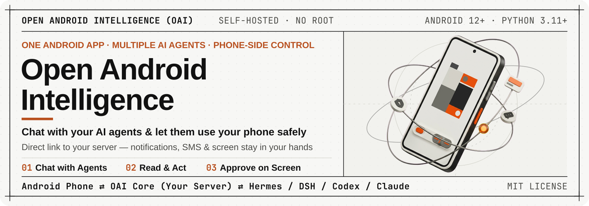
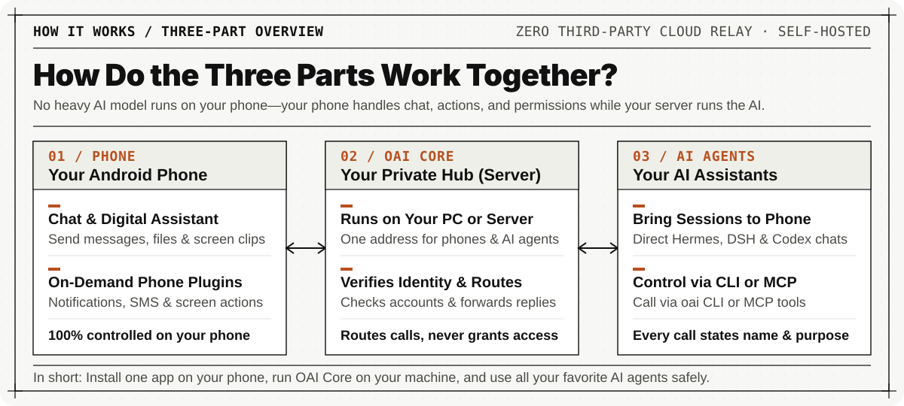
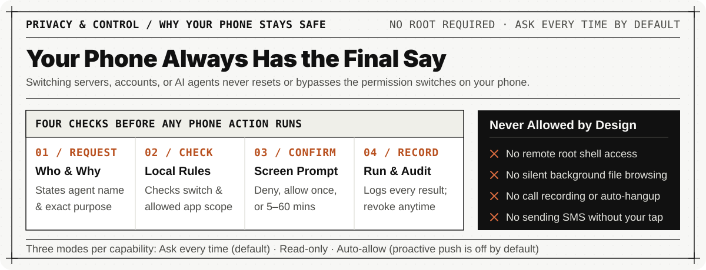

<p align="center">
  
</p>

<div align="center">

**One unified Android client to connect your phone with your favorite AI agents.**  
Chat with your self-hosted AI assistants from your phone anytime—and let them read notifications, check SMS, or tap your screen only when you say yes.

[**Download Android APK**](https://github.com/1rua/open-android-intelligence/releases) · [**What It Is**](#what-it-is) · [**Quick Start**](#quick-start) · [**Project Layout**](#project-layout)

<p>
  <a href="https://github.com/1rua/open-android-intelligence/releases/latest"></a>
  <a href="#quick-start"></a>
  <a href="#quick-start"></a>
  <a href="./LICENSE"></a>
</p>

<sub><a href="./README.md">简体中文</a> · <strong>English</strong></sub>

</div>

---

## What It Is

When you run AI assistants like Claude Code, Codex, Hermes, or DSH on your computer or server, two everyday frustrations come up:
1. **You lose touch away from your desk**: Once you step away from your computer, you cannot easily continue the conversation from your phone or send a quick phone screenshot to your AI.
2. **Your AI cannot safely reach your phone**: Sometimes you want your AI to check a verification text, summarize recent app notifications, or tap through a routine screen flow—without handing your private phone data to a third-party cloud relay.

**Open Android Intelligence (OAI)** solves both problems in plain, practical terms:

| What You Can Do | Plain-Language Explanation |
| --- | --- |
| **Chat with Your AI Agents on Your Phone** | Install one Android app to connect to **Hermes, DSH, Codex**, and other AI agents running on your machine. Pick up your existing computer chats right on your phone, send photos or files, or set OAI as your default Android digital assistant to circle anything on your screen and ask about it. |
| **Let AI Read Messages & Use Your Screen** | Any AI agent that can run CLI commands or MCP tools can use `oai` to request **reading notifications, checking SMS, viewing call logs, taking screenshots, or tapping and swiping your screen**. You can also opt into pushing selected notifications or texts proactively to a chosen agent. |
| **100% of Permission Decisions Stay on Your Phone** | **No root required, and zero third-party cloud relays.** Your self-hosted server only routes messages—whether an AI is allowed to read a text or tap the screen is decided strictly by the switches inside your Android app. |

### How Do the Three Parts Work Together?

<p align="center">
  
</p>

The system is split into three simple parts:
1. **Your Android Phone (Android App)**: Provides the chat UI, runs capability plugins (SMS, notifications, screen control, etc.), and enforces all permission switches locally.
2. **Your Private Hub (OAI Core Server)**: Runs on your own PC or server. A single address connects your phone and your AI agents. It verifies accounts and forwards requests, **without holding any authority to grant phone permissions**.
3. **Your AI Assistants (AI Agents)**: Run on your computer or server. They sync native chat sessions to your phone and call phone capabilities through the `oai` CLI or `MCP` server.

### Why Your Phone Stays Safe

<p align="center">
  
</p>

- **Independent Switch & Three Modes per Capability**:
  - **Ask Every Time (Default)**: Whenever an AI requests a phone capability, your phone pops up a confirmation card showing which agent is asking and why. You can tap **Deny**, **Allow Once**, or **Allow for 5–60 Minutes**.
  - **Read-Only**: Allows reading information (like viewing notifications or screen layout), while any action that changes state or taps the screen still requires your manual tap.
  - **Auto-Allow**: For trusted read or automation flows (note: sensitive state-changing actions like **sending SMS** always require manual confirmation on your phone screen).
- **Switching Servers or Agents Never Resets Your Rules**: Permission settings belong to your phone installation—switching OAI Core servers, accounts, or AI agents never resets or bypasses your local switches.
- **Fine-Grained Scope Control**: Pick exactly which installed apps may share notifications (with search and select/invert controls), filter SMS by **All / Keywords / Phone Numbers**, and keep proactive push off by default until you explicitly enable it and whitelist a verified receiver endpoint.

---

## Quick Start

Get your phone and your AI agents connected in 3 steps.

### Step 1: Install and Configure the Server (OAI Core)

**Requirements**: Linux or macOS with `Python 3.11+` and `git` (if dependencies are missing, the installer will prompt to install them for you).

**Option A: One-Line Quick Install (Recommended)**

Run the interactive install script directly in your terminal (installs to `~/.oai-core` by default):

```bash
curl -fsSL https://raw.githubusercontent.com/1rua/open-android-intelligence/dev/scripts/install.sh | bash
```

**Option B: Clone and Install Locally**

```bash
git clone https://github.com/1rua/open-android-intelligence.git
cd open-android-intelligence
./scripts/install.sh
```

Follow the terminal prompts to create your **administrator account and password** (keep the one-time administrator recovery code in a safe place). The wizard sets up the Python runtime, configures the listener port, and scans/connects local AI agents (Hermes, DSH, Codex).

**Daily Configuration, Account & Service Commands**:

```bash
# 1. Open the interactive setup menu (change ports, manage accounts, connect AI agents, toggle 2FA, manage service)
oai setup
# Or run the setup script directly:
./scripts/setup.sh
# Or invoke the installed setup entry via curl:
curl -fsSL https://raw.githubusercontent.com/1rua/open-android-intelligence/dev/scripts/setup.sh | bash

# 2. Create a regular user account for your phone and CLI (e.g., alice)
oai account create alice

# 3. Start OAI Core manually (if auto-start is not enabled)
~/.oai-core/start-core.sh
```

<details>
<summary><b>Optional: Quick Uninstall Script Commands (click to expand)</b></summary>

```bash
# Uninstall runtime while keeping configuration & data (for easy re-install)
curl -fsSL https://raw.githubusercontent.com/1rua/open-android-intelligence/dev/scripts/uninstall.sh | bash

# Move the entire installation into the temporary /tmp trash folder for manual review
curl -fsSL https://raw.githubusercontent.com/1rua/open-android-intelligence/dev/scripts/uninstall.sh | bash -s -- --purge
```
</details>

### Step 2: Install the Android App & Enable Capabilities

**Requirements**: Android 12 or newer (no root required; your phone and server just need to reach each other over LAN, Tailscale, or HTTPS).

1. Download the latest APK from [Releases](https://github.com/1rua/open-android-intelligence/releases) and install it on your phone.
2. Open the app, enter your `OAI Core` URL (e.g., `https://your-server:11451`), and sign in with the user account you created.
3. Open **Settings → Plugins / Authorization** in the phone app:
   - Enable the capability plugins you want to use (Notifications, SMS, Screen Reader, Screen Control, etc.).
   - Choose your preferred permission mode (**Ask every time** is the default) and select which apps or SMS scopes are allowed.

### Step 3: Let Your AI Agents Call Your Phone

Install the built-in `oai-client` skill into your local AI coding agents (Claude Code, Codex, Hermes, DSH, etc.) with one command so they automatically know how to use your phone:

```bash
./.venv/bin/oai skill install
```

Or log in and test calling your phone directly from a terminal:

```bash
# 1. Log in to OAI Core (password is prompted securely)
oai login --url https://your-server:11451 --username alice

# 2. List your paired Android devices
oai devices

# 3. Discover enabled capabilities and their parameter schemas
oai capabilities

# 4. Invoke a capability (e.g., read the latest 5 notifications and wait for approval)
oai invoke org.openandroidintelligence.notifications.query \
  --version 1.0.0 \
  --parameters '{"limit": 5}' \
  --agent-name "My Desktop Assistant" \
  --purpose "Check the 5 most recent phone notifications" \
  --idempotency-key "demo-notif-001" \
  --wait 30
```

If your AI client supports **MCP (Model Context Protocol)**, run `oai login` once and register `oai mcp` as a stdio MCP server—your agent will immediately gain access to `oai_devices`, `oai_capabilities`, `oai_invoke`, and related tools.

---

## Project Layout

If you want to explore the codebase, tweak a feature, or build a custom phone plugin, here is where everything lives:

```text
open-android-intelligence/
├── apps/android/                  # 📱 Android App source code (Kotlin + Jetpack Compose)
│   ├── app/                       #    Main APK: chat UI, pairing, settings & permission switches
│   ├── platform-kernel/           #    On-device gatekeeper: plugin lifecycle, local policy & audit log
│   ├── plugin-runtime-wasm/       #    WebAssembly sandbox enforcing CPU, memory & storage limits
│   ├── conversation-ui/           #    Chat timeline, thought cards & slash-command autocomplete UI
│   ├── assistant-holder/          #    Default digital assistant entry & screen-selection capture
│   └── ...                        #    Feature modules for SMS, notifications, call logs & screen control
│
├── oai-core/                      # 🖥️ OAI Core server & oai CLI / MCP entrypoint (Python 3.11+)
│   ├── src/oai_core/cli.py        #    `oai` CLI commands (login / devices / capabilities / invoke / mcp)
│   ├── src/oai_core/server.py     #    Single-port listener handling pairing, routing & agent sessions
│   ├── src/oai_core/mcp.py        #    Stdio MCP server exposing phone capabilities to AI agents
│   └── tests/                     #    Automated tests for Core, CLI, auth & session routing
│
├── plugins/                       # 🧩 Official reference phone plugins (Rust -> signed .alp packages)
│   ├── notifications/             #    Notification query & proactive push plugin
│   ├── sms/                       #    SMS query, filtering & proactive push plugin
│   ├── call-log/                  #    Read-only call log metadata plugin
│   ├── screen-reader/             #    Screen text & UI tree inspection plugin
│   ├── screen-capture/            #    Screen capture plugin
│   └── screen-control/            #    Screen tap, swipe, text input & back navigation plugin
│
├── integrations/                  # 🔌 AI agent session adapters & skill packages
│   ├── skills/oai-client/         #    `oai-client` skill instructions (SKILL.md) for AI agents
│   ├── hermes-session-adapter/    #    Bridges Hermes native conversations to OAI Core
│   └── dsh-session-adapter/       #    Bridges DSH (DeepSeek Harness) conversations to OAI Core
│
├── gateway-contract/              # 📜 Communication schemas & 70 cross-host conformance test vectors
├── plugin-tooling/                # 📦 CLI tooling to package and sign `.alp` device plugins
├── scripts/                       # 🚀 Interactive installer (`install.sh`), setup (`setup.sh`) & uninstaller
├── tools/                         # 🛠️ Developer verification scripts (e.g., `smart-test.py`)
├── assets/readme/                 # 🎨 README visual assets and editable SVG/PNG source layers
├── docs/                          # 📚 Design specs, Architecture Decision Records (ADRs) & review reports
├── CONTEXT.md                     # 📖 Plain domain glossary explaining project terminology
└── AGENTS.md                      # 🤖 Contributor guidelines, test tiers & Git commit conventions
```

### Common Developer Commands

You don't need to rebuild the entire repository for small edits—use the built-in tiered test runner:

```bash
# 1. Fast check during daily development (runs only tests affected by your git diff)
npm run test:fast

# 2. Pre-PR verification (runs affected modules, dependents, and contract checks)
npm run test:pr

# 3. Full release regression suite (runs all tests and APK integrity checks)
npm run test:full
```

---

## License

Released under the [MIT License](./LICENSE).
