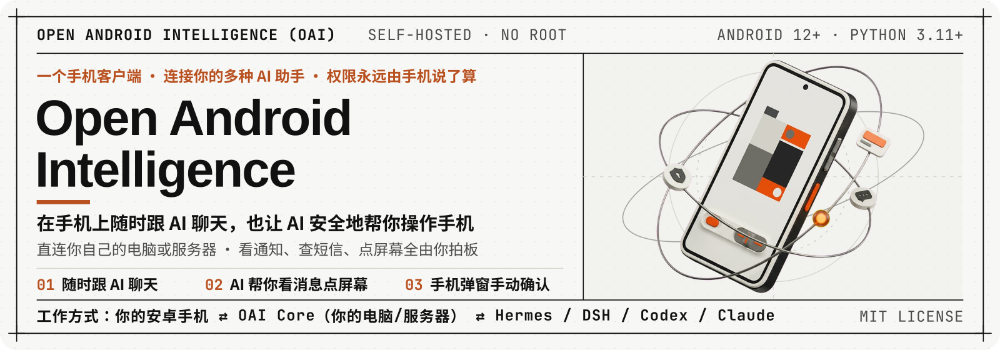
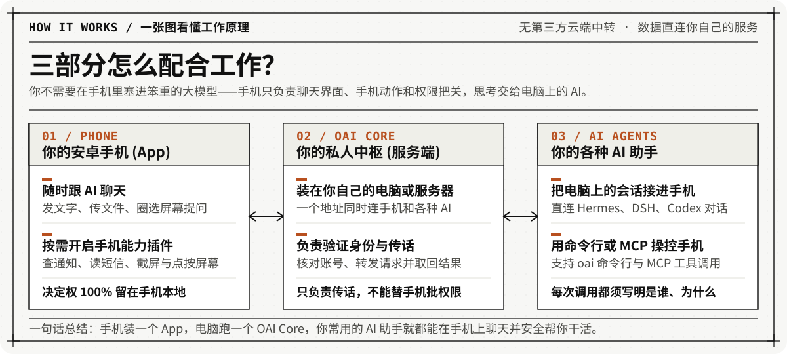
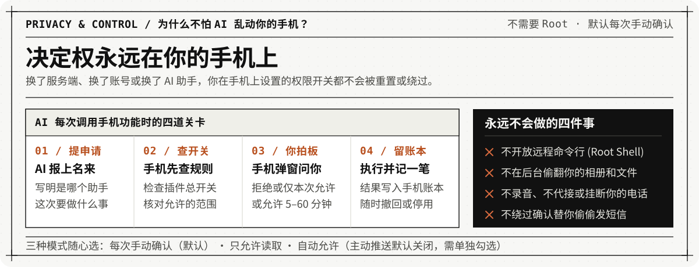

<p align="center">
  
</p>

<div align="center">

**一个帮你把安卓手机和各种 AI 助手连起来的统一客户端。**  
在手机上随时跟电脑里的 AI 聊天；AI 也能在经过你允许后，帮你看通知、查短信、点按屏幕。

[**下载安卓 APK**](https://github.com/1rua/open-android-intelligence/releases) · [**项目介绍**](#项目介绍) · [**快速开始**](#快速开始) · [**开发目录**](#开发目录)

<p>
  <a href="https://github.com/1rua/open-android-intelligence/releases/latest"></a>
  <a href="#快速开始"></a>
  <a href="#快速开始"></a>
  <a href="./LICENSE"></a>
</p>

<sub>**简体中文** · <a href="./README.en.md">English</a></sub>

</div>

---

## 项目介绍

平时我们在电脑上用 Claude Code、Codex、Hermes、DSH 等 AI 助手时，常常遇到两个痛点：
1. **离开电脑就断联**：人一走开，没法在手机上接着看刚才的 AI 对话，也没法随手发张手机截图让它接着干活。
2. **云端 Agent 碰不到手机**：想让 AI 帮你留意一条重要通知、查个验证码短信，或者自动在手机屏幕上点几下。
3. **本地 Agent 不互通**：要操控手机只能在手机再部署一个 Agent，占内存且记忆不互通 。

**Open Android Intelligence（简称 OAI）** 就是为了解决这两件事：

| | |
| --- | --- |
| **在手机上随时跟你的 AI 聊天** | 一个安卓 App，同时连上你电脑或服务器里的 **Hermes、DSH、Codex** 等多种 AI 助手。直接接着电脑上的聊天记录聊，支持发相册图片、传文件，还能设成手机默认数字助理——长按电源键就能圈选当前屏幕画面向 AI 提问。 |
| **让 AI 帮你看消息、操作手机** | 任何支持命令行或 MCP 的 AI 助手，都能通过 `oai` 命令向你的手机申请**查通知、读短信、看通话记录、截屏，或者点击、滑动屏幕**。让Agent留在云端，用你喜欢的Agent，无需本地部署 |
| **决定权 100% 留在你手里的手机上** | **不需要 Root 手机，也不经过任何第三方云端服务器。** 装在你电脑上的服务端只负责传话，能不能看短信、能不能点屏幕，全由你手机 App 上的开关说了算。 |

### 三部分怎么配合工作？

<p align="center">
  
</p>

整个项目只由三个清晰的部分组成：
1. **你的安卓手机（Android App）**：负责日常聊天界面、管理手机上的能力插件（短信、通知、屏幕操作等），以及把守所有权限开关。
2. **你的私人中枢（OAI Core 服务端）**：装在你自己的电脑或服务器上，用一个地址同时连起手机和各种 AI 助手。它只负责核对账号和传话，**不能替手机做任何权限决定**。
3. **你的各种 AI 助手（AI Agents）**：留在你的电脑或服务器上运行。既能把对话同步到手机上，也能用 `oai` 命令或 `MCP` 工具向手机发起操作申请。

### 为什么不怕 AI 乱动你的手机？

<p align="center">
  
</p>

- **每项功能都有独立开关和三种模式**：
  - **每次手动确认（默认）**：AI 每次想用这项功能，你的手机都会弹窗写明「是谁、想干什么」，由你点击「拒绝 / 仅本次允许 / 允许 5–60 分钟」。
  - **只允许读取**：允许查看信息（比如查通知、看屏幕），但凡涉及修改或点击的操作一律需要你手动确认。
  - **自动允许**：适合你完全信任的只读或自动化场景（注：**发短信**等敏感操作无论在什么模式下，都必须由你在手机屏幕上亲手确认）。
- **换电脑、换账号也不丢配置**：你的权限设置保存在手机本地，不会因为切换了服务端或换了 AI 助手就被偷偷重置。
- **范围精细可控**：通知可以从手机已安装的应用列表里搜索、勾选允许哪些 App 被读取；短信可以按「全部 / 关键词 / 电话号码」过滤；主动推送默认关闭，需要你单独开启并勾选允许接收的 AI。

---

## 快速开始

只需要 3 步，就能把你的手机和电脑上的 AI 助手连起来。

### 第一步：在电脑或服务器上安装并配置服务端（OAI Core）

**环境要求**：Linux 或 macOS，已安装 `Python 3.11+` 和 `git`（若缺少依赖，安装脚本会自动询问并帮你安装）。

**方式 A：一条命令快速安装（推荐）**

在终端直接运行在线安装脚本（默认安装到 `~/.oai-core`）：

```bash
curl -fsSL https://raw.githubusercontent.com/1rua/open-android-intelligence/dev/scripts/install.sh | bash
```

**方式 B：克隆仓库后本地安装**

```bash
git clone https://github.com/1rua/open-android-intelligence.git
cd open-android-intelligence
./scripts/install.sh
```

按屏幕提示设置**管理员账号和密码**（请妥善保管只显示一次的管理员恢复码），向导会自动创建运行环境，并引导你设置监听端口、扫描和接入本机的 AI 助手（如 Hermes、DSH、Codex）。

**日常配置、建号与服务管理命令**：

```bash
# 1. 打开交互式配置菜单（随时改端口、管理账号、接入 AI 助手、开关 2FA、启停服务）
oai setup
# 或者直接运行配置脚本：
./scripts/setup.sh
# 或远程调用本地已安装的配置入口：
curl -fsSL https://raw.githubusercontent.com/1rua/open-android-intelligence/dev/scripts/setup.sh | bash

# 2. 创建一个平时在手机和命令行登录用的日常账号（例如 alice）
oai account create alice

# 3. 手动启动服务端（若未开启开机自启）
~/.oai-core/start-core.sh
```

<details>
<summary><b>附：一键卸载脚本命令（点击展开）</b></summary>

```bash
# 默认保留账号配置与数据，仅移除运行环境（方便日后重装）
curl -fsSL https://raw.githubusercontent.com/1rua/open-android-intelligence/dev/scripts/uninstall.sh | bash

# 彻底移除整个安装目录（移入 /tmp 临时回收目录供人工复核，不直接永久删除）
curl -fsSL https://raw.githubusercontent.com/1rua/open-android-intelligence/dev/scripts/uninstall.sh | bash -s -- --purge
```
</details>

### 第二步：在手机上安装 App 并开启所需功能

**环境要求**：Android 12 及以上（无需 Root，手机与你的电脑/服务器在同一局域网、Tailscale 组网或公网 HTTPS 可达）。

1. 前往 [Releases 页面](https://github.com/1rua/open-android-intelligence/releases) 下载最新的 APK 安装到手机。
2. 打开 App，填入你的 `OAI Core` 服务地址（例如 `https://你的服务器地址:11451`）和刚才创建的账号密码完成登录配对。
3. 进入手机 App 的 **「设置 → 插件管理 / 授权管理」**：
   - 启用你需要的手机插件（如通知、短信、屏幕读取与操控）。
   - 为每项能力选择你放心的模式（默认均为**每次手动确认**）以及允许读取的应用/短信范围。
4. 换手机或重装 App 后，不必逐项重配：在 **「设置 → 高级设置与关于 → 备份与恢复」** 先导出一次设置
   （`oai-settings-年月日.json`），在新手机上选择导入即可恢复外观、通知、会话排序、能力策略等偏好。
   备份文件**不包含**账号密码、登录凭据、主密钥、会话历史与附件；系统权限和各项能力的实际授权
   仍需你在新手机上重新确认。

### 第三步：让你的 AI 助手调用手机

你可以把自带的「手机操控技能说明」一键安装到本机的 Claude Code、Codex、Hermes、DSH 等助手中，让 AI 自动学会怎么调用你的手机：

```bash
./.venv/bin/oai skill install
```

也可以直接在终端里登录并试试调用手机能力：

```bash
# 1. 登录你的账号（按提示输入密码）
oai login --url https://你的服务器地址:11451 --username alice

# 2. 查看已配对的手机
oai devices

# 3. 查看当前手机开启了哪些可用能力及参数格式
oai capabilities

# 4. 发起一次操作（例如：申请查看最近 5 条通知，等待手机弹窗确认）
oai invoke org.openandroidintelligence.notifications.query \
  --version 1.0.0 \
  --parameters '{"limit": 5}' \
  --agent-name "我的桌面助手" \
  --purpose "帮你查看最近 5 条手机通知" \
  --idempotency-key "demo-notif-001" \
  --wait 30
```

如果你的 AI 客户端支持 **MCP（Model Context Protocol）**，只需完成一次 `oai login`，然后把 `oai mcp` 配置为 stdio MCP Server，AI 就能直接调用 `oai_devices`、`oai_capabilities`、`oai_invoke` 等标准工具了。

---

## 开发目录

如果你想阅读源码、修改功能或自己写一个手机插件，可以按下面的目录直接找到对应代码：

```text
open-android-intelligence/
├── apps/android/                  # 📱 安卓手机 App 源码（Kotlin + Jetpack Compose）
│   ├── app/                       #    App 主界面：聊天窗口、账号配对、设置与权限开关界面
│   ├── platform-kernel/           #    手机端权限守门员：管插件安装启用、本地权限判断与操作账本
│   ├── plugin-runtime-wasm/       #    插件安全沙箱：限制插件能用多少内存、时间和存储空间
│   ├── conversation-ui/           #    聊天消息、思考过程卡片、斜杠命令补全等界面组件
│   ├── assistant-holder/          #    系统默认数字助理入口（长按电源键唤出、屏幕圈选截图）
│   └── ...                        #    短信、通知、通话记录、屏幕控制等各功能的安卓底层模块
│
├── oai-core/                      # 🖥️ OAI Core 服务端与 oai 命令行工具（Python 3.11+）
│   ├── src/oai_core/cli.py        #    oai 命令行入口（login / devices / capabilities / invoke / mcp）
│   ├── src/oai_core/server.py     #    Core 服务端主监听程序（配对、转发请求、连接 AI 会话）
│   ├── src/oai_core/mcp.py        #    供各类 AI 助手挂载的 MCP 工具服务
│   └── tests/                     #    服务端与命令行自动化测试
│
├── plugins/                       # 🧩 官方手机能力插件源码（Rust 编写，编译为安全的 .alp 插件包）
│   ├── notifications/             #    通知查询与主动推送插件
│   ├── sms/                       #    短信查询、过滤与主动推送插件
│   ├── call-log/                  #    通话记录只读查询插件
│   ├── screen-reader/             #    屏幕文字与布局读取插件
│   ├── screen-capture/            #    屏幕截图插件
│   └── screen-control/            #    屏幕点击、滑动、输入文字与返回键操控插件
│
├── integrations/                  # 🔌 第三方 AI 助手对接组件与技能包
│   ├── skills/oai-client/         #    教 AI 助手如何安全调用手机的 Skill 说明书（SKILL.md）
│   ├── hermes-session-adapter/    #    把 Hermes 聊天会话接入手机的适配器
│   └── dsh-session-adapter/       #    把 DSH (DeepSeek Harness) 聊天会话接入手机的适配器
│
├── gateway-contract/              # 📜 手机与服务端之间的通信格式定义与 70 组标准测试题（TypeScript）
├── plugin-tooling/                # 📦 插件打包与数字签名工具（把代码打成手机可安装的 .alp 包）
├── scripts/                       # 🚀 一键安装（install.sh）、配置（setup.sh）与卸载脚本
├── tools/                         # 🛠️ 开发自测脚本（如 smart-test.py 分级测试工具）
├── assets/readme/                 # 🎨 README 视觉图片与可编辑 SVG 源文件
├── docs/                          # 📚 详细设计文档、架构决策记录（ADR）与测试验收报告
├── CONTEXT.md                     # 📖 项目核心概念词典（遇到不熟的内部词汇可以查这里）
└── AGENTS.md                      # 🤖 代码规范、测试门禁与 Git 提交约定
```

### 常用开发自测命令

改完代码后，不需要每次都把所有模块从头慢吞吞编译一遍，仓库内置了按改动范围自动挑选测试的命令：

```bash
# 1. 日常改动快速自测（自动根据 git diff 只跑你改动涉及的模块测试）
npm run test:fast

# 2. 提交 PR 前的完整准入检查（包含关联依赖模块与通信协议检查）
npm run test:pr

# 3. 发布前的全量回归测试（包含全套单元测试与安卓 APK 打包校验）
npm run test:full
```

---

## 开源协议

本项目基于 [MIT License](./LICENSE) 开源。
