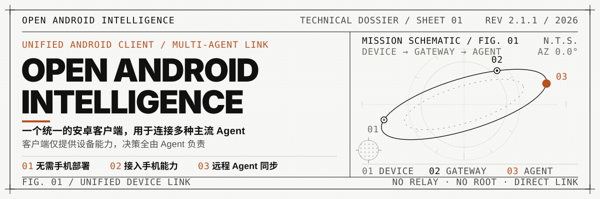
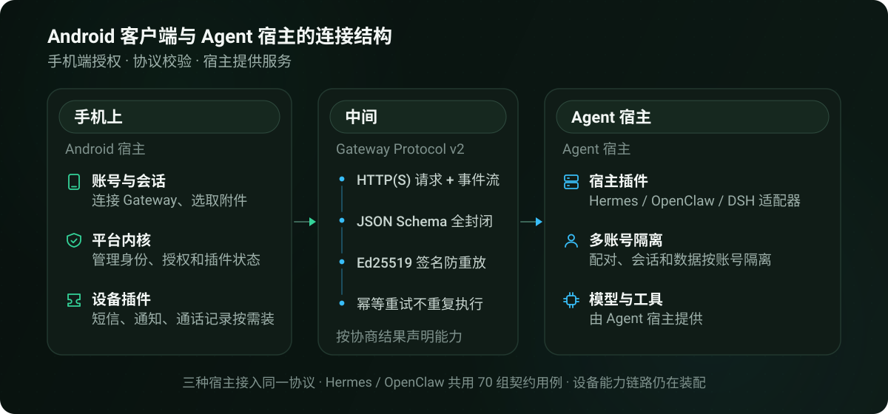
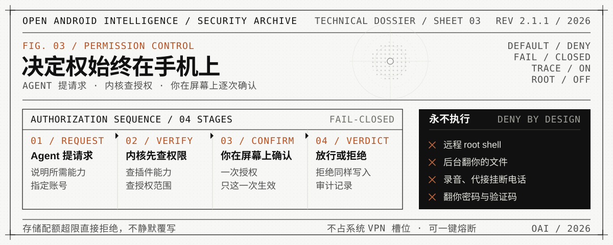

<div align="center">

<a href="#快速开始"></a>

# Open Android Intelligence

<p>
  <strong>一个统一的安卓客户端，用于连接多种主流 Agent。</strong><br>
  客户端仅提供设备能力，决策全由 Agent 负责。
</p>

<h3>
  <a href="https://github.com/1rua/open-android-intelligence/releases/latest/download/app-full-release.apk">一键安装 APK</a> · 连接多种主流 Agent · 隐私安全可控
</h3>

<p>
  <sub>
    零中转服务器 · 数据直连自托管网关 · 无需 Root 权限 · 生产级权限隔离<br>
    简体中文 · <a href="README.en.md">English</a>
  </sub>
</p>

<p>
  <a href="https://github.com/1rua/open-android-intelligence/releases/latest"></a>
  <a href="#快速开始"></a>
  <a href="#怎么工作"></a>
  <a href="#当前状态"></a>
  <a href="#安全边界"></a>
  <a href="LICENSE"></a>
</p>

<p>
  <a href="#30-秒看懂">30 秒看懂</a> ·
  <a href="#主要功能">主要功能</a> ·
  <a href="#怎么工作">怎么工作</a> ·
  <a href="#安全边界">安全边界</a> ·
  <a href="#快速开始">快速开始</a> ·
  <a href="#当前状态">当前状态</a> ·
  <a href="#文档导航">文档导航</a>
</p>

</div>

---

## 30 秒看懂

> [!TIP]
> ### Open Android Intelligence（OAI）是**一个统一的安卓客户端，用于连接多种主流 Agent**（如 Hermes、OpenClaw、DSH 等）。
>
> 并将手机硬件能力安全、受控地开放给 AI Agent，让多种远程 Agent 共享手机控制能力，而无需在手机部署独立Agent。

项目由以下三部分组成，宿主插件分别维护在独立仓库：

| 核心组件 | 定位与说明 | 代码位置 / 仓库 |
| --- | --- | --- |
| **Android App** | 连接 Gateway、管理账号与多会话，发送用户选定的多模态附件，承载设备能力沙箱 | [`apps/android`](apps/android) |
| **Gateway Protocol** | 定义手机与 Agent 宿主之间的身份认证、消息通信和全字段封闭数据协议 | [`gateway-contract`](gateway-contract) |
| **三方宿主插件** | 分别为 Hermes、OpenClaw 和 DSH（DeepSeek Harness）提供标准 Gateway 接入适配 | [Hermes 插件](https://github.com/1rua/hermes-gateway-plugin) / [OpenClaw 插件](https://github.com/1rua/openclaw-gateway-plugin) / [DSH 插件](https://github.com/1rua/dsh-android-gateway) |

> [!NOTE]
> **无中转架构**：Android App 直接与用户自建的 Agent 网关通信，项目本身不提供任何公网消息中转服务器。<br>
> **插件化授权**：设备能力按插件安装与授权，发短信等敏感操作必须由用户在手机屏幕上手动确认。


---

## 主要功能

<table>
  <tr>
    <td width="50%" valign="top">
      <h3>多会话原生聊天 </h3>
      <p>在手机上与你连接的主流 Agent 流畅对话。支持多会话独立管理、会话归档、目录整理与灵活排序；全面支持系统相册选图、文件选择器、剪贴板图片粘贴以及系统级多文件分享附件。</p>
    </td>
    <td width="50%" valign="top">
      <h3>多宿主网关直连 </h3>
      <p>通过同一套 Gateway Protocol v2 协议，无缝接入 <strong>Hermes</strong>、<strong>OpenClaw</strong> 以及 <strong>DSH (DeepSeek Harness)</strong>。直连你自己的服务器，自主掌控全部模型调用与历史记录，拒绝云端数据劫持。</p>
    </td>
  </tr>
  <tr>
    <td width="50%" valign="top">
      <h3>WebAssembly 插件沙箱 </h3>
      <p>万物皆插件。受保护的设备插件打包为标准 <code>.alp</code> 包，运行于高性能 WASM 沙箱中，受到 CPU 时间、内存上限（硬配额）、存储容量及并发连接的严密限制，杜绝越权滥用。</p>
    </td>
    <td width="50%" valign="top">
      <h3>零信任安全与屏幕确认 </h3>
      <p>遵循「默认拒绝」安全准则：插件安装、插件启用、网关账号授权严格分级解耦。短信发送等高风险操作必须经由用户在手机屏幕逐条手动确认，严禁静默执行。</p>
    </td>
  </tr>
  <tr>
    <td width="50%" valign="top">
      <h3>封闭契约与防重放校验 </h3>
      <p>基于 JSON Schema 2020-12 的全字段严格契约验证，多余未知字段整条丢弃；关键指令搭载 Ed25519 签名、时间戳与一次性随机数防重放校验，保障网络抖动下的幂等执行。</p>
    </td>
    <td width="50%" valign="top">
      <h3>原生系统通知与动态跟进 </h3>
      <p>深度融合 Android 原生生态：支持 Android 12–15 的会话通知（MessagingStyle）与悬浮气泡（Bubbles），并率先接入 Android 16 原生 Live Update，任务进度实时感知。</p>
    </td>
  </tr>
</table>

---

## 怎么工作

<div align="center">
  
</div>

整个系统由清晰的三层结构协同运转：

1. **Android 原生宿主端**（客户端）
   - **交互与会话**：提供网关连接配置、多会话管理、系统级附件选发（通过系统 SAF 选择器与分享接口）。
   - **平台内核（Platform Kernel）**：基于 Ed25519 密钥管理设备身份、插件生命周期与权限裁决。它只行使守门仲裁权，不私自预埋业务后门。
   - **安全插件沙箱**：通过 WebAssembly 运行时隔离执行设备扩展插件，严格限制 CPU、内存、本地存储与网络并发资源。
2. **Gateway Protocol v2 契约层**（连接桥梁）
   - **传输管道**：基于 HTTP(S) 请求响应 + WebSocket / SSE 事件流双向通信。
   - **严格验证**：基于 JSON Schema 2020-12 进行封闭式字段校验，出现未知字段立即整条拦截。
   - **密码学守卫**：关键请求携带 Ed25519 签名凭证、时间戳与 Nonce 防重放校验，具备幂等状态机与有界自动重试。
3. **Agent 宿主端**（后端大脑）
   - **生态插件适配**：Hermes 与 OpenClaw 借由各自的独立适配器插件介入；DSH 深度复用自有 Web 服务端口，无需额外部署独立 Bridge 进程。
   - **统一能力声明**：三种后端对齐同一 Gateway 协议规范，自主决定模型调度与工具执行链路，数据完全留存在你的宿主机。

---

## 安全边界

<div align="center">
  
</div>

安全与隐私是本项目的立身之本。所有设备硬件能力**默认完全关闭**。开启一项能力必须经过三道防线：**在手机上安装插件 → 手动启用插件 → 为特定网关账号单独授权**。

### 设备权限管控矩阵

| 敏感能力 | 严格限制与允许边界 |
| --- | --- |
| **通话记录** | **仅允许只读基础元数据**（联系人/号码、时间戳、通话时长）；严禁任何形式的录音、代接、挂断或自动拨号。 |
| **短信记录** | 仅支持受控读取收发记录；**发短信等变更操作必须在手机屏幕上手动逐条点击确认**，绝不允许后台代发。 |
| **应用通知** | **默认全部禁止**；需用户手动在白名单中勾选指定应用包名与字段，内存采用端到端加密缓冲，不落明文日志。 |

---

## 快速开始

### 0. 准备环境

| 运行端 | 最低要求 | 推荐配置 |
| --- | --- | --- |
| **Android 手机** | Android 12+ (`minSdk 31`) | Android 14+，推荐 8GB 内存 |
| **Agent 宿主环境** | 运行 Hermes、OpenClaw 或 DSH (DeepSeek Harness) | 具备公网或 Tailscale 局域网可达性 |
| **开发者编译工具链** *(仅参与源码开发时需要)* | Node.js `24.18.0` + npm `11.16.0`、JDK 21、Android SDK (`compileSdk 36` / `targetSdk 35`) | Rust 1.80+ (带 `wasm32-unknown-unknown` 目标) |

---

### 1. 手机端安装 App

前往项目 [Releases 页面](https://github.com/1rua/open-android-intelligence/releases) 下载 APK 并安装：

| 版本类别 | 适用群体 | 安装说明 |
| --- | --- | --- |
| **开发预览测试版** | 尝鲜体验者、开发者 | 使用仓库内置统一 Debug 签名，可覆盖安装，CI 每日构建直接下载 |
| **正式稳定版** | 普通日常使用 | 使用官方私有生产密钥签名，严禁与开发预览版交叉覆盖安装（详见 [Android 签名配置](apps/android/README.md#release-signing)） |


---

### 2. 为 Agent 宿主安装网关插件

根据你所使用的 Agent 框架，选择对应的宿主插件进行配置。为保障端到端安全性，Hermes 和 OpenClaw 需配置账号主密钥（Master Key）对消息正文进行对称加密保管。

<details>
<summary><b>配置 <a href="https://github.com/1rua/hermes-gateway-plugin">Hermes</a> 宿主（点击展开）</b></summary>

```bash
# 1. 安装并启用指定版本的 Gateway 插件（与当前 App 版本严格锁定）
hermes plugins install 1rua/hermes-gateway-plugin --ref 190441415652ae34fbd1cb8cc485f6208fff944b --enable

# 2. 引导配置手机连接网关
hermes gateway setup

# 3. 日常账号与网关状态查看
hermes open-android-intelligence account list
hermes open-android-intelligence account create -u my_user -p <设置密码> --confirm-local
hermes open-android-intelligence status
hermes open-android-intelligence contract status
```

> **版本对照提示**：当前配套版本为 `2.2.0`（SHA256: `032f5802...`）。如曾锁定旧提交（`9d642b4`），需加上 `--force` 重新安装并执行 `hermes gateway restart` 重启生效。
</details>

<details>
<summary><b>配置 <a href="https://github.com/1rua/openclaw-gateway-plugin">OpenClaw</a> 宿主（点击展开）</b></summary>

准备一个 32 字节的原始密钥文件（权限设为 `0600`），并配置系统环境变量：

```bash
# 设置主密钥文件路径
export OPEN_ANDROID_INTELLIGENCE_GATEWAY_MASTER_KEY_FILE=/private/path/gateway-master-key.bin

# 安装并核验插件运行状态
openclaw plugins install git:github.com/1rua/openclaw-gateway-plugin@c7c087b9fe28adcc658a1cbdb71689a377b65214
openclaw plugins inspect open-android-intelligence-gateway --runtime --json
```

> **版本对照提示**：当前锁定版本 `1.1.0`（提交 `c7c087b`），协议规范 `2.1.0`，宿主 API `2026.7.1`。
</details>

<details>
<summary><b>配置 <a href="https://github.com/1rua/dsh-android-gateway">DSH (DeepSeek Harness)</a> 宿主（点击展开）</b></summary>

[dsh-android-gateway](https://github.com/1rua/dsh-android-gateway) 是专为 DSH 打造的独立 Bundle 插件，版本 `0.2.0`，实现 Gateway Protocol v2.1。直接复用 DSH 原生 Web 端口：

```bash
# 克隆并编译 DSH 网关插件
git clone https://github.com/1rua/dsh-android-gateway.git
cd dsh-android-gateway
npm ci
npm run build
```

在 DSH 会话中执行 Bundle 安装指令：
```text
plugin_manager action=install_bundle target=/absolute/path/to/dsh-android-gateway
```

首次启动若账号表为空，插件会在 `$DSH_HOME/dsh-android-gateway/setup-account.json` 自动生成一次性初始凭据（`0600` 权限）。手机连接成功后请及时清理该临时文件。详见 [DSH 插件说明文档](https://github.com/1rua/dsh-android-gateway#readme)。
</details>

<details>
<summary><b>离线预置账号（CLI 快速工具）</b></summary>

若暂无宿主运行环境，可使用 Hermes 插件附带的独立 CLI 在本地预置账号凭据：

```bash
python3 tools/hermes-account.py init-key        # 生成 0600 权限主密钥文件
python3 tools/hermes-account.py create my_user  # 交互式设定密码
python3 tools/hermes-account.py status          # 查看网关托管与配对状态
```
</details>

---

### 3. 手机端连接网关

1. 打开手机 App，输入你的网关访问地址（支持 HTTP/HTTPS，推荐内网或域名反代地址）。
2. 输入刚才创建的账号与密码，点击「连接配对」。
3. 手机端成功完成握手后，证书信息与凭据将安全保存在本机 Android Keystore 中，后续启动无需重复输密。

<details>
<summary><b>HTTPS 证书公钥指纹（SPKI SHA-256）配置指引</b></summary>

在启用 HTTPS 时，为杜绝中间人攻击，需将服务端 TLS 证书的 SPKI SHA-256 摘要配置在 Gateway 插件中：

```bash
# 计算服务器证书公钥的 SHA-256 指纹
openssl x509 -in gateway.crt -pubkey -noout | openssl pkey -pubin -outform DER | openssl dgst -sha256
```

将计算出的公钥指纹写入网关环境变量：
```bash
OPEN_ANDROID_INTELLIGENCE_GATEWAY_TLS_SPKI_SHA256=sha256:<64位十六进制字符>
```
未配置指纹时握手会返回 `null`，客户端将拒绝提交密码凭据。明文 HTTP 虽可降级连接，但 App 界面会持续显示橙色未加密警告。
</details>

---

### 4. 设备能力按需启用

所有设备能力默认保持休眠。需要让 Agent 感知短信或通知时，需执行标准三阶授权：

```bash
# 查看指定账号的能力授权情况
hermes open-android-intelligence capabilities list <账号名>
```

> [!WARNING]
> **开发中状态说明**：设备插件包打标、Ed25519 签名校验、WASM 沙箱引擎及配额约束均已实现并完成测试；但 App 内部执行管道装配正在进行中，真机全链路闭环尚未最终验收。进展请查阅[当前状态](#当前状态)及[通知能力同步记录](docs/reviews/2026-10-20-agent-notification-capabilities.zh-CN.md)。

---

### 5. 源码编译与调试（开发者）

<details>
<summary><b>契约一致性测试（Hermes / OpenClaw 70 组用例）</b></summary>

```bash
npm ci

# 检出固定版本的 OpenClaw 插件源码并安装依赖
git clone https://github.com/1rua/openclaw-gateway-plugin.git .openclaw-gateway-plugin
git -C .openclaw-gateway-plugin checkout "$(python3 -c 'import json; print(json.load(open("openclaw-plugin-pin.json"))["revision"])')"
npm ci --prefix .openclaw-gateway-plugin --ignore-scripts

# 运行 TypeScript 与 Python 两端一致性比对测试
OPENCLAW_PLUGIN_ROOT="$PWD/.openclaw-gateway-plugin" npm run gateway:v2:conformance
```
</details>

<details>
<summary><b>构建官方设备插件包（.alp）</b></summary>

```bash
# 编译 Rust/WASM 产物
cargo build --locked --offline --target wasm32-unknown-unknown --release --manifest-path plugins/Cargo.toml
cargo test --locked --offline --manifest-path plugins/Cargo.toml

# 使用发行密钥进行确定性封装签名
npm ci --prefix plugin-tooling
OPEN_ANDROID_INTELLIGENCE_PLUGIN_SIGNING_KEY_FILE=/private/path/plugin-seed.bin \
  npm run build:references --prefix plugin-tooling
```
产物输出在 `plugins/dist/` 目录：包含 `notifications`、`sms`、`call-log` 等官方参考插件。
</details>

<details>
<summary><b>编译 Android 客户端</b></summary>

```bash
cd apps/android
./gradlew --no-daemon check :app:assembleFullDebug
```

所有 APK 模块统一采用仓库预置的 `debug.keystore` 签名，确保本地开发、CI 构建与测试包指纹完全一致，彻底避免 `INSTALL_FAILED_UPDATE_INCOMPATIBLE`。

验证调试包签名指纹：
```bash
apps/android/tools/verify-debug-signing.sh apps/android/app/build/outputs/apk/full/debug/app-full-debug.apk
```
</details>

---

## 当前状态

本表真实记录各项能力的自动化测试、宿主集成和物理真机验证状态。我们严格区分测试替身（Test Doubles）与真实验证，不拿模拟通过粉饰真机能力。

| 业务领域与核心能力 | 当前验证依据与范围 | 真实完备度与状态 |
| --- | --- | --- |
| **Hermes / OpenClaw 契约一致性** | 两端各自 70 组 TS/Python 共享契约用例逐条对齐比对 | ✅ 覆盖两端网关适配器协议一致性，不代表终端执行全链路 |
| **Hermes 网关适配器** | pytest 单元测试 + 真实 aiohttp SSE/WS 握手、签名与凭据撤销测试 | ✅ 协议层已覆盖；宿主上下文历史与工具执行结果回传待完善 |
| **OpenClaw 适配器插件** | 独立仓固定版本、宿主真实运行时动态载入、70 组共享测试用例 | ✅ 安装与通讯协议通过验证；Android 真机端对端待闭环 |
| **DSH (DeepSeek Harness) 插件** | 版本 0.2.0；201 项自动化测试；[DSH 与 Android 模拟器集成记录](https://github.com/1rua/dsh-android-gateway/blob/main/docs/reviews/2026-10-21-feature-completion.md) | ✅ 会话核心主流程已跑通；设备能力闭环待手机端插件与真机验证 |
| **设备插件打包与 WASM 运行时** | 确定性打包签名、WASM ABI 规范对接、内存存储预算配额及恢复测试 | ✅ 核心底层库测试通过；App 业务层执行调度管线待装配 |
| **官方参考插件业务** | 通知读取、短信、通话记录经平台内核权限拦截审查 | ⚠️ 需真机载入插件并完成多级授权，实际闭环待单独验收 |
| **Android 客户端界面与账号** | Gradle 编译、Robolectric 测试与模块自动化测试 | ✅ 账号管理、身份认证、事件总线与离线加密存储已接入；物理真机测试待开展 |
| **Companion 私网通道** | tsnet pump 传输管线与可信 IPC 令牌签发未就绪 | ⛔ 入口已切断关闭，暂不签发私网通道 |
| **物理真机端到端体验** | Android Keystore 硬件加解密、证书静默轮换、SAF 动态授权、真实宿主互联 | ⏳ 待真机验收测试闭环 |

---

## 文档导航

所有项目规范与实施记录均完整归档在仓库内。请根据需要查阅对应文档：

### 用户指南与配置

| 文档名称 | 核心内容 | 快速入口 |
| --- | --- | --- |
| **设备权限与读取配置** | 手机端通知、通话记录等设备读取权限开启与白名单配置 | [查看指南](docs/mvp/device-reads-and-reply-notifications.md) |
| **Android 端开发指南** | Android App 架构划分、签名配置与多变体构建说明 | [查看指南](apps/android/README.md) |
| **应用更新机制说明** | 正式版与预览版双通道更新策略与版本比对逻辑 | [查看说明](docs/reviews/2026-10-21-app-update-check.md) |
| **系统通知兼容性报告** | Android 12–16 各版本通知、气泡及厂商定制 ROM 限制边界 | [查看报告](docs/reviews/2026-10-18-session-notifications-compatibility.zh-CN.md) |

### 开发者与架构规范

| 文档名称 | 核心内容 | 快速入口 |
| --- | --- | --- |
| **领域术语与概念边界** | 统一术语定义、核心实体交互与安全责任边界 | [`CONTEXT.md`](CONTEXT.md) |
| **模块化插件架构规格** | 插件系统总体架构设计规格书 | [查看规格](docs/superpowers/specs/2026-08-24-modular-plugin-architecture.md) |
| **Gateway Protocol v2 规范** | 手机与 Agent 网关通信契约与 JSON Schema 封闭规范 | [查看契约](docs/contracts/gateway-protocol-v2.md) |
| **设备插件包 v1 规范** | `.alp` 插件包元数据定义、Ed25519 签名及沙箱约束 | [查看规范](docs/contracts/device-plugin-package-v1.md) |
| **DSH 宿主网关插件** | 为 DeepSeek Harness 打造的官方接入插件与用例集 | [访问仓库](https://github.com/1rua/dsh-android-gateway) |
| **网关密钥管理 (ADR 0023)** | SQLite 与明晰 Gateway Secret 管理决策记录 | [查看 ADR](docs/adr/0023-use-sqlite-with-explicit-gateway-secret-management.md) |
| **明文配对安全警告 (ADR 0047)** | 允许内网明文配对但持续显示醒目安全警告决策 | [查看 ADR](docs/adr/0047-allow-plaintext-gateway-pairing-with-explicit-warning.md) |
| **视觉资产与设计规范** | README 静态矢量图的色值 Token 与字号红线规则 | [设计规范](assets/readme/README.md) |
| **Agent 行为准则** | 开发与贡献者规范、测试验证红线与 Git 提交要求 | [`AGENTS.md`](AGENTS.md) |

---

## 项目目录

<details>
<summary><b>点击展开完整代码仓库结构</b></summary>

```text
open-android-intelligence/
├── apps/android/                  # Android 原生宿主应用（AGP 8.9.2、SDK 36、Kotlin 2.1.20）
│   ├── app/                       # 主入口 APK：多会话聊天、账号凭据、系统设置、附件管理
│   ├── platform-kernel/           # 平台内核：权限裁决引擎、插件生命周期、安全加密原语
│   ├── plugin-package/            # .alp 插件包解析、Ed25519 验签与安装管理器
│   ├── plugin-runtime-wasm/       # WebAssembly 高性能沙箱运行时
│   ├── conversation-ui/           # Material 3 会话界面交互组件库
│   ├── assistant-holder/          # 系统全局助手角色与按键手势触发器
│   ├── tailscale-companion/       # 可选用户态 Tailscale 连接插件（Companion APK）
│   └── ...                        # 领域模型、Room 数据存储与契约端口模块
├── gateway-contract/              # Gateway Protocol v2 契约与 Hermes / OpenClaw 一致性测试套件
│   ├── schemas/                   # JSON Schema 2020-12 严格封闭式定义
│   ├── vectors/                   # 跨语言通用测试向量（70 组标准用例）
│   ├── src/                       # TypeScript 契约实现参考
│   └── tools/                     # Hermes / OpenClaw 一致性自动化测试执行工具
├── plugins/                       # 官方参考设备插件源码（Rust/WASM + .alp 构建产物）
├── plugin-tooling/                # 插件打包与确定性签名工具链（Packaging CLI）
├── integrations/                  # 共享集成测试环境与固定测试夹具
├── docs/                          # 产品规格书、ADR 架构决策记录与技术评审文档
├── assets/readme/                 # README 所需的精美矢量 SVG 资产与设计 Token 规范
├── legacy/                        # 已冻结归档的历史版本 Bridge 与过渡组件
├── openclaw-plugin-pin.json       # 锁定 OpenClaw 插件的版本、标签与 Git Commit SHA
└── CONTEXT.md                     # 统一领域术语与设计边界说明书
```
</details>


## 许可证
MIT

