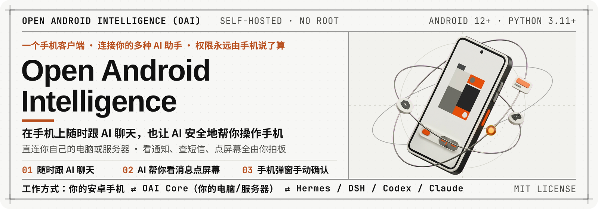
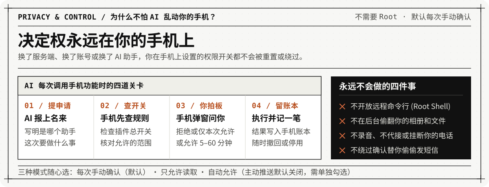

<p align="center">
  
</p>

<div align="center">

**一个帮你把安卓手机和各种 AI 助手连起来的统一客户端。**  
在手机上随时跟电脑里的 AI 聊天；AI 也能在经过你允许后，帮你看通知、查短信、点按屏幕。

[**下载安卓 APK**](https://github.com/1rua/open-android-intelligence/releases) · [**项目介绍**](#项目介绍) · [**快速开始**](#快速开始) · [**开发目录**](#开发目录)

<p>
  <a href="https://github.com/1rua/open-android-intelligence/releases/latest"></a>
  <a href="#快速开始"></a>
  <a href="./LICENSE"></a>
</p>

<sub>**简体中文** · <a href="./README.en.md">English</a></sub>

</div>

---


## 项目介绍

平时我们在电脑上用 Claude Code、Codex、Hermes、DSH 等 AI 助手时，常常遇到两个痛点：
1. **离开电脑就断联**：人一走开，没法在手机上接着看刚才的 AI 对话，也没法随手发张手机截图让它接着干活。
2. **云端 Agent 碰不到手机**：想让 AI 帮你留意一条重要通知、查个验证码短信，或者自动在手机屏幕上点几下。
3. **本地 Agent 不互通**：要操控手机只能在手机再部署一个 Agent，占内存且记忆不互通 。

**Open Android Intelligence（简称 OAI）** 就是为了解决这两件事：

| | |
| --- | --- |
| **在手机上随时跟你的 AI 聊天** | 一个安卓 App，同时连上你电脑或服务器里的 **Hermes、DSH、Codex** 等多种 AI 助手。直接接着电脑上的聊天记录聊，支持发相册图片、传文件，还能设成手机默认数字助理——长按电源键就能圈选当前屏幕画面向 AI 提问。 |
| **让 AI 帮你看消息、操作手机** | 原生 DSH 可通过 `ds-harness-remote` 内置工具，外部 Agent 可通过手机 `android_*` MCP 工具，向你的手机申请**查通知、读短信、看通话记录、截屏，或者点击、滑动屏幕**。让 Agent 留在电脑或云端，无需在手机部署本地 Agent。 |
| **决定权 100% 留在你手里的手机上** | **不需要 Root 手机。** Remote 连接不授予手机权限；能不能看短信、能不能点屏幕，全由手机 App 上的开关和本机确认决定。 |

### 手机与电脑怎样连接？

1. **Android App** 保留聊天、附件、默认助理和本机能力管理；手机权限由 Android 内核裁决。
2. **DSH Remote** 提供账号、电脑发现和加密连接；手机使用独立 Client 与 Virtual Host 身份。
3. **电脑上的 AI 后端** 通过实际发现的 Host、后端与工作区提供会话。用户手动切换目标，消息、附件与审批保持各自归属。

本仓不再提供独立 Core 服务的安装、管理员账号或旧 Gateway 配对向导。Remote 的服务和电脑端安装由上游维护。

### 为什么不怕 AI 乱动你的手机？

<p align="center">
  
</p>

- **每项功能都有独立开关和三种模式**：
  - **每次手动确认（默认）**：AI 每次想用这项功能，你的手机都会弹窗写明「是谁、想干什么」，由你点击「拒绝 / 仅本次允许 / 允许 5–60 分钟」。
  - **只允许读取**：允许查看信息（比如查通知、看屏幕），但凡涉及修改或点击的操作一律需要你手动确认。
  - **自动允许**：适合你完全信任的只读或自动化场景（注：**发短信**等敏感操作无论在什么模式下，都必须由你在手机屏幕上亲手确认）。
- **换电脑、换账号也不丢配置**：你的权限设置保存在手机本地，不会因为切换了服务端或换了 AI 助手就被偷偷重置。
- **范围精细可控**：通知可以从手机已安装的应用列表里搜索、勾选允许哪些 App 被读取；短信可以按「全部 / 关键词 / 电话号码」过滤；主动推送默认关闭，需要你单独开启并勾选允许接收的 AI。

---

## 快速开始

当前开发分支正在迁移，以下步骤说明目标连接入口；安装包与真实环境是否通过验收请先查阅[验收台账](docs/reviews/2026-11-14-dsh-remote-acceptance-index.zh-CN.md)。

### 第一步：准备 DSH Remote 电脑端

按 [DSH Remote 上游说明](https://github.com/liguobao/ds-harness-remote)安装DSH插件，并登录 Remote 账号。


### 第二步：连接 Android App 与工作区

1. 从 [Releases](https://github.com/1rua/open-android-intelligence/releases)选择安装包，核对其版本及迁移验收状态。
2. 在 Remote 连接页填写服务地址、邮箱和密码。手机与电脑 Host 使用同一 Remote 账号。
3. 刷新已登录的电脑，手动选择 Host、后端和工作区，再选择或创建对话；实际能力以远端发现结果为准。
4. 在本机设置中按需开启手机能力和系统权限；敏感动作仍须手机本机确认。
5. 本机设置支持备份与恢复。备份不包含账号密码、登录凭据、主密钥、会话历史或附件，系统授权仍须重新确认。

### 第三步：配置手机操作（原生 DSH / 手机 MCP）与 Agent Skill

- **原生 DSH**：登录 DSH Remote 并保持手机在线后，可直接由内置 `remote_*` 工具连接手机的 `harness / phone-capabilities` 工作区，按 [OAI Phone Control Skill](integrations/skills/oai-phone-control/SKILL.md) 规范操控手机，无需额外配置外部 MCP。
- **外部 Agent（Claude Code / Codex / OpenCode / Hermes ACP 等）**：使用[手机 OAI MCP](integrations/oai-android-mcp/README.md)的 DSH 进程内桥与 Stdio 入口，把生成的 `mcpServers.oai-android` 加入外部 Agent 的原生 MCP 配置，不复制 Remote token 或私钥。
- **安装 Skill**：可将 [integrations/skills/oai-phone-control](integrations/skills/oai-phone-control/SKILL.md) 目录同步到本机 Agent / DSH 技能目录（如 `~/.agents/skills/`、`~/.dsh/skills/` 等），替代已退役的旧版 `oai-client` 技能。

`oai-android-mcp` 入口只公开 `android_*` 手机工具，不提供跨工作区 Agent 委派。首次调用前核对手机目标和本机授权。
真实后端、屏幕与短信能力的支持范围继续按验收台账分别记录，不能由隔离测试推断全部可用。

---

## 开发目录

如果你想阅读源码、修改功能或自己写一个手机插件，可以按下面的目录直接找到对应代码：

```text
open-android-intelligence/
├── apps/android/                  # 📱 安卓手机 App 源码（Kotlin + Jetpack Compose）
│   ├── app/                       #    App 主界面：聊天窗口、账号配对、设置与权限开关界面
│   ├── gateway-client/            #    DSH Remote 客户端与手机虚拟主机门面（Noise 传输与控制总线）
│   ├── platform-kernel/           #    手机端权限守门员：管插件安装启用、本地权限判断与操作账本
│   ├── plugin-runtime-wasm/       #    插件安全沙箱：限制插件能用多少内存、时间和存储空间
│   ├── conversation-ui/           #    聊天消息、思考过程卡片、斜杠命令补全等界面组件
│   ├── assistant-holder/          #    系统默认数字助理入口（长按电源键唤出、屏幕圈选截图）
│   ├── ui-resources/              #    独立国际化字符串资源库（values/strings_*.xml）
│   └── ...                        #    短信、通知、通话记录、屏幕控制等各功能的安卓底层模块
│
├── plugins/                       # 🧩 官方手机能力插件源码（Rust 编写，编译为安全的 .alp 插件包）
│   ├── notifications/             #    通知查询与主动推送插件
│   ├── sms/                       #    短信查询、过滤与主动推送插件
│   ├── call-log/                  #    通话记录只读查询插件
│   ├── screen-reader/             #    屏幕文字与布局读取插件
│   ├── screen-capture/            #    屏幕截图插件
│   └── screen-control/            #    屏幕点击、滑动、输入文字与返回键操控插件
│
├── integrations/oai-android-mcp/   # 手机 MCP、进程内桥与固定上游探针
├── integrations/skills/            # DSH Remote 手机操控 Agent Skill（oai-phone-control）
├── plugin-tooling/                # 插件打包与数字签名工具
├── tools/                         # 🛠️ 开发自测脚本（如 smart-test.py 分级测试工具）
├── legacy/                        # 🗄️ 已冻结的历史归档目录（不参与现行 CI 与发布）
├── assets/readme/                 # 🎨 README 视觉图片与可编辑 SVG 源文件
├── docs/                          # 📚 详细设计文档、架构决策记录（ADR）与测试验收报告
├── CONTEXT.md                     # 📖 项目核心概念词典（遇到不熟的内部词汇可以查这里）
└── AGENTS.md                      # 🤖 代码规范、测试门禁与 Git 提交约定
```

### 开发环境与本地构建准备

在本地拉起开发或测试前，请确认基础工具链版本满足以下要求：

| 工具 / SDK | 版本要求 | 说明 |
| --- | --- | --- |
| **Node.js** | `>=24.18.0 <25` | 见 `.nvmrc` 与根目录 `package.json` |
| **Python** | `3.12+` | 用于运行 `smart-test.py`、CI 影响分析与门禁校验脚本 |
| **JDK** | `21` | 运行 Gradle 构建与 Robolectric 单测（Android 产物字节码目标为 Java 17） |
| **Android SDK** | `compileSdk 36` / `targetSdk 35` / `minSdk 31` | 用于构建 Android App 与运行单元测试 |
| **Rust** | `1.90.0`（目标 `wasm32-unknown-unknown`） | 用于编译 `plugins/` 下 6 个官方 WASM 插件 |

按以下步骤完成本地环境准备与依赖安装：

```bash
# 1. 参考环境变量模板配置本机密钥与路径（切勿提交本地 .env）
cp .env.example .env

# 2. 一键安装根目录、plugin-tooling、oai-android-mcp 及工具链依赖
make bootstrap

# 3. 编译 6 个官方手机能力插件的 WASM 载荷
make build-wasm
```

### 常用开发自测命令

改完代码后，不需要每次都把所有模块从头慢吞吞编译一遍，仓库内置了按改动范围自动挑选测试的命令：

```bash
# 1. 日常改动快速自测（自动根据 git diff 只跑你改动涉及的模块测试）
npm run test:fast

# 2. 提交 PR 前的完整准入检查（包含关联依赖模块与通信协议检查）
npm run test:pr

# 3. 发布前的全量回归测试（包含全套单元测试与安卓 APK 打包校验）
npm run test:full
```

---

## 感谢

本项目基于[ds-harness-remote](https://github.com/liguobao/ds-harness-remote)（[MIT](https://github.com/liguobao/ds-harness-remote/blob/main/LICENSE)）实现,欢迎给上游项目和本项目star

本项目采用[KaTex](https://github.com/KaTeX/KaTeX)库([MIT](https://github.com/KaTeX/KaTeX/blob/main/LICENSE))

## 开源协议

本项目基于 [MIT License](./LICENSE) 开源。
