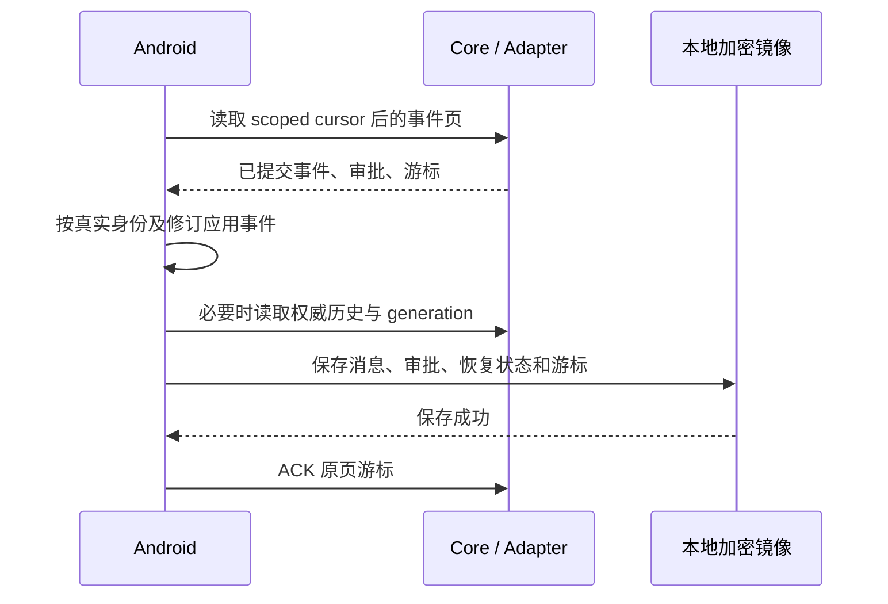

# 原生会话持久事件重放与消费确认

日期：2026-10-30。补充[生成回执与原生历史](2026-10-29-native-session-recovery.zh-CN.md)，沿用 Android → OAI Core → Session Adapter → Agent。聊天正文与工具历史仍以宿主原生记录为权威；事件缓冲复用现有账号 EventStore，消费位置保存在同一账号的 metadata，不新增会话消息数据库。

## 执行与观察

服务端可靠受理后，宿主后台任务继续执行。手机 SSE、Core 到 Adapter 的 NDJSON、事件长轮询分别是观察者，关闭它们仅解除观察。显式取消仍调用绑定真实 generation 的取消端点。设备断线不能证明宿主任务失败，也不能触发重新 POST 用户输入。

`generationRecovery` 继续表达按原 clientMessageId/generationId 查询持久执行回执。新的可选能力 `eventSync=true` 表示宿主还支持持久事件页与单调 ACK。旧宿主未声明此能力时保留现有查询及历史补偿，不假定存在消费确认。

## 公开接口

会话基础路径为 `/open-android-intelligence/v2/agents/{agentId}/sessions/{sessionId}`，以下请求继续经过现有签名认证、账号和配对检查。

| 接口 | 输入 | 响应与约束 |
| --- | --- | --- |
| `GET .../events` | 可选 `cursor`、`limit`、`waitMs` | `{events, cursor, hasMore}`。limit 为 1–128，默认 128；waitMs 为 0–25000 毫秒。事件沿账号 EventStore 的提交顺序读取。 |
| `GET .../events?snapshot=true` | 不可同时带 cursor 或非零 waitMs | `{events: [], cursor, hasMore: false, approvals}`。先固定事件高水位，再提供当前审批事实，供客户端随后补齐原生历史。 |
| `POST .../events/ack` | 严格 `{cursor}` | `{cursor}`。客户端应用并持久化成功后才发送。重复 ACK 幂等，较旧 ACK 不能回退已确认位置。 |

游标是不透明、URL 安全的字符串。客户端不解析、不排序，也不根据时间或消息正文构造游标。不带 cursor 的普通读取从该消费者的已确认位置继续；显式旧 cursor 可在保留期内重放，客户端以真实 eventId 和各自修订域幂等应用。未知字段、重复查询参数、越界数字、非法游标和自选 consumerId 均拒绝。

长轮询在真实事件提交后唤醒，或在约定期限返回；内存通知仅负责唤醒。页可以不包含本会话事件而仍推进不透明位置，例如账号中其他会话占据了这一批提交；客户端应继续处理 hasMore。文本突发不能从持久缓冲淘汰审批、工具通知或终态。

## 隔离与验证

Core 根据已认证的账号、Agent ID、设备 ID 和配对代次生成消费者身份。它通过认证后的 Adapter 桥接头传递，公开请求不能指定或覆盖。Adapter 将消费者、原生会话以及账号的加密上下文绑定到游标和 ACK；不同账号、Agent 别名、设备、配对代次或会话之间不能复用消费位置。认证在读取前和长等待返回后分别检查。

页只包含本原生会话的 conversation.message、conversation.generation、conversation.approval 事件，以及经真实受理消息关联的工具更新通知。没有 conversationId 的工具通知须同时匹配通知代码与当前会话的持久 userMessageId，不能靠文字或时间猜归属。Core 继续校验既有事件 Schema 和审批公开字段。

审批快照元素为 `{type: approval_requested | approval_resolved, approval: <现有公开结构>}`。已决审批保留其真实 decision/decidedAt；展示失败不产生任何决定。宿主内部 sessionKey、hostRequestId 和账号选择参数不会进入此结构。消费 ACK 不授予设备能力，不代替审批决定。

## Android 落地顺序

必要的消息、执行步骤、审批和恢复状态保存成功后，才推进本地消费位置并 ACK。写盘失败时保留旧位置和待处理事实；事件消费者保持可恢复。ACK 响应丢失时重试同一位置，不重发原任务。切换账号、Agent 或会话时，旧所有者不能向新作用域写入或提交 ACK。

`eventId` 表达事件身份与幂等去重；`messageId` 表达原生消息身份；`clientMessageId` 对应原始提交；`generationId` 表达真实执行轮次。消息正文修订、执行步骤修订和 generation 生命周期修订继续分开比较，不以手机时间或另一修订域替代。

## 游标过期与重启

EventStore 沿用既有保留期，默认 24 小时。快照定位使用持久提交序号，不依赖前一事件在补历史期间仍存活。清理过期事件时，在同一事务保存对应会话的最大清理序号；普通页据此区分“无新事件”和“尚未消费的事实已过期”。零位置游标和事件表全部清空时仍执行同样检查；其他会话的短期事件不会迫使当前会话反复补偿。`CURSOR_EXPIRED` 必须执行快照补偿：先取得 snapshot 高水位与审批事实，再读取并应用同一会话的宿主历史及必要的 generation 回执，完成本地保存后 ACK 该高水位；补历史期间的新事件从下一页继续读取。不能先取历史、后跳到当前事件尾部，否则会漏掉两者之间的提交。

Core 或 Adapter 对象重建后，事件和 ACK 从原账号存储恢复。Core 进程重启不应中断独立 Hermes 宿主的任务。Hermes 宿主进程真正退出属于另一生命周期：应保留可信的终态或 unknown，不根据连接恢复伪造完成，也不向模型重新提交原用户请求。宿主自带 delivery ledger/resume_pending 的重启行为，需要独立的宿主日志和实测证据，不能按 Recovered reply/System note 字符串过滤历史。

实现与验证见[专项修复报告](../reviews/2026-10-30-dev-reliability.zh-CN.md)。
