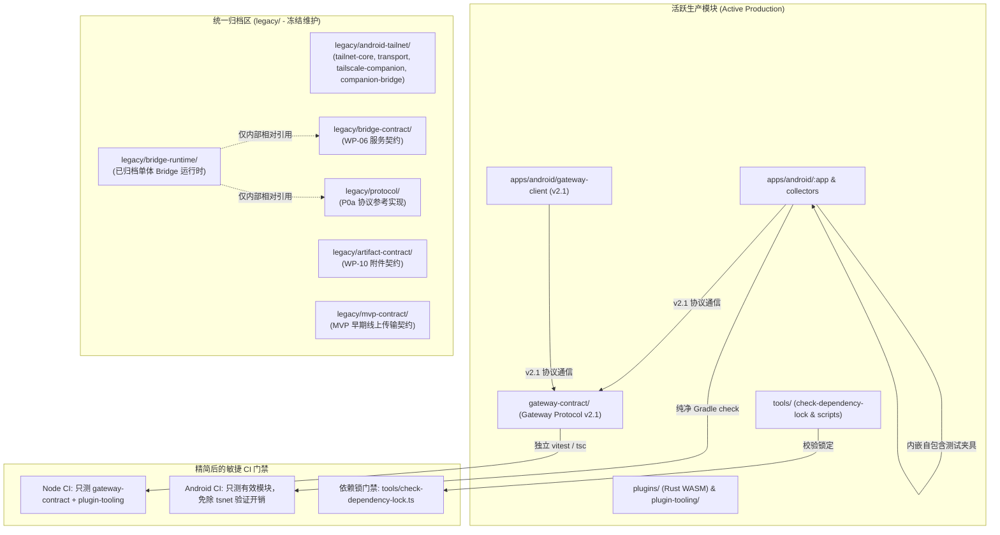

# 全仓架构解耦、代码瘦身与遗留目录归档实施方案

> **状态**：待用户审批 (Planning Mode)  
> **适用范围**：废弃 Tailnet 方案退役、根目录历史契约归档、CI 测试精简、依赖平滑过渡

---

## 一、方案目标与背景

随着项目全面演进为 **Gateway Protocol v2.1** 及**原生 WASM 插件系统**，项目早期探索阶段的部分单体和实验性架构已不再被生产环境使用：
1. **Tailnet / tsnet 方案已正式废弃**：Android 端现已全面采用基于系统网络栈的 HTTPS / WSS Gateway 直连，原先挂载的 userspace Tailnet（tsnet AAR、AIDL 伴生进程、独立 VPN 扫描门禁）已切断关闭，但依然留在 Gradle 工程中，每次构建和测试都耗费大量算力；
2. **P0a 语言中立协议（v1）与旧 Bridge 契约已完成历史使命**：现行所有端侧与 Agent 通信均遵循 `gateway-contract/`；
3. **CI 存在大量不必要的测试开销**：CI 流水线（`.github/workflows/ci.yml`）仍在全量扫描、类型检查和测试已经被废弃的旧协议和旧运行时；
4. **部分遗留依赖未解耦**：如 Android 通话记录测试硬编码查找 `mvp-contract/fixtures/`，以及依赖锁门禁工具被放置在 `mvp-contract/tools/` 下。

本方案旨在**平滑解耦活跃代码的依赖、将所有过期模块整齐归档至 `legacy/`、精简 CI 测试与构建耗时**，在保证 100% 功能不受影响的前提下完成仓库瘦身。

---

## 二、需要用户审阅的核心决策 (User Review Required)

> [!IMPORTANT]
> **1. 废弃 Tailnet 方案的 Android 模块退出生产构建**
> `apps/android/tailnet-core`（包含 ~15MB 的 `tsnet-android-1.98.10.aar` 二进制）、`apps/android/transport`、`apps/android/tailscale-companion`、`apps/android/companion-bridge` 将从 `apps/android/settings.gradle.kts` 中移除，并整体归档到 `legacy/android-tailnet/`。主 APK 与所有现行模块不再编译或引入它们。
> 
> **2. 依赖锁门禁工具提升至 `tools/` 根工具集**
> `mvp-contract/tools/check-lock.ts` 承载着生产依赖（OpenClaw、Hermes、TSNet 证据锁）的防篡改校验，本方案将其正式迁移并更名为 `tools/check-dependency-lock.ts`，相关 npm 脚本升级为 `npm run lock:check`。
> 
> **3. 根目录四个历史契约目录统一归档**
> `protocol/`、`bridge-contract/`、`artifact-contract/` 及剩余的 `mvp-contract/` 统一移入 `legacy/` 目录；`legacy/` 将被配置为测试排除目录，不再参与日常 CI 的默认运行。

---

## 三、架构解耦与归档全景设计



---

## 四、具体修改方案与步骤 (Proposed Changes)

### 阶段一：平滑解耦 Android 模块与依赖锁工具（保证功能不受影响）

#### 1. Android 通话测试夹具自包含
* **现状**：[`CallLogWireCodecTest.kt`](file:///mnt/data/projects/open-android-intelligence/apps/android/call-log-collector/src/test/kotlin/com/openandroidintelligence/calls/CallLogWireCodecTest.kt) 动态向上遍历父目录寻找 `mvp-contract/fixtures/v1/`。
* **改动**：
  * **[NEW]** `apps/android/call-log-collector/src/test/resources/fixtures/v1/call-record-released.json`
  * **[NEW]** `apps/android/call-log-collector/src/test/resources/fixtures/v1/call-record-withheld.json`
  * **[MODIFY]** `apps/android/call-log-collector/src/test/kotlin/com/openandroidintelligence/calls/CallLogWireCodecTest.kt`：改用标准 `javaClass.classLoader.getResourceAsStream(...)` 读取 Classpath 资源，彻底消除跨目录依赖。

#### 2. 依赖锁校验工具提升至全仓工具集
* **现状**：`mvp-contract/tools/check-lock.ts` 被 `package.json` 的 `mvp:lock:check`、`tools/compute-lock-hashes.ts` 引用。
* **改动**：
  * **[NEW]** `tools/check-dependency-lock.ts`（由 `mvp-contract/tools/check-lock.ts` 迁移并升级适配路径）；
  * **[NEW]** `tools/check-dependency-lock.test.ts`（由 `mvp-contract/test/dependency-lock.test.ts` 迁移，继续保护 OpenClaw/Hermes/TSNet 依赖不漂移）；
  * **[MODIFY]** `tools/compute-lock-hashes.ts`：更新 import 路径为 `./check-dependency-lock.ts`；
  * **[MODIFY]** 根目录 `package.json`：新增 `"lock:check": "node --experimental-strip-types tools/check-dependency-lock.ts"`，原 `"mvp:lock:check"` 作为兼容别名重定向到新脚本。

---

### 阶段二：现行网关与工具链自立门户（为 CI 精简做准备）

#### 1. 为 `gateway-contract/` 设立独立的测试与编译配置
* **[NEW]** `gateway-contract/vitest.config.ts`：
  ```ts
  import { defineConfig } from "vitest/config";
  export default defineConfig({
    test: {
      environment: "node",
      env: { TZ: "UTC" },
      fileParallelism: false,
      maxWorkers: 1,
      minWorkers: 1,
      testTimeout: 10_000
    }
  });
  ```
* 验证在 `gateway-contract/` 目录下独立运行 `npm test` 和 `npm run typecheck`。

#### 2. 收敛根目录 `vitest.config.ts` 与 `tsconfig.json`
* **[MODIFY]** `vitest.config.ts`：增加 `"legacy/**"` 到 `exclude` 列表；
* **[MODIFY]** `tsconfig.json`：移除 `"include": ["protocol/**/*.ts"]`，改为覆盖 `tools/**/*.ts` 等公共辅助工具；
* **[MODIFY]** 根目录 `package.json`：
  ```json
  "scripts": {
    "test": "npm test --prefix gateway-contract && npm test --prefix plugin-tooling",
    "typecheck": "npm run typecheck --prefix gateway-contract && npm run typecheck:tools --prefix gateway-contract && npm run typecheck --prefix plugin-tooling",
    "gateway:v2:conformance": "tsx gateway-contract/tools/run-openclaw-conformance.ts && python3 gateway-contract/tools/run-hermes-conformance.py && npm test --prefix gateway-contract -- test/cross-host-conformance.test.ts",
    "lock:check": "node --experimental-strip-types tools/check-dependency-lock.ts",
    "mvp:lock:check": "npm run lock:check"
  }
  ```

---

### 阶段三：归档废弃代码与模块至 `legacy/`

遵循仓库安全规程，**严禁使用任何永久删除命令**，使用 `git mv`（或保留版本历史的移动）进行归档：

#### 1. 归档 Android Tailnet 系列废弃模块
* 移动目标：
  * `apps/android/tailnet-core` -> `legacy/android-tailnet/tailnet-core`
  * `apps/android/transport` -> `legacy/android-tailnet/transport`
  * `apps/android/tailscale-companion` -> `legacy/android-tailnet/tailscale-companion`
  * `apps/android/companion-bridge` -> `legacy/android-tailnet/companion-bridge`
* **[MODIFY]** `apps/android/settings.gradle.kts`：移除 `:tailnet-core`、`:transport`、`:tailscale-companion`、`:companion-bridge`；
* **[MODIFY]** `apps/android/app/build.gradle.kts`：移除未使用的 `implementation(project(":companion-bridge"))`；
* **[MODIFY]** `apps/android/build.gradle.kts`：从 `appAndroid12RuntimeLibraries` 中移除 `:companion-bridge`；
* **[MODIFY]** `apps/android/gradle/mvp-forbidden-surfaces.gradle.kts`：清理不再参与构建的 `tailscale-companion`、`companion-bridge` 及 `tailnet-core` 规则。

#### 2. 归档根目录四个历史契约目录
* 移动目标：
  * `protocol/` -> `legacy/protocol/`
  * `bridge-contract/` -> `legacy/bridge-contract/`
  * `artifact-contract/` -> `legacy/artifact-contract/`
  * `mvp-contract/`（解耦后的剩余部分） -> `legacy/mvp-contract/`
* **[MODIFY]** `legacy/bridge-runtime/`：修正内部 25 处对旧契约的相对 import 路径（由 `../../../bridge-contract` 改为 `../bridge-contract`，`../../../protocol` 改为 `../protocol`），确保历史代码在 `legacy/` 内部自包含闭环；
* **[NEW]** `legacy/README.md`：详细记录归档说明、废弃原因及只读冻结声明。

---

### 阶段四：精简 CI 流水线测试任务 (`.github/workflows/ci.yml`)

* **[MODIFY]** `.github/workflows/ci.yml`：
  1. `gateway-and-protocol` Job：
     - `Typecheck` 步骤：直接执行现行模块检查，不再对已归档的 `protocol` 进行检查；
     - `Run Gateway Tests` 步骤：执行 `npm test`（只运行 `gateway-contract` 与 `plugin-tooling` 的测试），不再跑 `protocol` 的 29 个旧测试；
     - 增加 `npm run lock:check` 步骤验证生产依赖锁。
  2. `android` Job：
     - 执行 `./gradlew check` 时，Gradle 将不再构建和检查 `:tailnet-core`，直接消除 `verify-tsnet-aar.py` 对 Python 环境和 15MB AAR 的依赖，构建时间显著缩短。

---

## 五、验证计划 (Verification Plan)

所有改动遵循“先测试验证，确认全部通过后再提交”的铁律：

### 1. 自动化单元与契约测试
```bash
# 1. 验证 Android 通话记录测试夹具自包含且 100% 通过
cd apps/android && ./gradlew :call-log-collector:test

# 2. 验证提升后的依赖锁门禁工具正常工作
cd /mnt/data/projects/open-android-intelligence
npm run lock:check

# 3. 验证现行 Gateway Protocol v2.1 独立测试与跨端一致性
npm run typecheck
npm run gateway:v2:conformance
npm test

# 4. 验证 Android 全仓 check 与 APK 打包完全通过（免除 tsnet 开销）
cd apps/android && ./gradlew check :app:assembleFullDebug
```

### 2. 回归与安全审查
- 运行 `python tools/check-openclaw-plugin-pin.py` 验证插件锁定不受影响；
- 运行 Android 禁用网络面审查：`./gradlew checkForbiddenSurfaces`；
- 启动独立代码审查子 Agent 对所有改动进行 Code Review，重点确认无遗留孤立依赖或配置损坏。
