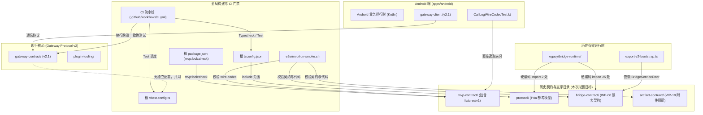
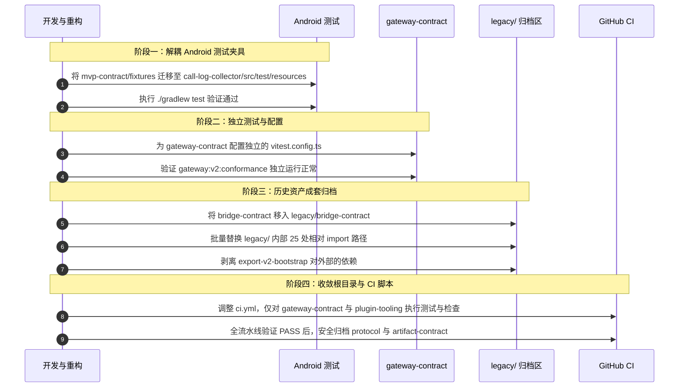

# 根目录历史契约与配置文件删除可行性评估报告

> **报告日期**：2026-10-24  
> **评估范围**：根目录下勾选的 4 个目录（`artifact-contract/`、`bridge-contract/`、`mvp-contract/`、`protocol/`）与 2 个配置文件（`tsconfig.json`、`vitest.config.ts`）  
> **评估结论**：**全部严禁直接删除**。各目录与文件均存在直接代码导入、Android 单元测试硬编码读取或 CI 门禁强绑定。直接删除会导致 Android 编译/测试挂死、全仓 TypeScript 报错或 CI 流水线全面变红。

---

## 一、评估结论汇总表

| 检查目标 | 类型 | 最新 App 生产代码 | 最新 App 测试代码 | CI / 脚本强绑定 | 删除可行性 | 风险等级 |
| :--- | :---: | :---: | :---: | :---: | :---: | :---: |
| [`mvp-contract/`](file:///mnt/data/projects/open-android-intelligence/mvp-contract) | 目录 | 否（已镜像） | **是（硬编码读取）** | **是（根脚本+门禁）** | ❌ **绝对不可删** | 🔴 极高（构建/测试立即瘫痪） |
| [`protocol/`](file:///mnt/data/projects/open-android-intelligence/protocol) | 目录 | 否 | 否 | **是（CI+Legacy强依赖）** | ❌ **绝对不可删** | 🔴 极高（CI Typecheck即刻挂死） |
| [`tsconfig.json`](file:///mnt/data/projects/open-android-intelligence/tsconfig.json) | 配置文件 | 否 | 否 | **是（根构建入口）** | ❌ **绝对不可删** | 🔴 极高（TypeScript 编译报错） |
| [`vitest.config.ts`](file:///mnt/data/projects/open-android-intelligence/vitest.config.ts) | 配置文件 | 否 | 否 | **是（全仓唯一测试配置）** | ❌ **绝对不可删** | 🔴 极高（并发测试雪崩/时区错乱） |
| [`bridge-contract/`](file:///mnt/data/projects/open-android-intelligence/bridge-contract) | 目录 | 否 | 否 | **是（Legacy强依赖+E2E）** | ❌ **绝对不可删** | 🟠 高（Legacy崩溃/冒烟失败） |
| [`artifact-contract/`](file:///mnt/data/projects/open-android-intelligence/artifact-contract) | 目录 | 否 | 否 | **是（E2E冒烟+架构审计）** | ❌ **绝对不可删** | 🟡 中高（冒烟测试/就绪审计失败） |

---

## 二、架构依赖全景图

下图清晰呈现了现行系统（Android App、Gateway Protocol v2）与历史系统（Legacy Bridge、P0a Protocol、MVP Contract）之间的交错依赖关系：



---

## 三、各目标深入排查细节

### 1. `mvp-contract/`（MVP 核心传输契约）
* **定位**：MVP 阶段规范权威源（Single Source of Truth），包含严格校验的 JSON Schema（Call、SMS、Notification、Assistant Chat）、双向无歧义编解码器 `wire-codec.ts`、黄金数据夹具以及依赖锁门禁工具。
* **致命依赖证据**：
  1. **Android 原生单元测试直接读取**：
     [`CallLogWireCodecTest.kt`](file:///mnt/data/projects/open-android-intelligence/apps/android/call-log-collector/src/test/kotlin/com/openandroidintelligence/calls/CallLogWireCodecTest.kt) 中直接动态遍历目录并打开 `mvp-contract/fixtures/v1/call-record-released.json` 和 `call-record-withheld.json`。删除该目录后，运行 `./gradlew :call-log-collector:test` 会直接抛出 `IllegalStateException: fixture not found`！
  2. **根目录 npm scripts 绑定**：
     [`package.json`](file:///mnt/data/projects/open-android-intelligence/package.json) 第 13 行定义了 `"mvp:lock:check": "node --experimental-strip-types mvp-contract/tools/check-lock.ts"`。
  3. **哈希工具代码导入**：
     [`tools/compute-lock-hashes.ts`](file:///mnt/data/projects/open-android-intelligence/tools/compute-lock-hashes.ts) 第一行即为 `import { sha256Evidence } from "../mvp-contract/tools/check-lock.ts"`。
  4. **门禁与测试活跃维护**：
     `mvp-contract/test/dependency-lock.test.ts` 锁定全仓生产依赖防漂移（包括 OpenClaw、Hermes、TSNet），该文件在最近（2026年10月中旬 commit `8bd21427`）仍持续更新维护。

### 2. `protocol/`（P0a 语言中立协议参考模型）
* **定位**：项目最初规划的 P0a 语言中立参考协议，涵盖 22 项安全规范（防重放窗口、凭据轮换、离线操作状态机等）及其 29 个测试套件。
* **致命依赖证据**：
  1. **CI 编译门禁（Typecheck）写死绑定**：
     根目录 [`tsconfig.json`](file:///mnt/data/projects/open-android-intelligence/tsconfig.json) 唯一定义了 `"include": ["protocol/**/*.ts"]`。CI 的 `Typecheck` 步骤第一条命令即为 `npm run typecheck`。若删除 `protocol/`，TypeScript 编译器因无任何输入文件报错 `error TS18003: No inputs were found`，CI 门禁立即变红中断。
  2. **历史代码硬编码导入**：
     `legacy/bridge-runtime/src/durable-task9-event-path.ts` 直接导入了：
     ```ts
     import { ... } from "../../../protocol/src/event-contract.js";
     import { ... } from "../../../protocol/src/replay-window.js";
     ```
     删除会导致历史运行时模块编译报错、测试崩溃。

### 3. `tsconfig.json` 与 `vitest.config.ts`（根构建与测试核心配置）
* **致命依赖证据**：
  1. **`tsconfig.json`**：根目录类型检查的唯一配置文件，删除后执行 `npm run typecheck` 直接抛出 `error TS5083: Cannot read file 'tsconfig.json'`，CI 立即挂掉。
  2. **`vitest.config.ts`**：**全仓库唯一的 Vitest 运行配置**。
     * 当前处于核心地位的 `gateway-contract/` 目录下**根本没有配置独立的 `vitest.config.ts`**；
     * CI 中执行的跨宿主网关一致性测试（`npm run gateway:v2:conformance`）和全仓测试（`npm test`）全部依赖该根配置文件；
     * 该文件提供了三大核心安全保障：
       - `exclude: [".worktrees/**", ".toolchains/**", "third_party/**"]`：避免将临时工作树和外部依赖误当测试执行；
       - `maxWorkers: 1`：强制单线程串行执行，防止涉及文件读写、端口绑定和 SQLite 操作时发生并发争用（Race Condition）；
       - `env: { TZ: "UTC" }`：锁定 UTC 时区，避免时间戳解析在不同时区机器上断言失败。
     * **删除后果**：导致现行网关与跨端一致性测试失去环境隔离和并发保护，CI 测试随机报错雪崩。

### 4. `bridge-contract/`（Device Bridge 服务契约）
* **定位**：旧单体架构下 Device Bridge 服务层抽象与测试契约缝（WP-06）。
* **致命依赖证据**：
  1. **历史模块存在 25 处直接相对引用**：
     `legacy/bridge-runtime/` 共有 14 个源码文件和 11 个测试文件直接通过相对路径引用 `bridge-contract/src/...`。
  2. **关键迁移工具阻断**：
     旧系统向新网关配置平滑迁移的核心工具 `legacy/bridge-runtime/tools/export-v2-bootstrap.ts`，直接导入了 `bridge-contract/src/service-types.js` 中的 `BridgeServiceError`。
  3. **冒烟测试与就绪审计检查**：
     `e2e/mvp/run-smoke.sh` 显式执行了 `bridge-contract/test` 的测试与编译；`mvp-contract/tools/mvp-readiness.ts` 在审计 WP-06 工件时直接断言该目录下 14 个文件的存在性。

### 5. `artifact-contract/`（附件凭据生命周期规范）
* **定位**：MVP 阶段 Task 11 / M1.1 附件门禁/凭据生命周期纯 TypeScript 规范参考。
* **致命依赖证据**：
  * 虽然 Android 端已在 Kotlin 内部实现并沉淀为独立组件，但 `e2e/mvp/run-smoke.sh` 冒烟脚本与 `mvp-contract/tools/mvp-readiness.ts` 审计脚本（WP-10）显式校验其存在性。删除后将直接导致端到端冒烟测试与交付就绪审计无法通过。

---

## 四、核心疑问专项解答

### 疑问 1：这些在最新的 App 代码中还有使用吗？
* **运行时代码（APK 运行）**：
  * **没有直接使用** `protocol/`、`artifact-contract/`、`bridge-contract/` 以及根目录的 Node 配置文件。
  * 最新 App 采用 Kotlin 编写，完全运行在 Android / JVM 环境，与后端的通信遵循的是定义在 `gateway-contract/` 中的 **Gateway Protocol v2.1**。
* **自动化测试代码（CI 与本地验证）**：
  * **正在直接使用 `mvp-contract/`**！Android 的通话测试套件 `CallLogWireCodecTest.kt` 必须动态读取 `mvp-contract/fixtures/v1/` 下的数据包。

### 疑问 2：CI 目前的测试包含这些，还有必要吗？
* **从“技术演进与设计解耦”角度**：
  * `protocol/`、`bridge-contract/` 以及 `artifact-contract/` 确实属于历史早期单体时期的产物，对验证最新 Android App 的日常功能来说，持续对其运行测试属于**技术债务与历史负担**。
* **从“当前工程实现与门禁现状”角度**：
  * **目前属于必须存在的现状**。因为 CI 流水线（`.github/workflows/ci.yml`）目前采取的是全仓大一统门禁（直接跑 `npm test` 和 `npm run typecheck`），将新旧模块紧密耦合在一起。
  * 在没有对 CI 流水线和 npm scripts 进行重构解耦之前，直接删除这些目录会直接让 CI 变红，阻断日常 PR 合并与发布。

---

## 五、安全解耦与仓库瘦身实施路线图

如果后续计划精简仓库根目录、卸掉历史包袱，**严禁使用任何永久删除命令**，必须遵循以下四阶段分步安全重构：



### 1. 第一阶段：消除 Android 测试对外部物理路径的依赖
* 将 `mvp-contract/fixtures/v1/` 下的通话夹具文件复制并正式纳入 `apps/android/call-log-collector/src/test/resources/fixtures/`；
* 改造 `CallLogWireCodecTest.kt`，改用标准 ClassLoader / Resources API 读取，解除向项目根目录寻找物理文件的耦合；
* 运行 `./gradlew :call-log-collector:test` 验证 100% 通过。

### 2. 第二阶段：让现行网关模块自立门户
* 在 `gateway-contract/` 和 `plugin-tooling/` 下各自创建专属的 `vitest.config.ts`，将单线程、UTC 时区和排除规则内化到子模块；
* 验证在子目录下执行 `npm test` 行为完全一致。

### 3. 第三阶段：历史代码成套移入 `legacy/` 归档
* 将 `bridge-contract/` 移动至 `legacy/bridge-contract/`；
* 批量调整 `legacy/bridge-runtime/` 内部的 25 处导入路径（将 `../../../bridge-contract` 改为 `../bridge-contract`）；
* 将 `export-v2-bootstrap.ts` 所需的简单错误类自包含，解除对外部契约包的依赖；
* 同步更新 `e2e/mvp/run-smoke.sh` 中的路径指向。

### 4. 第四阶段：收敛根目录 package.json 与 CI 流水线
* 调整 `.github/workflows/ci.yml`：
  - 将 `npm run typecheck` 细化为 `npm run typecheck --prefix gateway-contract` 和 `npm run typecheck --prefix plugin-tooling`；
  - 将 `npm test` 细化为针对各子包执行；
* 确认全仓自动化测试与 CI 流水线 100% 通过；
* 此时方可将 `protocol/` 与 `artifact-contract/` 进行安全归档。若确需删除，必须使用 `trash-cli`（`trash-put`）移入回收站，严禁使用 `rm`。
