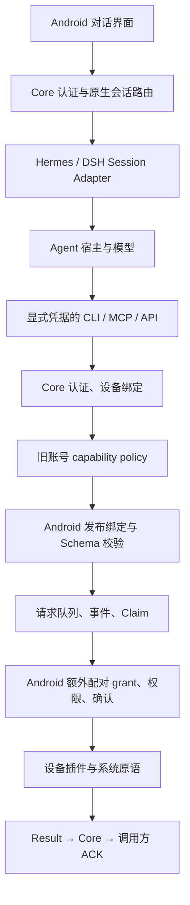
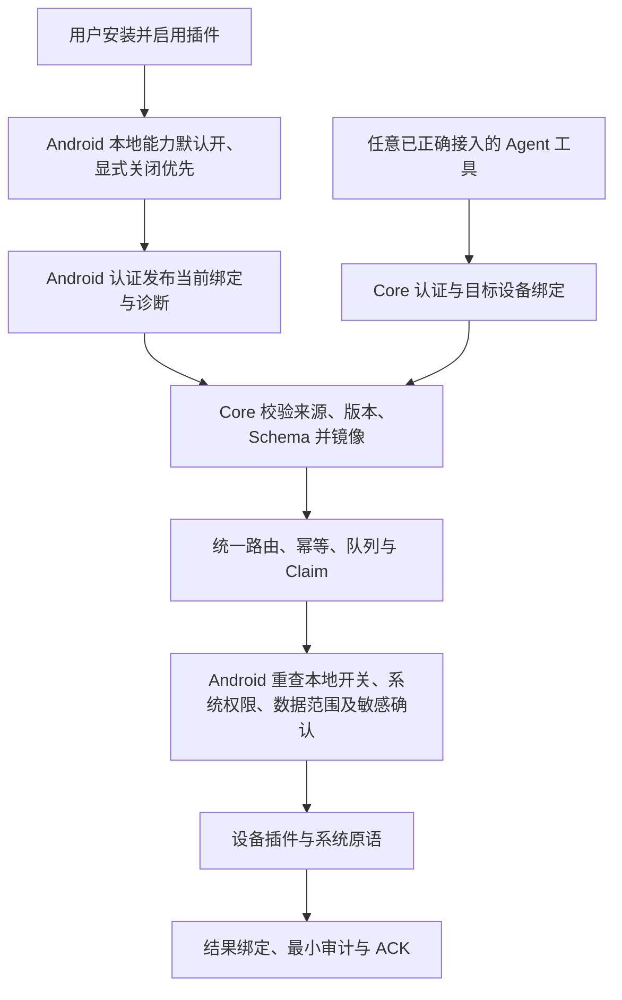

# 设备能力授权设计偏移：只读排查与完整修复计划

> **历史阶段说明（2026-10-28 后续更新）**：本文及其[Core 证据记录](2026-10-28-device-capability-authorization-core-evidence.zh-CN.md)固定记录 `dev@e5c7f42a59262f404888858045aa975830dafb61` 的只读排查，保留当时源码事实、旧验证结果及原 32 份 Markdown 文件清单。本文中的“待 Review / 未执行修复”只描述该历史阶段，不是当前 feature 分支状态。分支实现与验证见[实施记录](2026-10-28-device-capability-authorization-implementation.zh-CN.md)：实现位于 `feature/android-device-authority-20261028`，待 PR 合入 `dev` 和真机验收。不得把 e5 静态排查或其 Fast 环境失败改写成实现测试结果。

日期：2026-10-28。状态：**待 Review 的计划，未执行修复**。

排查基线为 `dev@e5c7f42a59262f404888858045aa975830dafb61`。开始时本地工作区干净，
本地 HEAD、`git ls-remote origin refs/heads/dev` 与 GitHub 的 dev 分支 API 返回同一 SHA。
所有行号以该提交为准。补充的 Core 证据见
[Core 证据记录](2026-10-28-device-capability-authorization-core-evidence.zh-CN.md)。
目标需求见[授权需求修订](../superpowers/specs/2026-10-28-device-capability-authorization.md)，
架构决定见 [ADR-0059](../adr/0059-android-is-the-sole-device-capability-authority.md)。

共享工作区说明：执行期间本地 HEAD 新增 `05b116aa3c7d17b7635575d6d86e3bd1715c5c34`，
只改动 `scripts/install.sh`、`scripts/setup.sh`、`tests/test_install_script.py`；
本任务未执行该提交，也未改动或回滚这些文件。最终核对时远端 dev 仍为上述 `e5c7f42a`。
本计划引用的授权源码未被新增提交改动，代码证据仍固定于 `e5c7f42a`；工作区文档检查以
新增提交之后的 HEAD 为比较基准，避免把已有提交误计为本任务改动。

上述只读范围仅适用于 e5 基线排查阶段：当时只阅读源码、现有测试和文档，并修改 Markdown，
没有调用设备能力、访问用户账号数据库、读取设备日志、修改运行配置或执行迁移。随后 feature
分支按本计划实施了源码和测试变更；当前代码与验证事实以实施记录为准。
“已确认”仅指基线源码可证明的条件；用户实际部署、账号历史值和系统权限均未据此冒认。

## 1. 现象、已确认根因与影响

用户报告 Call Log Query、Notifications Query、SMS Query 已启用，但界面仍显示
“当前 Gateway 账号未启用；请通过 Gateway 能力配置开启”。源码确认插件启用状态、
Android 本地配对 grant、Core 账号能力策略来自不同状态源，现行代码仍把后两者都作为条件。
Hermes 新会话插件只负责桥接，没有旧设备授权 setup；因此该引导与重构后的职责不一致。

### 1.1 已确认原因

| 编号 | 确认事实与证据 | 影响 |
| --- | --- | --- |
| F1 | [PluginManagementScreen.kt](../../apps/android/app/src/main/kotlin/com/openandroidintelligence/mobile/plugins/PluginManagementScreen.kt)，能力行 420–423 优先显示 `gatewayStatuses[entry.id]`；`capabilityStatusLabel()` 496–508 把 `GATEWAY_DISABLED` 映射为上述提示 | “插件已启用”不覆盖远端状态；READY 文案“Gateway 与 Android 授权已就绪”同样暗含双权威 |
| F2 | [CapabilityPublisher.kt](../../apps/android/app/src/main/kotlin/com/openandroidintelligence/mobile/plugins/CapabilityPublisher.kt)，`sync()` 22–27 读取 `GET /v2/pairings/current` 的 `capabilityPolicy/capabilities`；[GatewayRuntime.kt](../../apps/android/app/src/main/kotlin/com/openandroidintelligence/mobile/GatewayRuntime.kt) 1293–1303 将目录状态传给界面 | 提示确实来自服务端目录，不能仅由该文案推断 Android 权限缺失 |
| F3 | [capability_policy.py](../../oai-core/src/oai_core/gateway/capability_policy.py)，`DeviceCapabilityPolicy.snapshot/allows/set` 14–55、`capability_catalog()` 58–95：读取各账号 `account_metadata[device-capability-policy:v1]`，仅 `enabled[id]` **显式为 false** 才覆盖目录为 `GATEWAY_DISABLED`，**缺项默认允许** | 存在额外服务端否决权；“没有 setup 导致缺配置默认关闭”不是本基线代码事实 |
| F4 | [capability_bindings.py](../../oai-core/src/oai_core/gateway/capability_bindings.py)，`available/validate()` 120–132 过滤旧 policy；[core.py](../../oai-core/src/oai_core/gateway/core.py)，`DeviceRequestStore.enqueue/claim/submit_result` 2718–2877、重放/读结果 2879–2937、`_assert_capability_enabled()` 3040–3046 再次检查 | 不只是显示问题；新请求、认领、结果提交和读取均可能拒绝。入口先过滤绑定时可只返回 `CAPABILITY_DENIED`；`GATEWAY_DISABLED` 是目录状态，不应写成所有请求的 HTTP 错误码 |
| F5 | [ProductionPluginHost.kt](../../apps/android/app/src/main/kotlin/com/openandroidintelligence/mobile/plugins/ProductionPluginHost.kt)，`enable/enableVerified()` 206–237 不创建能力许可；`grant()` 245–250 单独写 capability/primitive 和作者身份 grant；`capabilitySnapshot()` 254–289 在 263–264 要求这些 grant 全部存在 | 即使移除 Core 开关，已启用插件仍可能 `LOCAL_GRANT_REQUIRED`；目标默认开启必须在 Android 同时落实 |
| F6 | [PairingGrantState.kt](../../apps/android/platform-kernel/src/main/kotlin/com/openandroidintelligence/kernel/PairingGrantState.kt) 45–50 默认空集合；[CapabilityGrant.kt](../../apps/android/platform-kernel/src/main/kotlin/com/openandroidintelligence/kernel/CapabilityGrant.kt)，`EffectiveCapabilities.compute()` 68–92 将 grant 纳入交集；[PluginKernel.kt](../../apps/android/platform-kernel/src/main/kotlin/com/openandroidintelligence/kernel/PluginKernel.kt)，`requireIdentityGrant()` 152–155、`invoke()` 255–286 真正执行限制 | 不能只让能力目录显示 READY；需要改变本地有效能力计算，保留作者身份、隔离和撤权检查 |
| F7 | [PairingGrantPersistence.kt](../../apps/android/app/src/main/kotlin/com/openandroidintelligence/mobile/PairingGrantPersistence.kt)，`load/save/clear()` 14–53：缺省与历史撤销都可留下空 `granted`；`PairingGrantStateHolder.bind/updatePrimitives/clearCurrent()` 109–150 没有独立的显式关闭记录 | 无法仅凭空集合判断用户是否主动拒绝；直接补齐全部 grant 会覆盖历史用户决定 |
| F8 | `CapabilityPublisher.sync/observeChange/recordForeignRevision()` 32–36、67–76；`GatewayRuntime` 1295、`handlePlatformEvent()` 1859–1874：不能关联的较新远端 revision/digest 会取消执行并清空本地 grant | 旧同步语义仍可擦除手机状态；应保留旧请求失效和重新同步，不再由远端改写本地决定 |
| F9 | [gateway/admin.py](../../oai-core/src/oai_core/gateway/admin.py)，`AdminService.capabilities()` 290–336 关闭策略时写 `device-request-policy-revoked:{requestId}`、清正文/结果及取消；[cli.py](../../oai-core/src/oai_core/cli.py)，`_local_admin()` 84–110 的 `oai policy set` 只写策略 | 两种历史写入口后果不同；不能假定关闭过的请求都带撤销标记，也不能清除标记让旧请求复活 |
| F10 | [Hermes bridge.py](../../integrations/hermes-session-adapter/src/oai_hermes_adapter/bridge.py)，`register()` 223–250 仅注册平台，`create_hermes_bridge_app()` 32–76、207–220 提供认证后的会话/附件/审批/命令路由；[DSH index.js](../../integrations/dsh-session-adapter/index.js)，`createSessionHandler()` 60–77、174–237 与 `apply()` 245–253 提供会话桥 | 已核对仓库内两种桥不提供旧设备授权 setup，桥不是每次设备调用的必经节点。宿主账号 allowlist 和桥 Token 是会话访问边界，须保留 |
| F11 | [SettingsScreen.kt](../../apps/android/app/src/main/kotlin/com/openandroidintelligence/mobile/SettingsScreen.kt) 1327–1332、1368–1408 已有屏幕设置导航/页面；[ScreenCapabilityController.kt](../../apps/android/app/src/main/kotlin/com/openandroidintelligence/mobile/screen/ScreenCapabilityController.kt) `startSession/revokeSession` 100–132 与 [MainActivity.kt](../../apps/android/app/src/main/kotlin/com/openandroidintelligence/mobile/MainActivity.kt) 408–448 已有本地会话、投屏回调接线 | 两份屏幕指南原先“前端均待接入”已过期；本次纠正为源码已有入口，不把是否存在 UI 误当该提示根因，也不据此宣称真机验收通过 |

Core 的 C01–C13 细证据还覆盖 `GatewayCore.handle()` 的发布、Claim/Result 分支、
`GatewayAccount.bump_grant_revision()`、认证与防重放，见补充记录。上述判断没有依赖旧记忆
中的版本或某次历史 CI 结果。

### 1.2 影响范围与不能直接得出的结论

账号策略按 capability ID 保存，没有设备、作者或版本维度，因此同账号多设备发布同能力均可
受旧关闭值影响。短信、通知、通话记录和新屏幕插件共用此门禁，第三方设备能力也会受影响；
不是三个 UI 名称的单独故障。仅会话读取、普通聊天和附件链路不能据此认定已失败。

| 待验证假设 | 当前证据边界 | 后续只读验证所需最小证据 |
| --- | --- | --- |
| H1 用户账号确有显式旧 false | 源码证明这一条件产生提示，未读目标账号库 | 运行包/提交、目标账号单一 policy key 的能力 ID、布尔值、revision；不导出凭据/正文 |
| H2 运行服务还是旧 Gateway 或其他 Core 版本 | 仓库 dev 不等于用户部署 | 进程入口、安装包版本和配置指向、单进程所有权；不停止或替换服务 |
| H3 Android 有旧 pending/ack 或空 grant | 已确认存储格式和恢复路径，未读手机数据 | 同一配对的本地模型版本、revision、publication 摘要和脱敏状态；不清空 App 数据试错 |
| H4 系统权限或通知范围也未满足 | 远端状态可遮住 `androidStatus`，取消 policy 不保证 READY | 对同一能力核对 Android inventory、本地开关、系统权限、监听与数据范围 |
| H5 损坏 policy 影响目录 | `snapshot()` 可报 `CAPABILITY_POLICY_INVALID`，与显式 false 不同 | 限定读取并校验旧结构；不能通过写空值把损坏默认为已授权 |

## 2. 安全层级和目标规则

| 层级 | 谁决定 | 保留或调整 |
| --- | --- | --- |
| 身份认证 | Core 验证账号、Token、TLS、设备签名、nonce 与会话 | 全部保留；取消能力开关不允许匿名调用 |
| 设备绑定与账号隔离 | Core/Android 共同绑定账号、安装实例、设备与配对 generation | 保留；模型不得覆盖这些字段，设备凭据不随共享会话传播 |
| 插件能力开关 | **Android 唯一权威** | 已验证、已安装且启用插件的能力默认开；本地显式关闭优先；不需要远端账号许可或重复正向配对 grant |
| 系统与数据访问 | Android 系统权限、本地通知范围、屏幕许可、资源限制 | 保留；默认能力开启不等于允许采集所有数据或允许后台推送 |
| 敏感执行 | Android 对原请求、参数摘要、前台状态、当前屏幕/会话做确认 | 保留；写操作及高风险操作按现有风险模型确认，远端不得代批 |
| 发现、协议与路由 | Core 校验 Android 状态、Schema、提供者、版本及请求生命周期 | 保留为事实和一致性检查，不再加入账号 policy 许可交集 |
| 宿主会话接入 | 会话桥 Token、宿主账号 allowlist、真实操作能力 | 保留；这些不是设备 capability grant |

目标有效能力由 Android 计算：宿主支持范围、已验证插件声明及身份、插件启用与本地默认/显式
状态、本地安全限制、系统权限及当前请求约束共同决定。Core 只路由 Android 当前真实发布的
可调用绑定，最终动作和敏感结果外发前 Android 再检查。任何 hint、库存条目、远端旧 true 或
过时 READY 都不能凭空生成允许状态。

## 3. 当前调用链与目标调用链

### 3.1 当前：两条相连但职责不同的链

设备入口证据是 [mcp.py](../../oai-core/src/oai_core/mcp.py) `create_mcp()` 13–49 与
[client.py](../../oai-core/src/oai_core/client.py) `_request()` 112–123、`capabilities/invoke()`
163–173。桥接中的身份映射见 [adapters/hermes.py](../../oai-core/src/oai_core/adapters/hermes.py)
`_hermes_headers()` 47–62。当前 Hermes/DSH 的“原生会话能力声明”和设备 capability ID 是不同概念。

Android 先用签名 GET 取配对/目录，再用 **POST**
`/open-android-intelligence/v2/pairings/current/capabilities` 发布 bindings、本地 revision 和
可选 inventory。Core 在 `GatewayCore.handle()` 5493–5521 校验 expected revision、计算摘要并
保存快照。请求执行后走 Claim → Android 执行 → Result → Core 读结果/ACK；旧账号 policy 在多个
阶段重复生效，不只在发现时生效。

当前 `grantRevision` 变化会使旧受限 Core Token 返回 `GRANT_STALE`，需重新认证；配对代次
不符为 `PAIRING_GENERATION_STALE`，请求期限则按过期/结果未知状态机处理。上述身份和版本
栅栏不是待移除的账号能力开关，不能通过跳过校验解决同步后的拒绝。

### 3.2 目标：Android 一次裁决，Core 验证和镜像

原生会话仍为 Android → Core → Session Adapter → 宿主；不把设备凭据塞进会话桥，也不为各 Agent
新建设备端口或授权页。第三方 Gateway 统一使用上述设备调用规则；旧独立 Gateway 能否兼容
必须按版本矩阵验证，不能宣称外部仓库已经完成适配。

## 4. 待实施的文件、函数与具体方案

**本节全部是后续实现任务，本次不改这些文件。**

### 4.1 Android 本地模型和插件执行

下表 Kotlin 路径相对于仓库根目录，源文件链接可供 Review 逐项核对。

| 文件与函数 | 修复方案 | 必须保留 |
| --- | --- | --- |
| [PairingGrantState.kt](../../apps/android/platform-kernel/src/main/kotlin/com/openandroidintelligence/kernel/PairingGrantState.kt)：`PairingGrantState`、`PairingGrantStateHolder.bind/updatePrimitives/currentKernelGrant/clearCurrent` | 引入可区分默认值、明确允许/关闭及迁移状态的 Android 本地能力模型；已启用插件不再依赖缺省为空的正向 grant；按插件/作者/能力身份计算当前状态 | 当前账号/安装实例作用域、本地单调 revision、断连与配对变化时的执行失效；不同配对不能共享凭据或私有数据 |
| [PairingGrantPersistence.kt](../../apps/android/app/src/main/kotlin/com/openandroidintelligence/mobile/PairingGrantPersistence.kt)：`SharedPreferencesPairingGrantStore.load/save/clear` | 增加本地模型版本、显式决定和一次性迁移标记；原子持久化，失败可恢复；旧空集合按第 6 节处理 | 原 scope、设备与安装身份、用户明确关闭及屏幕附件选择等无关设置；不重建配对 |
| [ProductionPluginHost.kt](../../apps/android/app/src/main/kotlin/com/openandroidintelligence/mobile/plugins/ProductionPluginHost.kt)：`enable/enableVerified/grant/capabilitySnapshot/invoke` | 启用合法插件时能力采用本地默认开；以明确关闭覆盖默认；把旧重复 grant 操作转为真实本地能力设置；默认提供者唯一时按规则选择，多提供者明确提示用户选择，不能凭 capability ID 路由到陌生作者 | 包签名、兼容范围、作者身份、开发者信任模式、隔离、提供者绑定、系统权限和数据范围；不能先显示 READY 再保留底层旧 grant 阻断 |
| [CapabilityGrant.kt](../../apps/android/platform-kernel/src/main/kotlin/com/openandroidintelligence/kernel/CapabilityGrant.kt)：`CapabilityInputs`、`EffectiveCapabilities.compute` | 将有效能力交集中的额外正向配对 grant 改为 Android 当前本地有效状态；不混入 Core policy | 宿主上限、手机限制、声明、插件启用、请求约束以及独立后台同步许可 |
| [PluginKernel.kt](../../apps/android/platform-kernel/src/main/kotlin/com/openandroidintelligence/kernel/PluginKernel.kt)：`requireIdentityGrant/call/invoke` | 适配本地默认状态，作者身份绑定由已验证插件和本地决定提供，不再要求用户多勾一份相同许可 | 每次原语调用与结果输出前后的 revision、身份、资源和撤销检查；不按字符串通配开放所有原语 |

提供者选择的具体证据和后续适配入口是 [CapabilityProviderSelector.kt](../../apps/android/platform-kernel/src/main/kotlin/com/openandroidintelligence/kernel/CapabilityProviderSelector.kt) 的 `select()` 37–48、`setOverride()` 60–78、`refreshOverrides()` 82–89。现有默认选择取 `phoneDefaults`，覆盖绑定具体插件身份；默认开启不能使每个声明相同 ID 的插件都获得调用路由。后续须让默认选择与新的本地状态一致，并保留作者变化和旧选择失效检查。

### 4.2 Android 发布、请求执行和界面

| 文件与函数 | 修复方案 |
| --- | --- |
| [CapabilityPublisher.kt](../../apps/android/app/src/main/kotlin/com/openandroidintelligence/mobile/plugins/CapabilityPublisher.kt)：`sync/observeChange/recordForeignRevision` | 停止将 Core policy 当成本地控制来源；发布 Android 计算的绑定/库存。远端陌生 revision 只使旧请求与快照失效，保留本地决定并重新认证同步；保留摘要核验、CAS、丢 ACK 恢复。按模型版本隔离旧 pending/ack，不能重发已撤销的旧 body |
| [GatewayRuntime.kt](../../apps/android/app/src/main/kotlin/com/openandroidintelligence/mobile/GatewayRuntime.kt)：DEVICE_EXECUTION 装配 1293–1303、`handlePlatformEvent()` 1859–1874、会话清理 | 移除因账号 capability policy/陌生远端 revision 而清空用户本地选择的路径；区分本地授权状态、连接认证状态、服务端镜像状态。会话撤销、配对代次变化、换账号和无法关联请求仍取消执行与屏幕会话 |
| [DeviceExecutionDriver.kt](../../apps/android/app/src/main/kotlin/com/openandroidintelligence/mobile/plugins/DeviceExecutionDriver.kt)：`accept/execute/confirm`、重启恢复 | 对新的本地状态版本调整绑定；保留认证 GET、Claim receipt、设备/generation/revision 校验、终态和期限、风险较严格者优先、前台逐次确认。确认后再取请求，最终副作用前重查；未知写入不能自动重试 |
| [PluginManagementScreen.kt](../../apps/android/app/src/main/kotlin/com/openandroidintelligence/mobile/plugins/PluginManagementScreen.kt)：能力行、`capabilityStatusLabel()`、grant 对话框与安装说明 | 移除重复正向“配对授权”步骤，提供 Android 本地能力开关；状态分开说明插件启用、系统权限/本地范围、同步和连接。去除“到 Gateway 配置开启”，READY 改为当前本地条件满足的含义。旧 `GATEWAY_DISABLED` 指向版本/迁移诊断，不新增 wire 枚举冒充已实现 |
| [SettingsScreen.kt](../../apps/android/app/src/main/kotlin/com/openandroidintelligence/mobile/SettingsScreen.kt)：`PairingSubScreen()` 及 742、1276–1278、1304–1308、1339–1349；[SettingsViewModel.kt](../../apps/android/app/src/main/kotlin/com/openandroidintelligence/mobile/SettingsViewModel.kt)：`setSmsGrant` 与相关状态 | 同步替换额外配对 grant 和“网关变化会清空本地授权”的文案；短信设置统一调用本地能力模型，避免单项旧开关与作者身份许可分裂 |

现有屏幕入口 [screen/ScreenCapabilityController.kt](../../apps/android/app/src/main/kotlin/com/openandroidintelligence/mobile/screen/ScreenCapabilityController.kt)、[ScreenCapabilitySection.kt](../../apps/android/app/src/main/kotlin/com/openandroidintelligence/mobile/screen/ScreenCapabilitySection.kt)、[ScreenControlConfirmationDialog.kt](../../apps/android/app/src/main/kotlin/com/openandroidintelligence/mobile/screen/ScreenControlConfirmationDialog.kt) 以及 `SettingsScreen.ScreenCapabilitySubScreen` / `MainActivity` 远程截图回调也须核对文案和模型适配。复用已有 `startSession/revokeSession` 与系统授权接线，不重复创建一套界面；Controller 16–24 行的旧“安装+启用+配对授权”说明应随未来实现同步。逐次确认和回调中复核 CAPTURE 的检查保留。

### 4.3 OAI Core 发现、路由、状态机和旧管理入口

以下 Python 路径位于 `oai-core/src/oai_core/`。

| 文件与函数 | 修复方案 | 保留条件 |
| --- | --- | --- |
| [gateway/capability_policy.py](../../oai-core/src/oai_core/gateway/capability_policy.py)：`DeviceCapabilityPolicy`、`capability_catalog` | 旧策略仅供受控迁移读取，停止写入；目录不再用账号 false 覆盖 Android 状态，不从 policy hint 生成绑定 | 没有可信当前 binding 或有效 provider 时不伪造 READY；inventory 如存在须与绑定一致，其缺省兼容按版本矩阵处理 |
| [gateway/capability_bindings.py](../../oai-core/src/oai_core/gateway/capability_bindings.py)：`register/publication/list/available/validate` | 移除 `available()` 中账号 policy 过滤；统一取当前 Android 发布状态 | generation/revision、作者、provider、风险、Schema 摘要与参数、READY/bindings 集合一致性 |
| [gateway/core.py](../../oai-core/src/oai_core/gateway/core.py)：`DeviceRequestStore.enqueue/_assert_capability_enabled/claim/submit_result/read_result/validate_claim_replay/validate_result_replay` | 全面移除现时账号开关否决，将历史请求永久撤销与有效绑定校验拆开；所有入口采用相同规则 | 事务内复核、请求状态机、Claim/Result 绑定、超时取消、结果未知、原幂等账本、历史撤销标记及正文清理 |
| 同文件：`GatewayCore.handle()` 的配对 GET、能力 POST、设备请求 GET/Claim/Result、重放分支；`GatewayAccount.bump_grant_revision` | 不再发布有授权效力的 `capabilityPolicy`；按照兼容方案返回状态。revision 只反映受验证 Android 发布或身份安全失效，不能作为 Core 自有设备许可；审计每个调用方 | 不能删除所有 bump revision；绑定、token 失效、receipt、防旧请求执行与事件关联须继续有效 |
| [device_service.py](../../oai-core/src/oai_core/device_service.py)：`account/capabilities/submit/_record/get/cancel/acknowledge` | 各设备入口只基于当前 principal 与 Android 当前绑定；合理区分未配对、待同步、本地不可用、认证过期与参数错误，避免一律“去网关授权” | 远端不得覆盖账号、设备或风险，继续复用唯一队列及幂等实现 |
| [gateway/admin.py](../../oai-core/src/oai_core/gateway/admin.py)：`AdminService.capabilities/execute` 及旧命令解析；[cli.py](../../oai-core/src/oai_core/cli.py)：`_parser/_local_admin` | 退场 `capabilities.set`、`oai policy set`，给出明确“不再提供设备能力许可，转至 Android 设置”的弃用结果；不能假成功或自动代用户批量打开 | 账号、邀请、设备撤销、证书、备份、审计等运维入口保留；先冻结旧写入口再迁移 |
| [auth.py](../../oai-core/src/oai_core/auth.py)、[gateway/verifier.py](../../oai-core/src/oai_core/gateway/verifier.py) | 原则上不改身份认证；如快照版本适配影响 token，只做必要兼容并单独 Review | 账号/设备/generation/revision、Token 摘要与期限、Ed25519 原始字节签名、nonce、防重放、撤销和跨账号拒绝 |

### 4.4 Agent、第三方接入与协议资产

Hermes 的 `bridge.py:register/create_hermes_bridge_app` 与 DSH 的
`index.js:createSessionHandler/apply` 不应新增设备授权实现。核对设备工具统一接入 Core，
仅在发现兼容适配需要时调整包装与诊断；不能恢复第二个设备服务、旧 setup 或桥 Token 调用
设备的旁路。`adapters/hermes.py:_hermes_headers`、`adapters/remote.py:descriptor` 和
`adapters/dsh.py` 的身份/会话范围/真实工具能力声明继续保留。共享宿主中没有可信设备调用
主体绑定时，继续 `deviceTools=false`，不得因为插件默认开而给共享 Agent 注入个人设备 Token。

需后续评审的协议面为：配对 GET 的 `capabilityPolicy/gatewayEnabled` 兼容输出、Android
publication 的状态语义、`pairing.grant.changed`、token/receipt 的版本栅栏，以及旧客户端识别
新授权模型的方式。优先复用既有字段和版本，不为改名无故升级；**改变语义而双方不能安全
识别时必须增加显式协商，不能静默混用**。新协商标志、版本号和最终状态枚举必须由实现前
Review 定稿，本计划不虚构已发布字段。

若 Review 认定需要字段/Schema 改动，受影响源包括 `gateway-contract/schemas/session.schema.json`、
`event.schema.json`、`device-request.schema.json`，相应 dispatch registry、vectors 和
`apps/android/gateway-client` 的解码/校验。届时通过仓库生成工具更新
`SchemaContractHash.kt` 等派生产物与跨宿主合同，并验证旧/新组合；**本次一律不修改**。
不需要结构变更时也须测试旧字段不再产生额外许可，不接受仅靠返回 `gatewayEnabled=true`
而保留后台旧 policy 判断的修复。

## 5. 界面及错误提示目标

| 情况 | 应呈现的含义与操作 |
| --- | --- |
| 未安装/未启用 | 在 Android 安装或启用相应插件；不指向 Gateway setup |
| 已启用但用户本地关闭 | 显示本地已关闭，允许用户在 Android 修改；远端不得代开 |
| 缺系统短信/通话记录权限或通知使用权 | 指向实际 Android 权限入口，拒绝后仍保持诚实状态 |
| 通知采集关闭、空应用白名单或内容范围有限 | 说明对应本地范围；不自动扩大白名单或把空结果当授权失败 |
| 屏幕本地许可/系统投屏/无障碍/逐次确认未满足 | 分别显示原因；没有前端入口仍明确不可用，不能自动调用本地 start |
| 服务或提供者未就绪、多个提供者待选 | 显示服务原因或提供者选择，不以一个开关伪装 READY |
| 未认证、未配对、凭据过期、配对代次变化 | 先完成身份/连接恢复，与能力开关分开 |
| 未同步、快照陈旧、包加载失败 | 显示待同步、加载失败或版本不兼容；保留重试与诊断，不清数据试错 |
| 旧 `GATEWAY_DISABLED` | 说明服务端仍使用旧账号策略，需匹配版本升级/迁移；不提供“去 Gateway 配置开启”步骤 |

以上是产品文案与状态含义，**不是新增的 wire 枚举定义**。验收同时检查中文状态、无障碍
可读说明、可执行的本地设置入口，以及远端与本地状态暂时不一致时的诚实呈现。

## 6. 历史授权、持久化与缓存迁移

### 6.1 数据分类

| 旧状态 | 新模型处理 |
| --- | --- |
| Core `device-capability-policy:v1` 的缺失、true、false 或损坏值 | 备份并记录来源，停止写入，退出新请求许可判断。true 不能制造本地允许，false 不能转为本地拒绝；损坏旧策略可诊断归档，但真实身份/绑定存储损坏仍须拒绝 |
| Android `pairing_grant_v1.<scope>.granted` | 迁移为本地默认/明确决定模型；已能证明的本地拒绝保留。空集合或缺记录不能证明从未撤销，语义不明时在 Android 做一次迁移说明和复核，不静默全开 |
| Android 已批准系统权限、通知范围、后台同步、屏幕本地许可 | 不扩大、不伪造；系统状态重新查询。屏幕会话重启后继续无效，不迁移成长期许可 |
| `CapabilityPublisher` 加密 pending、acknowledged、摘要/revision | 按模型边界失效旧 publication，重新认证与发布；不复用旧 body 覆盖当前本地决定，保留幂等和丢 ACK 恢复 |
| Core publication、`device-grant-digest`、`device_keys.grant_revision` | 作为 Android 状态镜像及请求栅栏保留，迁移时使旧快照失效并等待 Android 新快照；离线设备不可凭历史状态自动 READY |
| `device-request-policy-revoked:{requestId}`、终态、幂等与未知结果 | 永久撤销/终态不可复活，不为迁移清掉；未知副作用保持未知，不重发 |
| 账号、主密钥、公钥、设备/配对/安装 ID、刷新凭据、会话与历史 | 保留原值和隔离边界，不重建、不合并，不生成替代主密钥 |

### 6.2 迁移执行顺序（未来实施）

1. 明确唯一设备运行时和数据版本，限制进入迁移期间的新设备请求；对数据库、必要 WAL 状态和
   原主密钥分别做一致、可恢复备份。敏感正文不进入迁移审计，备份不混入源码提交。
2. 冻结 Core 两种旧策略写入口及旧宿主写入；盘点旧 policy 来源、publication、各设备在途请求
   与永久撤销记录。禁止先批量把 false 改 true，或通过清数据库试错。
3. 让已取消/撤销/过期请求保持终态；已 Claim 的请求按实际结果或取消/未知结果语义收敛。
   CLI 直接关闭而未写 tombstone 的旧在途请求须按相同迁移边界失效，不能在 policy 退场后自动续跑。
4. Android 先按可验证来源迁移本地模型并持久化版本标记；新启用插件直接使用默认开，已能确认的
   明确关闭保留。无法区分历史用户撤销时，只在 Android 一次复核，不把它恢复成长期重复 grant 流程。
5. 以单调版本或经 Review 的迁移栅栏使旧 publication、请求和 Token 无法跨边界继续使用；不归零
   `grantRevision` 或 generation。Android 重新认证、发布完整绑定与诊断后，Core 验证并保存。
6. 新请求退出账号 policy 判断，进入单一 Android 决策链；继续保留永久撤销/幂等记录与身份校验。
   旧 `oai policy` 等写命令返回明确弃用，不能继续产生新的隐藏关闭值。
7. 记录逐设备迁移结果和未完成项；离线或旧客户端标为待升级/待同步，不阻塞其他账号设备，也不
   伪造就绪。旧数据清理须在回滚窗口后单独审查，本次不执行任何数据删除。

### 6.3 混合版本及回滚

| 组合 | 预期行为 |
| --- | --- |
| 新 Android + 新 Core + 任意合规桥 | 无额外账号许可；本地默认、明确关闭及安全检查一致 |
| 旧 Android + 新 Core | 不依据空 grant 推断全部允许；可继续镜像其真实旧授权状态，但明确提示旧客户端仍需升级才能获得新默认体验；若无安全模型协商，则明确不可用 |
| 新 Android + 旧 Core/独立 Gateway | 明确提示旧授权模型/版本不兼容，不引导找不存在的 setup；不得静默回退双权威或共享凭据 |
| 离线、缺 publication 或无法关联的新旧缓存 | 待同步/安全不可用；不凭静态 ID 或远端旧 true 放行 |
| 旧写入进程与新 Core 并存 | 阻止竞争写入/启动，不让旧进程继续改变已迁移状态 |

回滚必须使用匹配版本的数据及原主密钥，或确认新数据仍被旧版本安全读取后才回滚；不能只换
二进制。不可逆格式迁移应阻止旧版本误写。回滚不能复活已撤销、过期、取消或未知结果的操作。
本地明确拒绝与迁移复核结果必须可恢复；账号、设备和原生历史不得重建。具体发布组合与协商
矩阵在实施前作为 Review 硬门槛固定，不用“暂时兼容”掩盖未验证组合。

## 7. 安全边界、回归风险与验收矩阵

保留真实权限检查的代码证据：[DeviceReadPrimitives.kt](../../apps/android/device-primitives/src/main/kotlin/com/openandroidintelligence/device/primitives/DeviceReadPrimitives.kt)
`SmsReadPrimitive` 13–35、`NotificationsReadPrimitive` 38–73；
[PrimitiveBootstrapProvider.kt](../../apps/android/device-primitives/src/main/kotlin/com/openandroidintelligence/device/primitives/PrimitiveBootstrapProvider.kt)
23–37 的 READ_SMS/READ_CALL_LOG；
[PersistentNotificationPolicyAuthority.kt](../../apps/android/policy-engine/src/main/kotlin/com/openandroidintelligence/policy/PersistentNotificationPolicyAuthority.kt)
110–125、276–304 的本地允许/应用与字段范围；
[ScreenLocalAuthorization.kt](../../apps/android/control-ports/src/main/kotlin/com/openandroidintelligence/control/ScreenLocalAuthorization.kt)
38–45、86–163 的本地会话；
[ControlPorts.kt](../../apps/android/control-ports/src/main/kotlin/com/openandroidintelligence/control/ControlPorts.kt)
`DefaultControlAuthorizer.authorize()` 257–295 与
[RemoteScreenRuntime.kt](../../apps/android/device-primitives/src/main/kotlin/com/openandroidintelligence/device/primitives/RemoteScreenRuntime.kt)
115–123、153–185 的最终 guard 和结果外发检查。

因此“取消 allowlist”只指旧账号级设备许可。Android 通知应用 allowlist、插件网络目的地、
作者/Companion 身份、允许的系统动作、宿主账号 allowlist 和最小审计字段清单均继续保留。

| 验收 ID | 场景与预期 | 对应需求/风险 |
| --- | --- | --- |
| T01 | 分别安装并启用短信、通知、通话记录插件；权限与本地数据范围满足时可发现/调用，无 Core/Hermes/DSH 额外授权步骤 | AUTH-01、AUTH-02、AUTH-07、AUTH-08；防止只修文案 |
| T02 | 新账号无旧策略、旧 true、旧 false、损坏旧 policy 均不成为新模型许可来源；真实 publication 不存在时仍不可调用 | AUTH-07、AUTH-10；防止残留策略及伪造 READY |
| T03 | 手机本地关闭后立即阻断；重启、换账号再切回、重连、升级与同步不重置关闭 | AUTH-03、AUTH-10；防止默认值覆盖用户决定 |
| T04 | READ_SMS/READ_CALL_LOG 撤销、通知使用权拒绝、采集关闭/白名单为空/内容范围受限、监听未连接分别诚实处理 | AUTH-04、AUTH-09；数据范围不得被默认开扩大 |
| T05 | 未安装、停用、卸载、包验签失败、作者变化、旧提供者/版本、未选择提供者及故障包均不能执行 | AUTH-02、AUTH-06、AUTH-09；身份和声明不能绕过 |
| T06 | 未登录、错账号/设备、旧 generation/revision/Token、错签名/nonce/Schema/风险、请求体覆盖身份均拒绝 | AUTH-06；取消额外许可不降低身份与协议检查 |
| T07 | 发现→入队→Claim→确认→执行→结果外发各窗口本地撤销、取消或期限到达，禁止新副作用/敏感输出并返回准确状态 | AUTH-05、AUTH-11、AUTH-12；防竞态与过期许可 |
| T08 | 空 grant、部分 grant、明确关闭、旧 pending/ack、丢 POST ACK、进程崩溃、重复/陌生 revision、跨设备事件正确迁移，不覆盖本地决定或重发旧 body | AUTH-03、AUTH-10、AUTH-12；缓存与撤权恢复 |
| T09 | 覆盖 AdminService 和 CLI 两种历史关闭来源、永久撤销记录及无标记在途请求；迁移/回滚不复活，不重复写操作 | AUTH-10、AUTH-11；未知结果保持未知 |
| T10 | 发短信及屏幕 CONTROL 每请求确认；READ/CAPTURE/CONTROL 不互授，系统无障碍/投屏许可、锁屏、窗口代次、断线与本地会话过期继续限制 | AUTH-04、AUTH-05、AUTH-12；敏感能力不默认自动批准 |
| T11 | Hermes、DSH、通用第三方桥用同一 Core 设备入口；桥 Token、共享会话、宿主 allowlist 和 `deviceTools` 声明不带出个人设备权限 | AUTH-06、AUTH-08；会话授权与设备权限不混淆 |
| T12 | 用同一 `requestId` 贯穿 Agent 提交、Core 入队、Android Claim/执行、Result、读取和 ACK；幂等重试、正文清理、审计不记录短信/通知/屏幕正文或凭据 | AUTH-11、AUTH-12；可靠性及最小审计 |
| T13 | 验证第 6.3 节全部组合、并发旧写入者和一致备份回滚；不能安全识别语义的组合明确不可用 | AUTH-06、AUTH-10、AUTH-11；版本漂移 |

### 7.1 现有测试改造范围（后续任务）

- Android app：`ProductionPluginHostTest`、`PluginManagementScreenTest`、`CapabilityPublisherTest`、
  `NotificationCapabilityHttpTest`、`DeviceGrantFenceTest`、`DeviceExecutionRecoveryTest`、
  `SettingsCapabilityUiTest`，位于 `apps/android/app/src/test/kotlin/com/openandroidintelligence/`。
  其中 `CapabilityPublisherTest` 95–109 的远端变化清空 grant 断言、
  `NotificationCapabilityHttpTest` 183–186 的账号开关断言需换成新语义；丢 ACK、系统撤权与竞态
  场景继续保留，不能为了通过测试删除拒绝检查。
- 平台内核：`apps/android/platform-kernel/src/test/kotlin/com/openandroidintelligence/kernel/PairingGrantStateTest.kt`
  及现有有效能力/插件隔离测试，覆盖默认开、显式关闭、身份、提供者和迁移恢复。
- 屏幕和权限：保留 `ScreenLocalAuthorizationTest`、control-ports/capability-ports/screen-control/
  device-primitives 现有回归，补最终动作前撤销与结果外发窗口用例。
- Core：`oai-core/tests/test_screen_capabilities.py`、`test_cli_mcp.py`、`test_core_transport.py` 及
  `oai-core/tests/gateway_runtime/`。现有 `test_screen_capability_disabled_explicitly_blocks_new_requests`
  和 policy 命令测试须替换旧许可断言；补两类历史数据、Token/版本、Claim/Result/ACK 与回滚。
- 协议与接入：若协议有改动，同步 gateway-contract 的 Schema/向量/跨宿主一致性测试及 Android
  解码；安装后的 Core wheel 在无 Hermes 环境验证同一设备请求合同，不能只测源码 import。

### 7.2 分层验收

未来代码实施每批运行 `npm run test:fast`，提出 PR 前运行 `npm run test:pr`，正式发布前按
`npm run test:full` 完成全量与 APK 校验。本次不发 PR，也不运行发布构建或 CI 轮询。
Android API 31–36 按受影响平台权限矩阵覆盖；真实短信/通话记录权限、通知监听、本地屏幕
许可及敏感确认必须保留实体设备验收。单测、模拟器、安装 wheel、CI 和真机分别列证据，
不得把源码静态判断或某项通过说成整个运行链已经修好。

## 8. 按依赖排列的实施步骤与验收清单

| 顺序 | 工作与依赖 | 完成标准 |
| --- | --- | --- |
| S0 | Review 本计划、ADR 和 AUTH-01–12；只读确认目标部署 H1–H5 | 固定实施提交、模块责任、数据来源；确认不要求第二份远端能力许可 |
| S1 | 依赖 S0，确定本地显式状态/迁移格式、版本栅栏、旧事件含义和新旧协商；确定回滚窗口 | 数据和组合矩阵可评审；旧空 grant 歧义、永久撤销与无标记在途请求均有处理 |
| S2 | 依赖 S1，先补跨层回归与迁移/竞态测试；准备一致备份和旧写入口冻结方案 | 能复现旧否决及额外 grant，证明测试不是只检查文案 |
| S3 | 依赖 S2，实现 Android 本地状态、执行与发布迁移；实现 Core 策略退场与历史请求保护 | 以隔离测试环境打通 T01–T09；新行为由协商/迁移栅栏控制，不让半升级进入生产 |
| S4 | 依赖 S3，同步 UI/错误诊断、设置与第三方接入；如需协议变更同步生成资产和跨端解码 | 无旧 setup 引导；同一状态在手机/发现/请求链一致，T10–T13 通过 |
| S5 | 依赖 S4，按版本矩阵演练迁移与回滚、安装包/wheel、跨 Agent 与真实设备验收 | 所有证据绑定提交与包版本；不重建身份、不复活请求、无未处置的高风险失败 |
| S6 | 依赖 S5，另开实现交付 Review 并在得到发布授权后分批切换 | 发布/迁移另行授权，保留回滚入口；本次文档工作不执行此步骤 |

后续实现验收清单：

- [ ] Android 唯一授权，已安装且启用插件能力默认开，明确关闭可持久保留。
- [ ] Core 目录、绑定、入队、Claim/Result、读结果及重放无旧账号否决残留。
- [ ] 旧管理入口退出写入，旧 policy、两类请求撤销来源与缓存迁移均验证。
- [ ] 连接认证、设备配对、签名、Schema、代次/版本、隔离、敏感确认及最终撤销检查完整保留。
- [ ] Hermes/DSH/第三方桥无需设备授权设置，桥 Token 与共享会话不能继承设备权限。
- [ ] 新旧组合、丢 ACK、断线重启、并发撤销、幂等未知结果及备份回滚通过。
- [ ] AUTH-01–12 与 T01–T13 有自动化/集成/真机相应证据；未验证项明确阻止发布。

## 9. 本次文档同步与验证边界

本次同步范围覆盖 README（中/英）、Android/Core README、领域模型、模块化需求、设备包与
Core 协议 Markdown、架构基线/历史 ADR 的适用范围、设备读取/屏幕/第三方接入指南、两类桥
README、Agent 模板与调用说明。旧迁移计划保留历史事实，只标注后续授权修订；冻结的
Bridge v1 协议及历史测试/设备报告不改写为新功能已通过。SVG/截图若含旧图示，本次按仅
Markdown 约束保留，并在 README 用文字说明授权规则以本次目标为准。

文档校验检查相对链接、代码路径/函数引用、旧规则的当前/历史/目标标注、需求和验收覆盖、
Markdown 范围与空白格式。本次验证结果和全部创建/修改文件清单见第 10 节；
新授权行为与设备运行验收均留给 S2–S5，不能以文档检查替代。

## 10. 本次文档交付的自动验证与完整清单

| 检查 | 本次结果 | 证明范围 |
| --- | --- | --- |
| `git diff --check` | 通过 | Markdown 空白与补丁格式 |
| Git 修改范围检查 | 相对当前 HEAD 的未提交变更为 32 份 Markdown，新增 4 份、修改 28 份；无其他格式的未提交变更。期间新增的三文件提交见开篇共享工作区说明 | 未修改实现、配置、测试或协议生成物 |
| 相对引用与围栏检查 | 新增/改写引用均存在，受影响全文本地链接有效，代码围栏成对 | 文档可导航，不代表运行时行为已通过 |
| 需求/步骤覆盖 | AUTH-01–12、T01–13、S0–S6 完整 | 目标、验收、依赖步骤可对应 |
| 代码证据静态核对 | 24 个 Core 关键函数经只读 AST 存在性核对；Android/Core/桥链路经分工复审 | 证明引用对象及源码条件，不证明用户部署发生了同一原因 |
| `npm run test:fast` | **未通过**：依赖锁阶段 PASS（8 rows）；系统 Python 在 Core pytest 收集阶段出现 22 个导入错误，缺少 `oai_core`、`aiohttp`、`jsonschema` 等，另有 asyncio 插件配置告警 | 测试环境依赖未就绪；没有得到功能测试通过证据，后续 Android 阶段未运行 |
| 设备/部署/迁移验证 | 本次未执行 | 不宣称设备可用、新默认已生效或旧数据已迁移 |

没有为修复上述环境问题安装依赖、修改配置/测试、替换缓存或触发 CI。文档定向自动检查通过；
Fast 不能记为绿色门禁。本记录不改变 S2–S5 的实施验收要求。全部改动留在工作区，未提交、
未推送、未创建 PR。

| 动作 | 文档路径（相对于仓库根目录） |
| --- | --- |
| 修改 | [CONTEXT.md](../../CONTEXT.md) |
| 修改 | [README.en.md](../../README.en.md) |
| 修改 | [README.md](../../README.md) |
| 修改 | [apps/android/README.md](../../apps/android/README.md) |
| 修改 | [docs/adr/0004-separate-gateway-protocol-state-from-agent-working-state.md](../../docs/adr/0004-separate-gateway-protocol-state-from-agent-working-state.md) |
| 修改 | [docs/adr/0027-use-explicit-plugin-lifecycle-and-fail-closed-on-companion-failure.md](../../docs/adr/0027-use-explicit-plugin-lifecycle-and-fail-closed-on-companion-failure.md) |
| 修改 | [docs/adr/0054-unify-device-authority-and-native-sessions-in-one-oai-core.md](../../docs/adr/0054-unify-device-authority-and-native-sessions-in-one-oai-core.md) |
| 修改 | [docs/adr/0055-reuse-pinned-upstream-gateway-core-state-machines.md](../../docs/adr/0055-reuse-pinned-upstream-gateway-core-state-machines.md) |
| 新增 | [docs/adr/0059-android-is-the-sole-device-capability-authority.md](../../docs/adr/0059-android-is-the-sole-device-capability-authority.md) |
| 修改 | [docs/architecture/2026-10-26-core-independence-migration.zh-CN.md](../../docs/architecture/2026-10-26-core-independence-migration.zh-CN.md) |
| 修改 | [docs/architecture/2026-10-26-oai-core-architecture-baseline.zh-CN.md](../../docs/architecture/2026-10-26-oai-core-architecture-baseline.zh-CN.md) |
| 修改 | [docs/architecture/2026-10-27-native-session-message-integrity.zh-CN.md](../../docs/architecture/2026-10-27-native-session-message-integrity.zh-CN.md) |
| 修改 | [docs/contracts/device-plugin-package-v1.md](../../docs/contracts/device-plugin-package-v1.md) |
| 修改 | [docs/contracts/gateway-protocol-v2.md](../../docs/contracts/gateway-protocol-v2.md) |
| 修改 | [docs/deployment/2026-10-26-core-independent.zh-CN.md](../../docs/deployment/2026-10-26-core-independent.zh-CN.md) |
| 修改 | [docs/guides/agent-adapter-development-guide.zh-CN.md](../../docs/guides/agent-adapter-development-guide.zh-CN.md) |
| 修改 | [docs/guides/android-screen-frontend-handoff.zh-CN.md](../../docs/guides/android-screen-frontend-handoff.zh-CN.md) |
| 修改 | [docs/guides/android-screen-interfaces.zh-CN.md](../../docs/guides/android-screen-interfaces.zh-CN.md) |
| 修改 | [docs/mvp/device-reads-and-reply-notifications.md](../../docs/mvp/device-reads-and-reply-notifications.md) |
| 修改 | [docs/plans/2026-10-25-native-session-adapters.zh-CN.md](../../docs/plans/2026-10-25-native-session-adapters.zh-CN.md) |
| 修改 | [docs/plans/2026-10-25-unified-core-migration.zh-CN.md](../../docs/plans/2026-10-25-unified-core-migration.zh-CN.md) |
| 新增 | [docs/reviews/2026-10-28-device-capability-authorization-core-evidence.zh-CN.md](../../docs/reviews/2026-10-28-device-capability-authorization-core-evidence.zh-CN.md) |
| 新增 | [docs/reviews/2026-10-28-device-capability-authorization-repair-plan.zh-CN.md](../../docs/reviews/2026-10-28-device-capability-authorization-repair-plan.zh-CN.md) |
| 修改 | [docs/superpowers/specs/2026-08-24-modular-plugin-architecture.md](../../docs/superpowers/specs/2026-08-24-modular-plugin-architecture.md) |
| 新增 | [docs/superpowers/specs/2026-10-28-device-capability-authorization.md](../../docs/superpowers/specs/2026-10-28-device-capability-authorization.md) |
| 修改 | [integrations/dsh-session-adapter/README.md](../../integrations/dsh-session-adapter/README.md) |
| 修改 | [integrations/hermes-session-adapter/README.md](../../integrations/hermes-session-adapter/README.md) |
| 修改 | [integrations/skills/oai-client/SKILL.md](../../integrations/skills/oai-client/SKILL.md) |
| 修改 | [integrations/skills/oai-client/references/capabilities.md](../../integrations/skills/oai-client/references/capabilities.md) |
| 修改 | [oai-core/README.md](../../oai-core/README.md) |
| 修改 | [oai-core/docs/codex-device-isolation.zh-CN.md](../../oai-core/docs/codex-device-isolation.zh-CN.md) |
| 修改 | [oai-core/examples/agent-plugin-template/README.md](../../oai-core/examples/agent-plugin-template/README.md) |
