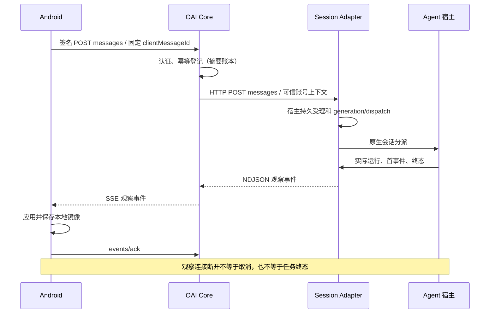

# App 到 Agent 通信链路诊断与修复

## 验证范围与交付条件

源码基线是 2026-10-30 核验的 `dev@33ab7a2a159b095e0d6408edc8888625011b3e84`。修复位于独立分支 `feature/communication-reliability-20261030`。原工作区及已有通信 worktree 保留，未复用其未验证结果作为本次通过证据。

现网只读；故障注入使用独立 loopback 实例和合成账号、宿主。性能以同环境的修复前后基线比较和正确性门槛验收，不把任意固定超时当性能目标。真实模型、真机画面和厂商后台行为必须单独列证据，不能由 JVM、SDK 或回环测试替代。

交付要求包括：发送与新建会话的阶段耗时、可靠受理与观察解耦、事件落盘与 ACK、恢复时保留原身份、不重复执行、无关会话继续推进，以及 Hermes/DSH/Codex 的能力差异。具体通信与接口见[生命周期说明](../architecture/2026-10-30-communication-lifecycle.zh-CN.md)。

## 实际请求、响应与事件链路

新建会话是独立 JSON HTTP 请求，不等待消息 SSE；原生事件补偿是分页 JSON 长轮询；平台事件 SSE/WS 与上述原生会话观察是不同通道。Codex 使用原生 app-server JSON-RPC/stdin/stdout。

Core 的操作摘要账本证明请求已登记，不单独证明用户输入已在宿主持久受理。Agent 开始处理也不能由气泡、HTTP 200 或 Core 已发出请求推断。首次 generation/原生受理、宿主开始、首个事件和最终保存分别取证。

## 已确认缺陷、证据与修复入口

| 类别 | 确认事实与复现边界 | 修改入口与回归 |
| --- | --- | --- |
| 平台订阅溢出 | 原 SSE/WS 队列满后只丢弃当前事件，继续发送更晚游标。两项真实 HTTP 回归在基线失败。 | `GatewayTransport._enqueue_frame`：溢出后停止该观察，从安全游标恢复；队列与事件库职责分开。 |
| Core 观察取消 | 原 create/send 路由的处理协程同时拥有远程调用；取消可中断执行或留下无结果操作。基线三项隔离回归失败。 | `AgentRegistry.start_operation`、原生 routes：受理与结果保存由服务任务持有，观察输出有界；显式取消保持独立。 |
| Core 同步账本 | `NativeOperations.begin` 在事件循环上等待 SQLite。诊断注入约 200ms 锁，无关回调从约 2.5ms 增至约 232.7ms。 | `AsyncNativeOperations`：同一线程创建、操作、关闭连接；有界实际工作队列；等待者取消不提前释放容量。该数字不是现网延迟。 |
| 创建结果恢复 | Android 没有把已有创建 ID 传到 HTTP；回执丢失后的新请求可以使用不同身份创建第二个会话。 | `AgentSessionClient.create`、原生仓储：固定操作身份；Core 同一账本提供按账号和 Agent 隔离的只读回执。 |
| Hermes 受理窗口 | 受理线程提交后，调用者取消可能发生在分派 task 登记之前。 | `HermesSessionAdapter.send`：宿主持有完整受理及登记任务，观察者只等结果。 |
| Hermes 同会话顺序 | 更晚的已受理输入先尝试 claim 时被拒绝，原实现随后退出，可能永远 queued。 | 原生 dispatch：按持久顺序排空未领取的 queued，前项结算后继续；running/unknown 不能重投。 |
| Hermes 存储阻塞 | 原事件发布同步等待历史锁、原生 KV/事件写入，附件路径也含同步文件操作。 | 事件持久化及附件工作移出宿主循环；保留账号、原生记录、事件提交和审批顺序。 |
| Android 恢复控制 | eventSync 产生消息事实但没有完整回填 tracker、取消路由及恢复屏障；冷启动镜像入口被异常分类提前返回。 | 原生仓储统一回执应用；本地提交后再改变控制状态；按正确 native 分区先恢复本地。 |
| DSH 观察清理 | 等待 prompt 受理时，观察期限不能完整清理；写入 false 后仍持续写入。 | 独立受理与观察状态、有界输出和 drain；迟到受理不伪造未执行，不自动取消宿主 inbox。 |
| Codex 隐式中断 | 真实 send 配合合成 RPC，观察取消触发 resume/start/interrupt。 | 原生执行所有者与 send 观察分开；只有明确取消才发目标 turn/interrupt。 |

以上是源码与隔离复现结论，不能直接认定为某次现场卡顿的共同根因。代理缓冲、连接资源饱和、厂商后台限制仍需对应运行证据。

独立复核补充发现并修复了两个边界：异步账本等待后的撤权检查须同时覆盖审批、管理和 Steering；认证前只能记录服务端 trace 与固定阶段，不能把原始请求头作为请求 ID 写日志。新增 15 项操作/授权回归全部通过，包含 Steering 查询 generation 期间撤权、宿主调用次数为零和未认证合成凭据不进入日志。

后续最终门禁还捕获了固定 SDK 的 SQLite 游标并发失败：共享连接只在 execute 阶段持锁，fetch/迭代仍可跨线程执行。新增四项真实 SQLite/线程回归在原实现稳定失败；游标读取、迭代及显式 cursor 操作补齐同一锁后，Hermes 专项 45 项通过，固定 SDK 原生生命周期契约独立重复 5/5 通过。此修复没有把空值当正常结果，也没有增加固定等待或放宽超时。

恢复状态的第二轮审查补齐四条语义：恢复中的已确认 running/queued 可以继续接收本地 Queue；Steering 必须绑定同一真实运行 generation；切出会话后恢复读取仍按原 Agent/会话落盘；歧义集合全部取得明确终态后才能解除屏障。未知或缺失回执不作为终态。Codex 首帧现在携带原生真实 turn ID，取消回执仅按原生 interrupted/completed 判定 cancelled/already_completed，RPC 成功本身不等于取消成功。

## 测量方法与性能结果

测量器为 `tools/measure-communication.py`，单独进程固定导入源码并保存 SHA/逐文件摘要、环境、测量器摘要、预热、并发和到达参数。每个适用的 mode/scenario 为 1000 次总尝试；失败始终保留分母。P50/P95/P99 分别提供成功样本与可观测样本总体，不能把超时从报告中抹去。

- direct：Core 路由连接受控宿主接口。
- bridge：Core 经真实 RemoteSessionAdapter 的 HTTP/NDJSON 观察连接访问合成桥。
- 普通 create/send、受理期间观察处理器被取消、桥观察断开、并发发送和单个慢 Adapter 隔离分别统计。取消注入用于验证所有权边界，不能把其失败率当真实手机断网故障率。
- 认证使用合成的本地 principal，不包含真实签名、配对及账号认证成本；可靠持久受理的磁盘验证另由真实存储与进程回归提供，HTTP 头或首个合成 generation 不能替代这一证据。
- 注入的 5ms/80ms 等延迟属于故障或负载参数，不能称为模型计算时间，也没有用于放宽业务超时。
- 数据库为内存操作账本；SQLite 实锁与独立进程重启另有正确性回归。不能据此宣称磁盘吞吐、数据库队列 P99 或真实模型时延。
- CPU/RSS/FD/连接数/事件循环延迟为隔离实例指标；Android 点击、帧提交、跨机器单向网络耗时及不可测的数据库阶段明确留空并写原因。

测量结果和修复版本对照将在完成固定源码验证后填入本节。原始证据位于 [measurements](evidence/2026-10-30-communication-reliability/measurements/)。

## 自动化验证与故障矩阵

修复前五项故障回归为红，见 [core-red.txt](evidence/2026-10-30-communication-reliability/core-red.txt)。首批 Core focused 55 项通过，随后 Core/HTTP/eventSync/独立进程集中回归 65 项通过；控制操作撤权和日志审查修复的专项 15 项通过。这些记录是中间检查，最终准入结果另行补齐。

首轮 `npm run test:fast`：Python Core、Hermes、DSH 阶段通过，Android gateway-client 318 项中 3 项失败、App 1181 项中 6 项失败；本轮没有将其记为通过。失败包括新增的冷恢复活动 generation、明确拒绝回执，以及旧日志筛选和测试异步清理边界，Android 专项正在修复。

独立安装验证已完成：仅复制已声明依赖的缓存闭包到独立环境、安装新 wheel，在仓库外运行 `verify_distribution.py` 和 `independent_core_contract.py`，均通过，未安装或导入 Hermes。wheel 与六个关键 Core 源文件逐项摘要一致。该项证明安装分发和 Core 自主运行，不代替物理设备或真实宿主验证。

必须验证的交界包括：

1. 正常连续发送/创建，多会话、多 Agent 和慢 Adapter 隔离。
2. 首帧前后取消、提交后 ACK 丢失、观察断开后任务继续、重复查询不再提交输入。
3. 事件提交/读取/本地保存/ACK 的延迟与失败，队列溢出、游标过期、审批保留。
4. Core→Adapter 断开恢复，独立进程重启，原生终态落盘前后的中断切点。
5. Android 前台、后台、网络变化、进程重建，running 恢复后的正确取消及终态后的后续发送。
6. 账号、Agent、会话切换后的旧任务不能更新当前所有者；审批和设备授权保持原边界。

验证顺序为专项回归、`npm run test:fast`、`npm run test:pr`。增量入口显式纳入新增 Hermes、进程恢复和 DSH 测试，固定 SDK 的跳过项单列。此任务没有正式发布授权，不以 Full 发布门禁或真实设备安装代替 PR 准入。

## 已完成的本地准入（首个冻结版本）

| 检查 | 结果与证据范围 |
| --- | --- |
| `npm run test:fast` | 退出 0，207.842 秒；源码摘要在执行期间未变。 |
| `npm run test:pr` | 退出 0，76.159 秒；源码摘要在执行期间未变。 |
| Core、安装器、准入选择 | 527 passed、6 subtests passed、1 skipped。跳过项是本地文件系统不能创建符号链接的卸载夹具，CI 仍执行。 |
| Hermes / HTTP / 原生 SDK / 进程恢复 | 143 passed；包含新并发分派与游标回归，固定 SDK 不跳过。另有既存 aiohttp AppKey 建议警告。 |
| DSH JavaScript | 原测试与可靠性测试 33 passed。 |
| 测量器 | portable provenance、失败分母、隐私与源码变更检测 24 passed。 |
| Android | 九个准入模块共 2392 tests，0 failed、0 skipped。包含 App 1198、gateway-client 318、conversation-ui 667；完整分模块记录见 evidence。 |
| 安装包独立性 | 新 wheel 在独立环境、仓库外运行真实 CLI 启动和 HTTP 契约通过；没有可选宿主。 |

门禁结果保留为 `test-fast-verified.*`、`test-pr-verified.*` 和 `android-pr-results.json`。前面的红例仍保留，未改写成通过。Gradle 第二次使用已有通过结果和增量缓存；不是第二次重新编译全部模块。正式发布的 `test:full` 未执行，此次交付为开发分支 PR。

## 部署与真机证据边界

2026-10-30 初始诊断时本机 Core 和 Hermes 服务正在运行。Core 安装元数据所指向的四个磁盘源码文件与基线相同；这不能证明运行进程已加载同一版本。Adapter 的实际加载来源及手机的运行时 capability 尚未确认。短时 CPU/RSS/FD 空闲快照不证明没有峰值拥塞。

现网未升级、未重启、未注入断网，也未读取消息或凭据。ADB 真机连接、真实模型连续发送、厂商 Doze/息屏恢复、真实代理拓扑及混合部署能力协商仍需独立验收。未取得这些证据前，不能宣称所有现场故障已关闭或手机到真实 Agent 已整体验收。

2026-10-31 00:04（Asia/Shanghai）的只读 `oai devices` 清单查询显示：19 条配对记录，0 台 online、19 台 offline。仅保存数量和布尔状态，不保存设备身份。它表示 Core 当时的连接判断，不证明手机物理断网；没有向设备提交任何请求，见[设备准备状态](evidence/2026-10-30-communication-reliability/device-readiness.json)。

## 性能对照后的继续修正

首个固定版本 `ef0c90d4` 的 v3 回环对照完成：修复前 13,000 次中 3,000 次在注入处理器取消后语义失败，修复后 13,000 次全部成功。该轮同时显示内存账本＋DEBUG 全量诊断下的额外延迟，不能据可靠性改善宣称性能目标也已达成。基线和 after 均保留在 paired-* 原始数据中。

随后合并账本完成回调，保持取消者不提前释放实际工作容量，同时将排队与存储耗时合为一条诊断记录，减少日志与线程唤醒。38 项相关回归通过。测量器 v4 增加 Core 磁盘账本和诊断开关，分别评估真实 SQLite 写入与默认关闭 DEBUG 的运行形态；不同数据库/诊断参数不能交叉比较。原生宿主状态仍为合成内存，不宣称原生磁盘持久化性能。新测量器 25 项测试通过。

Node 桥补充了默认关闭的单调时钟与进程标识日志；真实 HTTP 回调验证 trace 连续和不含正文/凭据，DSH 专项 37 项通过。Codex 原生 RPC 阶段补充后 31 项与 6 subtests 通过。以上后续源码需要重新通过最终 Fast/PR，再绑定提交和正式测量；不能用首个冻结版本的门禁冒充后续提交验证。

磁盘＋关闭 DEBUG 的补充对照暴露首个异步账本方案的队头积压：bridge/concurrent_send 455/1000 次超时。未放宽原测试期限。账本改为同线程、不定时等待的有界批量提交，每项独立 savepoint、整批成功提交后交付结果；幂等冲突不回滚其他请求，提交失败不发布可靠受理。新增相关回归正在验证同一负载。

批量提交＋保留 FULL 同步的 WAL 版本，对同一补充磁盘负载共 6000 次尝试全部成功。桥接并发完成 P95 从 1527.45ms 降至 19.86ms，直接并发从 866.06ms 降至 17.51ms；普通桥创建 P95 从 11.32ms 降至 9.61ms，桥首内容从 9.32ms 降至 8.24ms。该轮为优化诊断数据，最终正式全场景基线/after 将重新固定脚本、提交和环境。新运行时采用 SQLite 3.53.x；旧 SQLite 保持安全 DELETE 模式，不能套用 WAL 的性能结论。

批量事务复核还发现 SQLite 因容量不足自动回滚外层事务时，单项 savepoint 失效不能被普通异常隔离。该路径的真实 SQLite 容量限制回归先红；现遇到外层事务或保存点丢失立即终止整批，整批尚未交付结果全部失败，后续任务不在失去的事务上继续执行。58 项相关回归通过。某次门禁本身通过但执行期间包含此修正，其 source_changed_during_gate 非空，明确不作为最终固定源码验收；最终门禁重新执行。

## 最终批量账本版本准入

- `npm run test:fast` 实际退出 0，178.237 秒；业务实现摘要未变化，仅审查 Markdown 在测试期间更新，见 `test-fast-final-source.json`。
- `npm run test:pr` 退出 0，76.777 秒，全部输入文件摘要在测试期间未变化，见 `test-pr-final-source.json`。
- Core/安装器 544 passed、1 skipped、6 subtests passed；Hermes 143 passed；DSH 37 passed；测量器 25 passed；Android 2392 项、0 失败、0 跳过。
- 上述为最后一次源码变更后的门禁。新 wheel 同样在仓库外、无 Hermes 环境完成 CLI 与 HTTP 契约，六个关键源码文件与 wheel 逐项匹配。

接下来正式采集 v4 磁盘账本＋默认关闭诊断的全场景基线与修复版，各适用组 1000 次；先前的失败和调优数据保留，不作为最终提交的成功数据。
