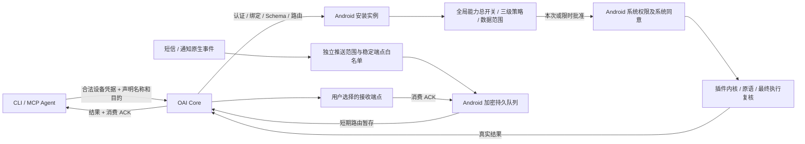

# 全局设备授权重构执行记录

日期：2026-11-01。需求状态：已接受；全局授权主实现与UI保真补充已提交；手动屏幕允许的真实stale失败修复中，完整验收尚未完成。
基线 `dev@3c9b82d1ef18062fc7dd09546efe6136803079cc` 已通过 `git ls-remote origin refs/heads/dev` 核对。
工作分支 `feature/global-device-authorization-20261101`，独立工作树 `.worktrees/global-device-authorization-20261101`。
完整要求见[规格](../superpowers/specs/2026-11-01-global-device-authorization.md)。

## 当前交付与未闭合项

- 通知/SMS范围与界面保真补充task-010已完成：源码1f338778，本地Fast/PR、Play回归、远端7checks全通过；Terra实际通知选择与短信被动/主动关键词、正文边界及未选端点对照通过。证据文档12d3f8f6已推PR #71，目标dev、OPEN、自动合并关闭。
- 已完成新包保留未ACK队列及真实1小时自然到期、突然进程死亡/重启保持。普通am kill未实际回收，未算系统OOM通过。全退出/重新登录、离线和剩余系统撤销矩阵仍分项执行。
- 手动屏幕允许back实测failed/SCREEN_STALE_REFERENCE，task-011正在建立受限修复，不关闭真实目标变化保护。reader、截图、只读拒绝成功不等于控制允许成功。
- 实体手机未连接，物理验收BLOCKED；整体goal保持active，不以自动化或模拟器替代完整要求。

## 已确认事实、待验证假设与设计

- 已确认事实（文档）：旧 ADR-0059、2026-10-28 规格和 CONTEXT 允许配对范围限制与独立后台许可，且记载旧迁移复核；与当前全局授权要求冲突，已明确取代。
- 已确认事实（仓库）：当前 dev 包含此前 Android 唯一能力权威改动；其覆盖范围和剩余执行否决点由本次源码审计确认，旧报告不作为本次通过证据。
- 待验证假设：配对持久状态和发布同步导致切 Core 后授权改变；必须追踪实际存储、发布、执行与日志后确认。
- 设计：Android 安装实例策略决定设备能力；Core 仅校验合法设备访问关系、协议、路由及可靠交付；账号会话、附件、历史的隔离独立保留。

## 分阶段计划与完成条件

| 阶段 | 工作 | 完成条件 | 当前状态 |
| --- | --- | --- | --- |
| 1 | Android、Core/CLI/MCP 并行只读审计；Terra 环境预检 | 文件/函数证据、文档冲突和环境清单 | 已完成，见源码审计结论 |
| 2 | 固化最小接口、全局迁移、请求生命周期与端点方案 | 明确写集合、兼容性与回归矩阵 | 主实现已提交 |
| 3a | 全局持久策略、旧授权清理、最终裁决及 UI | GLOBAL-01 至 05 自动化通过 | 主实现与UI补充已提交；屏幕手动允许修复中 |
| 3b | 统一请求声明、稳定端点注册和发现 | GLOBAL-07、11 契约及隔离测试通过 | 主实现已提交，已有自动化与 Core 运行证据 |
| 3c | 短信/通知独立推送、加密队列和生命周期 | GLOBAL-06、08、09 集成测试通过 | 主实现与SMS范围过滤已提交并验收，完整生命周期继续 |
| 3d | 屏幕独立策略及最小 FIFO 租约保护 | GLOBAL-10 并发、撤销、过期测试通过 | 主实现已提交，Terra 完整矩阵待闭合 |
| 4 | Fast、PR 受影响测试及 Terra 运行验收 | 记录真实退出码、版本和分项 PASS/FAIL/BLOCKED | 持续分项验收；最新 head CI 有失败待修复 |
| 5 | 文档与实际行为核对，PR 指向 dev | 中文提交、PR 链接、保持 Review | PR #71 已创建，OPEN、目标 dev、自动合并关闭 |

## 证据纪律

自动化、构建、CLI/Core 完整调用、模拟器、物理设备分别记录。
系统特殊权限必须走真实用户批准；测试特权不能冒充普通 Agent 权限；仅用准备的脱敏样本。
CI 触发后只记录链接，不使用 watch 或循环等待。尚未通过的功能不标记完成。
失败修复保留已有工作和可复核证据；禁用技能模板中的永久删除、reset/clean 回滚操作。

## 文档清单

规格、CONTEXT、ADR-0059、旧授权规格、设置规格、协议、Agent 指南、oai-client Skill、Android 能力/插件与 CLI/MCP 操作指南均同步本次模型。
具体实现、自动化结果、Terra 证据和 PR 链接将在对应阶段追加。

## 阶段一源码审计结论（静态事实）

| 入口 | 已确认的当前行为 | 本次修改 |
| --- | --- | --- |
| `platform-kernel/.../PairingGrantState.kt` 的 `PairingGrantBinding.storageKey` | Core地址、账号、安装实例共同构成授权存储键 | 改为安装实例单份策略，绑定只保留传输身份用途 |
| `app/.../PairingGrantPersistence.kt` 的 `load()/prefix()` | 每配对独立状态，旧标记和摘要可反复触发迁移复核 | 原子清理仅旧能力键，默认手动且推送关闭，保留明确本地拒绝 |
| `GatewayRuntime.establish()/teardown()` | 每次连接重新绑定授权，断开清空可见状态 | 连接解绑只暂停执行，本地策略离线可见 |
| `ProductionPluginHost.capabilitySnapshot()/invoke()` | 只有READY才发布可调用binding，尚无每项能力三级策略 | 手动模式可路由到App确认，独立能力总开关和最终复核 |
| `DeviceExecutionDriver.confirm()` | 仅前台确认，等待上限30秒，缺声明和临时许可 | 系统通知和App卡片，上限5分钟，严格参数范围许可 |
| `oai-core/.../capability_policy.py` | `allows()/set()`已报告由Android管理，无旧账号开关实时否决 | 保留已有退场和历史请求栅栏，不重复迁移 |
| `oai-core/{cli,mcp,client,device_service}.py` | 调用声明未贯通，REST严格三字段 | 加入非可信Agent名称和目的，保留凭据与设备绑定 |
| `notification-host`、`sms-collector` 生产入口 | 通知桥未挂载，短信运行工厂无生产安装，默认deny-first | 将真实事件源接到独立推送及加密ACK队列，不只实现Outbox类 |
| `oai-core/device_service.py` 的 `acknowledge()` | 依据Claim存在即可ACK，缺持久ACK回执 | 仅终态结果可ACK，增加可重试回执；主动推送逐端ACK独立 |

以上来自两个子Agent对 `3c9b82d1` 的只读源码核对，不代表原始问题已由运行环境复现。

## 阶段二最小方案

- 安装实例持久化revision、明确关闭及每能力 `enabled/mode`；策略键绑定插件作者、能力、真实Schema与风险，更新不得自动扩大自动许可。配对ID只作为每条连接和请求的投影。
- 临时许可只存内存、采用单调时间，按可信操作与规范化参数摘要精确匹配，跨合法Core/账号/Agent共享；无法证明更宽数据范围时要求重新确认。
- 执行和原语调用前、敏感结果返回及每次HTTP重投前重新检查策略与许可；迁移提升本地版本，旧敏感执行日志不可重用。
- Core/CLI/MCP与schema由同一子Agent归口修改；App UI、主动推送、屏幕FIFO租约分配不重叠写集合；主Agent负责全局策略、持久化、宿主执行与生产连接整合。
- 所有队列长期正文保存在Android加密存储。Core只做短期有界路由暂存和ACK元数据，端点名称不充当可信身份。

## 2026-11-01 整合中间证据

- 文档阶段已提交 `2e6a799ca5456125720e27353719ba898a6fc4dc`。源码仍在工作树整合，以下测试不归属于该文档提交；最终交付会记录源码提交。
- 第一轮完整 App 生产及测试源码编译成功，日志 `docs/plans/2026-11-01-global-device-authorization/android-compile.log`；不是所有单测通过。
- App 定向第4轮为87项、31失败，定位到新授权摘要校验不接受仓库标准 `sha256:` 前缀，已修并补回归。第5轮108项、2失败：通知fixture未安装登录采集门槛，以及附加连接交付恢复等待；仍在修复复测。
- 已实现安装实例单份持久策略、旧授权键原子清理、独立模式和SMS被动范围、单调时间临时许可、系统通知确认、多个认证设备连接投影、独立推送配置/加密队列/精确撤回与系统调度。屏幕租约和多连接按请求授权仍在最终接线。
- 独立安全复核指出审计失败回滚许可与附加连接取消漏洞：已改为持久拒绝屏障后审计、可恢复手动模式；运行请求扫描消费取消、敏感结果上传前核对远端状态，Core继续补原子取消保护。
- Terra已准备隔离Core A/B、专用账号、TLS和ADB反向端口，尚无新APK业务验收结论；未发现实体手机。
- 跨宿主协议一致性缺少固定OpenClaw checkout，正在仓库ignored运行目录补齐固定版本依赖；不会据此跳过该门禁。

## 最终数据流（整合版本，门禁待完成）

全局策略不按连接分区；连接认证、签名、公钥与配对代次仍独立校验。各账号私有会话、附件、历史不进入设备请求后台恢复扫描。
单次批准绑定完整连接与请求；限时许可按能力、可信操作与参数摘要共享。切换模式或收窄范围提升全局版本，使旧在途批准失效。
本地审计失败会保留拒绝屏障，重启可在审计恢复后以手动模式恢复；不回写旧自动允许值。

## 直接受影响 Android 模块验证

同一工作树执行 `:control-ports:testDebugUnitTest :screen-control:testDebugUnitTest :device-primitives:testDebugUnitTest :platform-kernel:testDebugUnitTest :notification-collector:testDebugUnitTest :sms-collector:testDebugUnitTest`，
最终 Gradle 退出码0，283项、0失败、0错误、0跳过。分项为38/28/51/78/44/44；日志 `docs/plans/2026-11-01-global-device-authorization/runtime/android-core-modules.log`，
JUnit报告在各模块 `build/test-results/testDebugUnitTest`。这证明这些模块当前自动化结果，不证明App完整门禁或设备矩阵通过。

首轮Fast前序：Core612通过、1跳过、6子测试通过；Hermes原生143通过；DSH37通过；通信测量25通过。
Fast最终因屏幕模块一处ConcurrentHashMap成员调用编译失败退出1；该编译问题已修且上述模块任务通过，最终Fast/PR仍待统一重跑。
跨宿主协议一致性在补齐固定OpenClaw checkout及历史Hermes一致性runner依赖后3项通过，未修改runner输出或跳过向量。

## 协议与隔离安全最终定向结果

- `npm test --prefix gateway-contract`：179项通过（包含跨宿主3项），10个测试文件通过；协议类型检查退出0。日志位于 `runtime/protocol-final.log`、`runtime/contract-types.log`。
- Core推送精确撤回、迟到投递撤销栅栏、取消后敏感结果保护及签名pending/短期presence：45项通过，日志 `runtime/core-revoke-cancel.log`。
- 验收准备脚本：10项通过；固定源码快照检查3项通过；官方签名插件来源/篡改检测5项通过。这些是测试工具证据，不是设备业务验收。
- 附加连接恢复修复：旧owner迟到回调不能误解绑新owner，独立registrationId撤销并已通过结果只补报一次回归。
- App与采集器间采用 `capability-ports/DevicePushSources`，生产实现位于 `device-primitives`，保留原App无直接采集器依赖边界。

## 兼容与回滚说明

Core封闭Schema hash由基线 `sha256:032f580246eb4a214624bded717819b4d5a76191208207edc9e5a4607f5c4d23` 更新为
`sha256:38786286ca26f601747cf7e52953e1cd4a57b8089e3b95cdc31fbb6f7a8b6d83`，Android生成常量已同步。
新App与旧Core或旧App与新Core需按原hash协商明确报告不兼容，不跳过签名/协商，也不降级成旧账号能力grant。
CLI/MCP旧无caller调用返回明确错误，升级调用端需要同时携带声明；设备访问凭据不因本地能力发布revision变化失效，
已创建请求仍绑定原revision，旧撤销/迁移fence不会清理或复活。

Android旧授权键迁移是不可自动逆转的本地模型升级，不把旧配对正向许可当作回滚数据。
需要回滚时须使用经核验的一致版本备份；不能靠重建账号、替换主密钥、卸载App或清空数据恢复。
本次没有执行共享生产部署或业务回滚验收，测试Core与模拟器隔离用户不代表现网已升级。

## App测试进程隔离证据

全App单JVM回归出现多项Compose空闲超时，线程栈确认测试主线程反复进入 `ComposeIdlingResource.isIdleNow`，
并非等待远端CI。保留 `runtime/app-full-idle-threads.txt` 后终止该已失败的测试worker；该次退出1，1162项、7失败、1跳过，不算通过。
相同会话分享与离线插件授权用例在新JVM定向运行14秒通过，日志 `runtime/ui-idle-isolated.log`。
因此将App单测按测试类隔离JVM（Gradle标准 `forkEvery=1`），复用全部编译和依赖缓存，保留原断言/空闲检查，
不放宽产品授权或修改Mock绕过结果。最终以随后完整Fast/PR退出码为准。

## Fast完整通过（当前阶段源码）

`npm run test:fast` 最终退出码0，日志 `runtime/fast-isolated.log`：Core624通过、1跳过、6子测试通过；
Hermes原生143通过；DSH37通过；通信测量25通过；Gradle完整受影响任务 `BUILD SUCCESSFUL`。
App JUnit汇总1295项、0失败/错误/跳过；platform-kernel79、gateway-client318、conversation-ui684、conversation-domain34、
control-ports38、capability-ports51、device-primitives51等全部退出0。
这一轮结束后补上系统MediaProjection入口移除旧屏幕会话前置的新回归，最终 `npm run test:pr` 正在覆盖该补丁；
不以Fast阶段结果替代最终源码SHA的PR与运行证明。

## PR准入门禁通过

最新实现执行 `npm run test:pr` 最终退出0（`runtime/pr.log`）：Core624通过、1跳过、6子测试通过；Hermes原生143通过；
DSH37通过；通信测量25通过；Gradle全部指定任务成功，用时7分40秒。该轮已包含系统截图入口去除旧会话前置及对应回归。

| Android模块 | 测试数 | 失败/错误/跳过 |
| --- | ---: | --- |
| app | 1297 | 0/0/0 |
| control-ports | 38 | 0/0/0 |
| capability-ports | 51 | 0/0/0 |
| screen-control | 28 | 0/0/0 |
| device-primitives | 51 | 0/0/0 |
| platform-kernel | 79 | 0/0/0 |
| gateway-client | 318 | 0/0/0 |
| conversation-ui | 684 | 0/0/0 |
| conversation-domain | 34 | 0/0/0 |

协议179项及类型检查另行通过，Core撤销/取消/pending定向45项通过。未执行正式发布Full门禁，不将PR测试当作发布或物理真机证明。
APK已成功构建，最终源码提交后还会重建记录哈希；真实运行矩阵与实体手机缺口见Terra报告。

## 源码提交与PR交付

- 文档规格提交：`2e6a799ca5456125720e27353719ba898a6fc4dc`。
- 源码实现提交：`17895223c16fc84dfbe7c889943a608f7fbaa095`，中文说明“重构: 统一安装实例设备授权并接通可靠主动推送”。
- PR：[\#71](https://github.com/1rua/open-android-intelligence/pull/71)，目标`dev`，已核对为OPEN、非Draft、未启用autoMerge，未合并。
- 提交后重新构建`:app:assembleFullDebug -Poai.requireBundledPlugins=true`退出0。APK 70,727,650字节，SHA-256 `c16db7ef1a0bbb0fb75ab249201a7a103d005c7757a32cff0f3eb5907a79b5f7`。
- 新Schema hash `sha256:38786286ca26f601747cf7e52953e1cd4a57b8089e3b95cdc31fbb6f7a8b6d83`。

本地624项Core测试中的唯一skip已定向核实为`tests/test_uninstall_script.py`的符号链接危险路径场景：
当前托管文件系统不能创建符号链接，在Linux CI执行；不是设备授权断言被跳过。App1297项全部无跳过。

## CI观察（不等待远端）

触发的Core/Android工作流：[41259046237](https://github.com/1rua/open-android-intelligence/actions/runs/41259046237)。
APK产物工作流：[41258964671](https://github.com/1rua/open-android-intelligence/actions/runs/41258964671)。
初次只读核对时，签名插件任务与DSH任务成功，其余部分仍运行；APK在编译前下载第三方Maven镜像依赖时HTTP502失败，
具体URL为`maven.aliyun.com/.../org/ow2/asm/asm-analysis/9.7/asm-analysis-9.7.pom`。已仅重试失败任务一次，未使用watch或循环等待。
最终CI状态需以对应Run和提交SHA核对，不把已触发或某一job成功等同整个CI通过。

真实运行矩阵仍未全部完成，实体手机未连接。PR保持Review且明确该风险；整体goal不因源码和PR已交付而标记完成。

## 未确认事件与时钟回拨补充

最终核对发现push runtime曾在进程启动检测到系统时钟回拨时提前清空全部未确认事件。
这不符合仅在过期、容量或用户撤销时清理的要求，已移除此早清分支；原事件、逐端收据和原始截止时间保持不变，
运行期继续用单调时间及持久观察锚维护到期。补充真实加密持久队列重启、回拨后仍可按原事件投递、再按单调时间正常过期的回归。
该后续补丁在`17895223`之后，需重新通过Fast/PR并另行中文提交，不能沿用旧提交通过状态。

## Android登录阻塞的实测根因与调试环境修复

Terra在隔离用户10中运行真实Android `CoreTlsConnectivityTest`，明确为1项1失败（ADB命令退出0不能当测试通过）：
`SSLHandshakeException / CertificateException / CertPathValidatorException`，原因`Trust anchor for certification path not found`。
探针使用App默认HTTPS、不携带凭据，主机端同CA验证及Core401、ADB反向端口均可用，证据把故障定位到调试App对用户测试CA的信任。

使用Android标准Network Security Config，在`src/debug`声明debug-overrides，仅调试构建认可用户在系统设置真实安装的CA；
不新增TrustAll/自定义HostnameVerifier，不改主机名或协议SPKI校验，不影响正式构建的证书策略。
需要以同一探针先红后绿及实际登录复测闭合，不能用静态XML存在代替通过。

## 源码提交17895223的CI结果补充

Core工作流已结束：Python3.11、Python3.12、Hermes native、DSH均成功；Android失败于318项gateway-client测试中的1项：
`GatewayWebSocketTransportTest.each handshake uses the shared complete session snapshot`，
`kotlinx.coroutines.test.UncaughtExceptionsBeforeTest`。现有控制台没有附带该提前异步异常的来源，尚未认定为产品缺陷或环境偶发。
后续仅补充完整异常日志和CI JUnit报告保留，不移除断言、不跳过WebSocket测试、不因本地通过而改称远端通过。
APK产物任务的Maven502已仅重试一次；后续head的CI另按新SHA观察，不对旧run做前台轮询。

## Android TLS先红后绿与登录成功

Terra复测使用App `677155810ca6c9a957ee29c859d9318df6d806c7fc4d63289ebd4254b237ee1d`、
testAPK `780ea9db6d46e393de7f1db953a13d3f978e3948e78abc38c3aba48516eca7c3`，设备安装后哈希一致。
同一`CoreTlsConnectivityTest`在debug用户CA配置下`OK (1 test)`，确实断言CoreA未认证接口返回401，
随后真实UI账号密码登录进入CoreA主页，日志09:34:30.316（Asia/Shanghai）记录`session.ready`，
关联请求`reqce8f278b3d674e15b4ec`返回HTTP200。未关闭TLS、未跳过协议SPKI/主机名校验。
这证明测试环境的TLS与登录路径已闭合，不等于实时通道、设备能力或实体手机矩阵通过。

## 后续修复门禁（未替代源码17895223结果）

保留未确认队列的时钟回拨补丁及脱敏连接诊断、debug用户CA配置，已再次通过Fast与PR完整入口
（`runtime/acceptance-fix-fast.log`、`runtime/acceptance-fix-pr.log`均退出0）。
之后新增“每条连接凭据当前有效性进入内核最终检查”补丁和立即退出回归，正在定向及最终门禁验证；
该补丁使退出/会话撤销无需等待10秒后台扫描，且不改变持久模式或有效队列。
CI已补完整异常链输出和always上传Android JUnit/HTML报告，仅增强失败证据，未屏蔽失败断言。

## Terra实测设备请求链路（通话记录）

隔离user10真实Android系统UI已分别拒绝和允许READ_CALL_LOG；拒绝时CLI能力发现明确`ANDROID_PERMISSION_REQUIRED/READ_CALL_LOG_REQUIRED`，
允许后目录READY、本机模式仍MANUAL。实际请求`devreq_807c16e8-f620-4c4c-9c32-e1c356e9d955`经App卡片拒绝后
CLI返回`denied/LOCAL_USER_REJECTED`，Android同requestId记录结果已被确认接收。没有返回通话记录正文。
先前请求因未及时操作真实超时返回`LOCAL_CONFIRMATION_TIMEOUT`，与用户拒绝分开记录。

现场发现按钮区重叠（此次用Tab/Enter准确激活拒绝）以及终态仍带awaiting进度：
按钮改标准Dialog单一纵向操作区，每个48dp独立触控范围，新增五按钮不相交测试并通过；Core输出只在claimed且未过期时公开进度，
先红后绿真实HTTP10项通过。最终新APK上触摸拒绝和终态字段复测仍待Terra闭合，不能把键盘成功代替按钮修复验收。

## 后续修复最终自动化结果

`runtime/review-fixes-fast.log`和`runtime/review-fixes-pr.log`均最终退出0；Core因新增终态进度回归更新为634通过、1跳过、6子测试通过，
Hermes143、DSH37、通信测量25通过，Gradle受影响任务全部成功。
App报告为1300项、0失败/错误/跳过。上述结果覆盖当前队列时钟回拨、凭据即时撤销、debugCA、确认按钮分区和Core终态进度补丁。

真实Core CLI/MCP已注册/发现两个稳定接收端点，五项未认证API均401；随后以同账号设备关系的独立新B凭据验证
B访问A、A访问新B的owned deliveries均403，名称或账号相同不扩展端点持有权。
端到端主动推送的手机选择、真实OS样本、逐端ACK仍待运行，不能以端点注册代替接收许可。

## 后续提交1680c04e的可复现产物

源码`1680c04e`已推送到同一PR#71，未合并。提交后本地App构建退出0，
APK `5affe22f0918e869539428f0a673491209fecedfdbf6fc059bcefcf0787e19ea`（73,481,493字节）；
androidTest APK `51a4fbce323c59f06482b471172ae3bd39c6c4e4014d46c7ba8eb33fda0461be`。
日志/元数据位于ignored运行目录`runtime/apk-1680c04e.*`，公开报告与最终源码SHA建立对应。
物理手机仍未连接；模拟器完整矩阵仍在逐项执行，不能将签名包或本地构建替代运行验收。

## 远端Android异步失败的确切来源

1680c04e远端APK、签名插件、Core3.11/3.12、Hermes native、DSH全部成功；Android仍1/318失败。
下载always保留的JUnit产物后，`UncaughtExceptionsBeforeTest`的suppressed明确来自
`GatewayTransportConcurrencyTest.heldStreamsDoNotSerializeCreateAndEveryTransportBoundaryHasItsOwnClock`
取消consumeResponse协程后，`GatewayTransport.observedStream.read/withTransportIo`逃逸`SocketException: Socket closed`，
被后续WebSocket测试开始时收集。正在最小修复取消传播，不使用忽略异常/跳过断言/测试进程隔离掩盖该问题。
证据XML位于ignored `runtime/ci-1680c04e-report/GatewayWebSocketTransportTest.xml`。

## CI网络取消问题的修复

最小生产修复仅在`GatewayTransport.withTransportIo`中捕获IOException后先`ensureActive()`：
协程已取消时保留取消原因，未取消时继续抛原网络错误。不是吞Socket异常或测试隔离。
`GatewayTransportConcurrencyTest`新增execute/consumeResponse两条阻塞读取取消与未取消错误路径回归；
定向31项通过，gateway-client全模块320项0失败/错误/跳过。完整Fast/PR和新CI仍需覆盖该后续补丁。

## 双端真实主动通知投递（消费ACK前）

Terra在user10通过真实系统NotificationManager发布固定样本，instrumentation `OK (1 test)`；
App主动通知范围仅自身包，正文开启，A和独立B在白名单，被动查询仍每次手动。
真实HTTPS receiver观察器确认同eventId `push_7e267b912b1056ed53658b86e1ac20a8295cbe03d209a3ac3159e298fd8e0b79`，
A投递`delivery_c822675c5fb34f2bb6875b31ad5fa666`，B投递`delivery_13ef41a1db40430eb5a1c4ea338d885d`，
两条route全字段匹配，正文等于`OAI-SAMPLE-NOTIFICATION-20261101 complete synthetic body`。
观察器在112.122秒结束PASS，全程无ACK，证明HTTP接收并未自行完成消费；手机队列与逐端ACK清理下一步验证。
该样本不含私人通知正文；不能将此单条通知代替SMS、离线恢复或实体手机矩阵。

## 手机队列与单端ACK

样本观察器结束后，主Agent按Android CLI真实界面读取并点击“刷新队列状态”，实际为2条事件、4次投递；
未以预期1/2代替实际读数。对已由两端消费观察到的固定样本，仅A提交ACK（03:10:17.680UTC），
返回acknowledged且route/事件/投递匹配；手机随后刷新为2条、3次投递，B和另一事件仍待确认。
公开截图`queue-before-ack.png`、`queue-after-ack-a.png`仅包含隔离测试配置和队列计数，未显示私人通知正文。

B端对同一固定事件提交消费ACK（03:14:00.170UTC）后，主Agent真实UI刷新队列为1条、2次待投递，
对应事件只有两端都确认后才清除；另一未确认事件仍保留。截图`queue-after-ack-b.png`。
这闭合一条OS事件→手机独立推送范围/白名单→Core→两个独立接收凭据→逐端ACK→手机清理的真实链路，
不等于全部SMS/离线/到期/撤销或物理设备矩阵通过。

重复消费ACK验证：对第一固定样本A/B各重复ACK一次，完整回执和首次acknowledgedAt保持一致；
只读元数据核查已ACK正文为空且长度0，未恢复敏感正文。未确认第二事件仍保留不被顺带ACK。
旧未选B端点因租期到期GET返回409，不能据此认定白名单零投递，正在正常续期后独立验证。

## 后台恢复发送前租约竞态

Fast曾在`GatewaySessionRefreshTest`得到租约到期后协商计数6→7。该日志不足以证明时序，
因此新增transport.io_dequeued闩锁，修复前令租约过期后放行，真实服务端协商计数1→2稳定复现。
`GatewayTransport`新增窄beforeConnect检查，在gateway-client网络owner真实factory.open前执行；
`GatewayRuntime.rotateStoredSession`为协商与刷新传递恢复所有者/租约检查。
原测试改成服务端在途闩锁和恢复Job完成状态，保留严格计数，不增加sleep或放宽断言。
新建且尚未发出的旧协议刷新记录在发送前拒绝时可安全清理；已有可重放未知结果记录保持。
noVpnSurfaceCheck及6项定向回归全部通过，最新完整Fast/PR仍在验证此补丁。

## 后台恢复与SMS系统许可的实测进展

手机长时间停在系统设置时，Core短缓冲到期后剩余未ACK事件的接收查询为0，不据此清空手机队列或伪造ACK。
返回OAI前台后，真实observer2在首轮0.083秒匹配同一历史未确认第二事件，两端同eventId、不同delivery、正文和route正确，
此前已ACK的第一事件没有重现；没有新发OS样本，符合本地持久队列恢复投递。仍需消费ACK及手机最终清理核对。
Terra随后从App SMS插件权限入口触发真实Android弹窗允许，user10 READ_SMS已granted=true，未用pm grant/appops。
短信OS合成样本及严格范围被动查询下一步运行，不以系统权限授予等同数据读取成功。

网络取消/后台租约修复已提交并推送`1199eb70`，最新Fast/PR均完整退出0；新head CI仅触发，不前台等待。

## 提交1199eb70的CI一次状态核对

APK和签名插件产物成功（Run41270553841）；Core3.11/3.12、Hermes native、DSH成功（Run41270556995），
Android仍IN_PROGRESS，记录链接后继续设备验收，不watch、不循环等待，也不宣称CI全绿。

## 长时临时许可验收排期约束

5/30/60分钟真实批准以每次UI批准时刻和设备单调时间记起点，未来时间范围参数避免返回私人通话内容。
计时中不覆盖安装、不杀进程、不切全局模式/范围；上述动作会按设计使许可失效，不能误判为自然到期。
后台到期观察有70分钟总截止，使用同参数的新请求确认重新进入手动等待，再取消请求，不改系统时钟。
实际批准尚未写入起点文件前不能宣称计时开始；未运行完的长时用例保持PENDING。

## 临时许可真实授予与跨Core即时共享

最终App在user10真实卡片分别批准future2099范围limit1/2/3的5/30/60分钟许可，批准时间下界为
12:01:16.499、12:03:34.117、12:06:26.736（Asia/Shanghai），点击上下界和设备单调时间保存在private `runtime/temporary-approvals.json`。
CoreB在30/60分钟窗口内使用完全相同参数、不同Agent声明，新请求
`devreq_b445a726-02cb-4271-8158-15dee3cc25ab`和`devreq_eb7f85e8-5687-47b6-a0a4-9e316385bbd8`
均无需新批准成功返回0记录，界面无新确认卡片。
5分钟跨Core请求实际提交晚于自然到期，重新进入确认并取消，只能作为到期后需重新确认的证据，不能当即时共享失败/成功。
未批准limit4范围请求进入确认并取消，不能扩大已批准参数范围。30/60分钟自然到期仍在后台计时观察，不能提前PASS。

## 提交1199eb70 CI最终完成

完成设备批次后再次只读核对，源码1199eb70全部checks已COMPLETED/SUCCESS：
APK/签名插件Run41270553841；Core3.11、Core3.12、Hermes native、DSH、Android Run41270556995均成功。
这是该源码提交的CI证明，不覆盖后续仅本地尚未推送的脱敏文档提交，也不替代剩余运行矩阵或物理手机。

独立SMS模拟器准备：emulator-5556/API34已干净启动，独立AVD及运行目录不与原5554/user10共用；
App/test包安装哈希与签名已核对，但启动后仍桌面，正在有界诊断，不据此声称SMS样本验证通过。
原5554的READ_SMS系统UI授予后严格范围查询`devreq_1ae3155b-57e7-4254-8b42-ad3ad59a8fe9`成功返回0记录，
只能证明调用/单次批准链路，不能证明注入样本归属及正文过滤。未读user0短信或补造数据。

## 30分钟临时许可自然到期

后台有界观察器按点击后上界+30分钟+5秒提交同一limit2/future2099范围，
请求`devreq_3d65079a-0b10-47a2-810f-1a82ccc83609`重新进入claimed/awaiting_confirmation，
未自动执行，测试随后取消为cancelled，scope30记录PASS。与到期前CoreB立即共享成功记录对应；
60分钟观察仍按原13:06:31计划，不提前宣称通过。

## Core wheel独立安装验收

从源码1199eb70的干净staging构建wheel `open_android_intelligence_core-0.2.0-py3-none-any.whl`，
SHA-256 `30fadccbabf34af63236323efbc77520a9a43e3750855e430c7b29c935c64a77`。
安装到独立target，取消PYTHONPATH/Hermes环境变量，并以`python -I`、checkout外cwd运行现有
`independent_core_contract.py`，确认import路径来自installed target、无旧Gateway/Hermes adapter，
端点与声明模块可导入、内置contracts存在，完整独立HTTP验收输出`independent Core HTTP contracts passed`，退出0。
第一次launcher参数错位导致路径断言失败，修正测试启动参数后通过，没有改生产返回值或放宽断言。
日志与wheel位于ignored `runtime/wheel-1199eb70/`；不执行生产部署。

## 屏幕预置入口的真实验收修复

Terra实测内置插件卡仅三项，源码`BundledPlugin`枚举也仅notification/SMS/calllog，尽管Gradle真实打包六个ALP。
追加screen-reader/capture/control三项及对应中文系统权限说明，复用同一验签/作者信任/禁止跨ID覆盖安装流程，
每个包独立缺失可诊断，新能力仍默认MANUAL。真实编译屏幕WASM签名测试包与UI定向38项通过，
最新完整Fast/PR正在覆盖；原5554许可计时中不重装，到期后再用最终包复测该入口。

新5556主用户已登录CoreA secondary测试账号，安装ID/设备公钥与服务端新设备记录匹配，
CLI绑定`dev_c16e3d46-108f-4fcb-833d-cf6d76487a5e`、online=true、generation1，不以列表第一设备猜身份。
初始capabilities为PLUGIN_NOT_INSTALLED，后续经真实UI安装SMS及系统授权再验样本，不绕过默认状态。
原5554独立用户仍保留临时许可计时，两个AVD所有操作显式serial。

## 实测屏幕绑定错误及回归

Terra请求`devreq_3711752e-5d09-468c-bb26-c1492ea5ba1d`在reader启用/READY、手动本次批准后，
拒绝SCREEN_SESSION_BINDING_CHANGED，未返回屏幕数据。源码核对发现selected屏幕登记在SSE初始IDLE/CONNECTING时被删除、
重连时换新opaque generation，但driver保留旧handle。新增真实Runtime重连序列回归先失败，
最小修复stream liveness变化只撤销旧请求/lease/image，保留仍已认证的设备关系；显式退出/配对撤销仍移除登记，
原批准不得因重连复活，新签名HTTP请求重新走全局策略。device-primitives全模块退出0（`runtime/screen-stream-green.log`），
当前完整Fast/PR和13:06许可到期后的最终包设备复测待完成。

## 60分钟自然到期及外部Terra服务阻塞

后台observer已finished/PASS，scope60在原计划到期后新请求
`devreq_db56f068-6553-41fd-884b-d5e0b3235109`重新进入等待确认并取消为cancelled；
scope5（延迟复验）、scope30和scope60三项均PASS，累计真实观察2848.13秒，不使用系统时钟跳变或Mock加速。
关键日志已脱敏保存`2026-11-01-global-device-authorization-ttl-complete-evidence.txt`。

两个手机Terra子Agent随后因外部模型API HTTP503 Service temporarily unavailable退出，
request IDs分别为`8f2c8062-6229-45f0-80c7-c4cafd5dc5d4`、`964024a7-0df3-4ecd-87f0-557eef2eab41`。
未完成的SMS样本/屏幕修复后运行/生命周期不据此标PASS，主Agent只尝试恢复原Terra会话一次，
不将主Agent或Mock当Terra验收。实体手机也仍未连接。

## 屏幕修复最终本地提交

屏幕入口和stream重连登记修复完整Fast/PR均退出0，App1309项、device-primitives52项、gateway-client320项无失败/错误/跳过；
本地提交`97f601f7`。当前feature领先远端两个提交（`cbf742a5`公开证据、`97f601f7`屏幕修复），
因为push自动审批连续两次超时，未执行推送且未绕过；远端PR#71目前源码仍1199eb70并已全部CI成功。

本地新App SHA-256 `cd1ec569ea4af5cc7a3b3ba08b8ac3f2cadae9195e78d514705fd4361eb2b608`，
androidTest `e3ee156dc87e66fb4c1d7d37c0103b04a20b61c7bbcd44fc521f2206addd7096`，
构建退出0。真实reader重试由恢复后的Terra继续，不提前PASS。

## 本地97f601f7新包真实reader复测

Terra核对App/test安装哈希后，手动本次批准
`devreq_03e191d5-adeb-4f9a-a913-dfd9c7a0d1e6`成功，前台package为OAI自身、8节点有界且truncated=true，
hash/revision元数据已记录，不输出节点正文，未再发生SCREEN_SESSION_BINDING_CHANGED。
截图MediaProjection和控制尚在后续独立验收，不将reader成功扩大为截图/控制许可。

## 新5556真实短信只读与本地范围

仅允许专用sender15550102202的READ_ONLY下，
`devreq_1fd4b447-5753-467d-8b3f-0d1929ad2b78`无需手动批准即成功1条固定样本；
越界sender15550103303请求`devreq_427bfdce-0db3-4c2f-b1f7-86ebb64e082b`明确denied/LOCAL_DATA_SCOPE_DENIED。
关闭正文且移除正文搜索query后，`devreq_669e2332-ffaa-4369-891a-d84c2805bea4`返回1条metadata，
`text:null`且无正文/marker，内容隔离通过；字段保留null不声称字段完全省略。
未改schedule/cancel的手动模式，未读其他号码或原5554user0。SMS主动推送接下来独立选择另一专用sender/正文，与被动范围分开。

## 真实MediaProjection与单次截图

原5554 user10在Android系统MediaProjection中选择“单个应用→OAI”，不是用ADB授权或复用附件圈选票据。
Screen Capture安装启用且MANUAL，App显示系统许可可用，真实本次卡片批准
`devreq_0b7358f9-003c-46b1-9436-3cea8dddab7c`成功返回PNG元数据512×1137/176517字节，
imageId `4d685c0a-ce58-4e5e-89bb-792c032a1b4a`，摘要
`c8eddfc75b65c80e9cf72b105bafd99ff94673669236f38e00413548dce4444f`。
未读取或公开像素数据，截图成功不授予CONTROL；下一步控制拒绝/执行与系统撤销分别测试。

## 远端状态复核（阶段描述更新）

后续只读`git ls-remote`确认远端已到97f601f7，PR71 head也为该SHA，仍OPEN/dev/autoMerge=null。
这与先前两次push审批超时未执行的工具返回阶段不同，未据此推断异步执行者或时间；当前同步状态以远端SHA为准，
先前“领先远端2提交”不是当前结论。
97f601f7的APK/签名/Core3.11/Core3.12/DSH成功，Android仍在运行，Hermes native3项审批测试失败。
读取已完成job独立日志（未等待整个workflow）得到3项StopIteration，正在沿测试/SDK真实事件链定位，不改自动批准/拒绝。

## 2026-11-01 用户 UI 补充与修复状态

用户要求已先写入规格 UI-01 至 UI-06、CONTEXT、设置规格、操作指南及仓库 AGENTS.md：通知使用原应用列表搜索、正选和反选；短信新配置默认全部，提供关键词/电话号码；功能改造不得擅自降级原 UI 或任意改写文案。新增范围须进入真实查询、采集和重投过滤，保持被动/主动独立，兼容旧配置与未 ACK 队列。

静态核对已确认本轮 PushSettingsScreen 手填通知包名、短信地址和 SmsPassiveScopeSettings 地址输入与用户要求冲突，正在恢复原选择行为并补范围模型与迁移；尚未通过新增自动化与 Terra UI 验收，不标记完成。文档相对链接、代码块、阶段任务 JSON 与 git diff --check 已通过，不能代替功能测试。

## 2026-11-01 最新远端与 CI 核对

PR #71 已核对为 OPEN、目标 dev、head `97f601f712728483e9917cec5dcfa5aaa41d5a3f`、autoMergeRequest=null；远端已包含前述曾遇审批超时的提交。该 head APK/签名、Core 3.11/3.12、DSH 成功；Hermes native 与 Android Play 有失败，不能称 CI 全绿。

Hermes 三项审批测试的本地复现证实：宿主审批持久化后等待固定 10ms，不保证流消费者已收到结构化 approval_requested；将真实事件读取延迟 50ms 可复现同三个 StopIteration。修复为等待实际结构化事件，保留原 3 秒上限和所有 51 条断言，同延迟下交互文件 18 passed、固定 SDK `75b083e` 的 native 组 143 passed。仅测试同步夹具变化，不自动作出批准/拒绝。本地 Python 3.14.6 与 CI 3.12.15 不同，远端复核待新提交。日志保存在忽略的运行目录。

Android Play 失败为 CoreAgentConversationRepositoryTest.serverQueuedReceiptDoesNotClaimAgentReceivedUntilAuthoritativeRunning 的 TimeoutCancellationException（189 项、1 failed、24 skipped）；完整日志已保存，正在单独定位，不跳过原断言。

## 2026-11-01 SMS 主动链路新增证据

Terra 接收端观察器已记录唯一匹配的 OS 合成短信：专用号码 15550104404、固定合成标记匹配，事件 push_cb5d79d1b1a8fb2417efd345b66e2af233ca12bc1e7216c5fc8544aff7c87cb1，投递 delivery_3f0bd6df3df64678aa3e2082b024c653，路由与已选端点逐项匹配，结果 PASS。观察 106.92 秒后退出，没有提交 ACK。此证据仅证明旧界面配置下的模拟器 SMS 主动链路，不代替新选择界面验收、1 小时自然到期或物理真机。

## CI 时序修复定向验证补充

Android Play 的队列用例观察 `SharedFlow` 首帧，但测试在 IO dispatcher 上普通 launch collector 后只 yield 当前 runBlocking，不能保证 collector 已订阅。CI JUnit 确认第 159 行等待 MessageAccepted 超时；同版真实 coroutines 的受控首次调度探针中，原方案发送前订阅数 0、3 秒超时，UNDISPATCHED 发送前订阅数 1、成功接收。原完整测试失败未在本地直接复现，不能将探针当成完整重现。仅将该测试 collector 改为 UNDISPATCHED 并移除 yield，保留业务断言和等待上限；修复后整个 Play CoreAgentConversationRepositoryTest 32 项、0 fail/error/skip，原用例 0.007 秒通过。生产会话代码未改。

## 屏幕运行补充：READ_ONLY 不自动允许控制

Terra 使用历史真实 revision 提交可逆 back：devreq_f4e2ea14-9d39-4a84-8b9a-5ddf2862f0b2 出现真实 CONTROL/back 确认卡，拒绝后 denied/LOCAL_USER_REJECTED，前后仍为插件管理页。仅证明只读不自动批准控制及拒绝有效，不证明允许执行。插件管理动态页面两次 reader 以 SCREEN_CHANGED 结束；切换 OAI 静态设置页后仅复测一次，devreq_b8218221-bada-4839-a8e0-3f43cc558ab8 succeeded、8 节点、truncated，未输出节点正文。源码表明 SCREEN_CHANGED 是捕获前后 generation/display 变化，未放宽保护来追求测试通过。

## Core B 最终终态进度字段复测

Terra 仅将 Core B 在无非终态请求时有界重启到 `97f601f7` 生产源码，保留原账号、令牌、设备配对、主密钥与 TLS 状态，旧源码快照留存。Core A 未重启。Core B 的 `core.py` SHA-256 为 `026a6119fb16545a1250c454a55073fc7d4aaec7950849dd56929759847398f7`。

使用原 B 凭据发现 schema 后提交未来范围空通话请求 `devreq_a7ef8a7a-559c-4ee3-b73b-3af3722a2084`，先观察 claimed/awaiting_confirmation，再取消；cancel_requested 与最终 cancelled 都不包含 localAuthorizationState，证明终态不继续显示等待/执行。见[脱敏证据](2026-11-01-global-device-authorization-core-b-97f601f7-cancel-evidence.txt)。此结论仅适用 B 运行快照，A 尚未更新，不能笼统称两个运行 Core 均为最新。

## 用户 UI 补充最新定向结果

新增UI62项通过后，独立复核找到257项通知草稿超限后无法修改再保存的P2；已先复现、再分离本地校验错误与并发/保存拒绝，原冲突保护不弱化。最新源码同次构建两APK及60项定向回归全部通过，见[专项报告](2026-11-01-device-scope-ui-preservation.zh-CN.md)。Fast/PR正在运行，Terra已收到新版产物做保留数据的升级及界面/实际过滤复测；未将旧版UI下的证据当新版验收。

## 本轮 Fast 与 PR 门禁

本次 UI/范围/迁移及CI同步补丁冻结后，`npm run test:fast` 与 `npm run test:pr` 均完整退出0。Core 634 passed、1 skipped、6 subtests；Hermes native143、DSH37、通信测量25通过。Android App1347、gateway-client320、device-primitives55、platform-kernel83、conversation-ui684均0 fail/error/skip；PR复用增量结果，未重编译无变化模块。Core skip仍为托管文件系统无法创建符号链接的危险卸载路径环境限制，不是授权断言被跳过。

Terra新包覆盖安装后18:09:17仍见短信队列1/1、expired0；18:12:43一次真实刷新变为0/0、expired1、待远端清理0，未ACK/改scope/改时钟。本机1小时自然过期PASS，不凭Core60秒buffer空结果推断手机到期。

## UI 补充交付与远端复核

`1f338778ecd6c39fc8eb0bd11134867d6c238568` 已推送到现有PR #71，用户要求的通知原应用选择、短信默认全部/关键词/电话号码及既有功能/文案保真规则已完成并通过本地Fast/PR；Play补充63项通过。Terra在新包完成通知名称/包名搜索、正反选、取消后恢复原选择和同值保存，SMS三模式草稿/空条件、独立范围持久化、CLI/MCP关键词实际过滤与正文边界、主动关键词metadata/有效未选端点0条、非匹配OS样本不入队，详见[专项报告](2026-11-01-device-scope-ui-preservation.zh-CN.md)。

18:43:50仅一次核对该head远端7项checks，Core3.11/3.12、Hermes native、DSH、Android、APK及插件签名全部SUCCESS。整体任务仍未完成，实体设备仍缺失，完整屏幕控制与生命周期正在分项验收，不因task-010完成或CI全绿扩大运行结论。

## 新增真实失败：手动允许屏幕控制后版本过期

Terra在新包以真实reader请求devreq_b7e50d69-1685-4dc9-a5f4-3311edecaf9a取得当前revision，随后提交back控制devreq_65d70d31-9ab2-41f7-b78f-36fdaa1e1da9。匹配真实卡点击“仅允许本次”后终态failed/SCREEN_STALE_REFERENCE，没有performed成功结果。已确认该失败，不将screen reader/capture/只读拒绝PASS扩大为控制允许通过。

静态假设：revision绑定无障碍事件代次，本机确认界面/通知和异步消失可能改变版本；仍需以实际路径测试区分本机确认变动和目标真正变化。修复约束：不关闭stale检测，不擅自替换调用者屏幕前置条件，不自动批准/切自动模式，不扩大单次授权。相同目标经过明确用户批准应能完成原动作；目标、显示、窗口或节点真正变化、连接/权限/租约撤销时继续拒绝。实现方案与测试结果待task-011补充。

## 生命周期分项：突然进程终止保留

Terra在5556专用用户0先尝试Home后am kill，返回0但旧PID仍在，未将其当回收成功。随后仅同UID run-as对精确测试进程执行一次kill -9：旧11994消失，系统新拉起14169；手动打开为WARM。账号、安装/设备身份、SMS插件、被动READ_ONLY/关键词/bodyfalse、主动独立关键词/bodyfalse、原端点第1代与1小时保留均保留。19:02:03真实刷新队列1/1、累计过期1、待清理0；端点租约已到期只显示不可用，没有自动清除选择或事件。该项PASS为突然进程死亡/重启，不冒充系统OOM或普通后台am kill成功。

屏幕手动允许失败的[脱敏轨迹](2026-11-01-global-device-authorization-screen-manual-stale-evidence.txt)已单列，修复task-011仍进行中。

## 全部退出账号：暂停与保留

Terra核对5556仅有专用secondary profile，通过真实UI退出全部有效登录，原profile/配对保留，推送页明确显示全部退出暂停。READ_SMS仍grant、SMS插件仍安装；原被动/主动关键词、正文关闭、端点第1代及1小时保留均不变。19:10:44唯一一次OS注入sender15550107707匹配主动关键词的专用合成样本，19:10:47真实刷新仍队列1/1、累计过期1、待清理0，证明退出态不新增采集。重新登录后恢复/补采与离线管理另行验收。

## Core A 更新与状态保留

Terra在无非终态请求时将A有界更新为1f338778生产源码，账号/配对/令牌/主密钥/CA以及endpoint/ACK/撤销账本重启前后相同，B不动。原5554凭据发未来空范围请求devreq_7720678b-703a-4e67-a4e2-a2fb54745a40，观察claimed/awaiting后立即取消，最终cancelled且无localAuthorizationState。原sender55在Core因端点到期已revoked且未ACK，此状态原样保留，不能解释为手机队列已清。

Core A最终运行复测的[脱敏状态保留与取消回执](2026-11-01-global-device-authorization-core-a-1f338778-evidence.txt)已入库。两个Core的终态字段均已分别实测，不能再用A旧快照的executing残留解释新服务行为。

屏幕修复独立审查的两个边界项已交付修复：子节点读取缺失时CONTROL不能生成完整proof；确认期间真实目标A→B→A不能仅比较最终快照放行。二者是当前补丁的静态风险，尚未宣称设备利用；须以新增定向断言和实际复测闭合。普通READ不要求完整控制证明，防止因修复控制而降级既有读取。

## 离线本机管理

Terra在5556真实系统飞行模式开启、WiFi关闭时（保持signedout），仍可查看被动/主动范围，修改草稿后取消不改变原范围；通过真实UI保存队列保留期1→2→1小时，19:20:53队列仍1/1、累计过期1、待清理0。19:23:40恢复初始飞行模式关/WiFi开，尚未重登录。此PASS仅证明离线查看/保存与队列保持；未单独读取原事件expiry，不能据UI声称跨设置修改到期时间未延长，该约束目前由clock/codec自动化证明。

## task-011 当前补丁与自动化（真实复测待定）

后端红测试已先复现同目标经过本机确认事件后旧revision被拒绝（1项失败、13秒）。生产补丁采用可信本地确认对象，绑定request/参数/连接/权限/期限及一次性消费；等待实际Dialog窗口root移除后检查完整目标与事件来源，旧reference不直接变成新参数。未知或目标事件、A→B→A、历史缺失/溢出、空子节点/密码不可证明、旋转、撤销继续拒绝CONTROL；普通READ只待窗口移除后读取当前屏幕，不受控制证明完整度限制。UI文案保持原样。

定向174项及最后构建/追加101项通过；独立安全复核的缺失子节点与中间目标变化两项已修复并加回归。新APK SHA-256为4161967a4e101d388f88d5be004ba7223fe8698dc11d5b5626b096814f2c0b71，测试包91fc97fb09a7a64c8557c3d257337dd35f1cce21228189f7e0470225460fe855，签名校验通过、原debug身份不变。源码基于12d3f8f6加10份生产补丁，摘要存运行目录，未冒充已提交版本。

最新Fast完整退出0：Core634/1符号链接环境skip、Hermes143、DSH37、通信25；App1350、screen-control38、device-primitives58、control-ports38均0 fail/error/skip。PR门禁和Terra freshreader→仅本次control复测继续，不能仅凭单测宣称屏幕实际允许已修。

## 重登录身份观察与现有入口边界

Terra退出后使用原账号资料填写普通密码并点击“登录OAI Core”，没有点击已保存profile或“使用已配对设备密钥登录”。安装/account/profile与设备密钥文件SHA保持，但当前deviceId从旧c16…变为d097…。该结果仅适用普通password路径，不能判定device-key恢复失败，也不能把密钥不变当成配对身份保留PASS。

源码确认Core普通password入口每次Issue新deviceId；现有device-key挑战/签名交换使用当前保存binding并沿用deviceId。UI没有明确提示密码会新建device，协议描述“创建或确认”含义也未完全收敛；本轮不擅自改登录协议、合并旧新设备或恢复数据库。正在通过原设备密钥入口验证当前binding退出恢复，不能将其回填为最早旧binding已恢复。已有旧设备与端点数据保持，不自动转投新device或新代次。

屏幕确认补丁最终PR门禁也已完整退出0（Core634/1环境skip、Hermes143、DSH37、通信25，Android增量复用）。10份生产源码摘要与APK构建manifest一致。新包保留数据安装到5554后，仍等待单次reader/control实测，不先据自动化标task-011完成。

## 官方设备密钥入口恢复当前绑定

Terra再通过UI退出当前d097…绑定，使用原有“使用已配对设备密钥登录”，未填密码，成功回到工作区；当前deviceId保持d097…、installation/account/profile与keyhash均相同。被动READ_ONLY/关键词/bodyfalse、主动关键词/bodyfalse、旧gen1不可用端点及1小时保留保持。19:52:07队列1/1、累计过期2、待清理1，与本次退出前相同。该项PASS仅证明当前binding密钥恢复，不能补写普通密码登录保留最早c16…身份PASS；c16…未恢复，旧route事件不自动迁移。

## task-011新包第一轮实际复测

4161967a…包的手动reader devreq_5d5a3690-6092-405f-b4bb-602db941367d经真实卡批准后succeeded，确认窗口移除路径未再卡死。约两分钟后control devreq_c28087cc-2c63-434e-ae2e-524bf6bdb247在确认卡出现前failed/SCREEN_STALE_REFERENCE，没有盲点批准或重试。它与旧包“批准后stale”阶段不同；正在以同进程立即衔接真实reader revision的单次控制请求区分人为间隔与本机迟到事件，保持所有保护。

## task-011立即链复测仍未通过

为排除第一轮3分13秒人为间隔，同包只执行一次脚本链：reader devreq_f24e7429-4f6f-4580-ae8a-b6ac4f3201b3经真实卡批准后succeeded，从终态中解析真实revision并在0.046413ms内开始提交control、46.208714ms收到提交响应。control devreq_bf3c1096-044a-4e49-9921-8759f1a3b474实际出现CONTROL卡，20:00:17真实点击“仅允许本次”后仍failed/SCREEN_STALE_REFERENCE，不循环重试。主Agent曾根据较早布局过早写“无卡”，已以最终卡片/批准轨迹更正。现在追加仅元数据phase/generation/事件来源诊断，拒绝条件不改；该结果说明当前补丁不能以自动化green直接宣布完整manual-control已修。

立即链批准后的事件日志已出现OaiScreenConfirmation：目标/其他窗口457与463的CONTENT_CHANGED、STATE_CHANGED及WINDOWS_CHANGED元数据被记录。当前还缺可信Dialog windowId与前置窗口关系，不能仅凭ID猜测哪一项来自本机确认；正在补阶段诊断，不把普通目标CONTENT事件自动放行。见[Terra完整脱敏链轨迹](evidence/2026-11-01-global-device-authorization/terra-screen-task011-416196-chain-summary.json)。

仅阶段诊断包已构建：7746203842ce0110e080380297ed44ca51ac28ec536e6afb5866d2bbdf4725d7，测试包仍91fc97fb…。新增日志记录issued/before/resumed窗口数字ID、可信DialogId及phase/generation/epoch和匹配布尔，不记录hash值、文本、节点或凭据，放行条件完全不变。诊断定向及APK构建通过，下一次唯一立即链用于定位statusbar/系统通知与本机Dialog归属，不按构建成功声称manual已修。

## 生命周期后真实到期终点

Terra在20:11:49仅一次真实刷新5556队列：待发0/投递0、累计过期3、待远端清理2、容量拒绝0，未ACK/注入/改登录或范围。先前19:52:07仍1/1、过期2的有效事件自然到期后退出敏感队列；旧不可用路由的撤回元数据继续保留等待合法连接处理，不用清空元数据伪报闭环。该终点补充进程死亡、退出、离线retention1→2→1及密钥重登之后队列仍按期限清理的真实证据；具体单事件绝对expiry未直接读取，不声称精确时钟漂移行为已测。

## 774620诊断定位：reader发行后状态栏迟到事件

诊断包链reader devreq_99c24d40-4bd2-4032-a713-17d31f35fd46成功；本机确认窗口可信ID531，确认前窗口460（导航区域）、457（状态栏）、530（应用）。窗口移除后reader发行gen205，立即control devreq_802273f5-bb2e-4bc6-a24a-c96f14f4e4ae在prepare阶段gen206：revision/hash/fingerprint不匹配、连接epoch相同、cache年龄不足1秒、完整proof存在。区间唯一事件是457状态栏TYPE_WINDOW_CONTENT_CHANGED；未见目标应用窗口事件。最终failed/SCREEN_STALE_REFERENCE，尚未弹控制卡，不按前一轮bf3c的批准后失败混写。

此证据说明“reader自己的确认通知退场或状态栏迟到变化”与全屏前置版本相冲突，具体通知来源仍需受限证明；不能将所有系统窗口变化一律忽略。下一修复须将调用动作真实作用目标与本机确认/通知窗口生命周期关联，保持未知/目标内容变化拒绝，不用固定等待或自动替换expectedRevision。

## 用户追加UI-07至10与断网恢复结果

用户明确取消通知推送256应用数量上限，并禁止自行定义未要求设计；已docs-first写spec/AGENTS/设置规范/指南，UI、模型、codec三处同步取消，无替代数量上限。1025应用UI回归先红后绿、27项定向与53项standalone通过。用户另外要求移除插件下方“恢复上一版本”按钮并修正主动推送菜单进退动画：只移除该入口，菜单复用其他设置页容器与四项既有AppTransitions，不另造新动效或文案；最终验证进行中。

真正断Core传输已补：只移除5556对应19841反向端口，pending请求devreq_d1416263-2269-4d13-a861-0f0ce399be8e为DEVICE_OFFLINE，20:46:25恢复同映射后，同request succeeded/metadata1/无正文，没有重提批准ACK。该请求实际排队寿命24h，与本机确认等待上限5min不同；断开期间本地授权可读，但草稿取消因工具timeout未完成，未计PASS。

## 最新用户菜单要求的静态修正

已确认DEVICE_PUSH与其他菜单继承同一NavHost四项AppTransitions；生产分支直接放PushSettingsScreen裸内容，只有运行时不可用分支使用SettingsPageScaffold，页面背景/标题栏/inset容器因此与同级子页不同。现改为两种运行状态都进入统一DevicePushSubScreen，复用原SettingsPageScaffold及presentation，原转场参数不动、正文文案不改。每插件“恢复上一版本”按钮已移除，底层回滚和历史包不删除。新增正常进入返回/减少动态/背景覆盖/多个插件操作回归收尾中。

最新用户UI补丁Fast已完整退出0（App1361/0失败/0跳过；Core634及独立适配器通过），PR执行中。Terra新包确认主动推送完整背景/顶栏/单次返回与原配置保留，动态实际录屏和插件按钮检查仍单列。审批审计初始化NPE曾失败，诊断断言保留、定向/当前Fast均过；根因尚未证实，未按“flaky修复”处理。

UI新要求最终Fast/PR均完整退出0，App1361/0失败/0跳过，产物67d7d5源码摘要保持。准备只提交通知无应用数量上限、插件按钮移除与菜单页面容器修正及对应规则/测试，屏幕task-011仍未通过的源码继续保存在工作树，不将其借UI提交标为完成。
