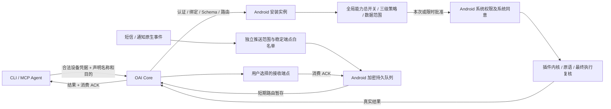

# 全局设备授权重构执行记录

日期：2026-11-01。需求状态：已接受；实现状态：分模块实施中；验收状态：待验证。
基线 `dev@3c9b82d1ef18062fc7dd09546efe6136803079cc` 已通过 `git ls-remote origin refs/heads/dev` 核对。
工作分支 `feature/global-device-authorization-20261101`，独立工作树 `.worktrees/global-device-authorization-20261101`。
完整要求见[规格](../superpowers/specs/2026-11-01-global-device-authorization.md)。

## 已确认事实、待验证假设与设计

- 已确认事实（文档）：旧 ADR-0059、2026-10-28 规格和 CONTEXT 允许配对范围限制与独立后台许可，且记载旧迁移复核；与当前全局授权要求冲突，已明确取代。
- 已确认事实（仓库）：当前 dev 包含此前 Android 唯一能力权威改动；其覆盖范围和剩余执行否决点由本次源码审计确认，旧报告不作为本次通过证据。
- 待验证假设：配对持久状态和发布同步导致切 Core 后授权改变；必须追踪实际存储、发布、执行与日志后确认。
- 设计：Android 安装实例策略决定设备能力；Core 仅校验合法设备访问关系、协议、路由及可靠交付；账号会话、附件、历史的隔离独立保留。

## 分阶段计划与完成条件

| 阶段 | 工作 | 完成条件 | 当前状态 |
| --- | --- | --- | --- |
| 1 | Android、Core/CLI/MCP 并行只读审计；Terra 环境预检 | 文件/函数证据、文档冲突和环境清单 | 进行中 |
| 2 | 固化最小接口、全局迁移、请求生命周期与端点方案 | 明确写集合、兼容性与回归矩阵 | 待实施 |
| 3a | 全局持久策略、旧授权清理、最终裁决及 UI | GLOBAL-01 至 05 自动化通过 | 待实施 |
| 3b | 统一请求声明、稳定端点注册和发现 | GLOBAL-07、11 契约及隔离测试通过 | 待实施 |
| 3c | 短信/通知独立推送、加密队列和生命周期 | GLOBAL-06、08、09 集成测试通过 | 待实施 |
| 3d | 屏幕独立策略及最小 FIFO 租约保护 | GLOBAL-10 并发、撤销、过期测试通过 | 待实施 |
| 4 | Fast、PR 受影响测试及 Terra 运行验收 | 记录真实退出码、版本和分项 PASS/FAIL/BLOCKED | 待验证 |
| 5 | 文档与实际行为核对，PR 指向 dev | 中文提交、PR 链接、保持 Review | 待交付 |

## 证据纪律

自动化、构建、CLI/Core 完整调用、模拟器、物理设备分别记录。
系统特殊权限必须走真实用户批准；测试特权不能冒充普通 Agent 权限；仅用准备的脱敏样本。
CI 触发后只记录链接，不使用 watch 或循环等待。尚未通过的功能不标记完成。
失败修复保留已有工作和可复核证据；禁用技能模板中的永久删除、reset/clean 回滚操作。

## 文档清单

规格、CONTEXT、ADR-0059、旧授权规格、设置规格、协议、Agent 指南、oai-client Skill、Android 能力/插件与 CLI/MCP 操作指南均同步本次模型。
具体实现、自动化结果、Terra 证据和 PR 链接将在对应阶段追加。

## 阶段一源码审计结论（静态事实）

| 入口 | 已确认的当前行为 | 本次修改 |
| --- | --- | --- |
| `platform-kernel/.../PairingGrantState.kt` 的 `PairingGrantBinding.storageKey` | Core地址、账号、安装实例共同构成授权存储键 | 改为安装实例单份策略，绑定只保留传输身份用途 |
| `app/.../PairingGrantPersistence.kt` 的 `load()/prefix()` | 每配对独立状态，旧标记和摘要可反复触发迁移复核 | 原子清理仅旧能力键，默认手动且推送关闭，保留明确本地拒绝 |
| `GatewayRuntime.establish()/teardown()` | 每次连接重新绑定授权，断开清空可见状态 | 连接解绑只暂停执行，本地策略离线可见 |
| `ProductionPluginHost.capabilitySnapshot()/invoke()` | 只有READY才发布可调用binding，尚无每项能力三级策略 | 手动模式可路由到App确认，独立能力总开关和最终复核 |
| `DeviceExecutionDriver.confirm()` | 仅前台确认，等待上限30秒，缺声明和临时许可 | 系统通知和App卡片，上限5分钟，严格参数范围许可 |
| `oai-core/.../capability_policy.py` | `allows()/set()`已报告由Android管理，无旧账号开关实时否决 | 保留已有退场和历史请求栅栏，不重复迁移 |
| `oai-core/{cli,mcp,client,device_service}.py` | 调用声明未贯通，REST严格三字段 | 加入非可信Agent名称和目的，保留凭据与设备绑定 |
| `notification-host`、`sms-collector` 生产入口 | 通知桥未挂载，短信运行工厂无生产安装，默认deny-first | 将真实事件源接到独立推送及加密ACK队列，不只实现Outbox类 |
| `oai-core/device_service.py` 的 `acknowledge()` | 依据Claim存在即可ACK，缺持久ACK回执 | 仅终态结果可ACK，增加可重试回执；主动推送逐端ACK独立 |

以上来自两个子Agent对 `3c9b82d1` 的只读源码核对，不代表原始问题已由运行环境复现。

## 阶段二最小方案

- 安装实例持久化revision、明确关闭及每能力 `enabled/mode`；策略键绑定插件作者、能力、真实Schema与风险，更新不得自动扩大自动许可。配对ID只作为每条连接和请求的投影。
- 临时许可只存内存、采用单调时间，按可信操作与规范化参数摘要精确匹配，跨合法Core/账号/Agent共享；无法证明更宽数据范围时要求重新确认。
- 执行和原语调用前、敏感结果返回及每次HTTP重投前重新检查策略与许可；迁移提升本地版本，旧敏感执行日志不可重用。
- Core/CLI/MCP与schema由同一子Agent归口修改；App UI、主动推送、屏幕FIFO租约分配不重叠写集合；主Agent负责全局策略、持久化、宿主执行与生产连接整合。
- 所有队列长期正文保存在Android加密存储。Core只做短期有界路由暂存和ACK元数据，端点名称不充当可信身份。

## 2026-11-01 整合中间证据

- 文档阶段已提交 `2e6a799ca5456125720e27353719ba898a6fc4dc`。源码仍在工作树整合，以下测试不归属于该文档提交；最终交付会记录源码提交。
- 第一轮完整 App 生产及测试源码编译成功，日志 `docs/plans/2026-11-01-global-device-authorization/android-compile.log`；不是所有单测通过。
- App 定向第4轮为87项、31失败，定位到新授权摘要校验不接受仓库标准 `sha256:` 前缀，已修并补回归。第5轮108项、2失败：通知fixture未安装登录采集门槛，以及附加连接交付恢复等待；仍在修复复测。
- 已实现安装实例单份持久策略、旧授权键原子清理、独立模式和SMS被动范围、单调时间临时许可、系统通知确认、多个认证设备连接投影、独立推送配置/加密队列/精确撤回与系统调度。屏幕租约和多连接按请求授权仍在最终接线。
- 独立安全复核指出审计失败回滚许可与附加连接取消漏洞：已改为持久拒绝屏障后审计、可恢复手动模式；运行请求扫描消费取消、敏感结果上传前核对远端状态，Core继续补原子取消保护。
- Terra已准备隔离Core A/B、专用账号、TLS和ADB反向端口，尚无新APK业务验收结论；未发现实体手机。
- 跨宿主协议一致性缺少固定OpenClaw checkout，正在仓库ignored运行目录补齐固定版本依赖；不会据此跳过该门禁。

## 最终数据流（整合版本，门禁待完成）

全局策略不按连接分区；连接认证、签名、公钥与配对代次仍独立校验。各账号私有会话、附件、历史不进入设备请求后台恢复扫描。
单次批准绑定完整连接与请求；限时许可按能力、可信操作与参数摘要共享。切换模式或收窄范围提升全局版本，使旧在途批准失效。
本地审计失败会保留拒绝屏障，重启可在审计恢复后以手动模式恢复；不回写旧自动允许值。

## 直接受影响 Android 模块验证

同一工作树执行 `:control-ports:testDebugUnitTest :screen-control:testDebugUnitTest :device-primitives:testDebugUnitTest :platform-kernel:testDebugUnitTest :notification-collector:testDebugUnitTest :sms-collector:testDebugUnitTest`，
最终 Gradle 退出码0，283项、0失败、0错误、0跳过。分项为38/28/51/78/44/44；日志 `docs/plans/2026-11-01-global-device-authorization/runtime/android-core-modules.log`，
JUnit报告在各模块 `build/test-results/testDebugUnitTest`。这证明这些模块当前自动化结果，不证明App完整门禁或设备矩阵通过。

首轮Fast前序：Core612通过、1跳过、6子测试通过；Hermes原生143通过；DSH37通过；通信测量25通过。
Fast最终因屏幕模块一处ConcurrentHashMap成员调用编译失败退出1；该编译问题已修且上述模块任务通过，最终Fast/PR仍待统一重跑。
跨宿主协议一致性在补齐固定OpenClaw checkout及历史Hermes一致性runner依赖后3项通过，未修改runner输出或跳过向量。

## 协议与隔离安全最终定向结果

- `npm test --prefix gateway-contract`：179项通过（包含跨宿主3项），10个测试文件通过；协议类型检查退出0。日志位于 `runtime/protocol-final.log`、`runtime/contract-types.log`。
- Core推送精确撤回、迟到投递撤销栅栏、取消后敏感结果保护及签名pending/短期presence：45项通过，日志 `runtime/core-revoke-cancel.log`。
- 验收准备脚本：10项通过；固定源码快照检查3项通过；官方签名插件来源/篡改检测5项通过。这些是测试工具证据，不是设备业务验收。
- 附加连接恢复修复：旧owner迟到回调不能误解绑新owner，独立registrationId撤销并已通过结果只补报一次回归。
- App与采集器间采用 `capability-ports/DevicePushSources`，生产实现位于 `device-primitives`，保留原App无直接采集器依赖边界。

## 兼容与回滚说明

Core封闭Schema hash由基线 `sha256:032f580246eb4a214624bded717819b4d5a76191208207edc9e5a4607f5c4d23` 更新为
`sha256:38786286ca26f601747cf7e52953e1cd4a57b8089e3b95cdc31fbb6f7a8b6d83`，Android生成常量已同步。
新App与旧Core或旧App与新Core需按原hash协商明确报告不兼容，不跳过签名/协商，也不降级成旧账号能力grant。
CLI/MCP旧无caller调用返回明确错误，升级调用端需要同时携带声明；设备访问凭据不因本地能力发布revision变化失效，
已创建请求仍绑定原revision，旧撤销/迁移fence不会清理或复活。

Android旧授权键迁移是不可自动逆转的本地模型升级，不把旧配对正向许可当作回滚数据。
需要回滚时须使用经核验的一致版本备份；不能靠重建账号、替换主密钥、卸载App或清空数据恢复。
本次没有执行共享生产部署或业务回滚验收，测试Core与模拟器隔离用户不代表现网已升级。

## App测试进程隔离证据

全App单JVM回归出现多项Compose空闲超时，线程栈确认测试主线程反复进入 `ComposeIdlingResource.isIdleNow`，
并非等待远端CI。保留 `runtime/app-full-idle-threads.txt` 后终止该已失败的测试worker；该次退出1，1162项、7失败、1跳过，不算通过。
相同会话分享与离线插件授权用例在新JVM定向运行14秒通过，日志 `runtime/ui-idle-isolated.log`。
因此将App单测按测试类隔离JVM（Gradle标准 `forkEvery=1`），复用全部编译和依赖缓存，保留原断言/空闲检查，
不放宽产品授权或修改Mock绕过结果。最终以随后完整Fast/PR退出码为准。

## Fast完整通过（当前阶段源码）

`npm run test:fast` 最终退出码0，日志 `runtime/fast-isolated.log`：Core624通过、1跳过、6子测试通过；
Hermes原生143通过；DSH37通过；通信测量25通过；Gradle完整受影响任务 `BUILD SUCCESSFUL`。
App JUnit汇总1295项、0失败/错误/跳过；platform-kernel79、gateway-client318、conversation-ui684、conversation-domain34、
control-ports38、capability-ports51、device-primitives51等全部退出0。
这一轮结束后补上系统MediaProjection入口移除旧屏幕会话前置的新回归，最终 `npm run test:pr` 正在覆盖该补丁；
不以Fast阶段结果替代最终源码SHA的PR与运行证明。

## PR准入门禁通过

最新实现执行 `npm run test:pr` 最终退出0（`runtime/pr.log`）：Core624通过、1跳过、6子测试通过；Hermes原生143通过；
DSH37通过；通信测量25通过；Gradle全部指定任务成功，用时7分40秒。该轮已包含系统截图入口去除旧会话前置及对应回归。

| Android模块 | 测试数 | 失败/错误/跳过 |
| --- | ---: | --- |
| app | 1297 | 0/0/0 |
| control-ports | 38 | 0/0/0 |
| capability-ports | 51 | 0/0/0 |
| screen-control | 28 | 0/0/0 |
| device-primitives | 51 | 0/0/0 |
| platform-kernel | 79 | 0/0/0 |
| gateway-client | 318 | 0/0/0 |
| conversation-ui | 684 | 0/0/0 |
| conversation-domain | 34 | 0/0/0 |

协议179项及类型检查另行通过，Core撤销/取消/pending定向45项通过。未执行正式发布Full门禁，不将PR测试当作发布或物理真机证明。
APK已成功构建，最终源码提交后还会重建记录哈希；真实运行矩阵与实体手机缺口见Terra报告。

## 源码提交与PR交付

- 文档规格提交：`2e6a799ca5456125720e27353719ba898a6fc4dc`。
- 源码实现提交：`17895223c16fc84dfbe7c889943a608f7fbaa095`，中文说明“重构: 统一安装实例设备授权并接通可靠主动推送”。
- PR：[\#71](https://github.com/1rua/open-android-intelligence/pull/71)，目标`dev`，已核对为OPEN、非Draft、未启用autoMerge，未合并。
- 提交后重新构建`:app:assembleFullDebug -Poai.requireBundledPlugins=true`退出0。APK 70,727,650字节，SHA-256 `c16db7ef1a0bbb0fb75ab249201a7a103d005c7757a32cff0f3eb5907a79b5f7`。
- 新Schema hash `sha256:38786286ca26f601747cf7e52953e1cd4a57b8089e3b95cdc31fbb6f7a8b6d83`。

本地624项Core测试中的唯一skip已定向核实为`tests/test_uninstall_script.py`的符号链接危险路径场景：
当前托管文件系统不能创建符号链接，在Linux CI执行；不是设备授权断言被跳过。App1297项全部无跳过。

## CI观察（不等待远端）

触发的Core/Android工作流：[41259046237](https://github.com/1rua/open-android-intelligence/actions/runs/41259046237)。
APK产物工作流：[41258964671](https://github.com/1rua/open-android-intelligence/actions/runs/41258964671)。
初次只读核对时，签名插件任务与DSH任务成功，其余部分仍运行；APK在编译前下载第三方Maven镜像依赖时HTTP502失败，
具体URL为`maven.aliyun.com/.../org/ow2/asm/asm-analysis/9.7/asm-analysis-9.7.pom`。已仅重试失败任务一次，未使用watch或循环等待。
最终CI状态需以对应Run和提交SHA核对，不把已触发或某一job成功等同整个CI通过。

真实运行矩阵仍未全部完成，实体手机未连接。PR保持Review且明确该风险；整体goal不因源码和PR已交付而标记完成。

## 未确认事件与时钟回拨补充

最终核对发现push runtime曾在进程启动检测到系统时钟回拨时提前清空全部未确认事件。
这不符合仅在过期、容量或用户撤销时清理的要求，已移除此早清分支；原事件、逐端收据和原始截止时间保持不变，
运行期继续用单调时间及持久观察锚维护到期。补充真实加密持久队列重启、回拨后仍可按原事件投递、再按单调时间正常过期的回归。
该后续补丁在`17895223`之后，需重新通过Fast/PR并另行中文提交，不能沿用旧提交通过状态。

## Android登录阻塞的实测根因与调试环境修复

Terra在隔离用户10中运行真实Android `CoreTlsConnectivityTest`，明确为1项1失败（ADB命令退出0不能当测试通过）：
`SSLHandshakeException / CertificateException / CertPathValidatorException`，原因`Trust anchor for certification path not found`。
探针使用App默认HTTPS、不携带凭据，主机端同CA验证及Core401、ADB反向端口均可用，证据把故障定位到调试App对用户测试CA的信任。

使用Android标准Network Security Config，在`src/debug`声明debug-overrides，仅调试构建认可用户在系统设置真实安装的CA；
不新增TrustAll/自定义HostnameVerifier，不改主机名或协议SPKI校验，不影响正式构建的证书策略。
需要以同一探针先红后绿及实际登录复测闭合，不能用静态XML存在代替通过。

## 源码提交17895223的CI结果补充

Core工作流已结束：Python3.11、Python3.12、Hermes native、DSH均成功；Android失败于318项gateway-client测试中的1项：
`GatewayWebSocketTransportTest.each handshake uses the shared complete session snapshot`，
`kotlinx.coroutines.test.UncaughtExceptionsBeforeTest`。现有控制台没有附带该提前异步异常的来源，尚未认定为产品缺陷或环境偶发。
后续仅补充完整异常日志和CI JUnit报告保留，不移除断言、不跳过WebSocket测试、不因本地通过而改称远端通过。
APK产物任务的Maven502已仅重试一次；后续head的CI另按新SHA观察，不对旧run做前台轮询。

## Android TLS先红后绿与登录成功

Terra复测使用App `677155810ca6c9a957ee29c859d9318df6d806c7fc4d63289ebd4254b237ee1d`、
testAPK `780ea9db6d46e393de7f1db953a13d3f978e3948e78abc38c3aba48516eca7c3`，设备安装后哈希一致。
同一`CoreTlsConnectivityTest`在debug用户CA配置下`OK (1 test)`，确实断言CoreA未认证接口返回401，
随后真实UI账号密码登录进入CoreA主页，日志09:34:30.316（Asia/Shanghai）记录`session.ready`，
关联请求`reqce8f278b3d674e15b4ec`返回HTTP200。未关闭TLS、未跳过协议SPKI/主机名校验。
这证明测试环境的TLS与登录路径已闭合，不等于实时通道、设备能力或实体手机矩阵通过。

## 后续修复门禁（未替代源码17895223结果）

保留未确认队列的时钟回拨补丁及脱敏连接诊断、debug用户CA配置，已再次通过Fast与PR完整入口
（`runtime/acceptance-fix-fast.log`、`runtime/acceptance-fix-pr.log`均退出0）。
之后新增“每条连接凭据当前有效性进入内核最终检查”补丁和立即退出回归，正在定向及最终门禁验证；
该补丁使退出/会话撤销无需等待10秒后台扫描，且不改变持久模式或有效队列。
CI已补完整异常链输出和always上传Android JUnit/HTML报告，仅增强失败证据，未屏蔽失败断言。

## Terra实测设备请求链路（通话记录）

隔离user10真实Android系统UI已分别拒绝和允许READ_CALL_LOG；拒绝时CLI能力发现明确`ANDROID_PERMISSION_REQUIRED/READ_CALL_LOG_REQUIRED`，
允许后目录READY、本机模式仍MANUAL。实际请求`devreq_807c16e8-f620-4c4c-9c32-e1c356e9d955`经App卡片拒绝后
CLI返回`denied/LOCAL_USER_REJECTED`，Android同requestId记录结果已被确认接收。没有返回通话记录正文。
先前请求因未及时操作真实超时返回`LOCAL_CONFIRMATION_TIMEOUT`，与用户拒绝分开记录。

现场发现按钮区重叠（此次用Tab/Enter准确激活拒绝）以及终态仍带awaiting进度：
按钮改标准Dialog单一纵向操作区，每个48dp独立触控范围，新增五按钮不相交测试并通过；Core输出只在claimed且未过期时公开进度，
先红后绿真实HTTP10项通过。最终新APK上触摸拒绝和终态字段复测仍待Terra闭合，不能把键盘成功代替按钮修复验收。

## 后续修复最终自动化结果

`runtime/review-fixes-fast.log`和`runtime/review-fixes-pr.log`均最终退出0；Core因新增终态进度回归更新为634通过、1跳过、6子测试通过，
Hermes143、DSH37、通信测量25通过，Gradle受影响任务全部成功。
App报告为1300项、0失败/错误/跳过。上述结果覆盖当前队列时钟回拨、凭据即时撤销、debugCA、确认按钮分区和Core终态进度补丁。

真实Core CLI/MCP已注册/发现两个稳定接收端点，五项未认证API均401；随后以同账号设备关系的独立新B凭据验证
B访问A、A访问新B的owned deliveries均403，名称或账号相同不扩展端点持有权。
端到端主动推送的手机选择、真实OS样本、逐端ACK仍待运行，不能以端点注册代替接收许可。
