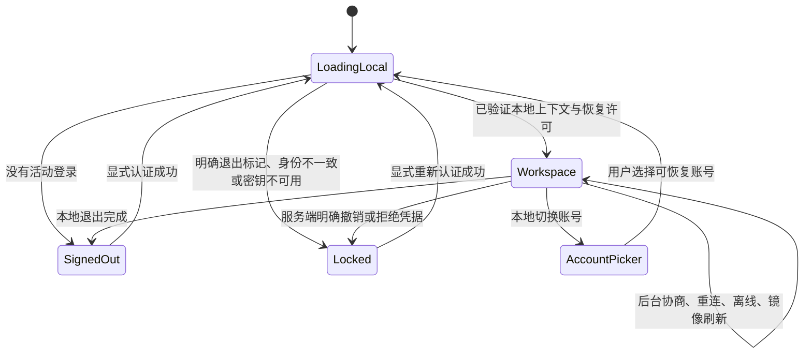

# Android 登录、会话恢复与本地退出修复计划

> 状态：只读审查与修复设计，尚未实施。
>
> 审查日期：2026-10-28（Asia/Shanghai）。
>
> 最终审查基线：`dev`，`737f87e5a90bcf6bb012064300660bb408aea061`。审查开始于 `c91d54310fb549d643baded5b4d535ee148c85b5`，当时工作区干净；结束前共享分支前进至上述最终 SHA，通过 GitHub 只读分支接口再次确认本地与远端一致。
>
> 基线变化核验：这段新增提交仅改 Core 的 capability_policy.py 及五个相关测试文件；`apps/android`、本文引用的 Core 退出实现与相关 ADR 没有差异，因此下面 Android/认证证据及行号同时适用于两个 SHA。本文不对同期新增的能力默认策略作回归通过声明。本次未执行这些提交或合并。
>
> 本次唯一产出为本文档。不修改业务代码、配置、测试或其他文档，不运行 App，不实施修复，不创建提交或 PR。

## 1. 结论与证据边界

两个现象都有直接的源码依据，但不能把全部原因归到 OAI Core 重构：

1. **冷启动页面选择错误。** 根页面把“尚未恢复本地状态”“正在认证”“用户确实未登录”都落到登录表单；本地镜像又要等第一次网络失败后才打开。已经保存的本地会话不能独立决定首屏。该结构在 Core 重构前已经存在。
2. **离线退出受远端确认控制。** 运行时明确拒绝 `OfflineMirror` 状态下的退出，在线退出也要等远端成功后才清本机凭据。设置页同时把退出和切换账号入口放在 `Connected` 条件内。切换账号的运行时函数本身已具备本地离开能力，不能笼统归因为“换号接口必须联网”。
3. **Core 原生会话存在额外的持久化缺口。** `b3272537` 新增原生会话工作台时绕过旧镜像仓库，并把原生分支的 `persistence` 设为 `null`。只改页面判断或提前调用旧镜像恢复，不足以恢复 Core 原生聊天的本地首屏。
4. **退出不能简单改成后台发送旧请求。** 当前 Core 的 `revokeRefresh=true` 按设备撤销全部有效刷新凭据；旧退出请求迟到执行可能撤销同设备新登录的凭据。客户端的任务取消或代次检查只能保护本地状态，不能缩小服务器的撤销范围。

本文使用以下证据等级：

| 标记 | 含义 | 本次可得出的结论 |
| --- | --- | --- |
| F：静态事实 | 当前源码、历史文件与提交差异可直接核对 | 分支条件、调用顺序、持久化接线、清理范围、现有测试预期 |
| H：待验证假设 | 根据可达代码及时序提出，尚未执行对应场景 | 实际显示的帧数、具体用户设备的数据残留、并发触发频率 |
| P：拟议设计 | 后续实现应达到的行为 | 状态模型、修改方案、测试与验收要求 |

**本次未执行问题的运行复现、Android 自动化测试、构建、真机验收或生产 Core 联调。** 阅读测试源码不等于测试通过。用户未提供已验收正常的旧 APK/SHA；下面选取有明确父子关系的重构前提交作为源码比较基线，不把它称为已验证的正常版本。

## 2. 问题复现与取证方案

本节是后续实施时的复现步骤，本次没有执行。使用独立测试账号与可控 Core，保留 App 数据；进程终止使用 force-stop 或测试框架终止，不清除应用存储，不解除配对。

### 2.1 冷启动登录页闪现

前置条件：已完成引导，账号 A 在 Core A 成功登录；选择 Agent X，打开已有会话，读到双方历史并保存草稿。记录 APK 对应提交、Core 提交、账号与设备的脱敏标识、最近线程以及本地持久化完成点。

1. 完全终止 App 进程，重新从桌面启动。
2. 分别测试 Core 正常、协商响应被挂起、刷新响应被挂起、连接拒绝、网络超时与断网。
3. 记录根页面状态序列以及登录表单是否进入 Compose 语义树；实际闪帧由 UI 帧记录或屏幕录像核对。
4. 网络保持挂起时，检查本地会话列表、双方消息、最近线程和草稿是否已显示。
5. 断网进入镜像后恢复 Core，检查恢复期间是否再次进入登录页、草稿是否变化、是否重复发送。

F：当前代码存在先选择登录页、后建立在线或离线工作台的区间。H：用户设备上该区间持续多久、是否每次都被绘制、是否受动画放大，均需上述运行证据确认。

### 2.2 Core 离线时退出、换号与改地址

1. 账号 A 登录后终止进程，使 Core 不可达，再启动至离线镜像。
2. 打开“设置 → OAI Core 管理”，检查身份显示、退出与切换账号入口。
3. 从会话抽屉点击“退出登录”，检查提示、页面与保存的默认账号指针。
4. 对“连接仍显示 Connected，但服务端已失联”的情况重复，分别注入 503、401 与无响应。
5. 在首次认证、自动恢复、凭据轮换、重连交接各阶段尝试换号和改地址。

F：设置页会隐藏账号操作；抽屉出口会到达运行时离线拒绝分支；远端失败会跳过本地退出清理。H：具体设备停在哪个连接阶段、现场是否还存在持久化失败，需要现场状态与脱敏日志区分。

### 2.3 历史版本比较方式

同一套独立测试数据分别运行当前版本与选定旧版本，保持 Core 协议能力、账号、引导状态、网络故障点一致。旧 App 与新 Core 不兼容时单列，不把“旧版没有原生会话入口”当成启动问题消失。只记录阶段、代次、错误码和耗时，不记录密码、刷新凭据、访问令牌、签名材料或聊天正文。

## 3. 当前流程与代码证据

以下未特别注明的行号均属于当前基线。链接使用仓库内相对路径；历史行号必须结合第 5 节指定的 SHA 查看。

### 3.1 启动、导航与连接恢复

| 编号 | 文件、函数与位置 | F：源码可直接确认的行为 |
| --- | --- | --- |
| E01 | [GatewayRuntime.kt](../../apps/android/app/src/main/kotlin/com/openandroidintelligence/mobile/GatewayRuntime.kt)，字段初始化，187–192、311–319 | 初始登录状态为 `SIGNED_OUT`，连接阶段为 `Disconnected`，工作台为 `null`；没有“本地状态尚未检查”的根页面事实。 |
| E02 | [MainActivity.kt](../../apps/android/app/src/main/kotlin/com/openandroidintelligence/mobile/MainActivity.kt)，`onCreate()` 内根页面，179–183、550、589–609 | 分别收集 `phase/controller`；仅 `(Connected 或 OfflineMirror) 且 controller != null` 进入工作台，其余状态显示 `GatewayLoginScreen`。根导航没有使用现有 `loginStatus` 区分恢复与退出。 |
| E03 | 同文件，338–341；[OpenAndroidIntelligenceApplication.kt](../../apps/android/app/src/main/kotlin/com/openandroidintelligence/mobile/OpenAndroidIntelligenceApplication.kt)，74–83、158–165；`GatewayRuntime.onAppForegrounded()/onNetworkAvailable()`，375–396 | Compose effect、前台生命周期与网络恢复都可能触发恢复；后台服务合法重建另经 `onBackgroundSessionRestarted()`。不能把 effect 当成唯一恢复入口。 |
| E04 | `GatewayRuntime.restoreSessionIfAvailable()`，986–1009、1024–1041 | 检查上次账号、设备编码和刷新凭据后，先发布 `RESTORING/Negotiating`，再协商、轮换凭据、`establish()`。本地工作台没有先建立。 |
| E05 | 同函数，1043–1061；`showOfflineMirror()`，962–982 | 只有遇到可重试网络失败才打开加密镜像，创建 `allowSending=false` 的工作台，再发布 `OfflineMirror`。SSL、结果未知等故障另有分类，并非所有错误都进入镜像。 |
| E06 | `restoreSessionIfAvailable()`，1032–1038；`establish()`，1165–1178、1446–1451 | 重连时先关闭离线工作台并把 `controller` 置空，随后异步初始化在线工作台。该窗口再次使 E02 的工作台条件为假。 |

当前可达顺序为：

```text
进程创建 → Disconnected / controller=null
         → 根页面选择登录表单
         → 恢复检查 → Negotiating → 网络协商与刷新
             ├─ 成功 → 本地初始化 → Connected + 工作台
             └─ 可重试失败 → 此时才读取镜像 → OfflineMirror + 工作台 → 后台重试
```

**根因一（F）：根导航采用连接状态推导本地登录与可展示状态，并且镜像恢复排在网络失败之后。** 即使前台生命周期比 Compose effect 更早启动恢复，`Negotiating` 仍属于登录页分支，因此仅移动 effect 或换一个触发点不能修复状态模型。

### 3.2 退出、切换账号与 Core 地址

| 编号 | 文件、函数与位置 | F：源码可直接确认的行为 |
| --- | --- | --- |
| E07 | [SettingsViewModel.kt](../../apps/android/app/src/main/kotlin/com/openandroidintelligence/mobile/SettingsViewModel.kt)，`SettingsUiState`，46–59 | `isGatewayConnected` 仅接受 `Connected`；用户名与地址也仅由该状态投影，导致离线子页显示“未登录”和“—”。 |
| E08 | [SettingsScreen.kt](../../apps/android/app/src/main/kotlin/com/openandroidintelligence/mobile/SettingsScreen.kt)，`GatewaySubScreen()`，1222–1261 | 整个“账号与会话”区受在线条件控制，刷新、退出、切换账号等入口在离线时消失。1127–1130 的地址只是显示项，没有编辑回调。 |
| E09 | 同文件，307–315；`SettingsViewModel.logout()/chooseAnotherAccount()`，315–320 | ViewModel 直接转发运行时操作。换号回调调用后立即 `onBack()`，没有等待本地切换是否成功。 |
| E10 | `GatewayRuntime.logout()`，549–591 | 离线状态直接返回；其他情况要求已连接且连接任务空闲。先调用远端退出，失败返回，401 还可能先续期再重试。 |
| E11 | 同函数，594–611 | 远端成功后才清刷新凭据、refresh journal、默认账号指针并关闭工作台；因此本地退出被远端响应决定。 |
| E12 | `chooseAnotherAccount()/selectSavedAccount()`，622–647；`leaveWorkbench()`，649–687 | 换号可取消自动恢复，再走本地保存与关闭流程；并不要求远端确认。非恢复的连接任务活跃时仍可能静默返回。 |
| E13 | `MainActivity.GatewayWorkbenchScreen()`，798；[ThreadDrawer.kt](../../apps/android/conversation-ui/src/main/kotlin/com/openandroidintelligence/conversation/workbench/ThreadDrawer.kt)，160–176 | 会话抽屉退出没有设置页的在线可见性门禁，最终仍调用同一个离线拒绝的 `runtime.logout(true)`。 |

**根因二（F）：运行时把远端撤销成功作为本地退出的前置条件，设置又把本地身份管理与在线连接混在一个门禁里。** “离线切换账号不可达”的主要直接证据是入口隐藏；不能据此声称 `chooseAnotherAccount()` 本身必然联网。当前缺少独立的离线地址编辑入口，用户只能依赖回到登录表单修改地址。

### 3.3 Core 原生会话与镜像

| 编号 | 文件、函数与位置 | F：源码可直接确认的行为 |
| --- | --- | --- |
| E14 | `GatewayRuntime.establish()`，1388–1401、1440 | 原生模式选择 `CoreAgentConversationRepository`，不走 `mirroredRepository`；`persistence = if (nativeAgentSessions) null else mirror`。 |
| E15 | [CoreAgentConversationRepository.kt](../../apps/android/app/src/main/kotlin/com/openandroidintelligence/mobile/conversations/CoreAgentConversationRepository.kt)，`listConversations()/timeline()`，250–265、288–310 | 通过 `client.sessions/history` 取得数据后返回映射结果，这两条读取路径不写完整镜像。 |
| E16 | [WorkbenchController.kt](../../apps/android/conversation-ui/src/main/kotlin/com/openandroidintelligence/conversation/state/WorkbenchController.kt)，初始化，1279–1317；`persistCheckpoint()`，4888–4904 | 最近线程、消息与草稿依赖 `persistence?.load()`；持久化为空时 checkpoint 保存直接返回。 |
| E17 | [NativeConversationOrganizationStore.kt](../../apps/android/app/src/main/kotlin/com/openandroidintelligence/mobile/conversations/NativeConversationOrganizationStore.kt)，31–72；`GatewayRuntime`，1453–1475 | 已保存 Agent 选择及按 Agent 区分的排序、文件夹等偏好，但组织存储不包含聊天正文、草稿与最近线程。 |
| E18 | `showOfflineMirror()`，962–981；[EncryptedConversationMirror.kt](../../apps/android/app/src/main/kotlin/com/openandroidintelligence/mobile/conversations/EncryptedConversationMirror.kt)，23–34 | 离线仍固定读取旧会话镜像，其范围包含 profile、Gateway、account、installation，未包含原生会话面与 `agentId`。 |

**根因三（F）：原生工作台脱离完整镜像，而离线恢复仍读旧镜像。** 这证明当前接线无法保证原生聊天的本地恢复，不证明服务器历史被删除。H：若用户有旧协议镜像残留，离线可能显示旧内容；若没有残留，可能只有空镜像。必须读取对应作用域或运行隔离测试确认，不能把两种情况写成现场事实。

### 3.4 持久化与安全边界

| 编号 | 文件、位置 | F：当前边界 |
| --- | --- | --- |
| E19 | [AndroidAccountProfileStore.kt](../../apps/android/app/src/main/kotlin/com/openandroidintelligence/mobile/AndroidAccountProfileStore.kt)，11–39、54–80 | AccountManager 保存公开资料、账号/设备 Binding、所选 Agent；不保存密码和刷新秘密。 |
| E20 | `GatewayRuntime.profileIdFor()/saveLastProfile()/clearLastProfile()`，1891–1938 | profile 由规范化 URL 与用户名编码；`saveLastProfile()` 同时更新目标 profile、全局默认指针及运行时账号标识，并非仅保存轮换结果。 |
| E21 | `rotateStoredSession()/persistRotation()`，874–926 | 校验刷新响应的 account/device；`NonCancellable + IO` 保证已经轮换的秘密持久化，其中也会调用 `saveLastProfile()`。 |
| E22 | `teardown()`，1770–1806 | 停止工作台、通知、气泡、设备执行与屏幕控制，清访问令牌与客户端，执行 `pairingGrants.unbind()`；普通退出无需删历史或设备密钥。 |
| E23 | [GatewayAuthClient.kt](../../apps/android/gateway-client/src/main/kotlin/com/openandroidintelligence/gateway/auth/GatewayAuthClient.kt)，`logout()`，145–173 | 现有 DELETE 需要 access token 和 account/device/session，只有 2xx 成功判断，没有退出 operation ID 或结果查询接口。 |
| E24 | [Core 的 core.py](../../oai-core/src/oai_core/gateway/core.py)，`_handle_session_logout()`，4789–4813；`revoke_refresh_credentials()`，3966–3991 | 验证旧 access session 后，`revokeRefresh=true` 更新该账号数据库下该 device 的全部 active 刷新凭据，不按旧 session 或凭据代次限定。 |
| E25 | [SqliteConversationRecords.kt](../../apps/android/app/src/main/kotlin/com/openandroidintelligence/mobile/conversations/SqliteConversationRecords.kt)，61；[EncryptedPluginState.kt](../../apps/android/app/src/main/kotlin/com/openandroidintelligence/mobile/plugins/EncryptedPluginState.kt)，20–23；[AndroidKeystoreGatewayCredentialStore.kt](../../apps/android/gateway-client/src/main/kotlin/com/openandroidintelligence/gateway/auth/AndroidKeystoreGatewayCredentialStore.kt)，57、97–114 | 现有读取路径会调用 getOrCreate 或同类方法，原别名不存在时可能生成新 AES 密钥。因此提前读取旧密文必须配套只读取钥入口，不能只承诺“保留 Keystore 实现”就保证不生成替代密钥。 |

E24 是源码可证实的服务器作用域；“旧退出请求在新登录之后执行”是需要屏障测试验证的并发场景。不能以客户端忽略旧回调为由，认为服务器不会撤销新刷新凭据。

## 4. 已有并发防护与待验证风险

不把“使用协程”“没有 join”本身当成根因。现有保护包括：`restoreSessionIfAvailable()` 的同步入口和 job 门禁，恢复任务 finally/completion 的所有者检查（1064–1089），`sessionOperationMutex`，`requireReauthentication()` 先关闭续期再锁内清理（929–947），以及 [GatewaySessionRenewal.kt](../../apps/android/gateway-client/src/main/kotlin/com/openandroidintelligence/gateway/auth/GatewaySessionRenewal.kt) 的 closed/owner 检查（39–54、105–109）。

| 编号 | 场景与现有依据 | 当前判定 | 修复必须验证的要求 |
| --- | --- | --- | --- |
| R01 | effect、前台与网络回调同时恢复；986–990 有门禁 | F：已有常规去重，未证实重复恢复缺陷 | 本地引导只运行一次；联网所有者至多一个，重复回调不重置页面。 |
| R02 | 离线工作台重连时 1036 清 controller | F：存在再次选择登录页的状态窗口；可见帧数为 H | 旧本地视图保留到新工作台就绪，以一次状态发布交接。 |
| R03 | `cancelRestoration()` 658–667 取消但不等待，随后换号 | F：取消不是持久化结束；现有同锁收尾可保护一般路径，不能认定已经账号复活 | 保留不可取消轮换保存的目的；旧代次只能写自己的必要记录，不能恢复旧活动选择。 |
| R04 | 将退出改成本地优先后，迟到的轮换仍执行 920–926 | P 引入时必须防范的风险，当前未运行复现 | 每 profile 持久退出屏障与短时本地写入锁共同保护，退出后不得回写可恢复凭据。 |
| R05 | `login()` 463–539 的成功保存与 establish；原生 Agent collector 1459–1500；旧平台事件 | H：旧意图与新意图交错的具体运行结果待验证 | 每次发布身份、工作台、通知或处理撤销前校验上下文代次、profile、HTTP/session 所有者。 |
| R06 | 设置换号立即 onBack，但 flush 649–655 可失败 | F：关闭界面先于完成结果；用户实际感知待复现 | 由本地操作结果驱动关闭弹层/打开选择器；保存失败仍可知原因。 |
| R07 | 换号、改地址遇到非恢复的 connectionJob 活跃而 return | F：本地操作可能被长认证任务挡住 | 本地意图可替换旧认证意图；不能用持有网络工作的 job 代表本地操作锁。 |
| R08 | `teardown()` 同时清连接与 `_loginStatus` 1803–1806 | F：停止运行态会被表达成退出 | 区分“停止远端运行态”“锁定/退出本地身份”，重连和正常离线不得自动写 SignedOut。 |
| R09 | 原生切 Agent 同 ID 会话、离线落盘、两控制器交接 | H：直接复用旧 mirror 的潜在串数据风险 | 存储按面与 Agent 分区；同一范围同一时刻只有一个有效写入者。 |
| R10 | 旧 `revokeRefresh=true` 请求延迟到同 device 新登录后执行 | F：服务器会按 device 扩大撤销；该时序未运行 | 普通本地退出不得留下能撤销新刷新凭据的后台任务；超时不得当作服务器未执行。 |

## 5. 历史版本对比与引入范围

本地 `git rev-parse --is-shallow-repository` 为 `true`，`dev` 的直接历史存在 `552fb2c8` 边界，另有 `08385b17` 边界。对这些行的 blame 显示边界，不代表真实引入提交。本次使用其他本地 refs 中可读的历史、`git log --all -S`、`git show` 及 GitHub 只读提交列表交叉核对，未执行 fetch、checkout 或修改 Git 元数据。

| 提交与上海时间 | 核对内容 | 能确认什么，不能确认什么 |
| --- | --- | --- |
| `ce55a8bd6dc4be40584fc9627f765e2f39d74a6a`，2026-09-03 01:22 | 旧路径 `apps/android/app/src/main/kotlin/com/agentlife/mobile/MainActivity.kt` 的 52–55、110–143 接入 effect 恢复及非 Connected 登录分支；同提交新建 GatewayRuntime，120–133 为远端先成功再本地清理 | F：这是当前可追踪 Runtime 根分支及远端优先退出的接线引入点。父版本仍是 LinearLayout 分类导航，并无这套完整恢复流程，不能把父版本当作已验收的正常认证版本。 |
| `22fc40d6fa75c9792d66ae379a9c05266b83fc97`，2026-09-03 02:35 | 品牌改名后 MainActivity 52–55、110–143 继续上述恢复与导航 | F：仅延续接线，不是根因新引入。 |
| `c7ec2cb8aa6a73684a616c2cbd4ab4d9122d1d67` 的父版本，2026-09-13 前 | 历史 GatewayRuntime 131–157，远端 logout 失败即 return，后续才本地清理 | F：远端优先语义继续存在，不能归到后来明确离线拒绝的提交。 |
| `a49c95bff33682890675557b2093127405a9f9ea`，2026-09-20 22:55 | 新建分组设置；历史 SettingsScreen 787–814 | F：新设置页把退出管理放进 `isGatewayConnected`，可具体定位可见性耦合的引入。 |
| `b5907815a212a0680fabcb2ee6ee35c2c1009939`，2026-10-11 04:59 | GatewayRuntime 历史 282–285 新增明确 OfflineMirror 拒绝；MainActivity 新增工作台退出接线 | F：明确离线拒绝分支由此引入。父版本已经远端优先，不能说该提交首创全部退出限制；它也修复了真实按钮接线，不宜整体回退。 |
| `0435c78df4dc3ff2109dc453bc627cac8708e699`，2026-10-18 18:51 | 持续恢复、刷新互斥、撤销处理；换号可取消恢复 | F：增强恢复并改善本地换号；仍保留远端退出前置要求，不是本地先恢复界面的实现。 |
| **重构前直接基线** `00642ad15c88fbd43d68ae36cad7cc5e0ecf3e4a`，2026-10-26 02:37 | 它是 `ab496489` 的父提交。历史 MainActivity 334–336、462、502–521；GatewayRuntime 535–597、948–1023 | F：已有与当前等价的根导航、离线拒绝、网络先行恢复。该基线不支持“重构前必定无闪现”的断言。 |
| `ab496489a63ea81c51f2de193a0de30df132b58b`，2026-10-26 08:21 | 统一 Core 与原生多 Agent；添加原生分支及初始化交接保护 | F：不是上述根页面条件、离线拒绝的首次引入。应保留其协议与初始化保护目的。 |
| **明确接线变化** `b32725374baf40cf3d11693bbcd21eec55f253e3`，2026-10-26 20:48 | 父提交 `736e458c481aa7a79b5e2d984efda7bcaf4c1287` 的 GatewayRuntime 1378–1403 固定使用 mirroredRepository/mirror；本提交引入 coreAgentRepo 与原生 persistence=null | F：原生完整镜像缺口可定位到该变更。不能反推父提交已能正常使用 Core 原生会话。 |
| `726233b96b83192d66c0422d4074a0c7153af675`，2026-10-27 23:02 | 增加原生会话组织存储并恢复多项交互 | F：只补排序/文件夹等持久偏好，未恢复完整原生聊天镜像。 |
| `c91d54310fb549d643baded5b4d535ee148c85b5`，2026-10-28 08:23 | 审查起始 dev | 上述启动、退出门禁与原生持久化缺口仍在。 |
| `737f87e5a90bcf6bb012064300660bb408aea061`，2026-10-28 17:26 | 审查结束前的最新 dev；合入设备能力默认策略变更 | F：与 c91d5431 比较，Android 及本文引用的 Core 退出实现、相关 ADR 内容一致；本文结论延续，未推断新策略的运行效果。 |

历史差异中的关键逻辑：

```kotlin
// b3272537 之前，736e458c 的工作台接线
repository = mirroredRepository
persistence = mirror

// b3272537 引入，当前原生分支继续使用
val activeRepo: ConversationRepository = coreAgentRepo ?: mirroredRepository
persistence = if (nativeAgentSessions) null else mirror
```

**历史归因结论：**当前现象是旧的生命周期耦合与新的原生镜像缺口共同暴露。已有静态证据足以规划修复，尚不足以指定“某个最近提交让所有用户首次出现闪帧”。若需要定位用户可见回归的首个版本，应补充实际正常 APK/SHA，按 2.3 做同条件比较；不能用浅历史边界、提交标题或旧 CI 通过替代该证据。

## 6. 目标状态模型（P）

### 6.1 状态职责

在 `GatewayRuntime` 内保留一个本地会话权威，统一发布不可变的本地展示快照；UI 不再拼接两个独立流猜测身份。沿用现有连接、凭据和续期实现，新增的类型仅表达当前缺少的本地事实，不新造通用认证框架。

| 维度 | 建议状态/内容 | 决定什么 |
| --- | --- | --- |
| 本地展示 | `LoadingLocal`、`SignedOut`、`AccountPicker`、`Workspace`、`Locked(reason)` | 根页面。构造初始为 LoadingLocal；SignedOut 只能来自完成本地检查或明确退出。 |
| 活动上下文 | profile、规范化 endpoint、account、device、installation、会话面、agentId、操作代次 | 镜像、草稿、客户端、通知与后续结果的唯一归属。username 仅作显示/现有 profile 查询，不替代 accountId。 |
| 本地恢复许可 | 每 profile 的 Eligible / ExplicitlySignedOut / ReauthRequired，以及显式活动选择 | 是否允许自动恢复或解锁镜像，独立于“能否读到一个残留 refresh 文件”。 |
| 凭据事实 | 现有 AVAILABLE / REFRESHING / RECOVERY_PENDING / UNAVAILABLE | 续期与可用性；不单独决定登录页或镜像可读权限。 |
| 远端连接 | 现有 ConnectionPhase、connectionStatus | 在线状态、重试与操作能力。断线不等于本地退出，在线也不自动推翻退出屏障。 |
| 远端撤销结果 | 未请求 / 已确认旧会话撤销 / 未确认 / 结果未知 | 退出后的准确提示，不控制本地是否退出，也不授予恢复权限。 |

`loginStatus` 作为兼容投影从本地权威与认证结果推导，避免与新快照分别写入形成两个登录真相。连接阶段可继续服务现有网络消费者，但不再支配根导航。



页面规则：

- 读取本地资料期间展示主题一致的本地加载表面；不显示登录表单，也不以无限启动屏等待网络。首个业务页面由本地读取结果决定。
- 有许可且可解密的镜像先显示真实会话；无镜像时显示真实的“尚无本地历史”空态。此时后台连接可继续进行，不伪造已连接或已有消息。
- 临时断网、超时、503 仅改变连接提示，继续本地会话；明确凭据撤销、已退出或作用域/密钥异常则锁定原镜像，保留文件并要求重新认证或恢复。
- 本地可读不等于远端可写。发送、审批、取消生成、设备能力仍要求当前在线身份、协商能力与现有本机授权；不因镜像解锁或缓存 Agent 描述而启用。

### 6.2 本地持久记录与兼容

在既有本地偏好存储中增加少量非秘密元数据：版本、显式活动 profile、每 profile 恢复许可/退出屏障、会话面和已确认的 Agent 选择来源。写入需检查 commit 结果；秘密仍只在现有 Keystore 凭据存储中保存。

旧数据首次读取时，仅在 `KEY_LAST_*`、AccountManager Binding、规范化地址、安装实例、设备编码及可读取刷新凭据一致时推导 Eligible；普通资料列表、残留镜像或 selectedAgentId 单独存在不能代表仍登录。缺失/损坏时保留数据并进入明确状态，不生成替代设备密钥，不把损坏当成空账号悄悄修复。

E25 表明现有读构造并非全部只读取钥。实施需为既有密文增加不生成密钥的读取入口：原 alias 缺失直接 Locked，保留原文件；只有明确首次建立、无既有密文的新范围才允许生成其新密钥。必要时给现有 provider 增加小型只读接口，不改变加密算法、帧格式、旧别名或设备身份。

主动退出后，即使刷新文件清理失败，持久退出屏障也必须阻止启动恢复、保存账号快捷恢复、后台服务和网络回调解锁该 profile。只有成功的显式重新认证可以开启新的许可代次。换号则保留旧账号许可，但清活动选择；没有显式选择时不能由网络回调任意挑一个保存账号自动登录。

### 6.3 操作边界

| 操作 | 当前活动身份 | 目标账号刷新凭据 | 配对密钥/已保存授权 | 加密镜像/私有原件 | 远端要求 |
| --- | --- | --- | --- | --- | --- |
| 本地退出 | 清活动选择并持久标为已退出，锁定页面 | 清除；清理失败也不得恢复 | 保留配置，解绑当前运行态 | 保留并锁定 | 不作为本地完成条件，结果另报 |
| 切换账号 | 进入选择器，旧 owner 失效 | 保留旧账号合法轮换后的凭据 | 保留配置，停止旧运行态 | 保留；仅解锁明确选中且有许可的目标 | 本地离开与选择不依赖 Core |
| 修改 Core 地址 | 本地离开旧上下文，打开连接表单 | 不复制到新 endpoint | 不把旧密钥或信任自动搬到新 endpoint | 保留旧 profile，建立独立新范围 | 保存草案与改地址不依赖 Core，新地址登录仍需真实认证 |
| 明确要求重新认证 | 清活动远端能力并锁定 | 按现有拒绝处理清理 | 保留合法持久配置，不增加授权 | 保留并锁定 | 只有真实认证后恢复 |
| 本地移除/解除配对 | 沿现有独立流程 | 沿原范围清理 | 沿原规则清理/撤销 | 扩展覆盖该账号全部已登记原生分区，公共下载继续由用户管理 | 保持原来的独立高风险语义，不作为退出实现 |

## 7. 最小修复方案（P）

### 7.1 冷启动：先本地，后远端恢复

1. 将恢复拆成本地引导与远端恢复两个职责，本地引导只有一个 owner。Activity、前台与网络入口调用幂等入口，不各自创建一套状态。
2. 在 IO 线程读取并校验本地活动上下文与许可；先打开正确范围的加密镜像，恢复会话列表、最近线程、双方历史与草稿，再发布 Workspace。读取失败不得悄悄替换成新空密钥/新存储。
3. 网络协商与续期在独立任务恢复，沿用 TLS 身份检查、刷新日志与重试分类。不能把“网络失败”作为允许读取本地的必要事件。
4. 在线工作台构造期间保留本地页面。若复用 controller，切换其数据来源须可证明所有者一致；若沿用当前重建方式，先保存并冻结旧快照、准备新 controller，再以单次本地快照发布交接。禁止先发布 `controller=null` 让根页面回登录。
5. 同一存储范围交接时控制写入者：旧 controller 完成已排队写入后关闭，新 controller 才取得写入所有权。新对象准备失败时保留原本地页面与错误提示，不发布半初始化的在线状态。

### 7.2 补齐 Core 原生镜像，但保留原生协议

这不是把 1440 的 null 改回旧 mirror 一行即可完成的修复。

- 为原生镜像增加明确命名空间：`(既有 ConversationScope, native 会话面, agentId)`，会话内部继续使用真实 native session ID。不把 Agent ID 拼进服务器 session ID，也不改变 `ConversationScope` 的现有协议含义。媒体索引、草稿、最近线程与去重记录均须沿用同一完整范围。
- 复用已有加密文档、SQLite 记录与 checkpoint 能力，通过小型原生镜像适配器接入 `CoreAgentConversationRepository` 读取结果及工作台持久端口；不复制一套加密实现，不把原生会话送回旧 `/conversations*` API。
- 在线读取保存真实列表、已打开会话的完整双方历史及附件元信息；保存草稿、最近线程与已确认消息身份。流式中间态落盘保持合并与节流，终态可靠落盘。不在每次登录时同步所有历史正文。
- 原生仓库适配需按真实可用的修订/权威事实更新；不能机械套用旧协议的 cursor、snapshotRevision 或消息批次语义。缓存缺项、部分列表或临时空结果不得推断为删除；远端明确删除后，本地副本不得重新覆盖远端。
- 离线恢复选择保存的面与 Agent 分区，禁用远端写操作。旧聊天镜像继续按原范围读取；归属未知的旧镜像保留但不自动认领为某个原生 Agent。
- `EncryptedNativeConversationOrganizationStore` 的排序/分组权威继续保留。增加聊天 checkpoint 时明确其读取与写入关系，避免两处互相覆盖组织偏好。
- 当前原生模式此前未落盘的内容无法凭空补回。升级首次离线可出现真实空态，重新联网后按需补齐；不能把此情况当成“已有本地历史丢失已被修复”。
- 新分区必须可按 profile/account/installation 在本地枚举。现有 `removeLocalAccount()`（729–752）与 `unpair()`（812–828）的清理只覆盖旧实例；后续需让这些独立动作遍历全部已登记的 Agent 镜像、私有媒体、相关密钥及私有恢复日志。枚举不依赖在线 Agent 列表，已下线/删除的 Agent 也不能遗漏。普通退出和换号保留分区；其他账号和公共下载不在清理范围。

### 7.3 本地退出：先阻断恢复，再清本地，远端结果独立

1. 捕获不可变的旧上下文与待保存快照，接收退出意图后立即冻结发送、审批、设备执行等入口，并使旧网络 owner 失效。重复点击返回同一个本地操作结果。
2. 在不包含 HTTP 等待的短时本地写入锁下，持久化该 profile 的退出屏障并清活动选择。所有凭据保存与活动指针提交都必须通过同一许可检查。不能为了拿 `sessionOperationMutex` 等一个挂起的网络请求，才允许用户离开。
3. 关闭 sessionRenewal，取消恢复/认证/重连意图并解绑旧运行态。沿用已有 closed/job 身份检查，并扩展到本地上下文代次。`teardown()` 拆开“停止网络/能力”与“改变本地登录事实”的职责。
4. 处理旧轮换的持久收尾：保留 `NonCancellable` 防止丢失已旋转秘密的设计，但保存前在本地写入锁内检查退出屏障。换号时可保存旧 profile 的新秘密及 Binding，不得改全局活动选择；退出时不得保存为可恢复秘密，已保存的旧秘密随后按同一屏障清理。
5. 保存旧工作台已排队的草稿/checkpoint，关闭其读写及通知、气泡、保活、附件/语音任务、设备请求和屏幕控制。历史保留，已保存的账号授权只解绑。保存失败需保留最后成功快照和可诊断状态，明确告知未保存部分；不得因此恢复登录权限或清空历史“解决”失败。
6. 清目标 profile 刷新凭据、待轮换内存结果与相关刷新日志，清访问令牌引用并发布本地 SignedOut。禁止清其他账号、安装 ID、设备签名密钥、TLS 信任、完整镜像或公共下载。
7. 本地结果决定根页面与设置弹层；远端失败只产生非秘密的撤销状态。若退出屏障及凭据阻断均无法持久化，当前进程保持锁定，显示“本机退出未能可靠保存”，不得声称重启后必然已退出。磁盘故障不能靠切 UI 假装成功。

锁顺序须固定：现有网络/轮换所有者提交本地结果时可短暂取得本地写入锁；退出持有本地写入锁期间不等待网络锁、网络请求或任务 join。退出先持久屏障再安排收尾，避免两把锁互等，也避免长网络任务重新成为退出门禁。

本地保存与清理可以异步执行，但必须有明确的持久完成点和失败态。退出不等网络；数据写入失败也不能被当作远端连接问题无限重试。

### 7.4 远端撤销：明确现有 API 的能力边界

**本计划建议：普通本地退出不自动派发可跨新登录生命周期执行的 `revokeRefresh=true` 任务。** 这是 E24 约束下的安全取舍，不宣称维持了“服务器全部刷新凭据必定撤销”的旧语义。

- 有旧 access session 时，可用只存于内存的旧快照做一次有界请求：`logout(revokeRefresh=false)`，只撤销旧 access session。不持久保存该 token，不刷新旧账号以完成退出，也不借用随后新账号的客户端。
- 没有旧 access session、401、连接失败或无响应时，本地退出仍完成。将远端状态分为已确认、未确认、结果未知；不能将超时/取消解释为服务器未执行。
- 服务器的原刷新凭据可能仍有效到过期或另行撤销。本机必须清除其副本并关闭恢复许可；界面只能承诺“已退出本机”，远端未确认时给出准确说明，不能显示“服务器全部凭据已撤销”。
- 设备级完整刷新撤销若保留为独立在线管理操作，需明确其范围及新认证互斥。若产品要求“完整远端撤销、同设备立即重新登录、未知网络结果”同时成立，需要按旧凭据 family/代次限定撤销或可验证终态的协议能力，不能靠客户端代次或固定延时实现。
- 现有 [ADR 0025](../adr/0025-use-revocable-device-sessions-and-restrict-insecure-tls-to-development.md)、[ADR 0033](../adr/0033-separate-account-device-and-local-removal-actions.md) 对退出有刷新撤销要求。后续实施必须同步审查并更新该行为说明，清楚记录本地退出与远端完整撤销的区别；不能只改调用参数而沿用旧安全承诺。本文不修改这些文件。

如实施阶段决定继续让普通退出发送 `revokeRefresh=true`，则必须先解决 R10，并给出同 account/device 的新认证不被迟到请求撤销的证据。在现有无结果查询的 API 下，不能把这一路径视为已满足本计划的安全验收。

### 7.5 换号与修改 Core 地址

本地换号与退出共享“停止旧 owner、保存旧快照、解绑能力”的处理，但不清旧账号合法刷新凭据，也不触发其远端撤销。打开账号选择器不等待网络；显式选择 B 后，仅解锁 B 合法范围。已主动退出的账号仍可显示公开资料，但快捷选择不能绕过重新认证要求。

设置增加“修改 Core 地址”操作，复用登录表单输入与地址校验：先本地离开活动上下文，再显示可编辑地址/用户名。改址保存为独立配置草案，不就地改写旧 profile 的隔离主键。不同 endpoint 不自动复制 refresh、TLS pin 或设备密钥；地址变化但实际部署/账号相同也不自动合并历史，须以明确身份事实及后续迁移设计处理。

设置用户名与地址由本地活动 profile 显示，离线仍能识别当前账号。刷新凭据、Agent 在线刷新与解除配对继续遵守各自联网/授权要求；只把退出、换号、改地址从在线门禁移出。连接表单的保存、选择器导航和远端认证分别报告结果。

## 8. 逐文件修改计划（P，均未实施）

为便于查找，表中 `mobile/` 代表 `apps/android/app/src/main/kotlin/com/openandroidintelligence/mobile/`；测试路径以仓库根为基准。

| 文件 | 计划修改 | 必须保留的边界 |
| --- | --- | --- |
| `mobile/GatewayRuntime.kt` | 引入本地展示快照、许可与操作代次；拆本地引导/网络恢复；重连原子交接；本地优先退出；区分 profile 保存与活动选择提交；所有异步发布检查所有者；移除/解除配对遍历新分区 | 原刷新互斥、journal/replay、响应 account/device 校验、TLS 信任、设备请求与本机授权链 |
| `mobile/LocalSessionState.kt`（拟新增，或以小类型放在 Runtime 旁） | 定义本地状态与不可变上下文；封装既有偏好中的少量许可/退出记录及短时本地提交 | 不放 token，不引入新的通用认证层，不以普通账号资料作为登录证明 |
| `mobile/MainActivity.kt` | 根页面改读本地快照；增加本地加载/锁定/选择器呈现；交接不落登录页；本地操作完成后处理弹层与旧页面状态 | 引导独立、分享/通知跳转校验、附件及语音 owner、原生插件信任边界 |
| `mobile/SettingsViewModel.kt` | 本地 profile 与恢复状态投影到 SettingsUiState；提供 local logout/switch/edit address 能力及操作完成结果 | 网络安全与协商能力仍取真实在线事实；ViewModel 不自行清 Keystore |
| `mobile/SettingsScreen.kt` | 本地账号信息离线可见；退出、换号、改址脱离 Connected 分组；刷新与解除配对仍各自控制；去掉换号立即 onBack 的成功假设 | 不把“本地退出”描述为“解除配对”或“全部远端凭据已撤销” |
| `mobile/GatewayLoginScreen.kt` | 支持连接配置草案、明确已退出账号的重新认证提示；取消/更改认证意图不受旧网络 job 阻断 | 不保存密码，不因 rememberSaveable 恢复旧表单而自动连接，设备密钥登录仍需明确用户动作 |
| `mobile/AndroidAccountProfileStore.kt` | 继续保存公开 Binding、Agent 选择；按需拆分资料更新接口，避免后台轮换改变活动选择 | AccountManager 不存秘密，不重建/合并账号；安装、account、device 标识稳定 |
| `mobile/conversations/CoreAgentConversationRepository.kt` | 接原生镜像读取/更新边界，固定每次操作的 Agent 与上下文；事件写入须确认 owner | 继续真实 `/agents`、原会话 ID、原生能力/审批/幂等与消息身份语义 |
| `mobile/conversations/NativeConversationMirror.kt`（拟新增适配器） | 复用现有加密存储与 AwaitableWorkbenchPersistence，按会话面和 Agent 分区，保存列表、历史与 checkpoint，维护账号级可枚举分区索引 | 不复制加密算法、不把旧协议 cursor 当原生权威，不认领不明历史；退出保留，独立移除动作按账号完整清理 |
| `mobile/conversations/EncryptedConversationMirror.kt`、`EncryptedHistoryMediaCache.kt`、`OfflineMirrorRepository.kt` | 仅按实际复用需要增加显式 namespace/范围输入或小适配口，保持旧构造的范围与格式；离线端口只读远端事实 | 旧 SQLite、密钥别名、AAD、删除屏障、原件与公开下载保留策略不变 |
| `apps/android/gateway-client/.../AndroidKeystoreGatewayCredentialStore.kt`、`apps/android/encrypted-store/.../AndroidKeystoreOutboxKeyProvider.kt`、`mobile/conversations/SqliteConversationRecords.kt`、`mobile/plugins/EncryptedPluginState.kt` | 为既有凭据/密文恢复增加最小只读取钥/存在性检查入口；新建与恢复路径明确区分 | 仅补读取边界，不重写 Keystore，不改变算法、格式、旧别名、签名身份；缺原密钥不得生成替代密钥 |
| `mobile/conversations/NativeConversationOrganizationStore.kt`、`mobile/NativeAgentsController.kt` | 校准组织偏好与镜像的单一写入关系；恢复所选 Agent 与迟到发现结果的所有者检查 | 无效选择不自动切到其他 Agent；离线目录不等同在线能力 |
| `apps/android/conversation-ui/.../WorkbenchController.kt` | 优先仅接入已有持久化端口；确需更改时限于范围校验、离线禁止发送、交接 flush 和只读恢复 | 不恢复未知发送，不改变命令/批次/审批的协议含义，不重复实现身份状态机 |
| `mobile/OpenAndroidIntelligenceApplication.kt`、`GatewayNetworkMonitor.kt`、后台服务入口 | 只做必要接线：前台/网络只唤醒有效 owner；后台恢复先检查本地许可 | 不新增常驻服务，不延长后台恢复租约，退出后网络回调不复活账号 |
| `apps/android/gateway-client/.../GatewayAuthClient.kt` | 若需要，只分清本地操作与远端撤销调用名/结果，不在客户端伪造新协议 | 普通远端旧会话撤销限定旧快照；禁止后台 true 撤销新凭据，保持既有协议字段 |
| 现有测试与拟新增生命周期/原生镜像测试 | 按第 10 节调整旧预期并增加真实边界测试 | 本次不新建或改测试文件；实施时测试真实 Runtime、根页面及存储，避免只测状态枚举 |
| 相关 ADR/用户说明（后续实施配套） | 说明本地退出、旧 access session 撤销、设备级刷新撤销与镜像锁定的区别 | 本次只写本文；后续不得保留与实际实现冲突的安全承诺 |

**不计划修改 OAI Core 服务端、多 Agent 适配器、协议 schema、设备身份与授权规则。** Keystore 仅允许补上述只读取钥边界，不改变算法、帧格式与旧密钥。若后续需要可靠且范围化的远端刷新撤销，另作有契约测试的变更，不把它混入本地首屏修复。

## 9. 实施顺序与阶段完成条件（P）

1. **建立可失败的复现测试。** 基于真实 Runtime/Compose 根页面加入网络挂起与本地存储闸门；先证明旧版在“登录表单不可出现”“离线本地退出成功”“原生重启读本地”三个断言上失败。同时固定 R10 的服务器撤销范围测试。
2. **加入本地权威、持久退出屏障和代次。** 先解决写入者、退出与轮换收尾顺序，保留原互斥/不可取消保存的安全目的；完成升级读取、写盘失败与迟到结果测试。
3. **补原生镜像最小适配。** 用两个 Agent 的同 ID 会话证明隔离；在线写入、断网重启还原列表/双方历史/草稿；旧镜像共存不误认领。
4. **接冷启动与重连展示。** 本地加载完成即显示会话；网络挂起不影响首屏；交接时根页面不返回登录页，同一镜像不出现两个写入者。
5. **接本地退出、换号、改址和设置。** 设置与抽屉均走同一个本地完成结果；远端结果独立；退出/切换时停止旧能力与通知；准确处理本地保存失败。
6. **完成定向及 PR 级回归。** 覆盖已有认证续期、明确撤销、授权、会话隔离与原件恢复，检查配套行为说明。实施后的源码、测试和文档须一致。
7. **独立设备验收。** 使用同签名覆盖安装验证保留现有数据的升级，不以 Robolectric/CI 替代真机 Keystore、进程死亡与屏幕授权验收。记录每层对应 SHA、APK 与结果。

本文阶段结束于计划与证据检查；以上步骤不构成本次实施授权，不执行提交、推送、创建 PR 或部署。

## 10. 回归测试设计（P，未执行）

### 10.1 现有测试需要怎样调整

| 测试与当前行号 | 当前断言/已有价值 | 后续处理 |
| --- | --- | --- |
| [GatewaySessionRefreshTest.kt](../../apps/android/app/src/test/kotlin/com/openandroidintelligence/mobile/GatewaySessionRefreshTest.kt)，934–945 | 远端 503 后保留已登录会话及刷新凭据 | 改为本地退出完成，远端未确认；保留其他账号和配对密钥的断言。 |
| 同文件，948–975 | 凭据清理失败但默认指针已清后不能重启恢复 | 扩展至持久退出屏障、显式选择已退出账号、两种写盘同时失败。 |
| 同文件，979–997 | 取消未确认退出保留凭据 | 改为以本地退出持久点判断；持久点后取消不得重新放开恢复，之前失败必须可见。 |
| 同文件，1001–1039 | 保留其他账号、密钥、历史，退出后不自动恢复 | 保留，增加原生镜像、网络回调与前台重入。 |
| 同文件，1043–1076 | 明确断言离线退出失败、继续显示镜像并保留刷新凭据 | 改为离线本地退出成功、镜像文件保留但不可读、刷新不可再使用。 |
| 同文件，1080–1110 | 初始化刚 Connected 时的换号、只使用选中账号凭据 | 保留并扩展到离线和迟到轮换；不能删掉初始化交接测试。 |
| [GatewayWorkbenchLogoutTest.kt](../../apps/android/app/src/test/kotlin/com/openandroidintelligence/mobile/GatewayWorkbenchLogoutTest.kt)，75–125 | 窄抽屉/宽侧栏的真实退出接线；远端拒绝留在工作台；通知取消 | 更新拒绝后的页面预期及远端参数断言；保留真实点击、通知与气泡清理。 |
| [NativeAgentsControllerTest.kt](../../apps/android/app/src/test/kotlin/com/openandroidintelligence/mobile/NativeAgentsControllerTest.kt)、[NativeConversationOrganizationStoreTest.kt](../../apps/android/app/src/test/kotlin/com/openandroidintelligence/mobile/conversations/NativeConversationOrganizationStoreTest.kt) | 已有 Agent 切换迟到历史、组织偏好隔离 | 保留并加入完整本地镜像；这些原有测试不能替代原生冷启动验证。 |

### 10.2 必须补充的场景矩阵

测试通过闸门暂停特定阶段并控制释放顺序，不依赖固定 sleep 碰撞竞态。根页面测试覆盖真实根导航条件，不能只测试独立登录页或一个布尔选择函数。

| ID | 场景 | 必须断言 |
| --- | --- | --- |
| T01 | 首装、没有任何活动账号；本地加载尚未结束 | 加载期间没有登录表单；确定无登录后才显示表单，引导仍按原规则执行。 |
| T02 | 有效本地许可与完整镜像，Core 协商无限挂起 | 本地首屏显示列表、最近线程与双方消息，登录表单从未出现；后台连接真实显示恢复中。 |
| T03 | 刷新挂起、连接拒绝、超时、503、断网 | 本地页面均独立可用，无空白覆盖完整历史，无自动发送。 |
| T04 | 离线转在线，在工作台交接点挂起 | 没有登录表单/null 页面窗口，草稿、选择与滚动上下文按设计保留；无双写。 |
| T05 | 有登录许可但原生本地镜像为空 | 真实空态与连接提示，不显示旧协议遗留聊天，不伪造已缓存历史。 |
| T06 | Core 原生在线读取会话、双方历史、草稿后终止进程再断网启动 | 对应 Agent 的列表、消息、最近线程与草稿还原；原 native session/message ID 保持。 |
| T07 | 两个 Agent 具有相同 session ID；账号 A/B；Core A/B 同名用户名 | 所有组合的历史、草稿、媒体与组织偏好互不串用，deployment 共享会话也不共享设备凭据。 |
| T08 | 旧协议镜像与原生镜像共存；未知 Agent 归属的旧资料 | 原范围可验证读取，不自动迁移/合并/清空，不把旧 cursor 用于原生恢复。 |
| T09 | 离线镜像从设置/抽屉退出；Connected 但远端无响应/503/401 | 本地完成不等待 HTTP；账号选择和改址可用；当前 refresh 不再可恢复，历史与密钥保留。 |
| T10 | 自动恢复、手动登录、刷新持久化、初始化刚发布 Connected 时退出 | 旧成功/失败/ finally 均不能恢复退出账号；已退出 marker 优先于迟到秘密写入。 |
| T11 | 轮换结果到达后暂停落盘，A→B 换号，再释放 | A 的必要轮换结果可安全保存，但活动选择与页面始终为 B；B 的凭据不被 A 覆盖。 |
| T12 | 重复退出/换号/改址；前台、网络、后台服务同时唤醒 | 每个本地意图有单一 owner；退出后不自动恢复；旧延迟动作不再执行新上下文的操作。 |
| T13 | 本地退出后终止进程、重新启动、点击保存的同一账号 | 镜像保持锁定；快捷选择不绕过重新认证；成功显式认证才开启新许可。 |
| T14 | 刷新文件清理失败、退出 marker 写入失败、草稿 flush 失败分别注入 | 有有效屏障时仍不可恢复；未能可靠持久退出时明确失败，不伪称成功、不擦历史；测试以原作用域验证最后成功数据保留，已退出后的产品界面与旧任务仍不可读取。 |
| T15 | 离线 A→选择 B、返回选择器、保存新 Core 地址 | 不等待 A 在线；只有明确选中并获许可的 B 可读；表单草案不自动发认证，不复制 A 的 token/pin/key。 |
| T16 | token 明确撤销、设备编码不符、密文损坏、Keystore 不可用、TLS 身份不匹配 | 不按临时断网吞掉错误，不生成替代密钥，不绕过重新认证；数据保留并给出可操作状态。 |
| T17 | 退出/换号时有气泡、回复通知、附件/语音任务、待确认设备请求及屏幕控制 | 停止旧运行态，取消旧确认与任务；保存授权配置不转移给新账号，最后副作用边界仍检查授权。 |
| T18 | 原生未确认发送、流式中间态、终态、远端删除后离线/重启 | 不自动重放未知发送，不重复用户消息，不用本地旧副本复活已确认删除；终态持久化完整。 |
| T19 | 先暂停旧设备级 true 撤销，再同 account/device 新登录，最后释放旧请求 | 作为边界证明锁住 E24：旧实现会影响新 refresh；普通退出修复不得发出这种任务。 |
| T20 | 普通退出的旧 session-only 撤销延迟至新登录后；旧响应丢失/401 | 请求限定旧 session、`revokeRefresh=false`；新 session/refresh 仍有效；未知结果准确报告，不重放、不刷新旧账号。 |
| T21 | 同部署地址别名、用户名变化映射到同 account/device | 不能仅凭 profileId 不同判断远端撤销安全；新旧上下文不发生凭据/镜像合并。 |
| T22 | 宽屏/窄屏、旋转/重建、通知点击、分享深链与引导完成 | 本地状态一致；返回键不回旧账号；深链不解锁已退出账号或把附件发给错误上下文。 |
| T23 | Agent 已离线/从 Core 删除；已退出账号的本地移除，或确认解除配对后的本地清理 | 不依赖在线 Agent 列表，清理全部已登记原生分区及私有索引/密钥/日志；失败可重试，其他账号及公共下载不变。 |
| T24 | 既有凭据/镜像密文存在，但原 Keystore alias 缺失 | 恢复进入 Locked，原密文保留，没有产生替代 alias；明确新建范围的首次建钥另测。 |

### 10.3 后续实施的命令与证据层级

下列命令**仅是实施阶段的验证计划，本次未运行**。从仓库根执行增量验证，以明确基线统计改动：

```bash
npm run test:fast -- --since 737f87e5a90bcf6bb012064300660bb408aea061
```

若需要直接复现，工作目录为 `apps/android`，沿用既有 Gradle 缓存与 Daemon，例如：

```bash
./gradlew :app:testFullDebugUnitTest --tests '*GatewaySessionRefreshTest' --tests '*GatewayWorkbenchLogoutTest' --tests '*NativeAgentsControllerTest' --tests '*NativeConversationOrganizationStoreTest' --console=plain
```

新增测试需加入相应过滤器或由增量运行器纳入；现有测试通过不能代替 T01–T24。未来发起 PR 前运行 `npm run test:pr -- --since <本次实施基线>`；发布前按仓库规则执行 `npm run test:full`。本次只写计划，不触发这些流程。

验证记录区分：本地定向测试、模块/PR 准入、APK 构建、Core 隔离集成、真机升级与进程死亡、用户实际部署。每层记录 SHA 与执行结果。CI 若由后续工作触发，只记录链接与触发状态，不前台 watch 或循环等待。

## 11. 验收标准（P）

1. **首屏来源正确。** 已有许可且有完整本地镜像的账号，在 Core 请求始终挂起时，首次业务页面即能显示本地双方会话；整个冷启动恢复及重连交接期间登录表单都不出现。加载耗时单独记录，不设等待网络才能进入的兜底分支。
2. **离线可管理身份。** 设置、抽屉均能完成本地退出；离线可以打开账号选择器、编辑并保存新 Core 地址。任何网络超时、503 或 401 不得决定这些本地操作是否可达。
3. **退出不可复活。** 退出持久点之后，自动重连、前后台、网络回调、后台服务、迟到认证/轮换/事件和进程重启均不能恢复该账号；重新认证是唯一解锁途径。
4. **保留并锁定数据。** 原有账号、安装 ID、设备密钥、TLS 信任、历史、草稿与私有原件保留；退出后 UI、气泡、通知、旧 controller 均不可继续读取/导出其内容。其他账号及公共下载不受影响。
5. **原生隔离成立。** 同 ID 原生会话跨 Agent、跨账号、跨 endpoint 的文本、草稿、原件与组织偏好隔离；不引入 Core 影子历史或旧聊天路由。
6. **远端撤销表述准确。** 普通退出不遗留能够撤销新刷新凭据的旧后台请求；只确认实际完成的旧 session 撤销，明确未确认/未知与未撤销的服务器刷新凭据，不声称端到端全部撤销成功。
7. **安全能力不扩权。** 离线可读不授予远端发送、审批或设备执行权限。账号切换后旧本机确认、Claim/Result/cancel/幂等链、屏幕会话与授权代次仍在最终操作处生效。
8. **故障不伪装成功。** 本地写入/Keystore 失败可见，保存失败不删除历史；不能以“界面已离开”代替持久退出成功。自动化与真机证据分别报告。

## 12. 潜在风险与控制

| 风险 | 控制与未决边界 |
| --- | --- |
| 新状态成为第二套登录真相 | Runtime 内保持单一权威，旧 loginStatus 与设置从同一快照派生；连接流只表示连接。 |
| 提前打开镜像绕过主动退出 | 先验证每 profile 许可与退出屏障，再读密文；普通公开 profile/残留凭据不作为充分条件。 |
| 本地优先退出与轮换写入互相覆盖 | 短时本地提交锁覆盖许可检查、秘密保存和活动指针；网络互斥不阻挡本地离开；用 T10/T11 的确定性顺序验证。 |
| 原生直接复用旧命名空间导致冲突 | 新增显式原生/Agent 子范围，旧范围不改名；保留原 ID、密钥格式和 AAD，不自动合并未知历史。 |
| 新 Agent 分区遗漏于原有账号移除/解除配对 | 维护本地可枚举索引，独立清理动作覆盖全部分区，不依赖 Core 当前列表；退出/换号不执行该清理。 |
| Controller 交接的双写或草稿回退 | 保存/冻结旧快照，单写者交接后原子发布；失败保留本地页面，不能把空网络结果当权威覆盖。 |
| 当前原生历史未落盘 | 无法离线补回此前没有保存的数据；明确空态，联网后从原宿主按需读取，不造数据。 |
| 后台 true 撤销伤及新登录 | 不作为普通本地退出后台动作；完整设备级刷新撤销须独立范围/终态设计。客户端代次不能解决服务器 SQL 范围。 |
| 改为 session-only 撤销影响既有安全承诺 | 属于明确语义调整，实施需同步 ADR/文案与测试；服务器旧 refresh 可能仍有效，不能称完整远端登出。这是当前 API 下可用性与撤销保证的边界。 |
| 密钥或存储损坏 | 对既有密文使用不生成密钥的读取入口，保留密文与原身份；双重持久失败时报告未能可靠退出，当前进程保持锁定。 |
| 升级/回退与旧版本忽略退出标记 | 新版兼容读取旧资料；若凭据清理失败，仅新 marker 保证不可恢复，不能宣称降级旧 APK 也安全。回退前需确认秘密清理完成，禁止用清应用数据作为常规方案。 |
| 范围扩大成重新设计认证系统 | 保留 Core 协议、Keystore、续期/恢复与授权通路；优先小类型、小适配口。可靠远端刷新撤销能力单独设计，不混入本地页面改动。 |

## 13. 本次执行记录与尚缺证据

已完成：核对本地与远端 dev SHA，并在共享分支前进后比较新增差异、刷新最终基线；只读追踪启动、设置、恢复、凭据与镜像；比较重构父提交及更早可读历史；审阅现有测试预期、相关 ADR 与 Core 撤销实现；编写本文。

本次文档交付校验采用不落盘脚本检查必需章节、仓库内相对链接、引用文件与历史 SHA 可读取性，并检查仅允许的文档发生变化及补丁空白错误。该检查只证明文档结构与引用可核对，不证明 Android 行为已修复。

校验结果：通过。已核对 23 个相对文件链接、13 个历史提交与 24 个唯一回归场景编号；当前根导航、离线拒绝、原生持久化及对应历史变化的只读断言通过；最终基线相关代码一致，工作区仅新增本文，补丁无空白错误。

尚缺：用户设备的实际 APK/对应 SHA、已验收正常的旧版本、启动帧记录、本次问题的运行复现、T01–T24 自动化结果、真实 Keystore 与数据保留升级验收、部署状态与同窗口 Core 日志。以上不阻止完成当前静态修复计划，但在取得对应证据前，不将它们写成已验证事实。
