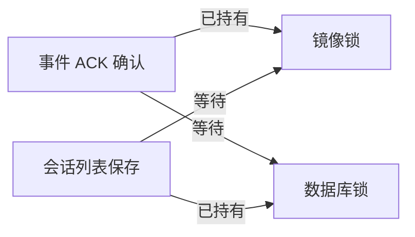

# 模拟器确认的原生镜像死锁

2026-10-31，专用 Android 15 / API 35 模拟器，连接隔离 Core、真实 Hermes HTTP Adapter、原生历史和受控宿主。初始业务 APK 为 `dda2a4dc`；定位时安装的诊断 APK 仅在工作台增加创建阶段日志，未改变保存、网络或恢复控制流。

## 实际现象和定位过程

首次登录后可读历史，但顶部和抽屉的新建入口均没有引发 Core 创建 POST；后端恢复后会话仍显示无法加载，后台返回也没有解除该状态。消息输入可以编辑；一次点击发送完成了本地界面应用与画面提交，但没有进入网络请求，Core、Adapter、宿主对应计数均为零。

诊断 APK 的一次新建日志显示：工作台未关闭、协程仍活动，没有管理、创建或启动任务的早退条件；随后进入本地保存，未出现保存完成、创建回执或 HTTP 请求。这将停滞定位在 Android 本地提交屏障。

对该进程发出 Java 线程栈采集信号，只读提取两条等待链：

| 线程 | 当前调用 | 已持有 | 正在等待 |
| --- | --- | --- | --- |
| DefaultDispatcher-worker-1，tid 17 | `EncryptedConversationMirror.confirmNativeAck` → `SqliteConversationRecords.transaction` | 同一个会话镜像对象锁 | 数据库记录对象锁，由 tid 26 持有 |
| DefaultDispatcher-worker-6，tid 26 | `saveNativeConversations` → `documents.transaction` → `saveThreads` | 同一个数据库记录对象锁 | 会话镜像对象锁，由 tid 17 持有 |

两个锁对象的身份在原始栈中一致，形成闭合等待。另一个事件提交线程也在等待同一镜像锁。本轮由实际运行栈确认了死锁，超出静态风险分析；这解释了当前样本的无 POST、保存不完成和恢复停滞。

## 修复与回归目标

将会话列表保存与 ACK、创建回执、事件提交统一为“先镜像锁，再数据库事务锁”，保持原来的事务、持久化和 ACK 边界。测试需要真实经过两个生产方法和数据库事务，使用可控同步制造相反并发顺序；不能用两个测试假锁替代实际路径。

完成后重新安装修复包，验证新建产生权威会话 ID、输入实际到达宿主、后台与网络恢复成功，并按原始输入身份核对每段 POST 和宿主启动次数。不能只验证顶部显示已连接。

原始线程栈、完整诊断日志、截图和 JSON 仅本地留存，没有提交；本文件只保留定位所需调用与锁关系。本例不解释全部生产现场故障，也不代替物理设备、厂商 Doze、生产代理或真实模型验收。
