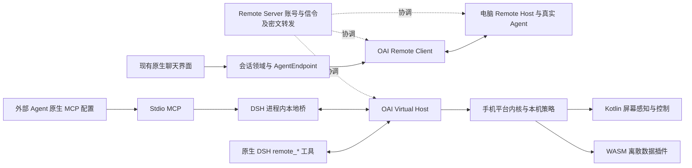

# DSH Remote 后端、通信与手机控制架构重构规格

本规格是用户经过逐轮讨论后确认的目标架构。**架构已接受，运行时代码尚未按本规格重构，
运行验收待进行。** 本次 issue #185 只交付文档，不能据此宣称新通道或任一 Agent 已可用。
代码事实基线为 `dev@a7dbe3fc8f59a6f01deec101489c705c1e878661`。

后续实施从 `dev@12094e684e4bd6d4270513d54b6ef35437536552` 启动，按
[分阶段计划](../plans/2026-11-14-dsh-remote-migration-plan.zh-CN.md)与
[验收台账](../reviews/2026-11-14-dsh-remote-acceptance-index.zh-CN.md)推进；关联全量跟踪 #187、P0 #188、P1 #189。
实施启动不改变此处任何运行验收状态。

术语见 [CONTEXT](../../CONTEXT.md)，固定上游证据及能力差距见
[事实基线](../architecture/2026-11-13-dsh-remote-baseline.zh-CN.md)，
手机操作的请求、回执和文件接口见[控制契约](../contracts/oai-control-rpc-v1.md)。
关键取舍由 [ADR-0063](../adr/0063-adopt-dsh-remote-with-independent-client-and-host-identities.md)、
[ADR-0064](../adr/0064-share-control-sessions-through-dsh-and-local-mcp.md) 与
[ADR-0065](../adr/0065-separate-native-screen-control-from-wasm-data-plugins.md) 记录。

## 1. 已确认的产品边界

- 目标版本彻底退出 OAI Core、Gateway Protocol v2、旧服务端会话适配器和历史桥接运行时；
  不设计旧版兼容，也不要求迁移旧账号、配对、密钥或历史。实施时仍遵守文件安全移除规则。
- 不迁移旧数据不等于删减用户功能。聊天、附件、审批、默认助理、短信定时任务及
  短信/通知主动推送等已有能力仍须逐项覆盖；旧服务专属部署与管理功能退役。
- 手机只保留一个活动 Remote 账号，同账号设备互相发现。默认官方完整服务，允许兼容自托管地址；
  服务实际缺少的登录、配对、TURN 或其他能力必须明确不可用，不伪造等价支持。
- 登录即自动建立逻辑独立的主动客户端与被控虚拟主机身份；虚拟主机默认“仅被控”，主动客户端可独立休眠。
- 固定参考 `liguobao/ds-harness-remote@ea1c0925f8be825a5f5afac32ad2d0b2c699f7f7`，
  在本仓库补适配，不维护上游分叉，不新增 OAI 中心鉴权、穿透或 Relay 服务。
- 保留现有聊天组件结构，以 AgentEndpoint 屏蔽多主机、多 Agent 工作区层级，
  模型与思考强度绑定当前会话的真实目录，不假定不同后端功能相同。
- 手机工作区固定为 `phone-capabilities`，保留常驻 `control-bus` 并允许创建独立任务会话。
  手机不运行本地 LLM，两种电脑入口共用一个确定性执行器与本机权限裁决。
- 原生 DSH 使用已有 remote_* 工具；外部 Agent 使用电脑上的 Stdio MCP 与 DSH 进程内桥。
  MCP 仅公开 `android_*` 手机操作，目标限定为 OAI Virtual Host 的 `phone-capabilities`。
  跨 workspace 后台调度属于上游，本客户端不提供委派工具；正常多 Host/DSH/Codex/ACP 的手动切换完整保留。
- 新能力默认每次手动；用户在手机选择允许只读后，批准范围内读取免逐次确认。
  敏感操作强制本机确认。锁屏只允许已明确授予后台权限的数据请求，拒绝读屏、截图和屏幕控制。
- Kotlin 负责屏幕感知与控制，WASM 负责离散数据能力。采用无障碍悬浮确认与紧急停止；
  动作后等待 400ms 无布局变更或达到 3000ms 硬超时，超时不能成为重复动作的理由。

## 2. 权威范围与旧决策替代

本规格取代旧模块化规格中 Agent 内 Gateway、独立 Core、多账号逻辑 Gateway、Gateway v2
传输与服务端会话桥的目标设计。旧文档保留历史背景，不能继续作为新连接实现的规范。
旧 Core 安装、账号管理、管理员恢复与旧 Gateway 操作教程随该服务退役；不在 Remote 上复刻这些管理接口。

以下原则继续有效：Android 安装实例是本机能力授权的唯一权威；Protected Mode 与
Developer Trust Mode 分离；插件签名、沙箱、系统许可、独立数据范围、加密本地镜像和审计仍有效。
[全局授权规格](2026-11-01-global-device-authorization.md) 的本机授权和功能保真要求继续沿用，
其中 Core 路由、旧 grant 迁移与旧协议协商规则由本规格替代。

文档顺序为：本规格确定产品行为，控制契约确定 OAI 自有操作接口，上游固定规范确定 Remote 线协议；
事实基线说明哪些仍待实现。遇到上游能力缺口，不添加兼容旧 Gateway 的旁路，也不把目标能力标成现有能力。

## 3. 整体结构

所有远程业务均经过已认证的 Noise 通道；图中的本地 MCP 桥不是另一套公网服务。
Remote Server 仍承担账号、设备目录、在线状态、信令、TURN 凭据与密文 Relay，移除 OAI Core
不等于不再依赖任何服务。会话正文由真实 Agent 后端拥有；手机离线缓存不是第二个 Agent 会话权威。

## 4. 需求编号与模块边界

| 编号 | 必须满足的行为 | 主要验证入口 |
| --- | --- | --- |
| REM-01 | 单一活动账号，默认官方服务且允许兼容地址；服务缺少能力时明确诊断 | 登录与服务能力矩阵 |
| REM-02 | 登录自动建立独立 Client/Host 身份，Host 仅被控；角色凭据和生命周期互不覆盖 | 身份、退出与撤销互通 |
| REM-03 | 固定 Noise 套件与上游选路；断线不重放未知写操作 | 向量、四路径与重连 |
| REM-04 | AgentEndpoint 扁平化，会话与消息身份按端点隔离 | 跨主机/后端同名 ID 回归 |
| REM-05 | 原生 Harness、Codex、ACP 按实际数据面和后端能力适配 | 各后端能力矩阵 |
| REM-06 | 模型和思考强度按会话确认，旧结果不能更新新会话 | 切换会话、模型拒绝与断线 |
| REM-07 | 聊天组件结构与既有交互保留，连接设置和数据绑定改造 | UI 行为与功能覆盖表 |
| REM-08 | 附件分块提交、工作区路径引用及离线媒体保留真实身份 | 上传失败、未知提交和历史媒体 |
| REM-09 | Virtual Host 实现最小 Session V3 与受限文件面，不运行 LLM | 原生 remote_* 真实互通 |
| REM-10 | 总线与任务会话共用确定性 RPC、CLI 解析和请求状态机 | 正反契约与并发请求 |
| REM-11 | WASM 离散能力与 Kotlin 屏幕执行分离，均经平台内核 | 沙箱、端口与权限回归 |
| REM-12 | 精简语义树、快照绑定节点与按需 SoM，不伪造不可见控件 | 原生、WebView、Flutter 与图像界面 |
| REM-13 | 动作后 400ms 静默或 3000ms 超时，执行与收敛分别回报 | 高频事件、超时与窗口切换 |
| REM-14 | 无焦点冲突的悬浮确认与紧急停止，锁屏拒绝屏幕能力 | 第三方前台应用及真机锁屏 |
| REM-15 | 本机默认手动，独立只读/写入/后台/敏感确认，不由账号登录授权 | 权限、范围、撤销与排队复核 |
| REM-16 | 持久防重回执、未知结果和取消不因重连或重启失真 | 崩溃点与结果交付故障注入 |
| REM-17 | Stdio MCP 经本地 DSH 桥，仅公开 android_* 手机操作 | 原生 MCP 挂载、手机目标与工具白名单 |
| REM-18 | 退出旧协议及所有生产、构建、安装、CI 依赖，无旧服务旁路 | 依赖清单和干净安装 |
| REM-19 | 现有用户能力逐项落实，未支持项明确不可用而非伪造 | 第 9 节功能矩阵 |
| REM-20 | 文档接受、实现完成、自动化与设备/部署验收分开记录 | 文档检查与逐项证据 |

| 模块 | 目标动作与职责 |
| --- | --- |
| `oai-core/`、`gateway-contract/`、`legacy/` | 从目标生产/发布链路移除；清理消费它们的打包、测试、安装和 CI 配置，不把旧状态机悄悄搬回新服务 |
| `integrations/hermes-session-adapter/`、`integrations/dsh-session-adapter/` | 退出 Core 专用会话桥；改用 Host 已支持的 Hermes ACP、原生 DSH 接入 |
| `apps/android/tailscale-companion` | 从核心连接解耦，保留为可选独立能力，不能成为 Remote 连通或认证的前置条件 |
| `apps/android/gateway-client` | 重写为原生 dsh-remote 通信适配，承载 NoiseChannel、TypertRemoteClient 与 OaiVirtualHostServer；清除 Gateway 请求类型和运行依赖 |
| `apps/android/encrypted-store`、`apps/android/platform-kernel` | 保存隔离身份、加密状态、可信请求身份、最终策略、审计与防重回执；内核不变成新的聊天或中心服务 |
| `apps/android/conversation-domain` | 定义 AgentEndpoint 与统一 Session/Message 端口，隔离后端原生 ID、审批和模型目录差异 |
| `apps/android/conversation-data` | Remote 适配与新配置持久化、加密离线镜像；不读取旧 Core 身份冒充新登录 |
| `apps/android/conversation-ui` | 保留聊天组件结构，替换连接设置、端点选择和数据接线；清除对 Gateway 专有错误/路由的直接依赖 |
| `apps/android/policy-engine` | 从现有局部策略扩展为统一 ui.* 风险分类与裁决，不另存一份与内核相冲突的授权 |
| `apps/android/plugin-runtime-wasm` | 离散数据插件与脱敏处理；屏幕高频循环、编码和手势不进入 WASM |
| `apps/android/device-primitives`、`capability-ports` | 复用原生设备与截图来源，生成精简语义节点、快照和 Canvas SoM WebP |
| `apps/android/control-ports` | 类型化动作、全局互斥与收敛状态机；复用无障碍引擎，Shizuku 仅为显式可选引擎 |
| `apps/android/screen-control` | 承载真实 AccessibilityService、系统事件与无焦点悬浮窗，不复制第二个屏幕后端 |
| `integrations/oai-android-mcp` | 新增同一集成内的 Stdio 薄壳与 DSH 进程内桥，不新增公网监听、账号或穿透服务 |

现有屏幕 `.alp` 是原生 primitive 的薄包装，并非现有屏幕驱动在 WASM 中运行；实施时绕开这些
高频路径包装，继续复用实际 Kotlin provider。`.alp` 容器、签名、作者与沙箱规则继续有效；
包校验、工具链和配置中的 Gateway 兼容声明应随 REM-18 一并解除，不能靠虚构 Gateway 版本保留旧运行依赖。

## 5. 登录、连接与后台生命周期

### 5.1 两种身份

Client 与 Host 各自维护 deviceId、私钥、设备凭据、对端固定公钥和连接代次，按服务 origin 与角色隔离。
它们属于同一个活动账号，不复用私钥、设备 token 或连接 ID。“仅被控”只约束 Host 角色，
不能连带禁止 Client 发现电脑。账号成员关系、Noise 身份与本机能力许可是三个不同条件。

采用上游真实登录与注册流程。同账号首次身份固定仍依赖 Server 分发和成员关系，不能宣称具有
未实现的带外验证。已固定公钥不被服务器新值静默替换；撤销设备、退出账号或切服务地址后，
旧连接、审批和本地桥授权立即失效。不得因切换地址把旧凭据发送到另一 origin。

登录成功后自动尝试注册两个角色。一侧注册或运行条件不足时分别显示真实状态：
Client 可用不能伪装 Host 已在线，Host 可用也不能伪装聊天已连接。不把开启无障碍、短信权限或
屏幕捕获许可作为完成账号登录的条件；能力不可用由手机明确拒绝并说明缺失条件。

### 5.2 传输与恢复

遵循 `Noise_IK_25519_ChaChaPoly_SHA256`，绑定上游规定的协议版本、连接与双方身份。
原生 Android 适配使用成熟 Noise 实现或绑定，不自行编写密码状态机；通过上游固定密码向量、
协议向量和真实 Host 互通后才能宣告兼容。上游 Android 的 React Native/TypeScript 包不是 Kotlin SDK。

选路遵循 LAN、WebRTC P2P、TURN、WebSocket Relay；LAN/P2P 是 WebRTC 选中的路径分类，
不是手机新增的公网监听。所有路径保持相同加密和身份边界。区分建立失败回落、断线重建与可选恢复能力，
不得把实验性的控制链路恢复写成跨切路、进程重启均无缝恢复。丢帧、序列缺口和重连按真实 carrier
恢复或重新读取，不将旧事件当作新轮次，不在结果未知后换 ID 自动重发写入。

### 5.3 后台与锁屏

主聊天退后台且无待处理工作时，Client 可休眠；主动推送等已授权工作需要时再按系统允许条件使用 Client。
Host 维持轻量出站信令，按请求建立业务通道，避免把每个端点的完整聊天连接常驻手机。
其生命周期由已获准的 Android 服务及运行条件承载，处理系统回收、启动限制和前台服务超时；
不能将 dataSync 服务或 Accessibility overlay 当作永久在线保证。后台失联必须呈现离线或不可达。

锁屏保留信令与已明确授予后台权限的数据请求；读屏、截图、点击、输入、导航和其他屏幕动作均拒绝。
需要人工确认的数据请求保持待确认或按期限结束，不自行解锁，也不从锁屏拉起 Activity。
退出登录停止两种角色及采集、执行、推送，撤销活跃许可与连接；新架构自身的本机配置和加密数据
沿用对应功能的保留/移除语义，不把“不迁移旧数据”解释为每次退出都清空新历史。

## 6. 扁平会话与最小 UI 改造

AgentEndpoint 由稳定的 Host、backend、workspace 坐标确定，显示名可采用“主机名 · Agent（工作区名）”。
服务 origin 与账号归属进入其持久作用域；显示名和 connectionId 不作为稳定身份。
会话键包含 endpointId 与后端原生 sessionId，缓存、未读、忙碌、完成通知、附件及审批不能只按 sessionId 分组。
活跃事件另校验后端实例与连接代次，旧连接迟到结果不能进入新会话。

UI 继续消费统一 Session/Message 数据流，Session 增加 endpointId 与 backendBadge。
允许替换连接设置、增加端点选择及必要状态接线；不得重写 Material 3 气泡、流式渲染器、
多模态选择面板和审批卡片结构，也不擅自改其他既有文案、默认行为或数量限制。
后端缺少某项能力时，使用真实不可用状态和现有组件语义，不静默替换 Agent 或制造成功响应。

Harness 使用 Typert Remote / Session V3，Codex 使用 codex.app.*，ACP 使用 agent.acp.*；
桌面内存投影不表示这些后端共享一个 SessionStore。Android 适配相应数据面，并保留原生历史权威。
端点目录标识可用后端；当前会话的模型、思考强度和审批以上游真实状态为准。模型切换必须等 Host
确认，再读取该模型可用的思考强度；目录未到、失败或过期时不能放入静态兜底列表。

附件选择、上传完成、Prompt 提交是不同阶段。使用 Host 实际声明的分块能力，将已提交文件作为
对应会话工作区路径引用；图片和普通文件的支持分别判断，不能因为上传成功就声称后端支持图片。
提交结果未知时查询原回执/文件身份，不重复创建附件或消息。保持发送原子、防抖偏好、Queue/Steering、
默认助理附件交接、历史媒体读取与用户导出行为；具体后端未提供的操作必须明确不支持。

## 7. 反向控机与本地 MCP 桥

### 7.1 手机兼容接口

Virtual Host 对外声明真实实现的最小 Harness carrier，工作区为 `phone-capabilities`。
`control-bus` 是常驻入口，`session/create` 返回新的独立任务会话 ID，不把固定总线冒充新会话。
任务会话接收类型化 RPC 或同义 CLI 简写，按 request_id 返回结构化执行结果。
每个会话的目录、内存历史、运行状态和结果必须真实产生；全局会话 idle 不能替代具体请求终态。
`control-bus` 支持按可信 owner/request 隔离的单步快调；多步任务真实 create。控制任务消息、
Prompt、树、截图和结果正文仅在当前进程内存中，重启不恢复任务、不回放、不续做。持久层只保留
owner/request/task/op/参数摘要/execution/state/取消关联等最小防重事实；旧任务失效标记不等于
恢复其可执行状态。正常聊天镜像、主动推送队列与定时任务仍按各自功能加密持久。
重启后经当前总线发送只读 `request.status` 查询原最小回执，原 task ID 仅核对归属，
正文未保留返回 `resultAvailable:false`，不伪造原结果。

原生 DSH 的 remote_send_message 是电脑端工具，最终调用 session/prompt，不是同名网络 RPC。
手机需实现工具依赖的 workspace/session 发现、列表、follow/page、create/prompt/cancel，
以及 workspaceFiles/stat、readBytes 等受限文件面；截图与导出文件只映射到当前任务的私有虚拟根。
不开放任意手机文件系统、终端、shell 或通用方法调用。完整消息形状见控制契约。

### 7.2 电脑入口

原生 DSH 直接发现手机 Host、创建或选择任务会话、发送指令、等待、读结果和下载文件，
不额外部署 OAI 中心服务。外部 Hermes、Claude Code、OpenCode 等在电脑原生配置挂载 Stdio MCP；
不能假定从 Android 发 ACP session/new 参数就能注入 MCP。

Stdio MCP 只转接参数和结构化结果；通道、登录状态和任务观察由 DSH 进程内桥拥有。
桥复用电脑现有本地服务，校验本机访问来源和独立授权，固定暴露必要的端点发现、调用、状态、
取消及任务文件读取；不把 Remote 账号 token 或私钥交给外部 Agent，不开放任意 Typert 方法代理。
退出登录、切服务和插件卸载时，旧桥授权失效。MCP 标准输出只承载协议，诊断不能污染它。

MCP 只选择当前账号已授权的手机 OAI Virtual Host 与 `phone-capabilities`，只暴露 `android_*`。
后台跨 workspace 的 Agent 调度归上游，不是本客户端功能或验收前置。
正常聊天中用户可随时切换 Host、DSH/Codex/ACP workspace 与对话；切换须关闭并排空旧流，
用独立连接与连接代际拒绝迟到结果，不能限制切换、自动抢回工作区、改投新目标或重放未知写入。
MCP 首次读树/截图可 create 并返回 taskSessionId，后续显式携带原 taskSessionId/snapshotId；
不为每次工具调用暗中新建任务，也不以全局“最近任务”选路。
MCP 调用退出不等于撤销已执行副作用，取消必须映射到明确的原任务。按请求取消使用带
targetRequestId 的 request.cancel，由手机原子核对；原生 session/cancel 仅表示整任务取消，不能误停同任务下一请求。

## 8. 手机执行与本机门禁

所有请求先核验通道提供的可信账号/设备身份、任务归属、操作类型与参数，再进入内核策略。
Agent 名称、理由和 JSON 自报身份只用于说明与审计。安装、启用、系统权限、本机模式、数据范围、
后台许可和敏感确认独立裁决；执行及敏感结果交付前重新复核，排队后也重新复核。

屏幕读、截图、控制分别授权。精简树保留交互语义、文本/描述、状态、边界和中心坐标，去掉无效容器；
节点索引只在其快照内稳定，不能承诺跨页面永久稳定。按需 SoM 在本地 Canvas 标注可验证边界并输出 WebP；
无有效节点时如实报告覆盖不足，返回真实图像供电脑视觉判断，不凭空生成真实控件。
自动图像回退也必须经过独立截图许可。节点和坐标动作均绑定快照、窗口、包名与显示状态。

屏幕副作用由一个共享执行器按既有控制租约和 FIFO 互斥执行，支持无障碍 dispatchGesture；
Shizuku 仅在明确安装、授权、选中和可用时参与，不因失败自动升级权限。
动作回调之后等待 TYPE_WINDOW_CONTENT_CHANGED 与 TYPE_WINDOW_STATE_CHANGED：连续 400ms 静默即重新观察，
3000ms 未收敛则返回超时标记与最新可证明状态。执行是否发生、界面是否收敛分别表达，不能把超时重试成第二次点击。

本机确认、实时执行状态和紧急停止通过 AccessibilityService 的 TYPE_ACCESSIBILITY_OVERLAY 承载。
悬浮窗不夺取目标应用输入焦点；确认本身不能被远程动作命中，也不能把敏感确认内容加入远程树或截图。
确认展示与移除不能简单当作第三方目标变化，也不能因此忽略真实窗口变化；执行前重新验证目标与授权。
紧急停止立即撤销排队/活跃许可、租约和后续输出，已发生的副作用不能伪称回滚。

操作账本绑定可信主体、任务、request_id 和参数摘要，使用稳定逻辑身份防止重连重复执行；
连接代次仅用于活跃权限和迟到事件校验。执行中进程崩溃、取消与结果交付竞态均允许结果未知，
不承诺外部物理副作用恰好一次；旧回执查询仍需当前合法访问关系，不能靠知道 request_id 读取他人结果。

## 9. 现有用户能力覆盖表

“保留”表示目标要求，不是本次文档已验证。每个后端仅宣告其真实支持能力；后端缺口需在矩阵中明确，
不得用静态列表或伪造回执补齐。旧 Core 数据不迁移，不影响新版本自身继续提供离线缓存与持久配置。

| 用户能力 | 新架构覆盖要求 | 关键回归 |
| --- | --- | --- |
| 会话列表、历史、组织、重命名/归档/删除 | 保留既有操作入口语义，由后端能力决定可执行项 | 多端点混排、相同原生 ID、空/分页历史、离线镜像 |
| 流式回复、工具步骤、审批、打断、Queue/Steering | 映射真实 carrier，不把断流当完成或自动批准 | 迟到帧、重连、审批归属、完成通知同轮次一致性 |
| 文本发送、发送原子与消息合并偏好 | 保留客户端偏好和未知结果身份；旧 HTTP 路由不保留 | 连续发送、附件边界、重启后未知提交不重发 |
| 图片、相机、文档、语音和历史媒体 | 保留选择/取消/上传/导出与加密缓存，按后端能力传入 | 上传提交未知、媒体不可用、取消和附件迟到回调 |
| 默认数字助理与圈选交接 | 保留系统角色、生命周期、回退设置与附件关联 | 重复唤起、Back、hide/show、交接失败/超时和锁屏 |
| 短信查询及过滤、通知读取、通话记录 | WASM 离散能力经统一内核公开 | 手机范围、正文开关、通知搜索/正反选与真实权限 |
| 短信定时任务设置、状态、取消 | 保留现有插件任务与系统调度语义 | 延迟/重启恢复、执行前复核；不伪称精确定时 |
| 短信发送 | 按用户要求新增真实发送能力、端口和 Schema；现有读取定时任务不能充当发送 | 本机敏感确认、取消、未知发送结果与防重复 |
| 短信/通知主动推送 | 保留独立开关、范围、稳定目标白名单、加密队列及逐端点确认 | 唤醒 Client、离线/重启、撤销与重投过滤；不误投其他目标 |
| 屏幕读、截图、点击/长按、滑动/滚动/拖动、输入、导航与启动应用 | 复用已有原生能力并统一为类型化控制；保留原权限边界 | 陈旧目标、双调用者、锁屏、确认焦点、收敛超时与紧急停止 |
| 插件管理、能力设置、加密镜像与用户导出 | 保留本机功能与沙箱信任模式，清除 Gateway 专用接线 | 安装/启用/权限区分、重启、隔离、用户显式导出 |
| Core 部署、管理员/旧账号与 Gateway 配对管理 | 随明确废弃服务退役，连接设置改为 Remote 授权与端点选择 | 无旧服务前置、无旧凭据继承和无隐藏兼容链路 |

主动推送的稳定目标须绑定已验证的端点及其真实接收位置，不因 Host 重连、会话改名或切聊天目标改变。
用源事件身份与投递身份去重；接收端必须提供可核验确认后才能推进投递记录。仅接受“消息已受理”
不能代替业务投递成功；上游缺少所需确认或某后端没有接收接口时，该项保持阻塞，不取消白名单和可靠队列要求。

## 10. 实施顺序与验收

| 阶段 | 退出条件 |
| --- | --- |
| 事实与兼容验证 | 固定上游版本、原生 Noise/协议向量互通、Host 能力矩阵及最小手机 facade 通过真实工具探测 |
| 原生会话适配 | REM-01 至 REM-08 与既有聊天/附件/审批/助理回归完成；不依赖旧 Core |
| 手机控制与 MCP | REM-09 至 REM-17、后台/锁屏/焦点及两种真实手机控机入口完成 |
| 功能覆盖与退出旧依赖 | REM-18/19 完成，主动推送、定时任务与离线能力没有遗漏；生产构建不再消费旧契约或服务 |
| 发布验收 | 通过对应 Fast/PR/Full 门禁，记录真实设备、网络与后端矩阵；未完成项不得宣告完整重构 |

分阶段实施不表示向用户发布双协议兼容版本。旧源码可以暂时存在于开发过程，最终退出条件必须证明
生产入口、安装脚本、打包、插件工具链、CI 和测试路由没有旧运行依赖。历史文档及源码历史不作为继续发布旧服务的理由。

后续实现至少记录以下独立证据：

- 固定密码/协议向量、真实 Host 握手、篡改/重放、角色隔离、Server origin 切换、撤销和公钥变更拒绝。
- LAN、P2P、TURN、Relay 分别建立与实际选路证据；断线、切网、休眠、进程恢复后不重复副作用。
- Harness、Hermes、Codex、Claude、OpenCode、Cursor、Pi、Antigravity 的发现、真实模型、文本、附件、审批、打断及手动切换逐项矩阵。
- 原生 DSH remote_* 与外部 Agent 原生 MCP 配置两条控机链路，含真实任务创建、等待、读回与文件下载。
- 原生、WebView、Flutter、图像界面语义树与 SoM；屏幕旋转、旧快照、事件风暴、400/3000ms 和动作结果未知。
- 第三方应用前台时确认不丢焦点；远程不能确认自己的敏感请求；撤销、锁屏、紧急停止与互斥租约。
- 第 9 节全部保留能力，尤其主动推送接收确认、系统调度、默认助理和加密离线媒体，不以静态代码存在代替运行验证。

报告按需求编号记录 `VERIFIED / BLOCKED / UNVERIFIED`、执行命令、端点版本、提交 SHA 与证据位置。
本规格初始全部为 UNVERIFIED。自动化、模拟器、物理设备和共享部署分开记录；文档检查通过不改变运行验收状态。
