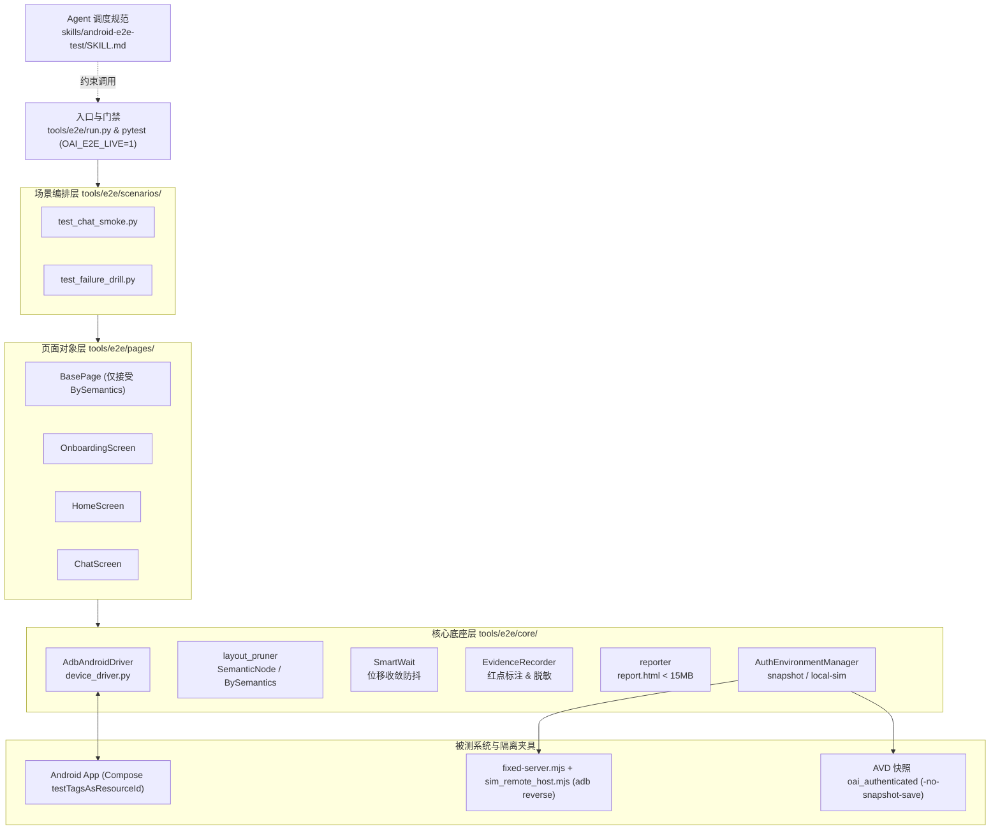

# Android E2E 分层测试框架、视觉留痕报告与自动化 Skill 设计规格

本文档定义 Open Android Intelligence (OAI) Android 客户端端到端（E2E）自动化测试框架的整体架构、Compose 无障碍语义契约、免密与本地仿真隔离方案、`<15MB` 视觉留痕报告预算及配套 Agent Skill 规范，对应需求 Issue `#236`。

---

## 1. 背景与设计目标

在 DSH Remote 架构下，OAI Android 客户端的完整主链路涉及“引导页 ➔ 服务连接与登录鉴权 ➔ Host/Agent 路由选择 ➔ 会话工作台与双向消息流式收发”。若在 Agent 对话过程中逐步手工执行 `adb shell uiautomator dump`、`adb shell input tap` 或 `android layout` 拉取原始控件树，会带来以下工程问题：

1. **上下文 Token 爆炸**：原始 `uiautomator` XML 或未裁剪布局树通常达到数万字符，且逐帧交互往返多次会快速耗尽上下文窗口。
2. **动画飘移脱靶与脆弱等待**：使用固定 `time.sleep` 或硬编码屏幕坐标在页面切换、键盘弹起或 Material 3 过渡动画期间极易点击偏移或竞态失败。
3. **凭据暴露与环境污染**：依赖人工真实账号登录会导致本地环境与报告泄露敏感信息，且未隔离的状态会破坏可重复性。
4. **排障缺乏直观视觉证据**：纯文本报错无法定位点击是否落在目标中心、动画是否遮挡或界面实际渲染状态。

为此，本框架确立以下四大核心目标：

- **单指令低 Token 驱动**：通过 `python3 tools/e2e/run.py --scenario <name>` 一键执行完整场景；通过时标准输出**严格仅输出 1 行**结构化摘要。
- **三层解耦语义驱动**：`core/`（底层驱动与能力底座）、`pages/`（Page Object 页面封装）、`scenarios/`（业务场景编排），彻底禁止坐标硬编码与固定 `time.sleep`。
- **双模式免密隔离**：支持 AVD 黄金快照（`oai_authenticated`）只读回放与纯本地回环仿真主机（`fixed-server.mjs` + `sim_remote_host.mjs`）免密隔离联调。
- **可控体积视觉自查报告**：生成自包含单文件 `report.html`（严格 `< 15MB`）与 `report.json`，自动绘制点击红框/中心红点（`#FF1744`）与 `Before/After` 对比，失败场景置顶标红并附精简堆栈。

---

## 2. 整体分层架构与目录布局



### 目录规划

| 路径 | 职责归属 |
| --- | --- |
| `tools/e2e/core/` | 设备驱动、语义树精简、位移收敛智能等待、视觉证据录制、`<15MB` HTML 报告生成、免密隔离环境管理及 `E2ERuntimeContext` |
| `tools/e2e/core/sim_remote_host.mjs` | 本地隔离 Remote Host 仿真节点（只读复用 `tools/remote-server/fixtures/` 与 `tools/remote-interop/fixtures/`） |
| `tools/e2e/pages/` | `BasePage` 与页面对象封装（`OnboardingScreen`、`HomeScreen`、`ChatScreen`） |
| `tools/e2e/scenarios/` | 端到端场景（`test_chat_smoke.py`、`test_failure_drill.py`），受 `OAI_E2E_LIVE=1` 环境变量保护 |
| `tools/e2e/run.py` | CLI 单指令入口与严格单行摘要输出 |
| `tools/e2e/test_e2e_framework.py` | 全离线单元测试套件（覆盖精简器、防抖等待、标注脱敏、15MB 压缩守卫及本地仿真进程就绪退出） |
| `apps/android/...` | 5 个 UI 文件的无侵入 `testTag` 与根宿主 `testTagsAsResourceId = true` 映射 |
| `skills/android-e2e-test/SKILL.md` | 面向 Agent 的标准端到端测试运行、排查与扩展规范 |

> **安全边界**：本框架**只读使用**既有夹具，严禁修改锁定目录 `tools/remote-server/`、`tools/remote/`、`tools/remote-interop/`、`integrations/oai-android-mcp/test/fixtures/`；所有临时目录与报告清理一律安全移至 `.worktrees/trash/`，严禁使用永久删除命令；代码中严禁硬编码本机绝对路径。

---

## 3. Core 核心底座层设计 (`tools/e2e/core/`)

### 3.1 `layout_pruner.py`（语义树精简与定位器）

- **`SemanticNode`（frozen dataclass）**：
  - 字段：`tag`, `desc`, `text`, `cls`, `bounds`, `center`, `clickable`, `editable`, `scrollable`, `focused`, `enabled`, `checked`, `selected`, `raw_id`, `children`。
  - **包名前缀自动剥离**：当 `resource-id` 形如 `com.openandroidintelligence.mobile:id/chat-composer-send` 时，保留原始 `raw_id` 并将 `tag` 标准化为 `chat-composer-send`（剥离 `<pkg>:id/` 前缀），使测试代码与包名/变体解耦。
  - 方法：`to_dict()`、`flatten()`。
- **`BySemantics`（frozen dataclass）**：
  - 语义查询条件：`tag`, `tag_prefix`, `desc`, `desc_contains`, `text`, `text_contains`, `clickable`, `editable`, `enabled`。
  - 方法：`matches(node: SemanticNode) -> bool`、`describe() -> str`。
- **解析与裁剪接口**：
  - `prune_layout_xml(xml_text)`：解析 `uiautomator dump` XML，过滤无语义信息且不可交互的纯装饰容器节点，输出精简语义树。
  - `prune_android_cli_json(data)`：兼容 `android layout` CLI 输出的 JSON 结构。
  - `find_nodes(roots, locator)` 与 `format_pruned_summary(roots, max_nodes=60)`：供 `SmartWait` 检索节点与在失败卡片中输出精简节点摘要。

### 3.2 `device_driver.py`（ADB 驱动与路径推导）

- **`resolve_repo_root()` & `resolve_toolchains_root(repo_root)`**：
  - 基于 `Path(__file__).resolve()` 定位仓库根目录；工具链目录严格按 `OAI_TOOLCHAINS_ROOT` ➔ `repo_root/.toolchains` ➔ `git rev-parse --git-common-dir` 父目录下 `.toolchains` 顺序相对推导，确保在主工作区与 Git Worktree 下均免配置可用。
- **`AdbAndroidDriver(serial=None, repo_root=None, command_timeout=15.0)`**：
  - 所有外部子进程调用必须显式传入 `timeout`，禁止无限期挂起。
  - `dump_semantics()`：优先执行 `adb exec-out uiautomator dump /dev/tty` 直接通过标准输出流读取 XML（避免频繁读写设备磁盘并稳定获取 Compose 映射后的 `resource-id`）；异常时依次回退 `/sdcard/window_dump.xml` 与 `android layout` JSON。
  - 提供完整原语：`ensure_device_connected()`、`install_apk_if_needed(...)`、`capture_screenshot_bytes()`、`start_app(package, activity, cold=True, clear_data=False)`、`tap_point(x, y)`、`swipe_points(...)`、`input_text(text)`（处理 ADB `%s` 空格转义及 shell 特殊字符转义）、`press_back()`、`press_enter()`、`hide_keyboard()`、`reverse_tcp(remote_port, local_port)`、`remove_reverse_tcp(remote_port)`、`recent_crash_log(...)`。
  - 异常统一封装为 `E2EDeviceError`。

### 3.3 `smart_wait.py`（连续采样位移收敛防抖）

为消除页面转场动画或列表滑动惯性引起的“查到旧坐标 ➔ 点击时控件已移走”问题，`SmartWait(driver, default_timeout=12.0, poll_interval=0.25, stability_px=2)` 采用以下机制：

- **`wait_for(locator, timeout=None, require_stable=True)`**：
  - 周期采样 `dump_semantics()` 并查找匹配 `locator` 的目标节点。
  - 当 `require_stable=True` 时，必须**连续两次采样**均命中该节点，且中心坐标曼哈顿/欧氏位移 `<= stability_px`（默认 `2px`），确认控件进入视觉静止状态后方才返回。
- **`wait_for_any(locators, timeout=None)`**：支持多分支状态识别（如冷启动后判定当前处于 `onboarding-*`、`remote-login-root` 还是已登录 `chat-workbench-root`），避免盲等单一分支耗尽超时。
- **`wait_until_gone(locator, timeout=None)`** 与 **`wait_for_predicate(description, predicate, timeout=None)`**：分别用于确认抽屉/弹窗退出与等待异步流式响应出现。
- 超时统一抛出 `SmartWaitTimeoutError(AssertionError)`，附带 `locator_desc`、`timeout` 与 `last_layout_summary`。

### 3.4 `evidence.py`（视觉留痕与敏感信息脱敏）

- **`StepEvidence`（dataclass）** 与 **`EvidenceRecorder`**：
  - **动作前（`Before`）标注**：在目标 `bounds` 区域绘制半透明红色高亮边框，并在实际点击坐标绘制实心中心红点（`#FF1744`），直观验证语义定位是否精准落于交互靶心。
  - **动作后（`After`）对比**：在同一位置绘制轻量对比参考圆环，便于肉眼验证点击后的焦点切换、页面跃迁或键盘弹出效果。
  - **图像压缩**：使用 Pillow 将截图等比缩放（最大宽度 `540px`）并编码为 WebP（`quality=78`）；若缺少编码依赖则提供纯标准库兜底方案。
  - **凭据脱敏**：当 `secret=True`（如登录凭据输入）时，所有日志文本、步骤描述与 JSON/HTML 报告内容均自动替换为 `******`。
  - **防二次异常**：`record_action`、`record_assertion` 与 `capture_failure_step` 内部妥善捕获截图/编码异常，保证即使设备异常断连也不会掩盖原始业务报错。

### 3.5 `reporter.py`（自包含报告与 `<15MB` 硬预算守卫）

- 定义硬上限常量：`MAX_REPORT_BYTES = 15 * 1024 * 1024`。
- **`write_html_report(report_dir, scenario_name, passed, steps, metadata) -> Path`**：
  - 同时产出 `report.html`（单文件自包含，图片内嵌 Base64，支持离线直接打开）与结构化 `report.json`（便于脚本与后续分析）。
  - **失败置顶高亮**：当 `passed=False` 时，将失败步骤卡片置顶并醒目标红，展示现场截图、精简后的异常堆栈（去除冗长框架栈帧）以及可折叠的 `Pruned Layout` 语义节点快照。
  - **体积守卫机制**：首次渲染后检查 `report.html` 字节大小；若超过 `15MB`，自动触发二次降采样与更低 WebP 质量重编码（必要时剔除非失败步骤冗余帧并保留关键失败现场），循环收敛直至严格 `< 15MB`。

### 3.6 `auth_env.py`、`sim_remote_host.mjs` 与 `context.py`

- **`IsolatedAuthEndpoint`**：封装 `mode`、`origin`、`fixture_account`、`fixture_token` 与 `host_name`（默认 `"E2E Sim Host"`）。
- **`sim_remote_host.mjs`**：
  - 以只读方式加载 `tools/remote-server/fixtures/` 与 `tools/remote-interop/fixtures/` 中的协议原文（按 `source.json` 核对不破坏完整度），并从仓库相对路径（`tools/remote-server/node_modules`、`integrations/oai-android-mcp/node_modules` 或根 `node_modules`）解析 `@noble/*`、`ws`、`@lukeburns/clatterjs` 等运行时依赖。
  - 连接由 `tools/remote-server/fixed-server.mjs` 拉起的本地临时信令服务，以 `role: "host"`、显示名 `"E2E Sim Host"` 注册在线，并完成 Noise IK 握手及 `relay` / `relay.attach` 数据通道建立。
  - 完整响应核心 Remote RPC 方法：
    - `harness.transport.describe`（声明 `harness.remote.v3` 能力）
    - `workspace/follow`、`session/follow`、`$events`
    - `session/list`、`session/create`、`session/page`、`session/models`、`commands/list`、`session/rename`
    - `session/prompt`：收到客户端文本消息（如 `"Hello OAI E2E"`）后，按流式契约依次推送 `turn/start`、`user/message`、`assistant/message`（内容为 `"E2E_PONG: " + text`）与 `turn/end` 事件帧。
  - 就绪时向标准输出打印单行 JSON：`{"status":"READY","hostId":"...","hostName":"E2E Sim Host"}`；当 `stdin` 关闭时优雅断开并退出。
- **`AuthEnvironmentManager` & `E2ERuntimeContext`**：
  - 统一托管 `snapshot` / `local-sim` / `auto` 三种免密隔离生命周期、ADB 端口反向映射（`adb reverse`）及退出时将临时运行目录安全移入 `.worktrees/trash/`。

---

## 4. Compose 界面无障碍语义契约 (`apps/android/`)

为使 `uiautomator dump` 能够稳定采集 Compose 组件树中的业务标识，同时确保**零改动既有人机交互、UI 文案（通过 `check_hardcoded_chinese.py` 与 `test_string_resources_integrity.py` 门禁）与布局尺寸**：

1. **根宿主统一开启资源 ID 映射**：
   在 `apps/android/app/src/main/kotlin/com/openandroidintelligence/mobile/RemoteWorkbenchRoot.kt` 中引入 `ExperimentalComposeUiApi`、`semantics` 与 `testTagsAsResourceId`，在 `AppSharedTransitionHost` 外层修饰符追加：
   ```kotlin
   Modifier.fillMaxSize().semantics { testTagsAsResourceId = true }
   ```
   启用后，所有后代节点的 `Modifier.testTag("<tag>")` 将自动暴露给 Android 无障碍服务与 `uiautomator` 的 `resource-id` 属性。

2. **关键页面语义标签契约清单**：

| 所属页面 / 文件 | 新增 / 保留语义 `testTag` | 用途说明 |
| --- | --- | --- |
| **引导流程**（既有） | `onboarding-welcome`、`onboarding-welcome-start`、`onboarding-appearance`、`onboarding-appearance-next`、`onboarding-permissions`、`onboarding-permissions-skip`、`onboarding-permissions-next`、`onboarding-deployment`、`onboarding-deploy-done`、`onboarding-guide`、`onboarding-guide-done` | 首次启动引导页识别与自动推进 |
| `RemoteLoginScreen.kt` | **新增**：`remote-login-root`、`remote-login-toggle-mode`、`remote-login-origin-input`、`remote-login-account-input`、`remote-login-password-input`、`remote-login-submit`、`remote-login-open-settings`<br/>**保留**：`remote-login-card`、`remote-self-hosted-login`、`remote-official-login` | 登录页根容器、自建/官方模式切换、三段表单输入（通过 `RemoteLoginInput` 可选参数 `fieldTestTag` 注入到 `OutlinedTextField`）及提交按钮 |
| `RemoteConnectionSettingsScreen.kt` | **新增**：`remote-host-item:${host.deviceId}`、`remote-refresh-hosts`、`remote-agent-item:${agent.key.backendId.value}` | 连接设置页 Host 列表项、刷新入口与 Agent 端点（如 `remote-agent-item:harness`） |
| `WorkbenchScreen.kt` | **新增**：`chat-workbench-root`、`chat-open-drawer`、`chat-new-conversation`、`chat-more-actions`、`chat-timeline`、`chat-welcome-empty`<br/>**保留**：`workbench-drawer`、`workspace-conversation-browser` | 会话工作台根容器、抽屉开关与会话浏览面板、新建/更多按钮、消息时间线与空态欢迎区 |
| `ComposerBar.kt` | **新增**：`chat-composer-attach`、`chat-composer-input`、`chat-composer-voice`、`chat-composer-send` | 底部输入栏附件、文本输入框（`BasicTextField`）、语音与发送/停止按钮 |

---

## 5. 免密与安全隔离方案

本框架提供两条互补且均不依赖人工敏感凭据的免密运行路径：

### 5.1 AVD 黄金快照模式 (`--auth-mode snapshot`)

- **适用场景**：已预先构建包含登录态加密密钥库（`RemoteCredentialVault`）的模拟器状态，用于极速跳过登录环节直接回归工作台与交互功能。
- **运行机制**：
  - 使用共享工具链 `.toolchains/android-sdk/emulator/emulator` 挂载共享 AVD 目录（`ANDROID_AVD_HOME` 指向 `.toolchains/avd-home/.android/avd`），配合只读快照参数 `-snapshot oai_authenticated -no-snapshot-save` 启动或回滚；
  - `chat_smoke` 场景在 `snapshot` 模式下采用 `clear_data=False` 冷启动应用，`HomeScreen` 检测到 `chat-workbench-root` 已就绪即记录断言并直接进入对话测试，避免快照内凭证被清空。
- **安全保证**：`-no-snapshot-save` 确保每次 E2E 运行产生的临时消息与本地状态不会写回黄金快照，保障多次回放幂等。

### 5.2 本地隔离仿真模式 (`--auth-mode local-sim`)

- **适用场景**：全新无状态环境、未预置快照的 CI/本地工作站、或需要完整验证“冷启动 ➔ 引导跳过 ➔ 自建服务器输入 ➔ Noise 握手 ➔ 选定 Host/Agent ➔ 对话往返”全链路。
- **运行机制**：
  1. `AuthEnvironmentManager` 启动隔离进程 `node --experimental-vm-modules tools/remote-server/fixed-server.mjs`，解析其输出的临时本地 HTTP 地址（`http://127.0.0.1:<port>`）及固定测试夹具凭据（`fixture@example.test` / `fixture-local-password`）。
  2. 执行 `adb reverse tcp:<port> tcp:<port>` 将模拟器/手机内部的 `127.0.0.1:<port>` 安全回环转发至宿主机本地仿真端口（`AndroidManifest.xml` 已支持明文回环）。
  3. 启动 `sim_remote_host.mjs` 注册虚拟主机 `E2E Sim Host`，待标准输出返回 `{"status":"READY",...}` 后进入 UI 流程。
  4. `chat_smoke` 在 `local-sim` 模式下以 `clear_data=True` 洁净启动 App，完成引导与表单填写（密码步骤启用 `secret=True` 脱敏为 `******`），选择 `E2E Sim Host` 与 `remote-agent-item:harness` 进入工作台，发送 `"Hello OAI E2E"` 并断言接收 `"E2E_PONG"` 回复。
  5. 运行结束于 `finally` 阶段关闭子进程 `stdin`、撤除 `adb reverse`，并将所有临时目录安全移至 `.worktrees/trash/`。

### 5.3 自适应模式 (`--auth-mode auto`)

默认模式下，`AuthEnvironmentManager` 自动探测设备与环境变量：若目标 AVD 已处于可直达黄金快照或指定 `snapshot` 就绪且用户选择复用，可走快照路径；否则自动拉起 `local-sim` 全栈仿真隔离闭环，实现单命令开箱即用。

---

## 6. 页面对象、场景层与 CLI 规范

### 6.1 Pages 层 (`tools/e2e/pages/`)

- **`BasePage(ctx)`**：
  - 所有操作入口（`click`、`fill`、`wait_visible`、`is_visible`、`assert_visible`、`press_back`）强制校验 `isinstance(locator, BySemantics)`；若误传 `tuple`/`int`/坐标，立即抛出 `CoordinateForbiddenError`。
  - `fill(...)` 流程：先语义定位并点击聚焦，再调用 `ctx.driver.input_text(value)`，随后通过 `SmartWait` 确认输入稳定，并在 `secret=True` 时脱敏留痕。
- **三大业务屏幕对象**：
  - `OnboardingScreen(BasePage)`：`complete_if_present()` 利用 `wait_for_any` 并行判定当前处于引导页还是已进入登录/工作台，仅在存在 `onboarding-*` 时逐页推进，不产生无谓超时等待。
  - `HomeScreen(BasePage)`：`connect_with_isolated_endpoint(auth)` 兼容已登录直通（`chat-workbench-root`）与自建登录流（自动检查 `remote-official-login` / `remote-self-hosted-login` 并在需要时点击 `remote-login-toggle-mode`，依次填写来源、账号、密码并提交，随后匹配 Host 与 `remote-agent-item:harness`）。
  - `ChatScreen(BasePage)`：`wait_ready()`、`verify_drawer_route()`（涵盖手机端抽屉打开/返回关闭与平板宽屏侧栏 `workspace-conversation-browser` 两种自适应形态）、`send_message(text)`、`assert_message_visible(substring, timeout=15.0)`。

### 6.2 Scenarios 层与 CLI (`tools/e2e/scenarios/`, `tools/e2e/run.py`)

- **Scenario 隔离守卫**：所有 `tools/e2e/scenarios/test_*.py` 必须声明：
  ```python
  @pytest.mark.skipif(
      os.environ.get("OAI_E2E_LIVE") != "1",
      reason="按需 Android E2E 场景，请使用 python3 tools/e2e/run.py --scenario <name> 执行",
  )
  ```
  确保日常运行 `pytest`、`npm run test:fast` 与 `npm run test:pr` 时不会误触发耗时的真机/模拟器动作。
- **内置场景**：
  - `chat_smoke`：完整冒烟验证（冷启动 ➔ 引导跳过 ➔ 隔离接入 ➔ 抽屉路由 ➔ 发送 `"Hello OAI E2E"` ➔ 断言用户消息与 `"E2E_PONG"` 均上屏）。
  - `failure_drill`：首屏稳定后故意断言缺失语义节点 `intentional-missing-tag-drill`（`timeout=2.0`），验证几秒内优雅中断、非 0 退出且完整生成置顶标红的故障报告。
- **单行输出契约**：
  - 非 `--verbose` 模式下，标准输出**严格仅输出 1 行**：
    - 通过：`PASS | scenario=<name> | steps=<n> | duration=<t>s | report_size=<mb>MB | report=<rel_report_path>`
    - 失败：`FAIL | scenario=<name> | steps=<n> | duration=<t>s | report_size=<mb>MB | report=<rel_report_path> | error=<summary>`（退出码 `1`）。
  - 无论成功或异常中断，均在 `finally` 块保证生成 `report.html` 与安全清理仿真进程。

---

## 7. Agent Skill 规范与 CI 边界

### 7.1 `skills/android-e2e-test/SKILL.md`

配套 Skill 文档规范 Agent 执行 Android UI 验证的行为准则：

- **Token 节流铁律**：严禁 Agent 在多轮对话中逐帧手工调用 `adb shell uiautomator dump`、`adb shell input tap`、`adb exec-out screencap` 或 `android layout`；必须通过 `python3 tools/e2e/run.py --scenario <name>` 单指令执行，正常情况仅解析单行结果。
- **视觉排障闭环**：仅当失败或需确认视觉呈现时，打开 `build/reports/e2e/report.html` / `report.json`，重点核对 `Before` 红色圆点落点准确性、动画是否残留及失败置顶堆栈。
- **安全清理**：清理临时报告目录（如失败演练报告 `build/reports/e2e-failure-drill`）时一律使用 `mv` 移入 `.worktrees/trash/`，严禁 `rm`/`unlink`。

### 7.2 与三级测试门禁的边界

- 日常 `npm run test:fast` 与 `npm run test:pr` 仅执行离线单测 `pytest tools/e2e/test_e2e_framework.py`、语法检查与 Android 安全/模块门禁，不强依赖 Android 模拟器在线。
- 真机/KVM 模拟器 E2E 验证按需由开发者或 Agent 通过 `tools/e2e/run.py`（或手动触发的 `workflow_dispatch`）执行。
- 变更路径均命中 `tools/ci/impact.py` 既定规则（`tools/` ➔ `fast`，`skills/.../*.md` ➔ 文档放行，`apps/android/...` ➔ Android 模块编译与预检），确保 `unknown_diff=false`。

---

## 8. 验收标准

1. **离线单测与门禁**：`pytest tools/e2e/test_e2e_framework.py` 全过；未设 `OAI_E2E_LIVE=1` 时 `pytest` 优雅跳过 `tools/e2e/scenarios/`；`python3 tools/ci/impact.py --base origin/dev --head HEAD` 输出 `unknown_diff=false`；`npm run lock:check`、`npm run test:fast` 与 `npm run test:pr` 全部通过。
2. **Android 静态检查与增量构建**：`python3 tools/check_hardcoded_chinese.py`、`python3 tools/test_string_resources_integrity.py` 及 `./gradlew :app:assembleFullDebug :conversation-ui:testDebugUnitTest` 全部通过。
3. **实机冒烟（验收 1）**：在 KVM Android 模拟器执行 `python3 tools/e2e/run.py --scenario chat_smoke` 退出码 `0`，标准输出严格 `1` 行，`build/reports/e2e/report.html` 体积 `0 < size < 15MB`，肉眼核查截图确认包含真实界面、`#FF1744` 点击红点及 `"Hello OAI E2E"` / `"E2E_PONG"` 往返。
4. **免密快照校验**：验证 `oai_authenticated` 黄金快照免密直通模式可用且不回写污染快照。
5. **失败演练（验收 2）**：执行 `python3 tools/e2e/run.py --scenario failure_drill --report-dir build/reports/e2e-failure-drill` 在数秒内以退出码 `1` 优雅中断，生成 `< 15MB` 的含置顶标红卡片、现场截图与精简堆栈的报告，核查后报告安全移入 `.worktrees/trash/`。
